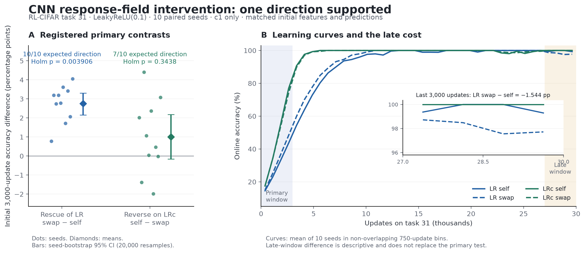

# CNN 中心化が保った c1 応答場の交換 — 登録走の結果

**主判定は `ONE_DIRECTION`。非中心化 LR へ中心化 LRc の場を移すと初期適応が改善し、逆移植による悪化は今回の主判定では確認できなかった。**

RL-CIFAR、LeakyReLU(0.1)、課題30末の保存状態、seed10–19。課題31を全4腕で30,000更新した。4腕×10seedの全結果を含み、除外・非有限損失は0件。中心化あり/なしの受け手の重み・入力処理・Adam状態は維持し、c1の応答場だけを自己場対移植場で比較した。

図の [PDF](result_figure.pdf)／[再生成スクリプト](result_figure.py)。点はseed、誤差棒はseed bootstrap CI、曲線は750更新ごとに区切った10seed平均。末尾の比較は副の記述統計。

## 主判定：最初3,000更新のonline accuracy

| 比較 | 対照 → 移植の精度 (%) | 判定用差 (point) | seed bootstrap 95% CI (point) | 予測方向のseed | Holm補正p |
|---|---|---|---|---|---|
| LRへの救済 | 28.6517 → 31.4079 | +2.7563 | [2.1496, 3.2994] | 10/10 | 0.00390625 |
| LRcへの逆移植 | 46.1098 → 45.1060 | 悪化 +1.0038 | [-0.1525, 2.1823] | 7/10 | 0.34375 |

検定の差は救済=LR_swap−LR_self、逆移植=LRc_self−LRc_swap。両側exact符号検定2本をHolm補正。CIはseed bootstrap percentile 20,000回、乱数seed1021。逆移植のCIは『悪化量』の符号で示した。多数派符号と平均差の方向は両比較で整合する。

主指標の全seed（精度は%、差はpoint）：

| seed | LR_self | LR_swap | 救済差 | LRc_self | LRc_swap | 逆移植の悪化量 |
|---|---|---|---|---|---|---|
| 10 | 28.6979 | 29.4792 | +0.7812 | 48.6542 | 46.6333 | +2.0208 |
| 11 | 28.0375 | 31.2271 | +3.1896 | 45.2875 | 46.6750 | -1.3875 |
| 12 | 28.5792 | 31.3146 | +2.7354 | 48.9708 | 44.5729 | +4.3979 |
| 13 | 26.5250 | 29.7188 | +3.1938 | 43.8104 | 42.7458 | +1.0646 |
| 14 | 28.2458 | 31.0250 | +2.7792 | 46.7167 | 46.6729 | +0.0438 |
| 15 | 26.3979 | 30.0188 | +3.6208 | 46.8917 | 44.5312 | +2.3604 |
| 16 | 25.9375 | 27.6562 | +1.7187 | 42.2979 | 44.2833 | -1.9854 |
| 17 | 33.5375 | 36.9583 | +3.4208 | 47.9000 | 47.4375 | +0.4625 |
| 18 | 31.0917 | 33.1583 | +2.0667 | 47.2917 | 47.3125 | -0.0208 |
| 19 | 29.4667 | 33.5229 | +4.0563 | 43.2771 | 40.1958 | +3.0813 |

## 副指標：改善の時間範囲

| 腕 | 最初3000 (%) | 全30000 (%) | 最後3000 (%) | 最終memo (%) | 最終memo CE |
|---|---|---|---|---|---|
| LR_self | 28.6517 | 88.3275 | 99.6650 | 100.0000 | 0.000744309 |
| LR_swap | 31.4079 | 89.5471 | 98.1206 | 99.5083 | 0.0274636 |
| LRc_self | 46.1098 | 94.1368 | 100.0000 | 100.0000 | 3.53061e-05 |
| LRc_swap | 45.1060 | 94.0114 | 100.0000 | 100.0000 | 4.23781e-05 |

**LRへの移植の改善は初期適応と全更新平均に見られるが、最後3,000更新では自己場を下回った。** この後半の悪化を省いて『全期間で救済した』とは書かない。固定集合の最終memoは最後の一点、onlineは更新前のbatch予測の窓平均であり、両者は一致を要しない。副指標で主判定を置き換えない。

### 全 30000 更新の全seed

| seed | LR_self | LR_swap | LRc_self | LRc_swap | 救済差 (pt) | 逆移植悪化量 (pt) |
|---|---|---|---|---|---|---|
| 10 | 87.8971 | 89.0581 | 94.4896 | 94.2425 | +1.1610 | +0.2471 |
| 11 | 87.8710 | 89.6385 | 94.0079 | 94.3192 | +1.7675 | -0.3112 |
| 12 | 88.1517 | 89.7467 | 94.4902 | 93.9233 | +1.5950 | +0.5669 |
| 13 | 87.3327 | 88.4562 | 93.7352 | 93.5673 | +1.1235 | +0.1679 |
| 14 | 88.1731 | 89.3721 | 94.3367 | 94.2738 | +1.1990 | +0.0629 |
| 15 | 87.7173 | 88.9477 | 94.1835 | 94.0096 | +1.2304 | +0.1740 |
| 16 | 87.9842 | 88.8596 | 93.6469 | 93.9083 | +0.8754 | -0.2615 |
| 17 | 90.2754 | 91.2656 | 94.4677 | 94.3246 | +0.9902 | +0.1431 |
| 18 | 89.7396 | 90.2060 | 94.1460 | 94.1354 | +0.4665 | +0.0106 |
| 19 | 88.1327 | 89.9208 | 93.8642 | 93.4096 | +1.7881 | +0.4546 |

対応平均差（記述的）：救済 +1.2197 point [95% CI +0.9774, +1.4557]、逆移植の悪化量 +0.1254 point [95% CI -0.0418, +0.2850]。追加の確認的検定として扱わない。

### 最後 3000 更新の全seed

| seed | LR_self | LR_swap | LRc_self | LRc_swap | 救済差 (pt) | 逆移植悪化量 (pt) |
|---|---|---|---|---|---|---|
| 10 | 98.4188 | 97.2771 | 100.0000 | 100.0000 | -1.1417 | +0.0000 |
| 11 | 100.0000 | 97.4271 | 100.0000 | 100.0000 | -2.5729 | +0.0000 |
| 12 | 100.0000 | 97.6688 | 100.0000 | 100.0000 | -2.3312 | +0.0000 |
| 13 | 100.0000 | 97.5708 | 100.0000 | 100.0000 | -2.4292 | +0.0000 |
| 14 | 100.0000 | 98.4271 | 100.0000 | 100.0000 | -1.5729 | +0.0000 |
| 15 | 100.0000 | 100.0000 | 100.0000 | 100.0000 | +0.0000 | +0.0000 |
| 16 | 100.0000 | 97.4104 | 100.0000 | 100.0000 | -2.5896 | +0.0000 |
| 17 | 100.0000 | 98.3083 | 100.0000 | 100.0000 | -1.6917 | +0.0000 |
| 18 | 98.2313 | 100.0000 | 100.0000 | 100.0000 | +1.7687 | +0.0000 |
| 19 | 100.0000 | 97.1167 | 100.0000 | 100.0000 | -2.8833 | +0.0000 |

対応平均差（記述的）：救済 -1.5444 point [95% CI -2.2938, -0.6277]、逆移植の悪化量 +0.0000 point [95% CI +0.0000, +0.0000]。追加の確認的検定として扱わない。

平均online CE：

| 腕 | 最初3000 | 全30000 | 最後3000 |
|---|---|---|---|
| LR_self | 2.37145 | 0.377985 | 0.0217293 |
| LR_swap | 2.35959 | 0.354018 | 0.121835 |
| LRc_self | 1.66497 | 0.186346 | 0.000120491 |
| LRc_swap | 1.71379 | 0.191719 | 0.00017108 |

## c1で実際に渡した応答

次の平均微分は、各チャネルの画像×位置での平均→16チャネル平均→10seed平均。微分分散は**チャネル内分散**をチャネル・seedで平均したもの。全ユニットを混ぜた総分散、勾配ノルム、学習速度そのものではない。Pool列は、その腕の実際の活動が選んだMaxPool winner上を集約した。開始時winnerは受け手自然網と完全一致している。

| 開始時の腕 | 全位置 平均φ′ | 受け手winner上 平均φ′ | winner上 φ′分散 | winner上 p(z_eff>0) |
|---|---|---|---|---|
| LR_self | 0.168888 | 0.190540 | 0.031003 | 0.100600 |
| LR_swap | 0.286081 | 0.300939 | 0.099440 | 0.223266 |
| LRc_self | 0.286081 | 0.385770 | 0.118813 | 0.317523 |
| LRc_swap | 0.168888 | 0.172172 | 0.023816 | 0.080191 |

LRへの移植はwinner上の平均微分を0.190540→0.300939へ上げ、LRcへの逆移植は0.385770→0.172172へ下げた。したがって逆移植の非有意を『応答を下げられなかった』とは読めない。ただし平均・分散・配置が一緒に変わり、平均微分だけの因果効果は分離していない。gain対照は走らせていない。

全位置の供与者場は交換できても、receiver winnerが違うため、winner上の値は供与者自身のwinner上の値と同一にはならない。例えばLR_swapの開始値0.300939はLRc_selfの0.385770とは異なる。

受け手winner上の実効平均微分の推移：

| 更新 | LR_self | LR_swap | LRc_self | LRc_swap |
|---|---|---|---|---|
| 0 | 0.190540 | 0.300939 | 0.385770 | 0.172172 |
| 100 | 0.190384 | 0.328845 | 0.374217 | 0.183212 |
| 750 | 0.178279 | 0.302021 | 0.354125 | 0.181721 |
| 3000 | 0.180746 | 0.311521 | 0.364824 | 0.183211 |
| 15000 | 0.185579 | 0.313388 | 0.372428 | 0.184030 |
| 30000 | 0.186183 | 0.311119 | 0.369962 | 0.182869 |

両方向の応答差は3,000更新以後も残る。後半のLR移植の成績悪化や、LRc逆移植の主指標が非有意だったことを、平均応答の値だけでは説明し切れない。

## raw前活性と人工場の座標を分ける

rawは学習中の受け手c1が作るz。effectiveは交換場の `z_D0+(z_Rθ−z_R0)` であり、受け手重みをその位置へ直接移した量ではない。m/s/rの表はチャネル中央値をseedで平均した値（rは各チャネルm/sの中央値）。

| 更新 | 腕 | raw m | raw s | raw r | effective m | effective s | effective r |
|---|---|---|---|---|---|---|---|
| 0 | LR_self | -2.74000 | 1.43376 | -1.89034 | -2.74000 | 1.43376 | -1.89034 |
| 0 | LR_swap | -2.74000 | 1.43376 | -1.89034 | -0.92622 | 0.70190 | -1.25590 |
| 0 | LRc_self | -0.92622 | 0.70190 | -1.25590 | -0.92622 | 0.70190 | -1.25590 |
| 0 | LRc_swap | -0.92622 | 0.70190 | -1.25590 | -2.74000 | 1.43376 | -1.89034 |
| 30000 | LR_self | -2.65556 | 1.40873 | -1.91972 | -2.65556 | 1.40873 | -1.91972 |
| 30000 | LR_swap | -2.78923 | 1.48931 | -1.86265 | -0.96861 | 0.73211 | -1.29342 |
| 30000 | LRc_self | -0.97645 | 0.68035 | -1.38988 | -0.97645 | 0.68035 | -1.38988 |
| 30000 | LRc_swap | -0.89907 | 0.73816 | -1.05195 | -2.71507 | 1.41353 | -1.83633 |

開始時には各受け手のraw前活性・活動・pool winner・全後段特徴・logits・CEが対照と移植で完全一致した。活動のeffective rankも受け手内で一致（LR系5.86233、LRc系12.95001）。以後のrank差は介入後の観察であり、この走からrankを原因として同定しない。LeakyReLUは負側でも微分0.1を持つので、負側割合を厳密なゼロ勾配死と呼ばない。

## 自然網と自己場の丸め差

自己場は自然forwardに置き換えず、移植と同じanchor演算を通した。開始時の全特徴と、最初の1更新後のP/m/vは両受け手で完全一致。2更新目以後には差が生じた。次は同じ課題31・同じ最初75更新を使ったpreflightの記録であり、主走の腕を追加した結果ではない。

| 受け手 | 2更新後 max\|ΔP\| | 75更新後 max\|ΔP\| | 75更新online差 self−natural (pt) | 75更新CE差 self−natural |
|---|---|---|---|---|
| LR | 1.3411045e-07 | 0.032924533 | +0.041667 | +0.00507472 |
| LRc | 1.5944242e-06 | 0.060854971 | -0.125000 | -0.000529163 |

このため主比較は同じ計算経路の自己場対移植場とした。今回の30,000更新の自己場軌跡を、自然網の30,000更新軌跡とbit同一だとは主張しない。保存された課題30の自然網評価との差は記録されたCSV精度程度で、最大絶対差は5×10⁻¹⁰未満だった。

## 読める結論と残った接続

このCNNでは、中心化で保たれたc1応答場を、開始時の特徴・予測を保って非中心化受け手へ渡すと、課題31の初期適応を10/10seedで改善した。長期の中心化履歴と、c1応答場に対する一方向の因果介入を結べた。

逆移植の悪化は主指標で未確認であり、双方向因果介入が閉じたとは言わない。自己場対照群差は最初3,000更新で17.458125pointあるが、この差で救済量を割って『媒介率』とはしない。中心化は入力・重み・下流特徴・最適化状態にも履歴を残す。c1の全Jacobian交換、中心化効果の完全媒介、実ラベルへの一般化は未同定。

同indexチャネルは初期化を共有するが、課題30で同じ意味の特徴である保証はない。非有意を『c1が原因でない』、後のrank差を『rankが原因』とは読まない。

## 再現・検査記録

登録spec commit: `aa991f9e594110a6a5ee6a216e1d90241e119ed6`。本走実装 commit: `92a2214db83f4b832c13d9fa8ef9f40113980536`。4腕のidentityはarm名以外完全一致し、preflightのidentityとも一致。各依存コードhashは本走commitのGit内容と照合済み。

RTX5060Ti、torch2.13.0+cu130、CUDA13.0、cuDNN92000。CUDA matmul TF32=false、cuDNN TF32=true、matmul precision=highest、deterministic=true。同順序seed10–19の10-run bundle、batch16、lr0.001、30,000更新。

保存batch曲線から全seedの精度・CE要約と主検定を再計算して一致。全400epoch×10seed×4腕の記録、doneのsummary hash、unit別記録からの応答集約も照合した。除外0、失敗0、非有限値0。graph/eagerと状態復元・反復の検査も合格。

本走後、集計の端末JSON表示がNumPyの型で失敗したため、親が符号カウントをnative boolへ変更した。学習更新や統計定義は変わらず、本報告は保存batch値から主判定を独立再計算して一致を確認している。

再生成：`python analysis/cnn_response_center_1021/result_report.py`。新たなforward・学習・GPU計算を行わず、保存CSV/NPZ/JSONのみを読む。入力hash、全seed要約、副の対応差、全時点のc1集約、丸め差の全記録は [result_report.json](result_report.json)。登録specは [spec](../../specs/spec_cnn_response_center_1021.md)、元の主判定は [verdict](../../results/cnn_response_center_1021/verdict.json)。
