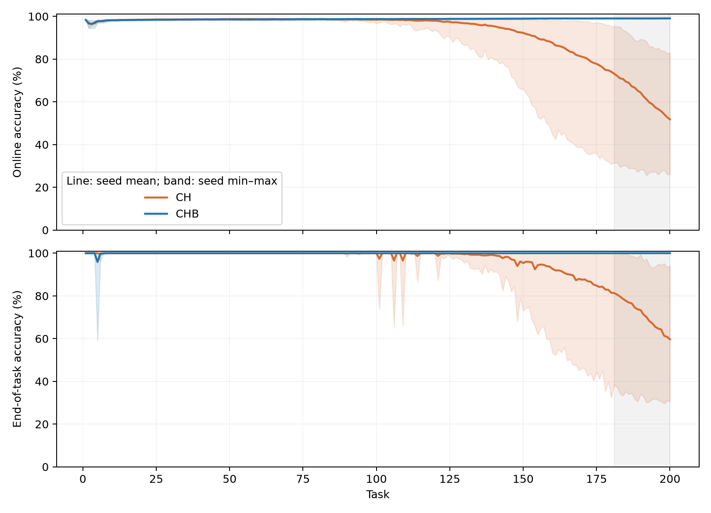
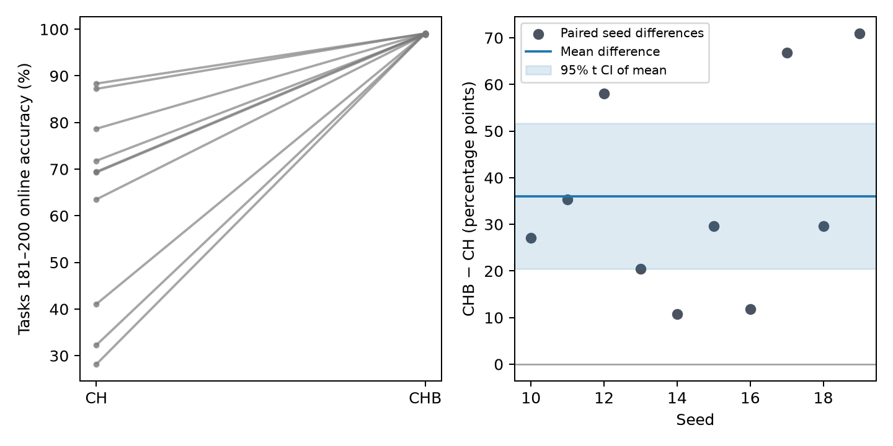
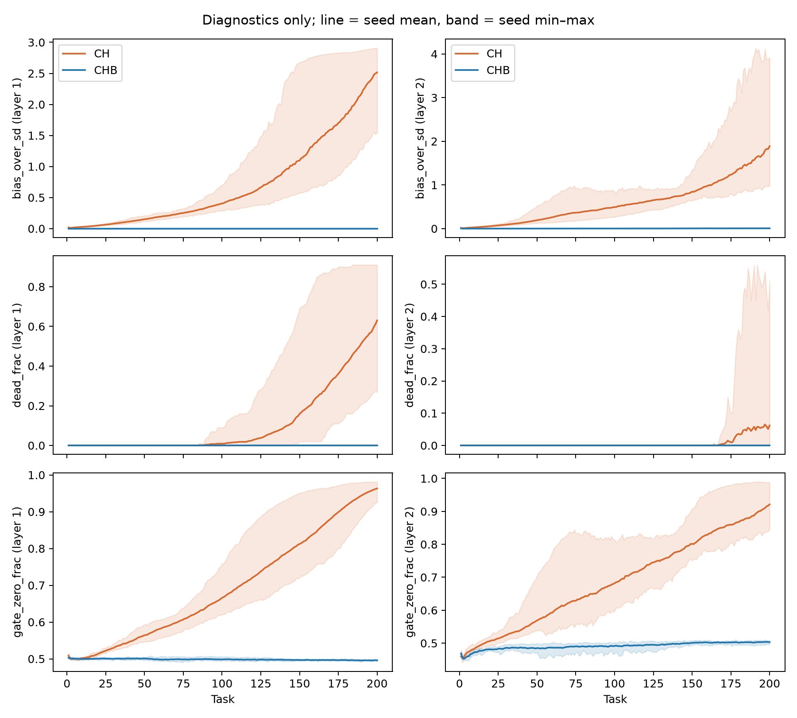

# CH と CHB の200課題での性能比較

最後の20課題の成績は、CHが **62.98%**、CHBが **99.03%**。同じseedどうしの差（CHB−CH）は平均 **36.05 pt**［95%信頼区間 20.45, 51.65 pt］だった。

中心化だけのCHでは、早期（t31–50）の98.63%から後期（t181–200）の62.98%へ、35.65 pt成績が下がった。biasも抑えたCHBは、98.54%から99.03%へと高い成績を保った。CHの低下とCHBの改善は、いずれも全10 seedで見られた。

CHBの後期成績がCHより高いことを支持する。

成績は各課題の全30,000更新における、更新前のミニバッチ正解率の平均（online accuracy）。各seedのt181–200平均を計算し、独立反復の単位をseed（10本）として対応差のt区間を求めた。区間はseed間差に対する近似推論である。

CHB−CHが正のseedは10/10、ゼロは0/10、負は0/10。

|条件|平均 (%)|中央値 (%)|最小 (%)|最大 (%)|
|---|---:|---:|---:|---:|
|CH|62.983|69.374|28.169|88.351|
|CHB|99.033|99.085|98.832|99.136|

|seed|CH後期 (%)|CHB後期 (%)|差 (pt)|CH早期→後期低下 (pt)|CHB早期→後期低下 (pt)|
|---|---:|---:|---:|---:|---:|
|10|71.7998|98.8317|27.0319|26.9652|-0.3633|
|11|63.5156|98.8597|35.3441|35.0798|-0.2460|
|12|41.0726|99.0822|58.0096|57.6207|-0.5777|
|13|78.6684|99.0791|20.4107|19.9376|-0.3066|
|14|88.3511|99.0887|10.7376|10.1389|-0.6744|
|15|69.4511|99.1275|29.6764|29.0951|-0.8646|
|16|87.2199|99.1036|11.8838|11.1412|-0.8108|
|17|32.2825|99.0879|66.8054|66.4647|-0.4252|
|18|69.2966|98.9369|29.6404|29.2474|-0.1871|
|19|28.1689|99.1357|70.9667|70.8188|-0.5269|

早期窓はt31–50。全桁の値、早期成績と低下量の対応差、両層の診断値は `paired_ci.json` と `per_seed.csv` に保存した。

CHBはb1の更新後ゼロ化とb2の減衰を組み合わせた開始時からの介入であり、b2減衰だけの効果や、崩壊後の回復を切り分けた比較ではない。200課題を超える保持も検証していない。

