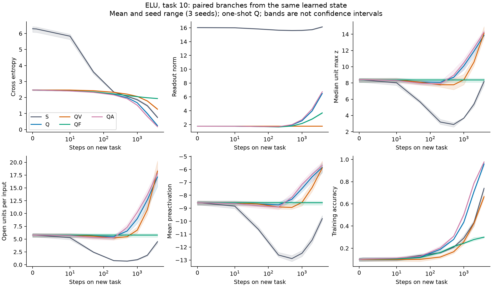

# 出力を上げる需要と読み出し縮小 — 勾配と実更新の分岐

親: `段①の対照_読み出しの整列と大きさ_stage1_ctrl_結果_1111` (Obsidian)・`ELUが沈降しない事件_総まとめ_0929` (Obsidian) / 状態: **検証中**（式の分解とこの箱での対照は完了、長期機構の量的な閉鎖は未） / 更新: 2026-11-11

数値の正本: `lop_analysis/results/demand_allocation_1111/summary.md`・`verdict.csv`。新規走は仕様登録 `2acc7298`、学習実装 `37c9ea82`。旧走の再集計は事後と明記する。現行原稿本文は変更していない。

## 1. 質問への答え

**活動を上げる需要は逆伝播で伝わる。「飽和すると上げようとしない」という言い方では、需要と応答を混同する。** 最終logitの正解成分への勾配は $p_y-1<0$。これを各unitに振り分けるのが読み出しであり、unitの活動 $a_i$ に届いた勾配が負なら、その活動を上げると局所的な損失は下がる。そこから前活性 $z_i$ と入側重みへ通るには活性化の微分が掛かる。

$$
z_i=w_i^\top x+\beta_i,\quad a_i=\phi(z_i),\quad
\ell_c=\sum_iV_{ci}a_i+b_c,\quad e=p-y,
$$
$$
D_i:=\frac{\partial L}{\partial a_i}=v_i^\top e,
\qquad \frac{\partial L}{\partial z_i}=\phi'(z_i)D_i.
$$

$D_i<0$ が「活動を上げたい」。大きな誤差があっても、$e$ と $v_i$ が直交すればそのunitへの需要は0になる。正解logitを上げたいことと、全unitの活動を上げたいことも同じではない。

読み出し縮小も同じ逆伝播経路を通る。**縮小だけで全閉ReLUに新しい勾配経路が生じるわけではない。** 毎回の縮小で応答を残す予防と、既に失われた応答の回復は区別する。

## 2. どこで遮られるか、別の入力からどう動くか

一標本の全勾配は

$$
\nabla_{w_i}L=\phi'(z_i)D_i x,\quad
\partial_{\beta_i}L=\phi'(z_i)D_i,\quad
\partial_{V_{ci}}L=e_c a_i,\quad
\partial_{b_c}L=e_c.
$$

ミニバッチではこの平均を取る。特徴側には $\phi'$、読み出し側には $\phi$ が掛かる。ELUの深い負側は $a\simeq-1$ なので読み出しは学習できても、自身の特徴側の勾配は弱い。全閉ReLUは $a=\phi'=0$ で、そのunitの現在のhidden/V勾配はともに0。過去のmoment、出力bias、他unitの更新は別に残り得る。

固定入力・運動量なしSGDの一歩では、受け手の入力 $r$ に対して厳密に

$$
\Delta z_{ri}=-\frac{\eta}{B}\sum_{n\in\mathcal B}
(x_r^\top x_n+1)\phi'(z_{ni})D_{ni}.
$$

右辺の微分は**更新を出す入力 $n$** のもの。受け手 $r$ が閉じていても、同じunitの開いた入力が重みを動かせる。自分の需要が上向きでも他入力が勝てば実変位は下向きになる。さらに $\Delta a_r\simeq\phi'(z_r)\Delta z_r$ なので、深部で $z$ が動いても活動がほとんど変わらないことがある。

前活性平均は今回の一層で $\Delta m_i=\Delta w_i^\top\mu+\Delta\beta_i$。多層ではさらに $w_{i,\mathrm{new}}^\top\Delta\mu$ が入る。今回の測定から上流が動く網の原因割合を結論しない。

| 活性化 | 活動増加の需要 $D<0$ を受けた自分のSGD項 | 注意 |
|---|---|---|
| ReLUの負側 | 0 | 正側は線形で微分1 |
| ELUの負側 | 数学上は前活性を上げる | 実装の零点とAdam履歴で実変位は異なる |
| SiLU/GELUの谷の左 | 前活性を下げて活動を負から0へ上げる | 活動増加と開口への移動が逆向き |
| leaky ReLUの負側 | 0.1倍の非ゼロ勾配 | 応答が残ることと適応性能の維持は別 |

この箱のfloat32 ELUは負側に `expm1` を使い、$z=-17$ で自動微分が0になった（数学上は $e^{-17}\simeq4.14\times10^{-8}$）。別実装のELUへこの閾値を移さない。出典: `sanity.json`。

## 3. 縮めた直後と、その後の学習

同じ活動・同じラベルでも、読み出し $V$ を変えると予測 $p$ も変わる。

$$D'-D=e(V'-V)+(e'-e)V'.$$

前半は読み出し縮小そのもの、後半は残差の変化である。したがって「$V$を縮めると必ず需要が強まる」「活動は必ず$1/c$倍になる」のどちらも成立しない。独立一様の新ラベル期待では $\mathbb E_yD_i=v_i^\top(p-\mathbf1/C)$。実際に引いたラベル、ミニバッチ、当てはめ中の需要はこれと別に測る。

SGD・同じ学習率・固定された残差と特徴の微小一歩では、hidden経由のlogit更新kernelは $v_iv_i^\top$ を含む。一様縮小 $V\to cV$ ではこの部分が $c^2$ 倍になり、head側kernel $(a_r^\top a_n+1)I$ は変わらない。縮小そのものから「活動側に強く学習を配る」という一般則は出ない。実軌道では誤差・開口集合・optimizerが一緒に変わる。

有限の一歩のlogit変化は、交差項も含めて

$$\Delta\ell=V\Delta a+\Delta V a+\Delta V\Delta a+\Delta b.$$

これを実測し、V固定と特徴固定も比較した。一歩の $-e^\top\Delta\ell$ は局所の一次寄与であり、長期性能の因果的な割合ではない。

## 4. 登録実験の条件と判定

784–100–10、乱数ラベルMNIST 1,200枚、batch16、4,000更新/課題、Adam lr=.001、β=(.9,.999)、ε=1e−8。ReLU/ELU/SiLU/GELU/leaky(.1)×対応する3seed（0,1,2）。課題2/10/25の直前から分岐した。元の基準軌道の375課題末は保存済み旧走とbit一致。

Qはクラス中心化したVの各列ノルムを初期値へ戻し、$b'=b+(V-V')\bar a$ で平均logitを保つ。単なる一様な温度変更ではない。Sは無介入、QVはQ後V固定（出力biasは学習）、QFはQ後hiddenのWとbias固定、QAはQ後hiddenのAdamだけ破棄、QHはQ後headのAdamだけ破棄（ELUのみ）。S/Qは次の1課題も介入なしで学習した。

登録P1〜P5は全て支持された。P6は学習配分の記述、P7は共有重みの恒等式の検算であり、独立の有意差判定ではない。反復の単位は3seedで、入力×unitを独立反復として扱っていない。

**全閉ReLUにも需要はある。** 課題25の開始で全unitが全入力に対して閉じており、活動増加を求める入力×unitの割合はseed順に49.880%、49.949%、50.247%だった。それでも生hidden勾配と実際のAdam変位はともに厳密に0。Q後に4,000更新して開き直ったunitも3seedとも0%で、Adamをリセットしても零微分の経路は開かなかった（`relu_closed_t25.csv`・`verdict.csv` P1/P4、`optimizer_t25.csv`）。

**縮小直後に増加需要が強まる、という説明は棄却。** ELU課題10の全入力×unitで、増加需要の大きさ $\operatorname{mean}\max(-D,0)$ はSの.25801からQの.02421へ減った。単なるV×.1でも.02214、平均logitを保つV×.1でも.02222だった。Qの需要の符号は元のSから約14.16%変わるので、残差固定の比例則でもない。5活性化の同課題でQの増加需要はSより小さい（`instant_t10.csv`、`instant_scalar_t10.csv`、全seedは`verdict.csv` P2）。

**最初の沈みを弱め、開口を残してから当てはめる。** ELU課題10の開始時は全腕とも平均前活性−8.578、上端中央値8.380、1入力あたり開くunitは5.783個。200更新後、Sは平均−12.611・開口0.796個、Qは−8.739・5.468個だった。現在開いている入力群の平均DはSで+.21626→200更新+.12022→500更新−.02018、Qで+.00673→−.00254→−.00538。増加需要はSにも後で現れるが、Qは開口を多く残した状態で当てはめへ移る。これらは現在の開口群なので、同じ入力だけの追跡ではない（`elu_time_t10.csv`・`elu_open_demand.csv`）。

固定群でも変化を確認した。介入前に開いていた入力×unitの平均活動変化は課題末S −1.641、Q +1.951、QV +1.484。介入前に $z\le-3$ だった群のうち課題末に開いている割合はS 1.29%、Q 7.36%、QV 10.00%。従って、Q後の上昇を既存のopenだけの一様な拡大としては説明できない（`fixed_groups_elu_t10.csv`、3seed平均）。

**特徴も読み出しも学んでいる。** 以下はELU課題10末の3seed平均。Vノルムはクラス中心化した全VのFrobeniusノルム、上端は各unitで1,200入力中の最大zを取った後の100unit中央値である。

| 腕 | 訓練精度 | CE | 上端中央値 | 開くunit数/入力 | Vノルム |
|---|---:|---:|---:|---:|---:|
| S 無介入 | 73.92% | .75354 | 8.175 | 4.486 | 16.129 |
| Q 両側を学習 | 95.94% | .24227 | 13.872 | 17.136 | 6.493 |
| QV 読み出し固定 | 66.42% | 1.27328 | 14.115 | 18.270 | 1.757 |
| QF 特徴固定 | 30.00% | 1.93800 | 8.380 | 5.783 | 3.680 |
| QA hiddenのAdam破棄 | 97.75% | .17751 | 14.249 | 17.822 | 6.739 |
| QH headのAdam破棄 | 95.56% | .26630 | 13.706 | 17.108 | 6.246 |

出典: `ends_t10.csv`。QVはSより上端・開口が高い（3/3seed）が、精度はQに及ばない。QFもQを再現しない。QのVは開始時1.757から6.493に再成長し、各seedの倍率は3.67〜3.71。200/500/1,000/2,000更新の予定batchに対する4回のprobeでは、WとVそれぞれの局所降下寄与の平均が3seedとも正だった（`verdict.csv` P6）。「活動だけが補償する」はこの対照に合わない。

全データで評価したlogitの一歩分解でも、Qの500更新時の一次降下寄与はbody .000419、V .0000557、出力bias −.00000353、交差項 .000000432。1,000更新時はbody .000579、V .000743に変わる。配分は一定でなく、batchの降下と全データの降下も同一ではない（`elu_allocation.csv`）。

**次の切替で押しは戻る。** Qを再び入れず課題11へ進むと、Q枝の平均前活性は最初の200更新で−4.181、開口は17.136→5.023個へ減った。Vが前課題末に再成長し、当てはまった状態から新ラベルへ切り替わったため、縮小直後の小さい押しが永久に続くわけではない。課題11末の精度はQ 91.47%、S 72.31%だった。この観測だけで再装填の原因をVだけに帰さない（`reload.csv`・`reload_first200.csv`、task=10は「課題10で分岐した枝の次課題」を表す）。

検算: 全15セル・375課題末のbit一致、手計算の生勾配とautogradの差0、有限logit分解の最大誤差1.43×10⁻¹³。Adam source会計の丸め残差は最大6.56×10⁻⁷、前活性のfloat32再計算との残差は最大5.94×10⁻⁵で、登録した尺度付き許容内。独立したfloat64の有限差分・Adam式・SGD kernelの検査も通過（`checks.json`・`sanity.json`・`algebra_checks.json`）。

## 5. Adamの尺度相殺とELUの−1成分

二次momentを読み出しVと区別して $s_t$ と書く。

$$m_t=\beta_1m_{t-1}+(1-\beta_1)g_t,\quad
s_t=\beta_2s_{t-1}+(1-\beta_2)g_t^2,\quad
\Delta\theta=-\eta\widehat m_t/(\sqrt{\widehat s_t}+\epsilon).$$

全履歴を $g\to cg,m\to cm,s\to c^2s$ と整合的に変え、εを無視できるときだけ尺度が相殺する。今回のように今のVだけ縮めて古いmomentを残す操作はその条件を満たさない。古い大きな二次momentによる抑制と、課題切替時の追随速度差による大きな一歩の両方があり得る。旧二次momentの係数は1,000更新後にも $.999^{1000}\simeq.368$ 残る。

ELUを $a=\psi-1$ と書くと、V勾配は $\overline{e\psi^\top}-\bar e\mathbf1^\top$。後半は全unit共通で、ミニバッチの平均誤差が揺れるとV勾配も揺れる。ただし、二成分の分散は**共分散を含めて**足す。定数成分の分散が大きいことだけで、実際のAdam更新が抑えられたと断定しない。

実測では、ELUのQ後の最初のhidden変位RMSを、hiddenのAdam履歴だけ破棄すると課題10で3.18〜4.70倍、課題25で2.58〜3.51倍になった（各3seed、P5）。ここでは同じ生勾配でも履歴で歩幅が抑えられていた。なお符号や長期改善まで倍率だけで決められない。QAは読み出し縮小と組み合わせた介入であり、旧stage1でhiddenのAdam破棄だけでは喪失を救わなかったことと矛盾しない。

ELU課題10・500更新時に「実装微分0かつD<0」の受け手を見ると、Q枝では平均5,467組あった。その一歩の前活性変化の平均への寄与は、旧一次moment +.002138、現在の開口入力 +.000412、境界帯 +.000171、深部 +.0000404だった。受け手自身の微分が0でも、同じunitの別入力から動くことを実測で確認した。出力元の群を消すとAdam分母も変わるため、この固定分母の会計を因果的な寄与率とは呼ばない（`zero_up_sources_t10.csv`）。

ELU課題10のV勾配分散で、定数−1成分の分散/全分散はSの500更新時.997、課題末.979、Qの課題末.488。比の低下と特徴側の変化が同時に起きている。共分散は負で、Q末の全分散.001091は、共通成分.000538＋残り.001113−.000560である。QHでheadのAdamをリセットしても課題末精度95.56%はQの95.94%に近かった。この新しい走だけから「−1の揺らぎが今回のQの効き目の全て」とは結論しない（`elu_noise.csv`・`ends_t10.csv`）。

9月のSPLIT／NOISE_B／bias補正の介入は、長期のV成長に共通揺らぎの経路が関わる証拠として別に残る。一方、全データbatch化はhidden側の揺らぎも消し、DEFLUCはbias追従を壊したため、単独の外科的な証拠にはならない。整理と訂正は `ELUを縮める_α梯子_1層200課題と理論_0925` (Obsidian) §8.33–8.44・8.50、最終まとめは `ELUが沈降しない事件_総まとめ_0929` (Obsidian) を参照。

## 6. 既存の長期結果とどうつながるか

9月のvfreezeは課題51でVを0.1/1/10倍にして凍結し、課題151–200を集計したもの。各時点で切替時に開口があるunitの中央値を取り、課題・2seedで平均する。当時の値は原NPZから再現した。

| Vを凍結する前の倍率 | 上端/幅 | 負側本体の0→500更新の変位 |
|---|---:|---:|
| 0.1 | 1.42085 | −2.25419 |
| 1 | 0.65396 | −2.30295 |
| 10 | 0.17116 | −2.28620 |

読み出しが自然に学習を続ける対照は上端/幅1.45627・本体変位−4.30589。1倍凍結も自然対照と違う。小Vで上端が高いことはこの長期窓の事実であり、介入直後に全入力の需要が強まった証拠ではない。出典: `existing_vfreeze.csv`、入力hashは `existing_provenance.json`。

毎切替Qの旧10seed走では、課題30末の全入力で閉じたunit割合はELU/SiLU/GELU/leakyで0、ReLUで.202。無介入はそれぞれ.075/.307/.488/.110/1.000。課題21–30のfreshとの差はELU .01553（無介入 .54474）、ReLU .15263（.87632）だった。この予防結果を、課題25で初めてQを入れる回復結果に置き換えない。出典: `existing_stage1.csv`（幅・位置は課題30末、Vノルムは課題30頭、精度不足は課題21–30の別窓）。

## 7. 一次資料との関係と残る範囲

- [Adam, Kingma & Ba, Algorithm 1・§2](https://arxiv.org/pdf/1412.6980): moment式と尺度不変性。全履歴とεを含めて条件を読む。
- [Lyle et al. 2023, §4.1](https://proceedings.mlr.press/v202/lyle23b/lyle23b.pdf): 課題変化に対するAdamの異なる時定数と不安定化。全LoPを飽和だけに還元する論文ではない。
- [Lyle et al. 2024, Appendix E.3 / Fig.18](https://arxiv.org/pdf/2402.18762): 乱数MNISTの切替でlogitと特徴が縮み、負への更新とunitの死が続く。今回の切替直後の局面と近いが、後の上昇やQの媒介割合までは同定していない。
- [Kumar et al. 2024](https://arxiv.org/pdf/2308.11958): RL-MNISTとL2 Initの比較。原典の400epochと今回の4,000更新は違う予算。重みノルムだけによる説明にも限界がある。
- [Sokar et al. 2023, Algorithm 1](https://proceedings.mlr.press/v202/sokar23a/sokar23a.pdf): ReDoはincoming再初期化とoutgoing零化を組み合わせる。読み出し縮小だけで全閉unitが戻る根拠ではない。
- [Dohare et al. 2024](https://pmc.ncbi.nlm.nih.gov/articles/PMC11338828/): 長期適応と表現能力の維持。今回の一度Qと毎回Qの同等性を保証するものではない。
- [Ren et al. 2026, §5](https://arxiv.org/html/2609.33620v1): 出力信号と読み出しを通過した信号を分け、方向に依存する伝達低下を扱う。接点は $V^\top e$ であり、MLPの活性化微分やoptimizer履歴を省略できる根拠ではない。

今回閉じたのは、需要・伝達・実更新の混同と、直後／当てはめ／次課題の対照である。3seedの一隠れ層診断から、深い網・実ラベル・長期の全媒介割合を一般化しない。9月のELUの−1→V更新→上端という鎖の各条件と今回の尺度を同一視しない。固定logitを復元する必要性や一様な1/V補償を仮定していない。

再現手順は `analysis/demand_allocation_1111/README.md`。初回起動の終了コード143による中断後、完成11セルを保持し未完了4セルだけ同じコードで取り直した（事前追補 `66f62051`）。中断した2セルの部分出力とログも保存。seed・腕・判定は変更なし。生データと復元先は `backup_manifest.json`、中断は `recovery.json`。
