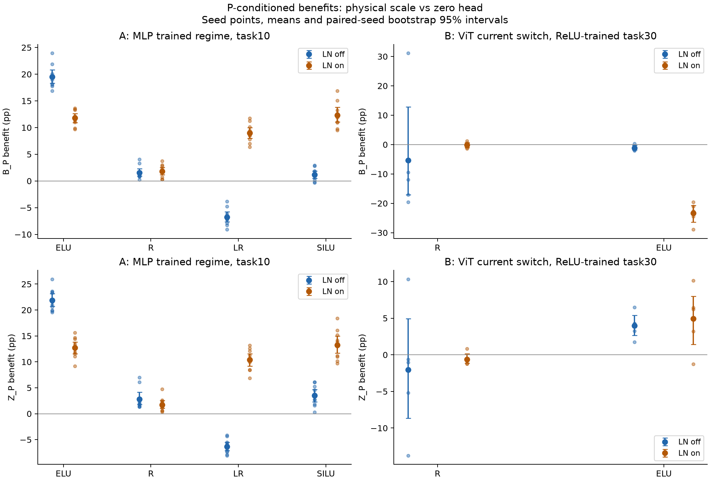
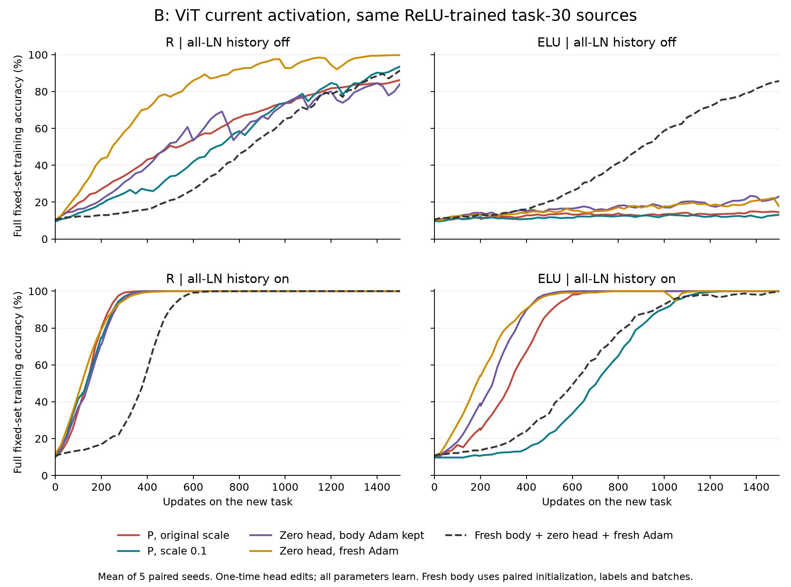
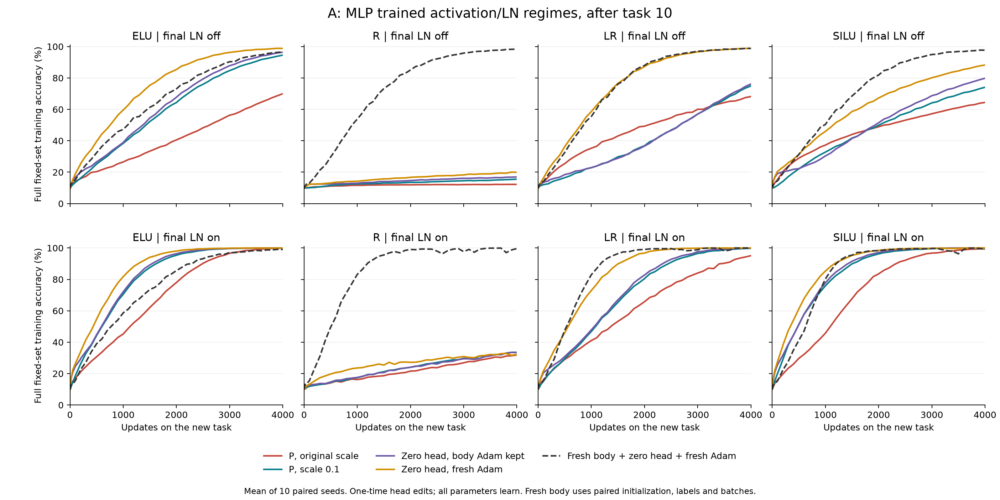

# ELU依存性とLNをそろえた読み出し費用比較 — 結果 2026-11-12

**「ViTで見えた影響はLNだった」とは結論できない。LNは勾配の伝達と学習状態を変えるが、読み出し依存の遅れに必要ではない。また、今回のReLU ViTではP後の追加利益が小さく見える理由をLNへ帰属できなかった。**

実行名 `elu_specificity_1112`。事前登録した全1,260曲線（MLP 1,120、ViT 140）を完了。新しい走の実行commitは `bf641700ad863f1e65b20b6d46326a410df8aa09`。以下は訓練集合上の学習速度の比較であり、汎化性能の比較ではない。

## 1. 何を分離して比べたか

Pは読み出し行列の**各特徴列でクラス方向を独立に並べ替える操作**である。各列の値の集合・ノルムを保って元の組合せを崩す。縮小とは別の操作。ただしGram行列や各例のlogit・確率も変わるため、「整列だけ」の純粋な介入とは呼ばない。

- S1：元の読み出し。P1：並べ替え後の読み出し。
- S01/P01：それぞれのクラス間成分を0.1倍にし、fork時の平均logitをbiasで補償する。
- Z_keep：読み出しのweight/biasをゼロにし、bodyのAdam記憶を残す。
- Z_clear：読み出しをゼロにし、bodyのAdam記憶も消す。
- F0：対応する初期body、ゼロ読み出し、新しいAdam。

全腕でheadのAdamを消す。**読み出しの変更・Adamのresetは分岐時の一度だけで、その後は全パラメータを学習する。ゼロや0.1倍に固定し続ける実験ではない。**

Uは期間平均の訓練正解率不足。利益はUの差で、正なら介入側が期間平均で速い。D₁=U(S1)−U(P1)、Bₚ=U(P1)−U(P01)、Zₚ=U(P1)−U(Z_keep)。表の単位はpercentage points、角括弧はseed対応を保つ10,000回bootstrapの記述的95%区間（多重性未調整）。ゼロをまたぐ場合は未解決であり、同等性ではない。

## 2. ViTでは、LNとP後の費用はこう分かれた

2-block ViT、TinyImageNetの固定2,500例、5対応seed、ReLUで30課題学習した保存状態から次課題を1,500更新した。LNなしSと、両block内4か所＋最終1か所のLNありSLを比較した。ReLU継続と、同じ保存状態のFFN活性化をELUへ切り替える条件を設けた。

| ViTの現在の活性化 | LN履歴 | Pだけの利益 D₁ | P後の縮小利益 Bₚ | P後のゼロ化利益 Zₚ |
| --- | --- | --- | --- | --- |
| ReLU | なし | +16.61 [+1.98, +25.97] | -5.40 [-17.08, +12.86] | -2.05 [-8.67, +4.95] |
| ReLU | あり | +7.40 [+6.76, +8.08] | -0.16 [-0.99, +0.67] | -0.62 [-1.15, +0.13] |
| ELUへ切替 | なし | -0.09 [-1.09, +0.88] | -1.11 [-1.85, -0.28] | +3.99 [+2.63, +5.39] |
| ELUへ切替 | あり | +3.47 [+1.67, +5.24] | -23.34 [-26.44, -20.76] | +4.95 [+1.42, +8.01] |

**ReLU継続では、Pだけの利益はLNなし・ありの両方で正。一方、P後にさらに縮める利益とゼロにする利益は、両方とも未解決だった。** これは「ViTに整列を崩す利益がない」という結果ではない。

P前の元のheadを0.1倍にする利益Bₛも、LNなし+7.81 [+3.40, +12.21] pp、あり+7.47 [+7.27, +7.64] ppで両方とも正だった。今回の対応をそろえた試験でも、読み出しへの介入で除ける遅れにLNは必要ではない。

BₚのLNなし−あり差は −5.24 [−17.00, +13.42] pp、Zₚの同じ差は −1.43 [−8.91, +5.84] pp。これらの直接比較でも未解決である。特にLNなしはseed間変動が大きい。「LNによって残余費用が消えた」「両条件で費用は同じ」とはいずれも言えない。元のtask100でのP残余の観測に対しても、今回はtask30であり、その機構を確定する比較ではない。

ただし絶対的な学習速度は別問題。ReLUのP1のUはLNなし41.95%、あり8.72%。Z_clearでも21.57%、8.30%だった（各条件の記述値）。LN条件での学習が速いことと、P後の縮小による**差分利益**が小さい理由とは同じ問いではない。この比較はLNを使って学習した履歴全体の効果で、同じbodyから最終LNだけを外す効果ではない。

ELU切替・LNありでは、P後の縮小が23.34 pp悪化させる一方、ゼロ化は4.95 pp改善した。したがって、ゼロ化の利益をそのまま「読み出しノルムを下げる利益」と同一視できない。ゼロ化はlogit・初期body勾配・その後の学習を同時に変える。

ELU切替・LNなしのZ_clearは最終正解率17.75%、F0は85.70%。これはReLUで学んだbodyへELUを急に入れた条件である。切替直後の特徴量・旧課題適合も大きく崩れた（[独立Bレビュー](study_B_review.md)のsource診断）。**ELUで最初から学習したViTが同じ破綻をする証拠にはならない。**

## 3. MLPではELU固有性とLNの交互作用を分けられた

MNIST固定1,200例、784–100–10、10対応seed、同じ初期重み・ラベル列・minibatch列。4活性化×最終affine LNの有無を最初から割り当て、10課題学習後の次課題を4,000更新した。

| MLPの学習時活性化 | 最終LNなし Bₚ | 最終LNあり Bₚ |
| --- | --- | --- |
| ELU | +19.48 [+18.34, +20.82] | +11.80 [+10.95, +12.61] |
| ReLU | +1.53 [+0.91, +2.30] | +1.83 [+1.16, +2.52] |
| Leaky ReLU (0.1) | -6.75 [-7.64, -5.78] | +8.97 [+7.96, +10.01] |
| SiLU | +1.17 [+0.49, +1.87] | +12.33 [+11.07, +13.78] |

LNなしではELUのP後縮小利益が大きい。しかしLNありではLeaky ReLUやSiLUにも大きな利益がある。**この現象にELUは必要ではない。** 同時に、ELUの負側飽和がELU条件に寄与していないとは言えない。媒介効果は測っていない。

ELU−SiLUのBₚ差はLNありで −0.54 [−1.89, +0.79] pp（未解決）。ELU−ReLU、ELU−Leaky ReLUの差はLNありでも正である。単に「ELUかどうか」「LNかどうか」の一方だけへ還元できず、事前登録した活性化×LNの交互作用がある。

LNありでLeaky ReLU/SiLUのBₚが大きくなったことも、「LNが学習を悪化させた」を意味しない。SiLUのP1のUはLNなし53.75%→あり28.52%、P01は52.58%→16.19%と双方改善した。介入後の改善がより大きいため、差分利益が増えた。

小さな追加利益を健全性と読むこともできない。ReLU MLPはZ_clearでも10課題後の最終正解率がLNなし19.92%、あり32.29%に留まる一方、対応するF0は98.37%、99.66%。ELU MLPはZ_clearでLNなし98.79%、あり100%まで回復した。これらは指定したreset方策・期間内での学習済みbodyの効用比較であり、不可逆な能力損失の測定ではない。

## 4. LNの機構として言えること

最終LNは平均方向を除き、中心化された入力の大きさ方向の勾配伝達を抑える。有限epsilon・affineを含む正確な式は[代数整理](theory_ln_scope.md)を参照。affine係数γを上流勾配へ掛けた後の成分分解では、大きさ方向と接線方向の伝達係数の比はepsilon/(分散+epsilon)であり、有限epsilonで常に完全遮断するわけではない。

一方、LNより**後**にある読み出しWの縮小は、手前のLNの分母では相殺されない。固定した誤差信号に対してはbodyへ渡る勾配も縮む。実際の介入では予測確率も変わる。この局所作用から長期の速度差や媒介割合は確定しない。

過去のLNなしViTでも、同じ保存bodyのheadをゼロにするとT90が5seedすべて短縮していた。よってLNは読み出し依存の遅れの必要条件ではない。旧試験はhead/body両方のAdamを保持し、fresh比較の課題年齢も異なるため、今回のZ_keepと同一条件ではない（[旧証拠の照合](prior_ln_evidence.md)）。

## 5. 「同種か」への判定と実験範囲

読み出しを変えると学習速度が変わる、という介入レベルでは共通点がある。しかし、**P後に残る遅れがELU MLPとViTで同じ機構から生じるとは、今回の結果では確認できない。** ReLU ViTではP後の追加利益が未解決、ELU切替では縮小とゼロ化の向きが分かれ、LN条件によって反応も変わった。

MLPは最終LNだけ、ViTは5か所すべてのLN。課題・構造・optimizer設定・学習年齢・期間も異なる。Aは活性化を含む学習履歴の総効果、BはReLUで学んだ履歴への現在の活性化切替の効果である。architecture単独の因果効果、ELU飽和の媒介割合、LN単独による元のMLP/ViT差の説明は主張しない。

## 6. 出典と検証

数値の正本は[summary.md](summary.md)、[contrasts.csv](contrasts.csv)、[arm_means.csv](arm_means.csv)。CSVからの転記行はstudy=A/t_end=10またはstudy=B/t_end=30、metric=U、表記したactivation・ln・contrast/armで一意に指定できる。endpointは同じ行群のaccuracy_end、Bの切替直後診断はstudy_B_review.mdに出典を記した補助診断である。

[事前登録](../../specs/spec_elu_specificity_1112.md)を変更せずに実行した。最初のcompile smokeで元実装との勾配差を検出したため、閾値を緩めずViT全条件をnative eagerに統一し、再smokeを通してから本走を実行。失敗smokeも保存した。本文説明を「変更を持続」から「head変更は一回、全パラメータを再学習」へ訂正したが、実行・統計コードは変えていない（analyzer_reporting_change.json）。

全1,260曲線・初期値と対応列・checkpoint/Adam・220件の既存曲線比較・参照ファイルSHAを別実装で監査した。A/Bの独立数値レビューも保存した。Bの画像再変換・初期モデル再構築・forward再実行までを独立監査したわけではない。生データの移動先とSHAはbackup_manifest.json、最終監査はintegrity_validation.json、資源・完了状態はcompletion.jsonを参照。

