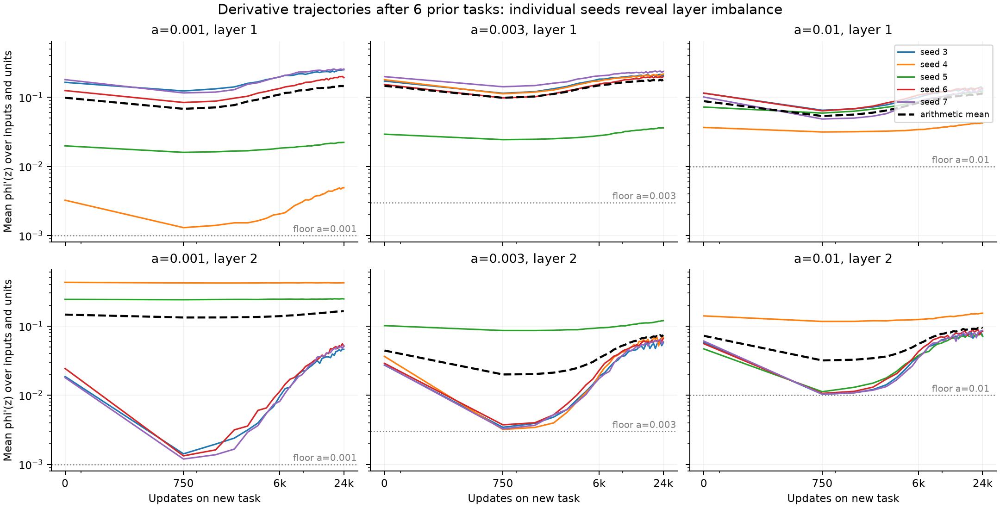

# Derivatives during relearning (posthoc request)

For leaky ReLU, phi'(z) is 1 on the positive side and a on the negative side. Its input/unit mean is a+(1-a) p(z>0). The slope a is therefore the floor, not the mean. These are activation derivatives, not parameter gradients.

All tables use source age6. Means across seeds can hide which layer is nearly negative-only. For example a=.001 seed4 starts with L1 mean .003239 and L2 mean .428172, and its sustained90 starts at39900. A high aggregate L2 mean does not imply a large gradient through L1. This is descriptive evidence, not a causal attribution of the slowing.

| a | L1 mean at start | L1 at750 | L2 at start | L2 at750 | L2 at24k |
|---:|---:|---:|---:|---:|---:|---:|
| 0.001 | 0.098349 | 0.067971 | 0.146356 | 0.132926 | 0.163617 |
| 0.002 | 0.061088 | 0.042911 | 0.088966 | 0.070180 | 0.114962 |
| 0.003 | 0.146129 | 0.098110 | 0.044228 | 0.019931 | 0.074144 |
| 0.005 | 0.132527 | 0.085414 | 0.047851 | 0.019608 | 0.073478 |
| 0.01 | 0.087705 | 0.053482 | 0.072180 | 0.031800 | 0.093295 |

## Seed medians at750 updates

Each seed value is first averaged over the1200 inputs and100 units in one layer. This table then takes the median of those five seed values. The preceding table uses the arithmetic mean across seeds. Neither replaces the individual-seed plot.

| a | L1 median of mean derivatives | L2 median of mean derivatives |
|---:|---:|---:|
| 0.001 | 0.083967 | 0.001416 |
| 0.002 | 0.026709 | 0.052815 |
| 0.003 | 0.112230 | 0.003432 |
| 0.005 | 0.097634 | 0.005473 |
| 0.01 | 0.059021 | 0.010602 |

At a=.001, seeds3,4,6,7 have one layer at .00119-.00142 at750 updates; for seed4 it is layer1, whereas for3,6,7 it is layer2. Seed5 differs: layer1 is .01594 and layer2 is .24031. Thus the large arithmetic layer2 mean at a=.001 is not representative of the three seeds whose layer2 sits near its leak floor.
The seed-averaged mean derivative first falls in both layers, then recovers during relearning. The smallest observed grid point a=.001 does not have the smallest source mean derivative in either layer. Thus source mean derivative alone does not give a universal inverse clock across these learned states. Individual trajectories, layer structure and optimizer history remain relevant.

The identity was checked at every stored derivative time point (absolute tolerance1e-9). No additional training or exclusions were performed. The plot uses the common first24k updates, available for every seed, and shows seeds individually.

