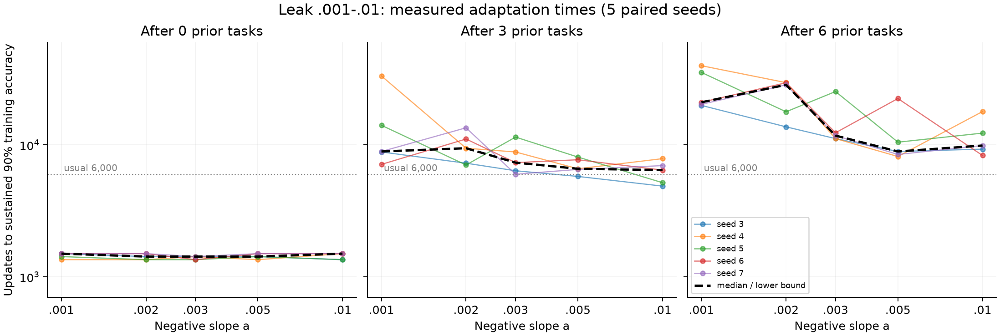
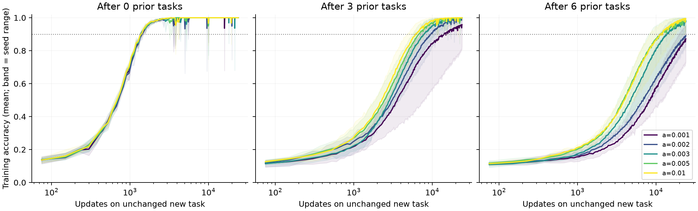

# Adaptation-time orders across a=.001-.01

All 75/75 probes reached sustained90. The latest start was 39,900 updates. At source age6, the median was 21,075 for a=.001 and 9,900 for a=.01. The five paired ratios were 2.05-2.88 (median 2.23). These are tens of thousands of updates, not hundreds of thousands or millions in this registered setting.
The intermediate grid is not strictly monotone: a=.002 has a larger sample median than .001, and .005 a smaller sample median than .01. Five seeds and differing accumulated states do not identify a sharp threshold or a universal inverse-a law. Fresh networks stay near 1,400-1,500 updates across the grid. The substantial slowdown appears after repeated tasks.

Registered design: five paired seeds, 1200 random-label MNIST samples, two hidden layers of 100 units, Adam .001. Source ages 0, 3, 6; each old task used 6000 updates. Every probe has a single unchanged new task. This is a new host experiment, not a reconstruction of CondA.

Primary time is the start of four consecutive evaluations >=90% (75-update spacing, confirmation 225 updates later). Exactly 1080/1200 qualifies. The common minimum budget is 24k; adaptive maximum is 1,536,000. The negative leak is not the mean derivative. Cross-leak comparisons include different accumulated learned states.

| Prior tasks | a | Recovered | Median sustained T90 | Per-seed sustained T90 (updates) | Mean accuracy at 6k | At 24k |
|---:|---:|---:|---:|---|---:|---:|
| 0 | 0.001 | 5/5 | 1,500 | s3=1,500; s4=1,350; s5=1,425; s6=1,500; s7=1,500 | 100.00% | 100.00% |
| 0 | 0.002 | 5/5 | 1,425 | s3=1,425; s4=1,350; s5=1,350; s6=1,500; s7=1,500 | 100.00% | 100.00% |
| 0 | 0.003 | 5/5 | 1,425 | s3=1,425; s4=1,425; s5=1,350; s6=1,350; s7=1,425 | 100.00% | 100.00% |
| 0 | 0.005 | 5/5 | 1,425 | s3=1,425; s4=1,350; s5=1,425; s6=1,500; s7=1,500 | 100.00% | 100.00% |
| 0 | 0.01 | 5/5 | 1,500 | s3=1,350; s4=1,500; s5=1,350; s6=1,500; s7=1,500 | 100.00% | 100.00% |
| 3 | 0.001 | 5/5 | 8,925 | s3=8,850; s4=33,375; s5=14,100; s6=7,125; s7=8,925 | 69.95% | 95.80% |
| 3 | 0.002 | 5/5 | 9,450 | s3=7,275; s4=9,450; s5=7,050; s6=11,100; s7=13,500 | 75.88% | 99.85% |
| 3 | 0.003 | 5/5 | 7,350 | s3=6,375; s4=8,850; s5=11,475; s6=7,350; s7=6,000 | 82.22% | 99.62% |
| 3 | 0.005 | 5/5 | 6,600 | s3=5,775; s4=6,600; s5=8,100; s6=7,725; s7=6,525 | 86.30% | 99.97% |
| 3 | 0.01 | 5/5 | 6,450 | s3=4,875; s4=7,875; s5=5,175; s6=6,450; s7=6,975 | 89.05% | 99.65% |
| 6 | 0.001 | 5/5 | 21,075 | s3=19,950; s4=39,900; s5=35,475; s6=21,075; s7=20,325 | 39.10% | 87.22% |
| 6 | 0.002 | 5/5 | 28,575 | s3=13,725; s4=29,700; s5=17,850; s6=29,625; s7=28,575 | 45.70% | 89.08% |
| 6 | 0.003 | 5/5 | 11,775 | s3=11,175; s4=11,175; s5=25,425; s6=12,375; s7=11,775 | 59.55% | 97.73% |
| 6 | 0.005 | 5/5 | 8,925 | s3=8,925; s4=8,175; s5=10,500; s6=22,500; s7=8,475 | 69.57% | 98.28% |
| 6 | 0.01 | 5/5 | 9,900 | s3=9,300; s4=17,925; s5=12,300; s6=8,325; s7=9,900 | 68.98% | 99.33% |

## Verification and interpretation

All 75 time records recomputed from integer correct counts. All 15 reused-a=.003 comparisons match prior CE exactly and match integer accuracy at common evaluation times. Source initial parameters/moments and prefix label/batch RNG states match across leaks. All seed-specific probe labels match. Training code SHA256: `11ad7030bf7433a8bdec84bc7c2b67cc22861fd4e37b555e306de678e4c4dc27`.
The older runner compared a float32 accuracy mean with decimal .9, so exactly 90% could be excluded. This runner uses integer correct counts; CE and all training arithmetic are unchanged. Do not treat .003 reruns as new independent seeds.
A right-censored first T90 means T90 > last evaluated update. For sustained start time, the rigorous lower bound is C-225 because three later evaluations are required to confirm the start. No censored case is omitted from summaries. Secondary T95/T99 can be censored by stopping at sustained90. Event counts distinguish start by budget from confirmation by budget.
The minimum24k curve includes every run. Later accuracies from surviving slow runs must not be averaged as though they represent the original cohort. Finite-budget failures do not demonstrate impossibility or a mathematical phase transition. Local log-log slopes in exploratory_local_slopes.csv are descriptive, not a universal law.

