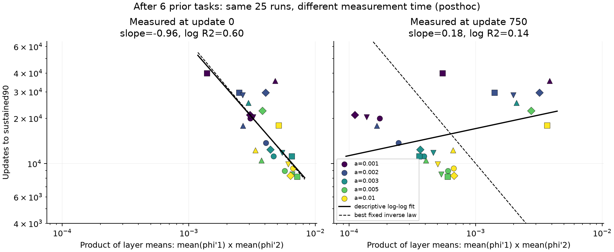

# Product of layer-mean derivatives and adaptation time (posthoc)

Requested by Issa after the completed leaky_order_1111 run: would layer1 x layer2 be the rough scale? No new training, no new labels, no exclusions. Source age6 is the main comparison from the preceding conversation. The source-state product (step0) and the previously shown step750 values are both reported; neither window is relabeled preregistered.

For each individual seed and leak, compute P=mu1*mu2, where each mu is the mean activation derivative across1200 inputs x100 units of that layer. Aggregate only after multiplying inside the same seed. The product of two across-seed medians is a different statistic. Time is the beginning of the first four consecutive full-bank >=90% evaluations, unchanged from the registered run.

At source age6, step0: T is descriptively proportional to P^(-0.9645), log-log R2=0.5959, Spearman(1/P,T)=0.7805. A fixed inverse fit gives T~64.647/P. The geometric residual RMS factor is1.363; actual/predicted values range0.608-2.637. This is an in-sample descriptive fit, not a prediction validation.
At source age3, step0, slope=-1.1484, R2=0.7455, fixed-inverse constant=245.018. Thus the rough within-age inverse relationship is not a common clock across source ages.
At age6, step750, slope=0.1799, R2=0.1389, Spearman(1/P,T)=-0.2485. The step0 correspondence does not persist at750. We do not select the more favorable time point as a universal law.

| a | Median product at source age6, step0 | Median sustained90 time |
|---:|---:|---:|
| 0.001 | 0.00305325 | 21,075 |
| 0.002 | 0.00268451 | 28,575 |
| 0.003 | 0.00466017 | 11,775 |
| 0.005 | 0.00570870 | 8,925 |
| 0.01 | 0.00609536 | 9,900 |

## Scope and theory

There are25 cells but only5 paired initialization/data seeds; no iid25 p-value or confidence interval is claimed. Fits for source ages0,3,6 at steps0 and750, and age6 at1500,3000,6000 are saved in fits.csv. All these measurements precede their corresponding T90_sustained. Source age0 has very little variation in P or time and an essentially zero fitted slope; it provides no informative within-age scaling range.
For a column-vector MLP with hidden preactivations z1,z2, D_l=diag(phi'(z_l)), logits f and loss error e=dL/df, the exact first-preactivation gradient is dL/dz1=D1 W2^T D2 W3^T e. The derivative factors multiply along paths. P=mu1*mu2 is an unweighted scalar approximation: weight magnitudes, signs, correlations of the gates on the same input and path, the error direction, and Adam history are not retained in it. Therefore the earlier layer-by-layer comparison was incomplete; the product is a better motivated candidate, while reciprocal learning time is a further empirical hypothesis.
[Backpropagation and the chain rule: Deep Learning, chapter6](https://www.deeplearningbook.org/contents/mlp.html). The numerical fits above use only the local experiment records, not this reference.

