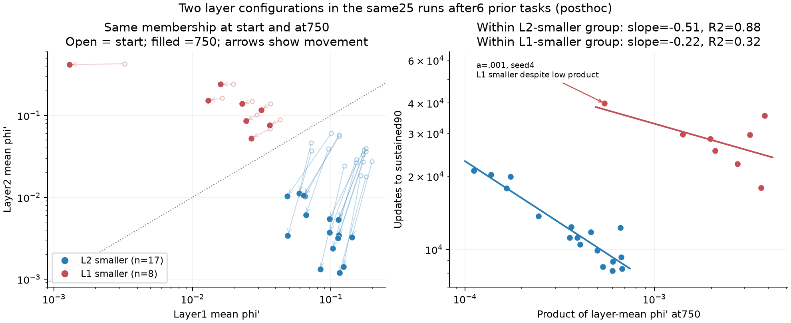

# Two groups at update750 (posthoc)

Issa observed apparent polarization in the previous750-update plot. Inspect the existing25 source-age6 runs, retaining all five leaks and five paired seeds. This is a descriptive posthoc analysis, not a registered two-component test and not new training.
Define group solely by which layer has the smaller input/unit mean derivative at750 (mu1<mu2 or mu2<mu1); do not use adaptation time in this assignment. There are8 L1-smaller runs and17 L2-smaller runs. This inequality always defines two sides; the evidence for separation is the unoccupied intervals and separated coordinate ranges, not the mere ability to label two groups.

| Configuration at750 | Count | L1 mean derivative range | L2 range | Median sustained90 time | Time range |
|---|---:|---:|---:|---:|---:|
| L2_smaller | 17 | 0.04843-0.14187 | 0.00119-0.01121 | 11,175 | 8,175-21,075 |
| L1_smaller | 8 | 0.00130-0.03623 | 0.05281-0.42039 | 29,100 | 17,925-39,900 |

The ratio mu2/mu1 spans .0103-.2135 for L2-smaller runs and1.9774-323.4504 for L1-smaller runs: no observation between .2135 and1.9774. Both layer coordinates have non-overlapping ranges between groups. The two-dimensional derivative configurations are clearly separated in this finite sample.
The raw product alone has its largest adjacent gap between .000674918 and .001410622, producing18 low-product and7 high-product observations. This differs from17/8: a=.001 seed4 is an L1-smaller run with a low product (.000546379) and very late time39900. Do not silently discard or relabel it.
All25 group labels at750 already match their labels at update0 and stay the same at every stored derivative evaluation through6000 (including update1). The layer-ratio gap increases from source ranges .0997-.6472 versus1.8898-132.1754 to the750 ranges above. This is evidence for amplification of a pre-existing configuration difference; it does not locate a newly occurring transition at750.
Pooled750 regression has slope+.1799 and log R2=.1389. Within L2-smaller17, slope=-.5075 and R2=.8751; within L1-smaller8, slope=-.2221 and R2=.3210. Thus an inverse trend survives within the main17-run group even though pooling reverses its sign. Its exponent is near-.5, not the source-state pooled exponent near-1. These are in-sample descriptive fits; no universal time law or causal mediation follows.

## Compare within each leak

| a | L2-smaller n | Median time | L1-smaller n | Median time | All L1-smaller times exceed all L2-smaller times? |
|---:|---:|---:|---:|---:|---|
| 0.001 | 3 | 20,325.0 | 2 | 37,687.5 | True |
| 0.002 | 2 | 15,787.5 | 3 | 29,625.0 | True |
| 0.003 | 4 | 11,475.0 | 1 | 25,425.0 | True |
| 0.005 | 4 | 8,700.0 | 1 | 22,500.0 | True |
| 0.01 | 4 | 9,600.0 | 1 | 17,925.0 | True |

The between-group time difference appears within every leak, rather than coming only from different leak proportions. Counts per cell are small and these are the same five paired seeds. Naming a configuration by its lower derivative does not prove that layer is the causal rate-limiting mechanism. Finite separation is not a thermodynamic or mathematical phase-transition demonstration.
At750, the median input variance of derivatives in layer1 is .001412 in the L1-smaller group and .038461 in the L2-smaller group. Median fraction of inputs with no positive layer2 unit is0 in L1-smaller versus .97417 in L2-smaller. These differences are descriptions of different configurations, not a new causal intervention. All members and observer summaries are in the CSV files.

