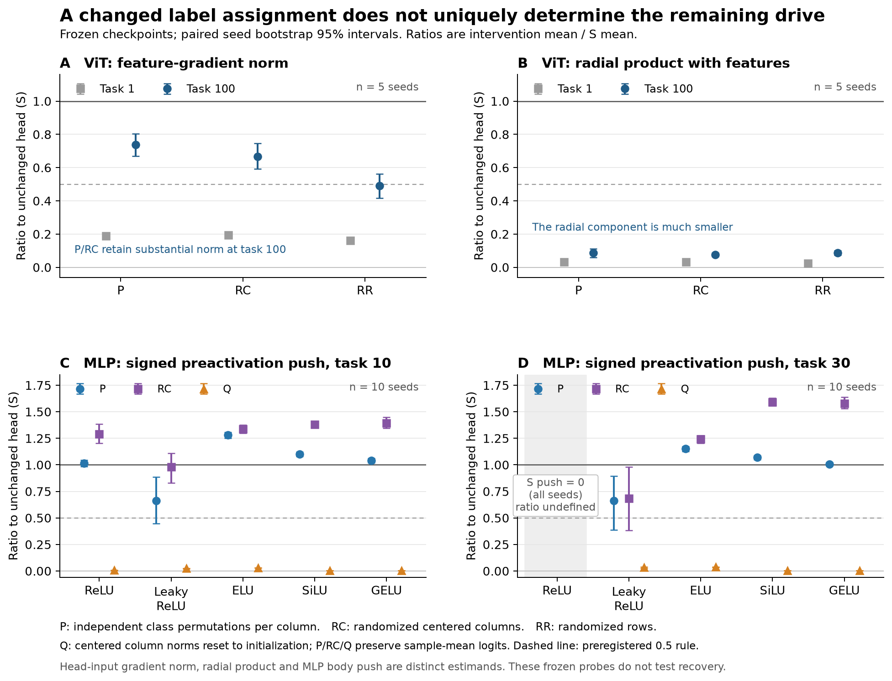

# loading_bridge_1111 A: frozen checkpoint results

The two essential distinctions are:

- **Gradient norm is not gradient direction.** At ViT task100 P/RC retain 74%/67% of the head-input gradient norm, while retaining only about 9%/8% of its radial product. They also create a much larger sample-mean gradient component. “The same push remains” would overstate this result.
- **A head-input gradient is not a body push.** All ten ReLU task30 checkpoints have zero opening on the fixed dataset, so their mean-preactivation push is exactly zero and its intervention/S ratio is undefined. Their nonzero head-input gradients do not pass through the ReLU derivative.

Figure: standalone scientific output in `static_figure.png` and `static_figure.pdf`, reproduced by `analysis/loading_bridge_1111/static_figure.py` from the CSV. Panels intentionally separate gradient norm, radial product and body push.

2026-11-11. New preregistered measurements on existing saved states; no learning took place in A. Implementation commit `f4a600e751b06b1c64e07932515adbc36f214b92`; the full spec (including premeasurement addendum 1) hash is `39d991d39f1c7afb6f79eeed0ae022f5aff863ec6531f8e8b9b4cdfe88ba71f4`. All 150 MLP and 10 ViT cells completed. No cell was dropped after observing outcomes. Raw artifacts total 377.9 MiB at report creation. Recorded main-run wall times: MLP 74.13s; ViT 14.68s.

## Verification and sources

- Synthetic analytic/invariant/custom-backward checks: 28 passed (`static_selftest.json`). All 3,180 real-cell invariant/reconstruction checks passed, with the registered tolerances.
- MLP: five activations, ten seeds, task ends 1/10/30; source `stage1_ctrl_1111/results/stage1_ctrl_1111/raw/states_adam_lr0.001_*.npz` under the data archive. Saved initialization, image subset and canonical labels were checked exactly. A does not reconstruct Adam or train the model.
- ViT: SL, seeds 10252010–10252014, task ends 1/100; source `vit_long_1024_2blk_rlfix/runs/SL/seed*/ckpt/model_t*.pt`. Analyses use only the 10 `loss_classes` rows of the 200-row head, and the same 2,500 fixed images and deterministic old labels.
- `static_provenance_mlp.json` / `static_provenance_vit.json` record each source SHA256, output hash, data/label hashes, command, versions, model reconstruction and invariant checks. Raw per-cell NPZ stores features, labels, logits/probabilities, head parameters, per-sample gradient norm/radial product and MLP unit/push arrays.
- Body features are produced in float32 and readout analysis uses float64. MLP also records the original stage1 helper's float64-body baseline push separately. Maximum absolute difference in signed mean push is 1.53e-08; maximum relative difference among nonnegligible baseline cells is 2.01e-07. These numerical variants must not be silently substituted.

## Estimands and intervals

Expected feature gradient is the per-example uniform-new-target CE gradient at the head input, without 1/N normalization. MLP unit push is `mean_x[(x dot mean(x)+1) phi_prime(z) g_h]`; positive values lower mean preactivation under SGD. The raw `stage1_S` array is N times this normalized push. The primary scalar below is the signed mean across all units. Active-unit (`z>0` for any input), absolute-mean and L2 summaries are auxiliary and retained in CSV. A head-input gradient can remain while the body's activation derivative blocks it.

Intervals below are percentile 95% intervals from 10,000 paired seed bootstrap resamples of the **ratio of means**. The CSV additionally reports mean seed ratios (auxiliary), denominator exclusions and the registered 0.5 rule. Seeds with abs(S)<1e-10 are not ratio-judged. These are cellwise intervals, without multiplicity adjustment. Old centered correct-class margin is not called project kappa. `centered_logit_rms` centers across classes for each example; `sample_mean_logit_rms` is the RMS across classes of these logits averaged over examples.

## MLP expected mean-preactivation push

| Task end | Activation | P/S | RC/S | Q/S |
|---:|---|---|---|---|
| 1 | R | 1.477 [1.315, 1.648] | 1.503 [1.353, 1.678] | 0.068 [0.062, 0.073] |
| 1 | LR | 1.182 [1.110, 1.255] | 1.087 [0.901, 1.288] | 0.087 [0.079, 0.094] |
| 1 | ELU | 0.766 [0.657, 0.879] | 0.925 [0.685, 1.139] | 0.116 [0.085, 0.139] |
| 1 | SILU | 1.358 [1.189, 1.584] | 1.318 [1.150, 1.507] | 0.125 [0.115, 0.134] |
| 1 | GELU | 1.488 [1.349, 1.627] | 1.413 [1.263, 1.575] | 0.109 [0.100, 0.117] |
| 10 | R | 1.014 [0.984, 1.043] | 1.291 [1.205, 1.386] | 0.007 [0.006, 0.008] |
| 10 | LR | 0.660 [0.448, 0.886] | 0.979 [0.829, 1.108] | 0.024 [0.020, 0.028] |
| 10 | ELU | 1.283 [1.252, 1.308] | 1.339 [1.299, 1.375] | 0.029 [0.028, 0.031] |
| 10 | SILU | 1.101 [1.080, 1.123] | 1.382 [1.361, 1.401] | 0.004 [0.004, 0.005] |
| 10 | GELU | 1.039 [1.019, 1.062] | 1.393 [1.345, 1.451] | 0.004 [0.004, 0.005] |
| 30 | R | not ratio-judged (S=0) | not ratio-judged (S=0) | not ratio-judged (S=0) |
| 30 | LR | 0.661 [0.386, 0.893] | 0.685 [0.381, 0.980] | 0.033 [0.026, 0.040] |
| 30 | ELU | 1.152 [1.128, 1.175] | 1.242 [1.205, 1.277] | 0.037 [0.035, 0.039] |
| 30 | SILU | 1.070 [1.050, 1.090] | 1.592 [1.558, 1.630] | 0.003 [0.003, 0.003] |
| 30 | GELU | 1.007 [0.992, 1.024] | 1.578 [1.533, 1.638] | 0.003 [0.003, 0.003] |

P and RC retain substantial expected signed push in most cells despite reducing old-label performance. LR task10 P and task30 P/RC remain unresolved by the registered interval criterion. ReLU task30 has zero opening on all 1,200 inputs for all 100 units in every seed: its expected body push is exactly zero for every head intervention and no ratio is assigned. Its head-input gradient nevertheless remains nonzero (S mean norm 0.2524), illustrating the distinction between a head residual and its pullback through the body.

Q makes the instantaneous expected push much smaller in every ratio-eligible MLP cell. This frozen-state result does not establish that instantaneous push mediates the long-run Qall benefit, and cannot measure later compensation, reloading, or recovery. B's natural and recovery trajectories address separate questions.

## ViT expected head-input gradient norm

| Task end | P/S | RC/S | RR/S | H10/S | T/S |
|---:|---|---|---|---|---|
| 1 | 0.188 [0.180, 0.197] | 0.193 [0.181, 0.202] | 0.160 [0.146, 0.171] | 0.017 [0.017, 0.017] | 0.170 [0.168, 0.172] |
| 100 | 0.738 [0.668, 0.803] | 0.666 [0.593, 0.747] | 0.491 [0.417, 0.563] | 0.051 [0.046, 0.056] | 0.512 [0.460, 0.566] |

At task100 P and RC pass the substantial-retention rule for head-input gradient norm; RR is unresolved. At task1 all three directions interventions remove a majority by this metric. Thus retention is conditional on the late checkpoint, rather than a property of every trained ViT head. RR preserves row norms while P/RC preserve centered column norms; these are different interventions and their effects should not be pooled.

At task100, the remaining gradients differ strongly in direction/structure from S:

| Arm | Old accuracy | Mean max probability | Sample-mean-logit RMS | Mean per-example gradient norm | Norm of sample-mean gradient | Mean radial product | Centered-feature radial product |
|---|---:|---:|---:|---:|---:|---:|---:|
| S | 1.0000 | 0.9998 | 1.8823 | 1.2899 | 0.0246 | 20.7130 | 20.7006 |
| P0 | 0.0000 | 0.9998 | 1.8823 | 1.2899 | 0.0246 | 20.7130 | 20.7006 |
| P | 0.1046 | 0.7200 | 1.8823 | 0.9515 | 0.6890 | 1.8153 | 1.8456 |
| RC | 0.1217 | 0.6594 | 1.8823 | 0.8585 | 0.6306 | 1.5925 | 1.5229 |
| RR | 0.0691 | 0.4686 | 0.3781 | 0.6337 | 0.2127 | 1.7892 | 1.7139 |
| H10 | 1.0000 | 0.4130 | 0.1882 | 0.0661 | 0.0025 | 1.2011 | 1.1955 |
| T | 1.0000 | 0.4130 | 0.1882 | 0.6607 | 0.0255 | 12.0111 | 11.9550 |
| G | 1.0000 | 0.9998 | 1.8823 | 0.1290 | 0.0025 | 2.0713 | 2.0701 |
| TG | 1.0000 | 0.4130 | 0.1882 | 0.0661 | 0.0025 | 1.2011 | 1.1955 |

The radial-product ratio at task100 is P/S 0.088 [0.061, 0.111] and RC/S 0.077 [0.065, 0.088]. Retaining gradient **norm** therefore does not mean retaining the same radial drive. P/RC also preserve the learned sample-mean logits by construction; their surviving large sample-mean gradient component must not be attributed solely to sample-specific feature alignment. Their mean-logit compensation differs from RR's unchanged bias.

## What A establishes and does not establish

1. P0 changes old-label assignment while leaving uniform-new-target CE and feature gradients invariant; relabeled old accuracy is restored. This is the registered mathematical sanity, not a new mechanistic discovery.
2. P/RC reduce old-label correspondence while retaining expected push in many MLP cells and gradient norm in late SL ViT. Reducing old-label accuracy does not certify removal of every relevant head–feature interaction.
3. H10 and T have the same probabilities at the checkpoint, but their raw feature gradients differ by a factor of ten; H10 and TG agree. This is an identity under the registered interventions. Adam step magnitudes, body displacement and recovery are not determined by this identity and must be read from B.
4. MLP's expected preactivation push and ViT's head-input gradient are different quantities. The MLP ReLU task30 case shows explicitly why a nonzero head gradient cannot stand in for body plasticity. ViT radial results likewise prevent treating norm retention as a shared downstream direction.
5. A does not test continual prevention, one-time reversal of accumulated body changes, optimizer memory, or causal mediation by scale/derivative. No manuscript claim is changed by this report.

Full outputs: `static_summary.csv` (1,750 rows), `static_ratios.csv`, architecture-specific versions, two provenance files, and raw per-cell NPZ/summary JSON. Raw logging files are `raw/loading_bridge_1111/static/static_mlp.log` and `static_vit.log`. A uses exactly the registered checkpoint sets and arms. Posthoc interpretation above introduces no additional intervention.
