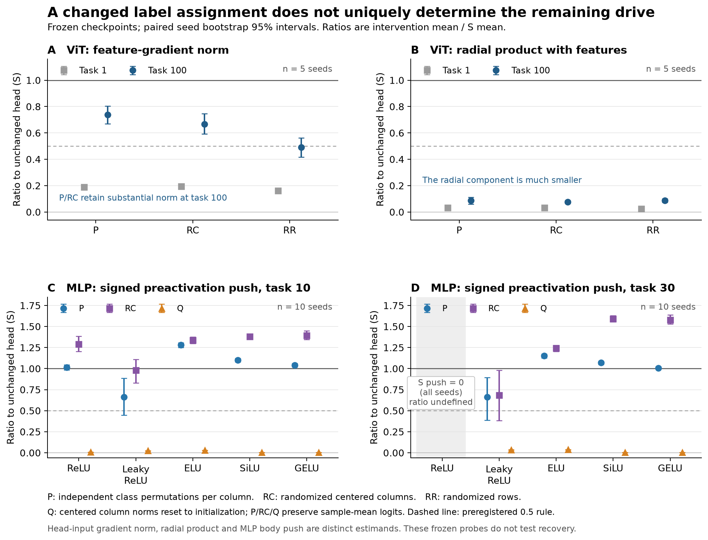
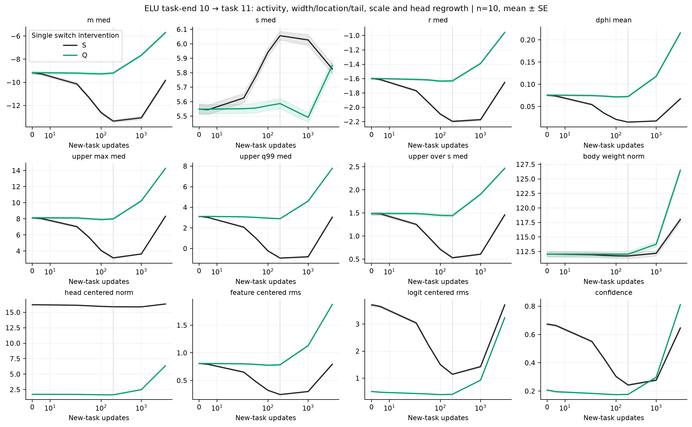
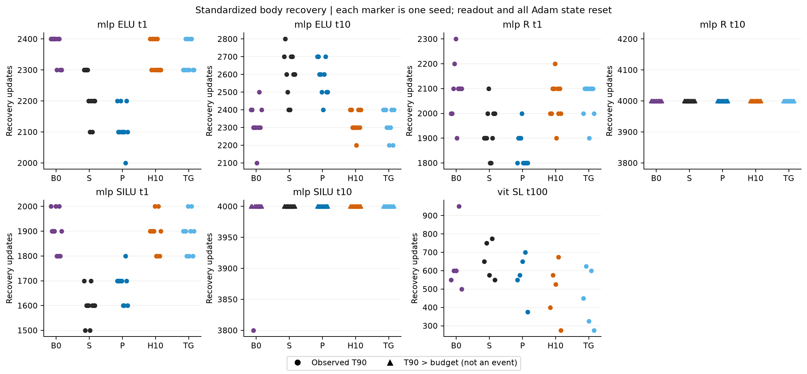

# ViTの装填費用とMLPの段①を照合する — loading_bridge_1111

2026-11-11。対象は2ブロックViTのSL（最終affine LNあり）とstage1_ctrlの784–100–10 MLP。文字GPTは対象に含めない。原稿は編集しない。

## 結論

**共通する近位の勾配構造は支持されたが、可塑性喪失の下流まで同じ機構とは結論しない。** 旧ラベルとの対応を崩しても、後期MLPの期待pushと後期SL ViTのhead入力勾配ノルムはかなり残る。ただしViTのradial productは大きく減るため、ノルム保持を同じ向きの作用の保持とは解釈できない。初期確信を揃えても実Adam変位は違い、出力確信だけでは初回更新を決められない。

ELUのQには、同じ体からの急性の沈み抑制と、その後の活動・上端位置・平均位置の違いがともにある。これは既存の「沈降しない事件」と両立するが、厳密な1/v補償や長期Qall救済の媒介率は同定しない。headとAdamを揃えた回復では、ViTは全条件で90%へ届く一方、課題10末のReLU/SiLUには未到達が多数残った。共通の近位要因から、網と体の履歴に応じた異なる下流経路へ分かれる、と整理する。

## 何を区別したか

新ラベルを入力から独立な一様乱数とすると、head入力h、logit z=Wh+bに対して期待勾配は `Wᵀ(softmax(z)−u)`。旧ラベルの名前への対応は式に現れない。一方、実際に体へ届く勾配にはbody Jacobianが入り、実変位にはAdamの履歴も入る。この3段階を同じ「押し」と呼ばない。

| 操作 | 定義 | 主な識別範囲 |
|---|---|---|
| S | 保存状態のまま | 基準 |
| P0 | Wの全列に共通のクラス行置換、bも同じ置換 | uniform新ラベルへの期待勾配が厳密不変という検算 |
| P | 各列に独立のクラス置換、平均logitを保つbias補正 | 旧対応を崩しても何が残るか。純粋な対応だけの介入ではない |
| RC / RR | 中心化列ノルム／行ノルムを保つランダム方向 | 同じ「方向破壊」でも保存する幾何が異なる |
| Q | MLPの中心化列ノルムを初期値へ、平均logit補正 | 同一体での即時作用。moments保持 |
| H10 | W,bを0.1倍、moments保持 | forwardとbackwardの両方、およびパラメータ化を変える |
| T / G / TG | (forward倍率, backward倍率)=(.1,1)/(1,.1)/(.1,.1) | 更新0の確率と逆伝播倍率を分ける機構対照 |
| H0 | headをゼロ化、headのAdamだけ消去 | 急性の比較腕 |

TとTG、SとGは更新0でのみ確率を揃える。その後の確率軌道は一致しない。H10とTGも初期head入力勾配は一致するが、headパラメータ勾配やmomentsを含む全更新は同じでない。登録仕様と実装の違いはないが、旧ViTのhead×cはmomentsも換算し、旧head0はheadのmomentsも保持していたので、過去の腕と新しい腕を同一視しない。

## 1. 先行文献が既に述べていること

[Lyle et al., Understanding Plasticity (ICML 2023)](https://proceedings.mlr.press/v202/lyle23b.html)は急な切替時のAdamの一次・二次モーメントの追従差、大きな更新とReLU飽和を扱う。[Disentangling (CoLLAs 2024 / PMLR 2025)](https://proceedings.mlr.press/v274/lyle25a.html)はerasing相とその後の適応を分け、正式版F.3/Fig.20でhead側と特徴縮小側のlogit抑制を議論する。これは今回の近位過程に近いが、Pの効果やViTの確信消失後の学習時間までを同定したものではない。

[NaP (NeurIPS 2024)](https://proceedings.neurips.cc/paper_files/paper/2024/file/c04d37be05ba74419d2d5705972a9d64-Paper-Conference.pdf)は最終線形出力層を射影対象に含めず、Appendix Dではscale/offset driftも扱う。「重みノルムを止めれば尺度全体が止まる」は既知の保証ではない。SLPの最終LN利得成長は別途実測した具体例として扱う。

[Nikishin et al. (ICML 2022)](https://proceedings.mlr.press/v162/nikishin22a.html)と[PLASTIC (NeurIPS 2023)](https://papers.neurips.cc/paper_files/paper/2023/hash/c464fc4516aca4e68f2a14e67c6f0402-Abstract-Conference.html)にはheadのresetで学習を改善する先行例がある。ただしreset範囲、optimizer、RLのreplay、測る成績が異なる。[Dohare et al. (Nature 2024)](https://pmc.ncbi.nlm.nih.gov/articles/PMC11338828/)にはContinual ImageNetの出力ゼロ化とCIFAR-100のhead-reset baselineの両方がある。旧ノートの「head-reset ablationは見つからない」は訂正が必要。

[LogitNorm (ICML 2022)](https://proceedings.mlr.press/v162/wei22d.html)はforwardの確信だけでなくbackwardの射影・尺度を変える実装なので、純粋な確信対照にはならない。7本の本文・付録・一部公式コードの確認箇所は[literature.md](literature.md)。この範囲の照合であり、網羅的新規性は主張しない。

## 2. ELUの「沈降しない事件」を先に照合した結果

既存0925–0929実験は、読み出しを小さくした後の幅・上端・開口の適応を直接示していた。これを即時期待勾配の縮小だけに読み替えない。

- vfreezeはtask50後にW2全体を.1/1/10倍して、その後W2だけlr=0で固定。biasは補正せず、全Adam履歴を保持。stage1 Qと同じ操作ではない。
- 長期の小v/中v/大vで約−2.25/−2.30/−2.29だった量は、**全入力の前活性lower medianの500更新後の実変化**。課題頭で開口ありのunitを選び、unit中央値を2seed×課題151–200で平均している。負側だけの期待勾配でも更新0の勾配でもない。元の自然対照は−4.31。
- 介入した瞬間には前活性は変わらず、その後1–2課題で上端/幅が分かれた。既存moment/epsilon整合、二次moment置換、方向/一歩長さ対照、固定残差nullを確認済みで、同じ対照は再実行しなかった。
- 固定logitへの再当てはめと、実際の乱数ラベル学習は違う。実学習では開く入力集合と出力そのものが変わるため、厳密な1/v補償を既存の結論へ戻さない。
- 「Adamが閉じたELUの微小勾配を常に全速へ戻す」「一回の押しで数値床へ落ちる」という旧説明は、原ノート末尾ですでに訂正されていた。

stage1 Qallのnorm=1.739は各課題の**開始時**であり、task30末は3.98–5.24へ再成長する（各活性化の10seed平均）。ELU task30のQallは更新0からs=12.24、r=−.925、平均|φ′|=.205で、Sの9.41、−2.159、.019と異なる。一方、同じ劣化S体への単発Qでは、sをほぼ増やさずr・開口が回復する例もある。したがって幅成長だけを全救済の媒介とする説明も支持しない。詳細は[elu_prior_audit.md](elu_prior_audit.md)、既存実装差は[existing_audit.md](existing_audit.md)。全30課題の既存raw再集計と図は[longitudinal_report.md](longitudinal_report.md)。

## 3. 新規A：保存状態の静的比較

MLP 5活性化×10seed×課題末1/10/30、ViT SL 5seed×課題末1/100の全160セル。学習なし。合成28検査と実データ3180検査がすべて通過。比の区間は対応seedを10000回bootstrapした平均の比の95%区間（多重比較補正なし）。

ViT課題100のPは旧ラベル正解率を100%から10.5%へ下げても、head入力期待勾配の平均ノルムを73.8% [66.8,80.3]残した。RCは66.6% [59.3,74.7]。ただしhead入力との内積はPで8.8%、RCで7.7%へ下がる。これは元の勾配とのcosineではなく、head入力に対するradial productである。標本平均勾配はむしろ増える。平均logit補正とaffine LNのβへの勾配も関わるため、「同じ方向の押しが7割残る」とは言わない。課題1ではP/RCのノルム比は約19%で、後期依存性もある。

MLP課題10ではP/Sの前活性平均への期待pushはReLU1.014、ELU1.283、SiLU1.101。Q/Sは.007/.029/.004へ下がる。課題30でもELU/SiLU/GELUはPで大部分が残るが、ReLUは全seedで固定1200入力上の開口・期待body pushがゼロ。head入力勾配が残ることと、体へ届くことは違う。LRの一部条件は登録した「半分以上残る」の区間判定では未決着。

この結果だけで、瞬間的勾配がQallの長期救済を媒介した割合、Adam実変位、回復不能性は分からない。[static_report.md](static_report.md)と[科学図](static_figure.pdf)に全条件を記録した。

## 4. 新規B：急性200更新とhead・Adamを揃えた回復評価

MLPはReLU/ELU/SiLU×10seed×課題末1/10、ViTはSL×5seed×課題末100。いずれも次課題の同じラベル・ミニバッチから200更新した。MLPは元engineのreplayで各課題末weights・labelsとのbit一致を確認した。全580出力（MLP540、ViT40）が予定通り揃い、全初期195組のCE/確信/entropy/期待勾配倍率の検算と、回復325件の評価grid・終了時刻・打切り整合検査を通過した。

### 更新0の確率を揃えても、最初の実変位は揃わなかった

T/TGは更新0の確率が同じで、非ゼロのbody勾配は10倍違う。しかし保存Adamでの最初の体変位比は次のようになり、一律10倍でも一律1倍でもなかった。Bの倍率は有効seed内の比を平均した量で、Aの平均値同士の比と区別する。

| 網・保存課題末 | 活性化 | 最初の体変位 T/TG、95%区間 |
|---|---|---|
| MLP 1 | ReLU | 4.187 [3.904,4.468] |
| MLP 10 | ReLU | 1.702 [1.000,2.456] |
| MLP 1 | ELU | 2.804 [2.540,3.095] |
| MLP 10 | ELU | 2.206 [2.014,2.387] |
| MLP 1 | SiLU | 3.730 [3.447,4.038] |
| MLP 10 | SiLU | 1.784 [1.640,1.918] |
| ViT 100 | SL | 3.895 [3.465,4.304] |

ReLU課題末10は7/10seedのbody勾配が比の分母閾値以下で、raw-gradientの10倍比の検算はn=3。表の実変位比はn=10であり、残るmomentsによる変位はあり得る。200更新後のT−TGの体変位差は全7セルで正だが、rや微分の変化は状態依存で、すべての指標が同じ方向に悪化したわけではない。これらは**初期確信だけでは初回の実更新を決められない**ことを示す。全期間の確信媒介の否定ではない。

ViTではPの体の累積経路長はSより更新1–25で小さく（対応差−4.378 [−4.904,−3.710]）、更新26–200では大きい（+4.843 [2.298,7.728]）。一方、始点から200更新後までの変位はなお小さい（−3.785 [−4.336,−3.287]）。経路長は各stepのパラメータL2変位の和、始点変位は最後と最初の差のL2である。静的な期待勾配ノルムの保持から、同じ動き方が続くとは推論できない。

### ELU：即時の保護と、後の活動・上端・位置の差がともにある

以下は**課題10末の同一S体へ単発Qを施し、次の課題11を4000更新**した診断replay。Qallの継続介入ではない。各seedでunit統計をまとめてから10seed平均した。rはunitごとのm/sの中央値であり、中央値m/中央値sとは違う。特徴RMSは入力方向の特徴平均を除去した値。

| 時点・量 | S | Q |
|---|---:|---:|
| 更新0 head中心化norm | 16.224 | 1.739 |
| 更新0 特徴中心化RMS | .807 | .807 |
| 更新0 logit中心化RMS | 3.704 | .507 |
| 更新200 特徴中心化RMS | .245 | .784 |
| 更新200 r中央値 | −2.196 | −1.632 |
| 更新200 平均絶対微分 | .0149 | .0725 |
| 更新4000 head中心化norm | 16.349 | 6.369 |
| 更新4000 特徴中心化RMS | .794 | 1.877 |
| 更新4000 logit中心化RMS | 3.707 | 3.234 |
| 更新4000 前活性幅s中央値 | 5.827 | 5.851 |
| 更新4000 r中央値 | −1.653 | −.957 |
| 更新4000 平均絶対微分 | .0674 | .2157 |
| 更新4000 全入力max/s中央値 | 1.458 | 2.466 |

Qでは200更新の活動・微分の低下が小さく、4000更新後にも大きな違いが残る。同時にhead自体が1.739→6.369へ再成長する。幅sの中央値はSと近くても、活動・標準化上端位置・平均位置が異なる。max(z)/sは位置を含む指標で、中心化したtail形状の変化を分離していない。また列別Qとhead再学習は固定vの条件を満たさず、この比較を厳密1/v則の定量検定にはしない。Qallの30課題後の差の何割をこの経路が媒介したか、個々のunitの幅変化がどれだけ寄与したかは同定していない。

### headとAdamを揃えた体の回復評価

回復評価では、急性200更新後のS/P/H10/TGの全headをゼロ化し、**全Adamを新品にして**、同じ次課題ミニバッチ列を最初から再生する。B0は急性更新をせず、保存時点の体から同じresetを行う。体に蓄積した有益な新課題学習も含めて評価するため、不可逆損傷の測定ではない。TとGには回復評価を実施していないので、T/TGの回復時間の直接比較はない。

MLP課題末10からの90%未到達数（各10seed、上限4000更新）は次の通り。

| 活性化 | B0 | S後 | P後 | H10後 | TG後 |
|---|---:|---:|---:|---:|---:|
| ReLU | 10 | 10 | 10 | 10 | 10 |
| ELU | 0 | 0 | 0 | 0 | 0 |
| SiLU | 9 | 10 | 10 | 10 | 10 |

これらはB0でも多数未到達なので、保存時点からの体の制約を含む。新しい急性200更新だけが作った障害として扱わない。

ELUの平均T90はB0/H10/TGで2330、Sで2600、Pで2580。ReLU/SiLUの未到達値を4000という観測T90へ置き換えない。未到達は予算内での未到達であり永久的な不能ではない。また到達時に停止するので、停止時精度の平均は同じ更新数での精度比較ではない。

ViT課題100末では全5seed・全回復腕が1500更新以内に到達した。seedを省略せず示す。

| seed下2桁 | B0 | S後 | P後 | H10後 | TG後 |
|---|---:|---:|---:|---:|---:|
| 10 | 550 | 650 | 550 | 400 | 450 |
| 11 | 600 | 750 | 575 | 575 | 625 |
| 12 | 600 | 575 | 650 | 525 | 325 |
| 13 | 950 | 775 | 700 | 675 | 600 |
| 14 | 500 | 550 | 375 | 275 | 275 |
| 平均 | 640 | 660 | 570 | 490 | 455 |

対応seed差の95%区間は、S−B0 +20 [−85,110]、P−S −90 [−160,−5]、H10−S −170 [−245,−95]、TG−S −205 [−250,−160]。Sの急性200更新が一様に体の再学習を遅らせるとは、この比較では言えない。H10−B0は−150 [−230,−70]、TG−B0は−185 [−295,−60]だが、これには急性区間の有益な新課題学習も含まれる。

**表のT90はreset後だけの更新数で、急性200を含めない。B0には急性区間がない。** 従ってH10/TGがB0より短いことを総学習更新数の短縮と解釈しない。平均の総更新数ならB0 640、H10 690、TG 655となるが、この手順自体は体の診断を目的としている。全CSV・打切り境界・図は[dynamic_summary.md](dynamic_summary.md)。

## 5. 共通と判断できる範囲と、残る境界

| 問い | 今回支持されること | 残る境界 |
|---|---|---|
| 旧ラベルとの対応が駆動に必須か | uniform新ラベルの期待勾配は旧クラス名を必要とせず、P/RC後も多くの後期条件で大きい | Pは幾何とbiasも変える。ViT初期は保持が弱く、norm保持は同じ方向の保持でない |
| head縮小は確信だけを変えるか | backward gainも初回実変位に効き、保存Adamでも完全には相殺されない | 初期確率のみ一致。T/Gの標準化回復は未実施なので、gainから回復時間までの直接比較は閉じていない |
| Q救済は即時の押し低下か、後の体適応か | 同一体からの急性差も、後の活動・位置・readout再成長も観測した | 両経路は両立し、持続Qallの媒介率、中心化tail形状・開集合交代の媒介は未同定 |
| MLPとViTは同じ喪失か | 近位の残差・readout pullback・optimizer履歴という分解は共通して有用 | ReLU/SiLUの未到達とSL ViTの回復は異なる。期待勾配だけから学習時間や回復不能性は推論しない |
| ノルム固定で十分か | 既存Qallは課題内再成長し、旧SLPではLN利得も動く | 新規BはLN利得を固定しておらず、その媒介を因果同定していない |

新規ViTはSLのみ・5seed、方向操作は各checkpointに1draw。区間は条件別で多重比較補正なし。MLP/ViTのデータ、活性化、モデル幅、勾配指標は一致しておらず、異なる網の絶対ノルムを直接比較しない。今回の比較は、共通機構を先に仮定する根拠ではなく、共通部分と分岐部分の境界を絞る証拠である。

## 再現と保存

最初の仕様commit `f135dacf`、ELU追加と監査の事前addendum `6bd8344a`、A実装 `f4a600e7`、B本走実装 `c331ea27`。仕様は計測前にcommitし、追加ELU対照も本走前に固定した。MLPのAdamは元engineをreplayし、各課題末weights・labelsのbit一致を必須とした。ViTは保存model/Adam/RNGと元のミニバッチ列を使った。既存データ再集計、新しい静的測定、診断replayを独立な再現実験と取り違えない。

コード `analysis/loading_bridge_1111/`、仕様 `specs/spec_loading_bridge_1111.md`、結果 `results/loading_bridge_1111/`。rawは `/home/issan/Projects/obsidian-research-data/loading_bridge_1111/`、対応SHA256は `backup_manifest.json`。各rawに元checkpoint hash・コード/spec hash・実行引数・版情報を残す。ローカルCPU/GPUのみ。BのCPU30ジョブは全成功、単一thread workerの合計wall time約1289秒。GPU本走は05:15:02–05:28:35 UTCの約13分33秒で、登録上限内。原稿・他の作業者のworktreeは変更しない。
