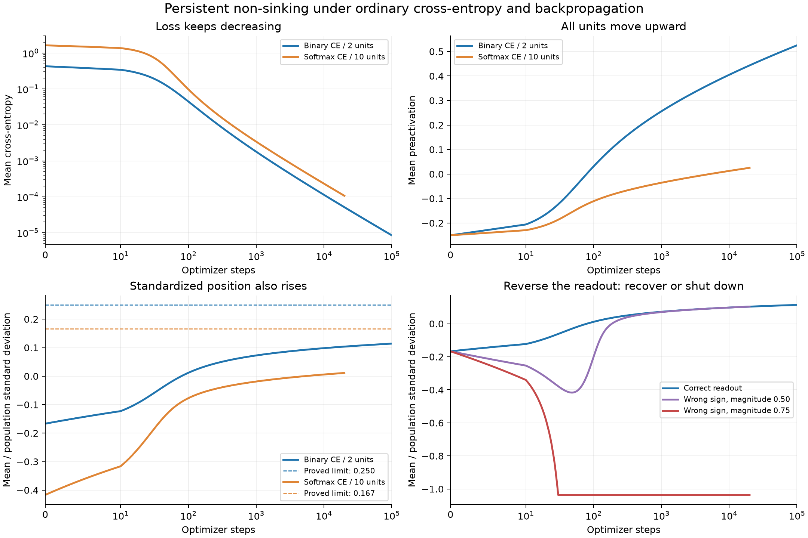

# 通常の CE・逆伝播で沈まない反例：結果（2026-10-26）

**達成したこと：通常の損失・全パラメータの逆伝播のまま、損失が 0 へ近づいても全 unit が沈まない反例を、二値分類と10クラス分類で構成した。**
永久性は [proof.md](proof.md) の離散 GD の証明で保証し、下の有限走は PyTorch 実装と成立条件を検算する。
初期状態を解析的に選んだ構成であり、ViT の典型性の証明ではない。入力・初期値を変えた開集合でも非沈降は保たれ、gradient flow では CE→0 まで示した。

## 主反例

| 走 | 更新数 | CE 初期 → 末尾 | μ 初期 → 末尾 | μ/σ 初期 → 末尾 | 下降した unit×step |
|---|---:|---:|---:|---:|---:|
| primary | 100,000 | 0.428701 → 8.47689e-06 | -0.25 → 0.525055 | -0.166667 → 0.114137 | μ: 0, r: 0 |
| softmax10 | 20,000 | 1.63828 → 0.000106824 | -0.25 → 0.0253179 | -0.416667 → 0.0112429 | μ: 0, r: 0 |

主反例は初期 accuracy=100%。ここでの学習は CE と margin の改善を意味する。
初期出力 bias を 2 にして誤分類を作った別の走では、accuracy は 50%→100%、CE は 0.835174→5.49055e-05。その間も両 unit の μ と r に下降はない。全 W,b,v,c を学習し、初期の対称性で c の勾配が 0 の走でも c は固定していない。

## 一点の微調整ではない

| 事前指定した比較 | 本数 | 各走の全 unit で μ と r が非減少 | gate の変化 | 最終 CE の範囲 |
|---|---:|---:|---:|---:|
| 入力・初期値を非対称に摂動 | 32 | 32/32 | 0 | 4.977e-05–5.595e-05 |
| 各クラス32点のばらつき | 8 | 8/8 | 0 | 5.344e-05–5.558e-05 |
| 32 unit | 8 | 8/8 | 0 | 4.201e-05–4.341e-05 |
| minibatch 1 の SGD | 1 | 1/1 | 0 | 5.136e-05–5.136e-05 |
| 標準 Adam | 1 | 1/1 | 0 | 1.841e-09–1.841e-09 |

二点データでの非沈降は不等式が定める開集合の保証がある。多点の μ/σ と Adam の無限時間の性質は、ここでは有限走の確認に留める。
32 unit の走では平均位置は末尾でも負の unit があるが、全 unit が初期位置から上がる。正側化と非沈降は異なる。

## 成立条件を壊すとどうなるか

| 比較（全て同じ通常学習） | 結果 |
|---|---|
| 読み出しの符号だけ反転、絶対値0.5 | 各 unit が最初の48更新で沈み、その後読み出しの向きが戻って上昇。accuracy 0%→100%。 |
| 読み出しの符号を反転、絶対値0.75 | 各 unit が30更新で閉じて学習が止まる。最終 CE=log(2)、accuracy=50%。学習が進む反例には数えない。 |
| 初期 b=1（μ/σが高い）、読み出しは正しい | μは1→約1.495へ上がる一方、rは2/3→約0.430へ全step下がる。σの成長による。 |
| 入力の平均・幾何を変更 | 正しいクラスだけで開く unit でも、対象 unit の μ は0.45→約−0.718、rは約0.818→−0.151へ全step下がる。 |
| 反対クラス間の拡張入力内積を正にする | gate が開閉して r の単調性は失われたが、μ は下がらなかった。十分条件を外すだけで沈降が必ず起きるわけではない。 |

上の48/30更新は登録 CSV の下降 unit×step 数を2 unitで割った値。独立なスカラー更新式でも最初の48/30更新であること、読み出しの反転・gate 閉鎖の時刻を再構成して照合した（checks.json）。

## 何が絞れたか

反例の核は、**活動する入力で読み出しが正しいクラスを支え、その対応が通常の更新によって補強されること**。その場合、CE の正味の信号は活動を上げる。下向きの自己成分の存在だけでは合計の沈降を説明できない。
この構成の十分条件は、入力の配置が gate の分離を維持し、平均へ運ぶ更新の向きが正で、幅の増加が r を逆転させないこと。
クラス純度だけでは十分でないことも、入力の幾何を変えた対照で確認した。
「常に沈む」を主張するなら、この領域を除外する条件が要る。「平均的・典型的に沈みやすい」を主張するなら、沈まない領域も含めて出現頻度と学習での到達性を説明する必要がある。候補は誤差で重み付けした活動の競合、入力幾何、幅の成長であり、どれが通常の学習状態で優勢になるかは未証明。本走を ViT の相2の原因同定や T5 の検証として運ばない。

## 検証と再現

- 全59走の各stepをオンライン集計し、保存状態を独立な NumPy 実装で再計算。検査結果: True。
- 通常 CE 全パラメータ勾配と autograd の最大誤差: 5.02e-16。
- 主例・10クラスの厳密な再帰との最大誤差: 1.78e-15。
- 開集合の不変量 I の最大誤差: 2.5e-13。
- 有限差分の r の式、I の不変性、読み出し反転の境界、多クラスの式を SymPy で恒等式として検算。
- 数値の単調性閾値は −1e−12。永続性の根拠には、この許容差や有限走を使っていない。
- 数値の正本: verdict.csv。環境・全初期値: provenance.json。検算: checks.json。証明: proof.md。
- 事前登録: specs/spec_nonsinking_ce_1026.md（d930de0a）、10クラス追補（6a4dbf56）。訓練ソース: 5a5baa91。

再現（repository root）:

    python analysis/nonsinking_ce_1026/run.py
    python analysis/nonsinking_ce_1026/analyze.py

依存: PyTorch、NumPy、SymPy、Matplotlib。GPU不要。生データの退避後は analyze.py に --raw で archive の raw フォルダを指定する。
