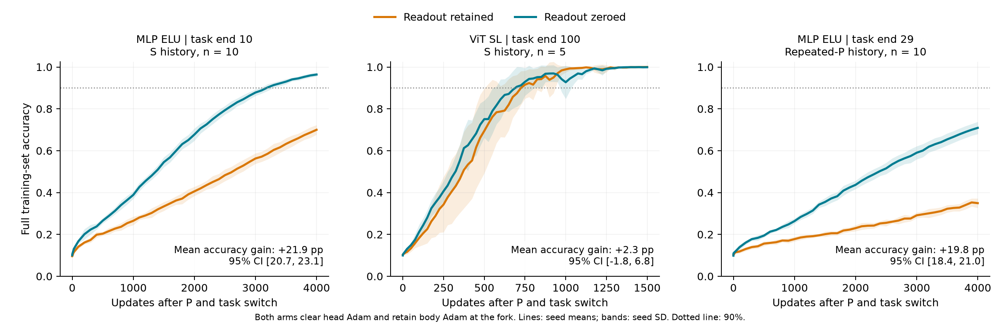

# P後の読み出し依存費用とViT装填費用：直接比較

**MLP側の「P後にも読み出しを外すと軽くなる費用」は確認された。一方、ViTとP後の残り方まで同じだとは確定できなかった。**

登録したoperational判定：**unresolved**。全820論理曲線（690本を実行、130本は登録済みの完全一致共有）、MLP各10seed、ViT5seedを完了。

問いは、Pで特定の整列を壊した後にも残り、読み出しを外すと小さくなる適応費用が、MLPとViTに共通するか。主比較では両群のhead Adamを空にそろえ、読み出しのweight/biasを残すKCとゼロにするZCだけを変えた。分岐時のbody parametersとbody Adamは完全一致。bodyはその後も学習する。

T90はここでは初回の記録到達。最後まで記録上90%以上を保つsustained T90はsummary.mdとCSVへ別保存。主指標Uは固定学習集合の精度不足1−accuracyを、残り区間で台形積分して期間で割ったもの。下表の正値は、読み出しを外すことで期間平均の精度が何percentage points改善したかを示す。異なるモデルの更新数や効果量の同等性は検定していない。

| 条件（いずれもP後） | KC−ZC：平均精度の改善 pp [95% CI] | 終点精度 KC → ZC | 90%到達：KC | 90%到達：ZC |
|---|---:|---:|---|---|
| ELU・通常履歴の課題10末 | +21.87 [+20.68, +23.13] | 69.99% → 96.39% | 0/10到達、全seed平均は未同定 | 10/10到達、平均3220 |
| ViT SL・課題100末 | +2.29 [-1.75, +6.79] | 100.00% → 99.89% | 5/5到達、平均705 | 5/5到達、平均675 |
| ELU・Pall履歴の課題29末 | +19.76 [+18.44, +20.96] | 34.93% → 70.91% | 0/10到達、全seed平均は未同定 | 0/10到達、全seed平均は未同定 |

## SとPでの残り方

| 条件 | S直後 KC−ZC pp | P直後 KC−ZC pp | P/S比 [95% CI] |
|---|---:|---:|---:|
| ELU・通常履歴の課題10末 | +21.10 [+20.09, +22.36] | +21.87 [+20.68, +23.13] | 1.036 [0.990, 1.086] |
| ViT SL・課題100末 | +11.47 [+8.01, +14.92] | +2.29 [-1.75, +6.79] | 0.200 [-0.156, 0.544] |

後期ELUはP後にもSと近い大きさの操作差が残った。ViTはSでは正の費用が明瞭だが、P後の点推定は約2割になり、区間は0をまたぐ。この比は登録したhead除去効果の比であり、全遅れの因果的な残存率や効果量の同等性検定ではない。

ViTでもhead Adamを保持する条件KK−ZKは正である。従って「ViTにはP後のhead依存成分がない」とは言えない。head Adamを消すと不確かになり、さらに25更新後の除去では符号が反転するという条件依存性が、ELUとの共通化を制限する。

更新予算はMLP4000、ViT1500。平均T90は全seed到達時だけ表示した。未到達を上限に代入していない。CIは対応seed bootstrap10000回、百分位95%、多重比較未調整。主要MLP条件の選択は先行データを見て行っており、既知KK/ZC再現と新規factorialを区別する。

## 読み出しの効果とAdam状態の効果

| 主条件 | parameters効果：Adamを消す KC−ZC | parameters効果：Adamを残す KK−ZK | Adam保持効果：head保持 KK−KC | Adam保持効果：headゼロ ZK−ZC |
|---|---:|---:|---:|---:|
| ELU・通常履歴の課題10末 | +21.87 [+20.68, +23.13] | +23.06 [+21.85, +24.35] | -0.48 [-0.53, -0.44] | -1.68 [-1.78, -1.57] |
| ViT SL・課題100末 | +2.29 [-1.75, +6.79] | +6.52 [+1.96, +11.07] | +1.13 [-0.20, +2.46] | -3.10 [-3.98, -2.18] |
| ELU・Pall履歴の課題29末 | +19.76 [+18.44, +20.96] | +19.81 [+18.47, +21.03] | -0.16 [-0.19, -0.12] | -0.21 [-0.29, -0.12] |

単位はUの差×100。parameters効果の正値は読み出しを外す利益、Adam保持効果の負値はAdamを残す利益。head Adamには一次・二次momentとstep counterを含む。正のKC−ZCは、head Adamリセットの差だけでは説明できない。これは読み出しweightとbiasを合わせた操作であり、両者の寄与は分離していない。

## Pから25更新後にも残るか

| 条件 | τ0 KC−ZC pp | τ25 KC−ZC pp |
|---|---:|---:|
| ELU・通常履歴の課題10末 | +21.87 [+20.68, +23.13] | +11.33 [+10.15, +12.53] |
| ViT SL・課題100末 | +2.29 [-1.75, +6.79] | -14.18 [-18.45, -10.24] |

τ25はP-KKの最初の25更新から共通分岐し、同じbatch列の25番目以降を続けた。最終更新数は同じ。異なるfork状態と積分区間なので、この差を25更新の媒介率や不可逆な体損傷へ読み替えない。Sのτ25対照は実施していない。ゼロ化は25更新で得た新しい読み出しも消すため、符号反転だけから初期の費用が完全に消えたとは言えない。

## 一般化の境界

| MLP条件 | P後τ0 KC−ZC pp | P後τ25 KC−ZC pp |
|---|---:|---:|
| R 課題1末 | -16.18 [-16.94, -15.42] | -15.88 [-16.80, -14.98] |
| R 課題10末 | +2.80 [+1.74, +4.12] | +2.31 [+1.37, +3.42] |
| ELU 課題1末 | -21.93 [-22.24, -21.56] | -23.14 [-23.47, -22.77] |
| ELU 課題10末 | +21.87 [+20.68, +23.13] | +11.33 [+10.15, +12.53] |
| SILU 課題1末 | -20.43 [-20.93, -19.96] | -18.69 [-19.07, -18.27] |
| SILU 課題10末 | +3.48 [+2.28, +4.62] | -3.57 [-4.58, -2.52] |

初期3活性化では読み出しを残す方が速い。後期R/SiLUはτ0で小さい正効果があるが、どの腕も4000更新内に90%へ到達していない。後期SiLU τ25は期間平均では保持側、終点ではゼロ側が良く、曲線が後半に交差する。単一の時点だけで「遅れが消えた」とまとめない。

Pallの比較はPを毎課題繰り返した同じ前歴内のfactorialである。読み出し除去後にも90%未到達が残る。SとPallの予防効果、全残差の媒介割合、永久的不能は検定していない。

## 結論をどこまで読めるか

登録した両主要条件での共通性は支持条件を満たしていない。判定と各区間を優先して解釈する。Pは全旧情報を消す操作ではない。MLPとViTの微視的な勾配機構、全ての残差、全ての学習段階が同じだとは結論しない。

全結果：summary.md、seed_metrics.csv、contrasts.csv、verdict.json。詳しいMLP境界：mlp_analysis.md。登録：specs/spec_p_residual_loading_1111.md。実装commit0c874fe9、事前登録commit359d0453。再現チェックと入力SHAはimplementation_notes.md/provenance.json、生データ退避先はbackup_manifest.json。

