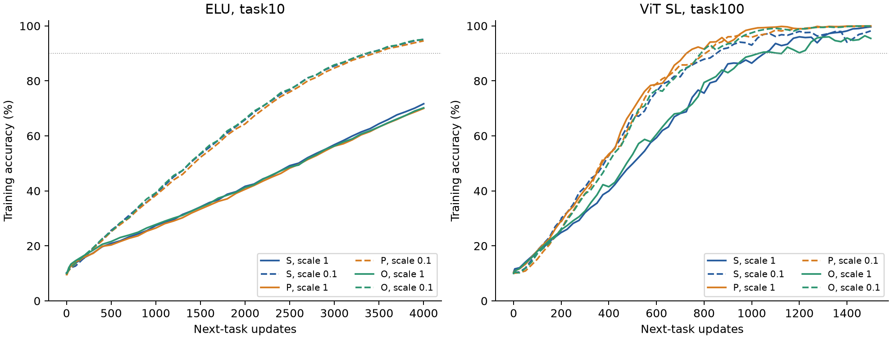
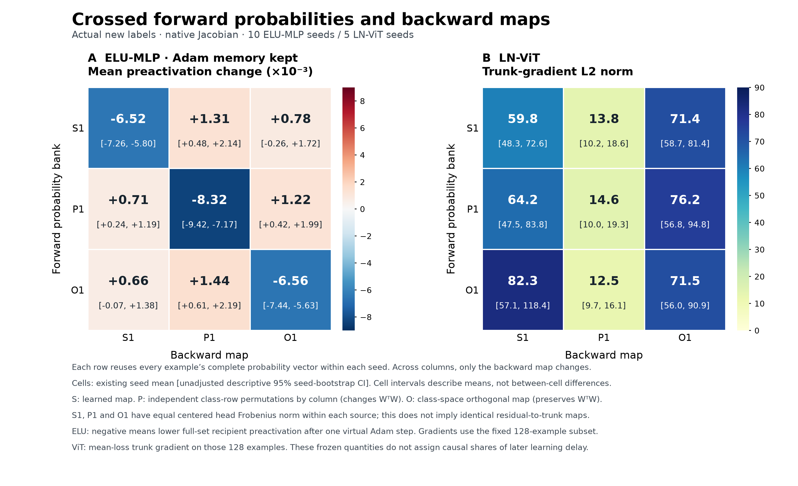

# 読み出し成長の害を方向・尺度・伝達・記憶に分ける

2026-11-11。事前登録 `specs/spec_readout_separation_1111.md` に基づく280本の学習軌道と2520件の局所比較を完了。ELU task-end10の10 seedsと、**最終affine LNありのViT SL task-end100**の5 seedsを各々の同一保存状態から分岐した。以下はこの二つの条件での結果であり、アーキテクチャ一般やLNの有無だけの因果比較ではない。

**主要な違いは、P後に読み出しを小さくして得られる改善がELUでは大きく残る一方、ViTでは確認できなかったこと。ViTはPそのものに強く反応した。ただし「ELUは大きさ、ViTは整列」という二分法では説明できない。** 確率を固定した局所比較では、ELUの平均位置を下げる作用は残差と読み出しの組合せに依存し、ViTでは同程度のhead入力勾配が異なるtrunk応答へ伝わる。さらにAdamの履歴、headの再学習、ELU/LNの逆伝播が別々に作用する。

## 1. 操作を区別する

- **S**：元の読み出し。
- **P**：読み出し行列の各列で、クラスに対応する要素の並びを独立に置換。列内の値とノルムを保存する。重みを縮める操作ではない。ただしクラス対応だけでなく、列間Gramと出力確率も変えるため、純粋な「整列だけの除去」ではない。
- **O**：クラス空間の直交変換。全1方向を固定し、WᵀW、特異値、列平均、列ノルムを保存する。Pと異なる幾何学的対照。
- **0.1倍**：クラス平均を除いた読み出し成分を0.1倍にし、biasで全訓練集合の各クラス平均logitを保存する。読み出しのゼロ化とは異なる。
- **body Adam keep/clear**：本体のoptimizer履歴を保持／消去。全ての新しい条件でhead Adamは消去済み。

P/O/縮小とも、fork時のbody・入力集合・次課題のラベルとbatch系列を共通にした。物理縮小は確率、body勾配、相対的なhead再学習を一緒に変えるため、その効果だけで経路を特定しない。

## 2. 全学習期間で最も明確な違い

主指標Uは、固定訓練集合のaccuracy不足を期間平均したもの。下表は **baseline−interventionの100倍** で、正なら学習期間平均accuracyの改善（pp）。最終accuracyや「遅れの何割」ではない。ELUは4000更新、ViTは1500更新。対応付きseed bootstrap 10000回の記述的95%区間で、多重比較調整なし。

| 操作（body Adam保持） | ELU 改善pp [95% CI] | ViT 改善pp [95% CI] |
|---|---:|---:|
| 元Sを0.1倍へ縮小 | +19.46 [18.63,20.65] | +6.80 [2.15,11.47] |
| 大きさを保ちS→P | −0.76 [−1.78,0.20] | +9.18 [5.29,14.44] |
| **P後に0.1倍へ縮小** | **+19.48 [18.35,20.79]** | **−1.42 [−3.75,1.02]** |
| 大きさとGramを保ちS→O | −0.12 [−1.09,1.06] | −0.03 [−6.56,3.75] |
| O後に0.1倍へ縮小 | +19.80 [18.99,20.59] | +7.28 [0.46,14.14] |

出典：`contrasts.csv` の metric=U、kind=scale/direction、contrast=S_keep/P_keep/O_keep/S-P_c1_keep/S-O_c1_keep。Pによる縮小効果の変化（scale_by_P_keep）はELU −0.018 [−1.033,0.962] pp、ViT +8.222 [2.707,14.460] pp。ELUのゼロ跨ぎを厳密な同等性とは呼ばない。

ViTのP自体の改善は5/5 seedsで同方向だった。ViTのS縮小・O縮小は各4/5で、P後縮小は4/5で悪化方向、平均の区間はゼロを跨ぐ。「P後の費用がゼロと証明された」とは言えない。SとOの平均が近くてもCIが広く、Oの同等性は未証明。**PとOを一括して「整列を壊した」と呼ぶと、ViTの違いを取り落とす。** Pの効果をGram変化だけへ帰属することもできない。

## 3. ELU：P後も残る下向き作用は、単なるノルム残差ではない

同じsourceの128例で、forwardが作る**確率ベクトル全体**を固定し、backwardの読み出しだけを差し替えた。ELUでは実際の次課題ラベルを用いた勾配からvirtual Adamを計算し、その更新が全1200入力の平均preactivationをどれだけ動かすかを測った。

| forward確率 / backward読み出し | 平均preactivationのAdam変位 [95% CI] |
|---|---:|
| S / S | −0.00652 [−0.00726,−0.00580] |
| S / P | +0.00131 [0.00048,0.00214] |
| P / P | −0.00832 [−0.00942,−0.00717] |

**同じ確率のままbackwardだけPにすると、平均を下げる作用は反転する。しかしP自身のforward確率へ戻すと、下向き作用が再び現れる。** P後に下向き作用が残ることは、残差と読み出しの結び付きが消えた証拠にならない。ELU derivativeもこの作用に関与する。ただし平均位置の変化という局所量と、後の学習を損なう因果経路は区別する。

出典：`probe_estimates.csv` の mlp/actual/native、F/B=S1/S1,S1/P1,P1/P1、metric=adam_keep_mean_preact_shift。詳しい式とGD/Adamの符号、受け手入力平均は `frozen_interpretation.md`。

## 4. ViT：読み出しの方向と本体の伝達が強く関わる

同じSの確率を固定し、backwardをS/P/Oへ差し替えると、head入力の例ごとの勾配norm平均は1.735/1.754/1.703である一方、trunk parameter gradient normは59.83/13.80/71.41だった。対応付きS−P差は46.03 [37.87,53.65]。Pでhead入力やpre-LNの勾配normは減っていないのに、trunkでは小さくなる。

したがって、読み出しの大きさや最終LNによる単純なnorm減衰だけでは足りない。**同じ大きさに近い信号でも、どの方向へ入り、本体のJacobianをどう通るかで違う。** 特定の層やGram成分を長期の原因と特定したわけではない。Pでtrunk normが下がる局所結果と、Pで学習が改善する動的結果は整合するが、前者が後者の何割を媒介したかは未識別。

出典：`probe_estimates.csv` の vit/actual/F=S1/J=native、B=S1/P1/O1、g_feature_unreduced_mean_example_norm/g_pre_norm/g_trunk_norm。CIとノルムを揃えた方向比較は `frozen_interpretation.md`。

## 5. LN・ELUの勾配制限は、それ自体を害と呼べない

最初の200更新だけ、forwardをその時点のnativeと完全に同じに保ち、ELU derivativeを1へ置換、または最終LNのradial subtractionを外した。元の大きさS1では、その後も含む全期間Uがそれぞれ **ELU +11.30 [10.83,11.83] pp、ViT +10.85 [8.83,12.88] pp悪化**した。ViTでmean subtractionも外す場合は+10.68 [8.67,12.74] pp悪化。

固定初期状態のvirtual AdamではELUの下向き平均変位が消える一方、このJacobian方策の学習成績は改善しなかった。ViTでもLNのradial成分除去を弱めると悪化した。この200更新の方策では、nativeの伝達規則を保つ方が有利だった。**「ELUが飽和するからその勾配制限が害」「LNが勾配を削るから装填が遅い」という説明は、この結果を説明できない。** Jacobian変更は方向とnormの両方を変える。局所でnormを揃えてもAdam方向は変わるが、それだけで長期の方向媒介を証明しない。

これはLNなしモデルの実験ではない。forward正規化、gamma/beta、他のLNは残る。ViT scale0.1のradial変更は全Uでは+4.35 [−2.03,12.36] ppで未解決、初期200では+3.29 [1.40,4.68] pp悪化。大きさで影響も変わる。出典：kind=transmission、metric=U/U_acute。ここだけ符号は **altered−native、正が害**。

## 6. Adam履歴とheadの再学習を分ける

同じ確率でbackward gainを0.1倍にすると、trunk gradientは0.1倍になる。しかしbody Adamをclearしたvirtual更新normは約0.975倍（ELU）／0.997倍（ViT）に留まった。保存Adamでは約0.456／0.293倍で、方向も変わる（seed内比率の記述的平均、S forward/S backward対照）。勾配の大きさをそのまま実際の移動量と解釈できない。

学習実験でも、S1でbody AdamをclearするとELU −4.36、ViT −5.99 ppと悪化するが、S0.1ではELU +6.16、ViT +2.56 ppと改善した（各95%区間は同符号）。**履歴は一律に有害ではなく、現在の勾配尺度との組合せで作用する。** 出典：kind=memory、S_c1/S_c0.1。全区間は `summary.md`。

forwardだけ弱めるT、body gainだけ弱めるG、両方のTGも最初の200更新で分離した。Tはクラス別固定平均logitを基準に縮小するので、argmaxも変わり得る「fork時の平均logitを保存するforward操作」であり、純粋なconfidence/temperature操作ではない。SでT単独の全U改善はELU +10.12 [9.46,10.79] pp、ViT +1.54 [−5.56,7.31] pp。G単独はELU +2.37 [2.08,2.70] pp、ViT +7.98 [6.27,9.49] pp。両者の交互作用が大きく、別々の改善を足して害の割合にしてはいけない。P後のViTではTが−21.00 [−28.41,−12.11] ppと悪化するため、forwardを弱めれば常に良いわけでもない。

物理0.1倍とTGは初期のp・body勾配・head勾配を揃える。それでもhead Adamを消去した同じ最初の座標更新がlogitへ反映される係数は、物理縮小で1、TGで0.1になる。これは初期の機能的head更新感度の違いであり、全期間10倍の学習速度ではない。

両者は解除前200更新ですでに差がある。physical0.1−TGのUacuteはELU S −1.97 [−2.44,−1.51] pp、ViT S −4.55 [−5.72,−3.26] ppで物理縮小が有利。全Uでは−16.17/−8.10 pp。ただしその後は確率とbody/headが連成して離れ、TGのみ200更新でforward/gainを解除する。**全期間の差を、head再学習の反映倍率だけへ帰属しない。** Pでも同じ注意が必要。出典：kind=parameterization。

さらにViTでは W→0.1W、gamma/beta→10倍にすると、logitと上流VJPを保存できることを全5 sourcesで確認した。raw W normの大小だけでは機能的な読み出し強度が決まらない。ただしこの座標変換でAdam軌道まで同じになるわけではない。

## 7. 時間と結論の境界

ELUの物理縮小は、body Adam保持では最初から有利ではない。UacuteのS/P/O縮小利益は−0.564/−0.354/−0.636 ppで、いずれも95%区間が負側。その後の改善により全Uでは約+19〜20 ppとなる。body Adam clearでは初期の符号も変わる。ViTのP後縮小も初期は−2.35 [−4.45,−0.74] pp悪化。**最初の伝達量・最初の平均位置・最後までの学習成績を一つの「遅れ」にまとめない。** Uacuteは解除前200、Ulateは解除後200、主Uは保存曲線の解除後200を使用する。

今回支持される表現は次である：**ELUでは、固定状態でもP自身の予測残差と読み出しの組合せに下向き作用が現れ、学習実験ではP後も縮小で除ける費用が残る。ViTでは、Pによる読み出しの対応・幾何の変更が大きく効き、その後の縮小利益は未確認である。両者とも伝達規則とAdam・head再学習が作用するため、同じ『大きな読み出しの害』と一括できない。** 局所の下向き作用をELUの長期費用の唯一の原因と認定したわけではない。

以前の `p_residual_loading_1111` のゼロhead介入と、今回のmean-logit保存0.1倍は別操作。数値を直接引き算して残余の割合やdose効果を求めない。T90未到達は打切りとして保存し、予算上限で置換しない。「sustained」は以後の保存観測点で90%以上という意味で、最終点での達成に持続時間保証はない。主結論はUに基づく。

## 再現・保管

- 実行commit：`a079256e9dc153cc029e3f8c01863efeddb4824f`。分析コード固定：`411f2804246d9015db90496f8b24d694f0e4c912`。
- 全280曲線、15 source状態、2520局所記録の完全性検査PASS。旧KC対照30本は全保存点で完全一致。
- 学習：`seed_metrics.csv`, `contrasts.csv`, `summary.md`, `summary_validation.json`。局所：`probe_*csv`, `probe_summary.md`, `probe_validation.json`。
- 独立監査：`independent_interpretation.md`, `scientific_review.md`。状態・コード検証：`integrity_validation.json`。
- 生データ／停止済み試行／ログ：`/home/issan/Projects/obsidian-research-data/readout_separation_1111/`。742ファイル、913628851 bytes、全SHA256照合済み。対応表：`backup_manifest.json`。
- `physical_curves.png` はseed平均の学習曲線。`scale_contrasts.png` は全Uの縮小効果と95%区間。`mechanism_contrasts.png` の「first 200」は介入期間を表し、表示効果は全期間Uである。
- 実行時の数値検証修正と停止試行の保全は `implementation_notes.md`、資源は `completion.json`。研究デザイン・主要対象・horizon・判断基準は変更していない。
