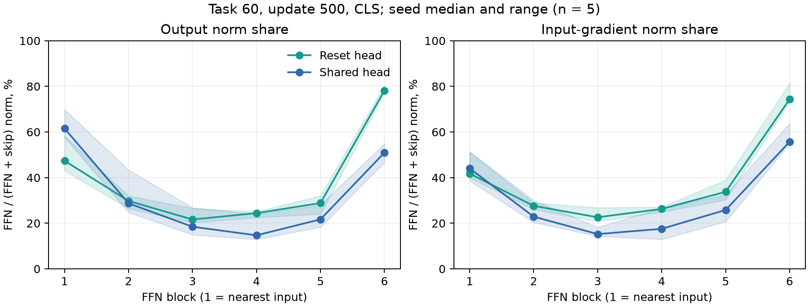

# 残差経路と FFN 経路の直接比率（1025、事後）

各 FFN を y = r + F(r) と書き、F は pre-LN と FFN を含める。出力比率は ‖F(r)‖ / (‖F(r)‖ + ‖r‖)。入力へ戻る勾配は g = ∂L/∂y と a = J_Fᵀg に分け、FFN 比率を ‖a‖ / (‖a‖ + ‖g‖) とする。**加算前のノルムの合計を 100% にした比率で、加算後の勾配や学習量の分割ではない。** FFN 出力自体には g が届くので、FFN に配られる誤差がこの割合になるわけでもない。

各画像の比率を checkpoint 内で中央値にし、さらに 5 seed の中央値・範囲を取る。以下は CLS。全 token の比率も CSV に保存した。task 60 / update 500 の最終 FFN の勾配比率は、共有 head 55.7%、reset head 74.4%。

| head | update | FFN6 の出力比率 | FFN6 の入力勾配比率（seed 範囲） | 勾配2経路のcos |
|---|---:|---:|---:|---:|
| R0L | 100 | 77.4% | 80.8%（79.3〜86.6%） | 0.077 |
| R0L | 500 | 78.2% | 74.4%（73.2〜81.4%） | 0.058 |
| SL | 100 | 48.0% | 55.3%（48.4〜61.2%） | 0.034 |
| SL | 500 | 50.9% | 55.7%（55.0〜63.7%） | 0.129 |

## 6 ブロックの比較

task 60 / update 500。FFN 経路の入力勾配比率の seed 中央値。

| FFN | reset head | shared head |
|---:|---:|---:|
| 1 | 41.7% | 44.0% |
| 2 | 27.6% | 22.9% |
| 3 | 22.6% | 15.2% |
| 4 | 26.3% | 17.5% |
| 5 | 33.8% | 25.8% |
| 6 | 74.4% | 55.7% |

中間 FFN では残差経路の比重が大きく、最終 FFN の比率は再び高い。この測定は「入力まで戻る勾配」を扱う。比率が小さくても FFN の parameter gradient が小さいとは限らない。絶対勾配が小さい学習済み状態でも比率は定義できるため、比率だけで沈降の強さを決めない。

補助の `parameter_gradients.csv` は課題全 250 画像の平均 CE に対する勾配で、各 FFN の norm2 + mlp の squared norm が全 parameter の squared norm に占める比率と、parameter 当たり RMS を記録する。parameterization に依存し、上の経路比率とは異なる。

検算: 80/80 保存状態。経路勾配の和と autograd の入力勾配の最大絶対差 0。元の記録との CE 最大絶対差 2.54e-08。最終 FFN の patch token 勾配は全件 0。学習更新なし。
