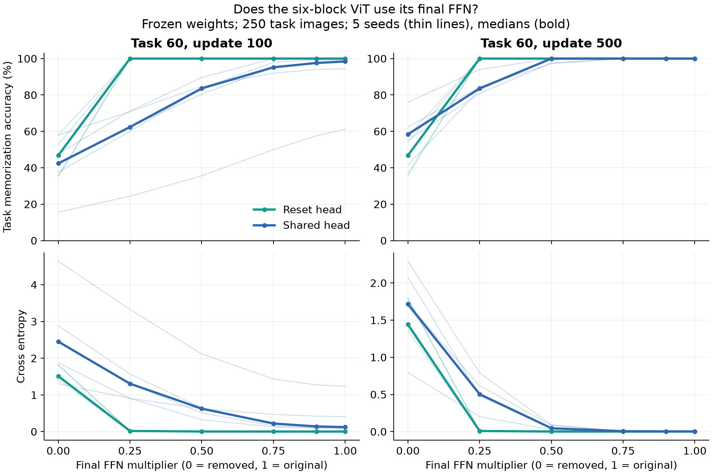
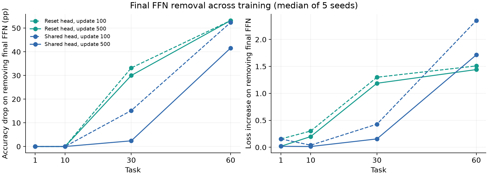

# ViT 最終 FFN 除去の事後検証（1025）

**最終タスクでは最終 FFN が予測に大きく寄与しており、実質的に未使用という仮説に反する。** task 60 / update 500 の最終 FFN 除去は、SL で全 5 seed の精度を 24.0〜58.4 pp、R0L で 42.4〜64.4 pp 下げた。検査した前半の時点では除去後も精度中央値を維持しており、依存はむしろ後期に大きくなった。ただし、これは現在の勾配や更新量の大きさを証明するものではない。

6 ブロック・ReLU・LayerNorm ありの保存状態を使用。全 5 seed、task 1/10/30/60、update 100/500、head reset/shared の 80 状態。元の課題内 250 画像と iid ラベルで評価した記憶精度であり、一般化精度ではない。重みは固定し、再学習していない。

## task 60 の最終 FFN 除去

各値は seed 中央値。精度低下は seed 内の差を取ってから中央値にする。括弧は seed 間の最小〜最大。

| head | update | 元の精度 | FFN 除去後 | 精度低下 pp（範囲） | CE 元 → 除去 | logit 相対変化 |
|---|---:|---:|---:|---:|---:|---:|
| R0L | 100 | 100.0% | 46.8% | 53.2（42.0〜64.8） | 0.00274 → 1.51324 | 89.3% |
| R0L | 500 | 100.0% | 46.8% | 53.2（42.4〜64.4） | 0.00072 → 1.44266 | 89.0% |
| SL | 100 | 98.4% | 42.4% | 52.4（36.4〜61.6） | 0.12387 → 2.45233 | 100.0% |
| SL | 500 | 100.0% | 58.4% | 41.6（24.0〜58.4） | 0.00296 → 1.71670 | 87.9% |

## タスク終了時の最終 FFN 除去効果の推移

seed 中央値。各 task の元の精度中央値はいずれも 100%。

| task | reset: 除去後の精度 | shared: 除去後の精度 |
|---:|---:|---:|
| 1 | 100.0% | 100.0% |
| 10 | 100.0% | 100.0% |
| 30 | 70.0% | 97.6% |
| 60 | 46.8% | 58.4% |

## 最終ブロック全体を除去する補助対照

FFN 単独除去とは別に、最後の attention と FFN の両方を恒等写像に置き換えた。task 60 / update 500 の精度中央値:

- R0L: 21.2%（18.8〜27.2%）。
- SL: 29.2%（23.6〜36.0%）。

## 検算

- 80/80 checkpoint の SHA256 と元の source hashes が一致。手動 forward と通常 forward、hook での除去と手動介入を照合した。
- 元の intask 記録と記憶精度は全件一致。平均 CE の最大絶対差は 2.3e-08。
- task 1 の両 head 条件は全 seed・全介入で一致。parameter の in-place version は全件不変。
- alpha = 0 の損失と logit 差がある場合、精度が維持されても FFN が未使用とは判定しない。

## 解釈の範囲

除去の影響は、その保存状態・課題内画像での予測への寄与を表す。最終 FFN が過去の学習で必要だったか、今後の学習に必要か、勾配がどの程度届くか、Adam の更新量、沈降の原因はこの介入だけから決まらない。最終 LN は元のままであり、FFN 除去による再正規化の影響も介入効果に含む。

生の example logits とラベル、画像ハッシュ、凍結ソースは `/home/issan/Projects/obsidian-research-data/vit_ffn_ablation_1025/`。使用 checkpoint は `checkpoint_provenance.json` の元の tar と member、SHA256 で特定する。
