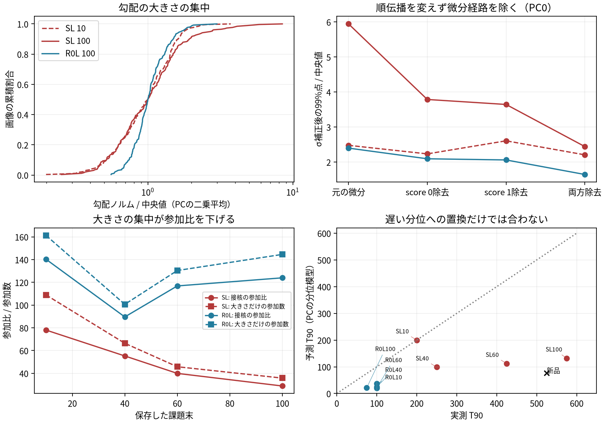
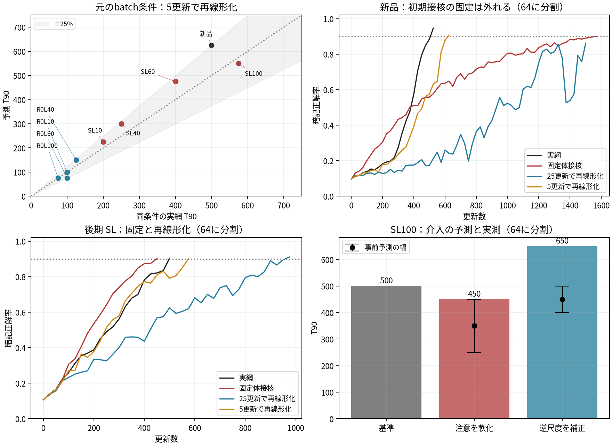

# SL の体の速さが新品並みに戻る理由 — Codex の解析

2026-10-28T15:28:25.383667+09:00。最終版。未導出の点も明記した。

seed 10252010 の保存状態からの事後解析。
予測と途中の判断は生データ側の `PROGRESS.md` に時刻付きで残した。

## 結論と限界

SL 後期の過剰な勾配の裾には、最終 LN の逆尺度と、飽和した注意の score 経路が効いていた。
後期 SL の注意では、多くの query がほぼ単一の候補を選んでいた。
飽和した softmax では、候補が接近した query に微分が残る。
この微分経路を除く診断で、上流の勾配の裾が縮んだ。
最初の block では CLS 以外の query がこの勾配を主に運ぶ。

head の成長を残した体の線形化と、元座標の Adam により、訓練済み状態の T90 の時間尺度を再現できた。
予測値へ合わせた係数は使わなかった。
初期の体の接核を固定する模型は新品では大きく外れた。
展開点の更新間隔は、粗い設定の失敗を記録した後に短くした。
共有 head から注意の飽和へ至る長期の形成過程は、即時の担い手とは区別する。
その長期の形成過程は、今回の測定だけでは導けていない。
課題10のSL保存状態では、共有headが実効query-keyノルムの形成を強める局所効果を確認した。
課題100のSL保存状態では、同じ量的予測を満たさなかった。


元のbatch条件での平均絶対相対誤差は 14.0% だった。
最大絶対相対誤差は 25.0% だった。
ただし新品と後期SLの細かな順序は逆になった。

## Q1: 何が画像間の勾配の裾を作るか

### 厳密な分解

特徴を h_m、読む方向を u、体のパラメータを θ とする。
方向勾配は g_m = ∂(uᵀh_m)/∂θ である。
重複しないパラメータ群なら、‖g_m‖² = Σ_p ‖g_mp‖² である。

最終 LN の入力を x、中心化行列を C = I − 11ᵀ/d とする。
σ = √(‖Cx‖²/d + ε)、q = Cx/σ、Γ = diag(γ) と置く。
列ベクトルの逆伝播は δ = (C − qqᵀ/d)Γu/σ である。
γ の掛け算と射影の順序は交換できない。
ε が正なので括弧は厳密な直交射影ではない。
ε を無視した極限で直交射影になる。

最終 LN より前の Jacobian を J_x とする。
δ̂ を δ の単位方向とすると、次の積は厳密である。

‖g_up‖ = σ⁻¹ · ‖(C − qqᵀ/d)Γu‖ · ‖J_xᵀδ̂‖。

因子は逆尺度、接方向への生存量、上流の方向別増幅である。
LN affine の勾配は ∂s/∂γ = u⊙q、∂s/∂β = u である。
全勾配にはこの二つの二乗ノルムを加える。

pre-LN の残差の逆伝播は δ_in = δ_out + J_branchᵀδ_out である。
各 LN の逆尺度を単純に掛けるだけの模型は、この和を落としている。

### 保存状態での照合

固定の画像集合で、既存測定と同じ rand と PC の方向を使った。
PC は特徴の主成分であり、実際の head の張る空間と同一とは限らない。
以下の群別表は PC 方向の勾配を二乗平均してから集計した。

| SL100 のパラメータ群 | 全画像の trace の割合 | 勾配上位12枚内の割合 |
|---|---:|---:|
| patch | 0.412 | 0.584 |
| block0 fc1 | 0.239 | 0.088 |
| block0 qkv | 0.154 | 0.162 |
| block0 attention proj | 0.085 | 0.038 |

上位画像は勾配二乗平均の最大側を選んだ。
固定の部分集合のおよそ5%に当たる。
最終 norm の affine は主な担い手ではなかった。

log‖g_up‖ の分散を、各 log 因子と合計の共分散へ分けた。
共分散比の和は恒等的に一になる。
この値は因果寄与率ではない。

| SL100 の因子 | PCの共分散比 | randの共分散比 |
|---|---:|---:|
| 最終 LN の逆尺度 | 0.547 | 0.459 |
| 最終 LN の角度による生存量 | 0.009 | 0.0002 |
| 上流の方向別増幅 | 0.444 | 0.541 |

| 状態 | 最終σの中央値 | σの90%点 / 10%点 | PC勾配の99%点 / 中央値 |
|---|---:|---:|---:|
| SL10 | 4.46 | 2.85 | 2.29 |
| SL100 | 74.03 | 4.36 | 4.95 |
| R0L10 | 2.41 | 1.87 | 2.01 |
| R0L100 | 4.22 | 1.90 | 2.03 |

この表の広がりの比は固定の部分集合での測定値である。
終点の分位比と、その比の課題間の伸び率は同じではない。

### 注意の score 経路

a = softmax(s) を注意重み、V を value、r を出力に戻る勾配とする。
score に戻る勾配は δs = (diag(a) − aaᵀ)V r である。
成分表示は δs_j = a_j(v_j − Σ_k a_kv_k)ᵀr となる。
候補が一つに決まるとこの微分は小さくなる。
候補が接近した画像では微分が残る。
query と key への逆伝播にはさらに互いのベクトルが掛かる。

順伝播を変えず、score から query と key へ戻る経路だけを除いた。
value と残差と FFN の経路は残した。
この操作は学習の介入ではなく、保存状態の微分経路の診断である。

| 保存状態 | σ補正後の裾 rand0: 元→除去 | σ補正後の裾 pc0: 元→除去 | pc0の大きさだけの参加数: 元→除去 |
|---|---:|---:|---:|
| SL10 | 2.62→1.91 | 2.48→2.21 | 138.6→142.7 |
| SL100 | 5.21→2.65 | 5.95→2.44 | 28.7→92.5 |
| R0L100 | 2.47→1.53 | 2.40→1.65 | 131.1→205.8 |

裾は画像間の99%点を中央値で割った量である。
この表は各種類の最初の方向だけを用いる。
前の PC 二乗平均の表とは集計が異なる。
SL100 の σ補正後の log 分散の減少は過半には達しなかった。
上位分位の裾と、分散全体の説明は区別する。

裾が縮むと参加比も回復するという次の予測は外れた。
経路除去では方向共有も変わるためである。
以下の Gram は検証済みの座標近似で測った。

| SL100 pc0 | 元 | score経路を両方除去 |
|---|---:|---:|
| 大きさだけの参加数 | 28.7 | 92.5 |
| 接核の参加比 | 24.5 | 25.5 |
| 向きだけの参加比 | 82.4 | 45.6 |

裾の縮小だけを接核全体の回復とは呼べない。

| SL100 pc0 | 元 | score経路を両方除去 |
|---|---:|---:|
| σ補正後の log ノルム分散 | 0.450 | 0.257 |

### CLS 以外の token と score の尺度

最初の block の CLS 入力は全画像で同一である。
その query について a_h = diag(γ)W_k,hᵀq_cls,h/√d_head と置く。
score の token 間標準偏差は ‖a_h‖·std_j(â_hᵀq_mj) に厳密に分かれる。
q_mj は affine 前の正規化 token である。
一般の query にも query ごとの同じ式が成り立つ。

| 課題10→100、CLS query | 実効 query-key ノルムの比 | token射影の広がりの比 | score尺度の比 |
|---|---:|---:|---:|
| SL | 2.826 | 1.018 | 2.877 |
| R0L | 1.119 | 0.929 | 1.039 |

ただし後期 SL の裾を CLS query だけへ帰着させる読みは外れた。
全 query の逆伝播重みで測ると、他 token が担い手だった。

| 状態 | block0 score勾配のCLS割合 | 全queryの飽和率 | 逆伝播重みつき実効ノルム | 逆伝播重みつきscore標準偏差 |
|---|---:|---:|---:|---:|
| SL10 | 0.404 | 0.524 | 6.25 | 24.04 |
| SL100 | 0.005 | 0.888 | 27.58 | 132.95 |
| R0L100 | 0.787 | 0.304 | 3.31 | 7.66 |

飽和は最大注意重みが 0.99 を超えることとした。
重みは softmax に入る逆伝播ベクトルの二乗ノルムである。
実効ノルムと score 標準偏差は query 間の重みつき幾何平均から求めた。
表は画像ごとの量の中央値である。
qkv 全体の重みノルムは R0L でも増していた。
重みノルム全体だけでは SL 特有の飽和を説明できない。

ReLU の重みつきゲートが単なる開口数より常に強く相関するという予測は外れた。
SL100 の最終 FFN では、勾配との順位相関は開口数の方が強かった。
旧クラス平均からの距離と勾配の順位相関も、SL後期では弱くなった。
これらを単独の担い手とは判定しない。

FFN の入力を a_t、出力へ戻る勾配を r_t とする。
前活性への逆伝播は b_t = 1[z_t>0]⊙W₂ᵀr_t である。
ゼロ点では実装が選ぶ微分を用いた。
fc1 の重み勾配は Σ_t b_t a_tᵀ となる。
その二乗ノルムは Σ_tt′(b_tᵀb_t′)(a_tᵀa_t′) である。
単なる開口数だけでこの量は決まらない。
最後の FFN では CLS だけが残るので、入力ノルムと重みつきゲートへ分解できる。
最初の FFN では token 間の交差項を残す必要がある。

| block0 FFNの量 | SL10 | SL100 | R0L100 |
|---|---:|---:|---:|
| CLSの開口割合 | 0.266 | 0.628 | 0.099 |
| 他tokenの開口割合 | 0.329 | 0.349 | 0.141 |
| CLSの逆伝播重みつきゲート | 0.253 | 0.627 | 0.099 |
| 全tokenの逆伝播重みつきゲート | 0.251 | 0.054 | 0.104 |

後期 SL では CLS の開口から全体の応答を推定することもできなかった。
全tokenで見た方向依存の応答の低下は測った事実である。
その形成を共有 head から導いたわけではない。

| 中間LNのCLS入力σ | SL10 | SL100 | R0L100 |
|---|---:|---:|---:|
| block0 norm1 | 0.049 | 0.132 | 0.185 |
| block0 norm2 | 0.590 | 4.806 | 2.097 |
| block1 norm1 | 1.442 | 30.514 | 2.906 |
| block1 norm2 | 1.380 | 33.694 | 3.166 |

最初の norm1 の CLS の値は全画像で同じである。
それだけでは画像間の裾は作れない。
他tokenの尺度と、注意を通る逆伝播を含めた各LNの重みつき統計は生出力に保存した。

### 実効 query-key ベクトルをさらに分ける

最初の LN の affine 前の正規化 token を ξ とする。
query-key ベクトルは a(ξ)=Aξ+b と厳密に書ける。
A=ΓW_kᵀW_qΓ/√d_head、b=ΓW_kᵀ(W_qβ+b_q)/√d_head である。
head ごとの行列を別々に用いる。
key の bias は token 間の score の差には寄与しない。

以下は CLS を除く全 query の rms である。
前の逆伝播重みつき幾何平均とは集計が異なる。

| 状態 | query側のaffine重みノルム | key側のaffine重みノルム | AのFrobeniusノルム | 実効ベクトルのrms | 入力・biasによる比 |
|---|---:|---:|---:|---:|---:|
| SL10 | 4.411 | 4.351 | 0.844 | 3.120 | 3.698 |
| SL100 | 8.655 | 8.649 | 4.492 | 33.014 | 7.349 |
| R0L10 | 3.890 | 3.851 | 0.464 | 1.736 | 3.745 |
| R0L100 | 6.299 | 6.368 | 1.843 | 5.955 | 3.232 |

入力・biasによる比は、実効ベクトルのrmsをAのFrobeniusノルムで割った量である。
次に、初期と後期の作用素と正規化入力を入れ替えた。
置換の両順序における log 変化を平均した。
そのため二つの項の和は全 log 変化と厳密に一致する。

| 課題10→100 | 全log変化 | 作用素側のlog変化 | 入力側のlog変化 | 作用素側 / 全変化 |
|---|---:|---:|---:|---:|
| SL | 2.359 | 1.908 | 0.451 | 0.809 |
| R0L | 1.233 | 1.189 | 0.044 | 0.964 |

作用素側が増加の半分以上を説明するという事前予測は支持された。
これは保存状態の静的な分解である。
混合した部品から訓練の因果過程を推論しない。

### 飽和から集中への条件付き導出

二つの候補の符号付きの差を z、score 尺度を τ とする。
a = sigmoid(τz) のscore差τzに関する微分は a(1−a) = 1/[4cosh²(τz/2)] である。
微分の残る領域の幅は尺度の逆数になる。
z の密度が原点で正かつ連続であると仮定する。
value 差など他の因子がその領域で一定と仮定する。
b(z) = τ sigmoid′(τz) と置くと、漸近的に次が成り立つ。

E[b²] ≈ τρ(0)/6、E[b⁴] ≈ τ³ρ(0)/140。
N_norm/N ≈ 35ρ(0)/(9τ)。

| この漸近式の項目 | 仮定 | 格 |
|---|---|---|
| 競合 | 二つの候補で近似できる | 模型の仮定 |
| score差 | 原点で正かつ連続な密度を持つ | 模型の仮定 |
| 他の微分因子 | 接近領域で一定としてよい | 模型の仮定 |
| 参加数への置換 | 接近領域にも十分な画像数がある | 大標本近似 |
| 実際の接核への適用 | 他の経路と方向の共有を別に扱う | 追加条件 |

実モデルは多候補・多head・多経路なので、最後の係数は直接当てはめていない。
実モデルで検証したのは飽和の差と、score 経路を除いたときの裾の減少である。

### 参加比を下げる項

w_m = ‖g_m‖²/Σ_n‖g_n‖²、c_mn = cos(g_m,g_n) とする。
参加比には次の恒等式がある。

1/PR = Σ_mw_m² + Σ_{m≠n}w_mw_nc_mn²。

第1項は大きさの集中である。
第2項は重みつきの方向共有である。
N_norm = 1/Σ_mw_m² は大きさだけで決まる参加数である。

| 状態 | PCのPR | N_norm | 1/PRの対角項の割合 |
|---|---:|---:|---:|
| 新品 | 6.1 | 236.6 | 0.026 |
| SL10 | 78.0 | 108.9 | 0.730 |
| SL40 | 55.3 | 66.4 | 0.853 |
| SL60 | 39.9 | 45.8 | 0.885 |
| SL100 | 28.8 | 35.8 | 0.857 |
| R0L10 | 140.3 | 161.3 | 0.871 |
| R0L40 | 89.6 | 100.7 | 0.908 |
| R0L60 | 116.8 | 130.4 | 0.898 |
| R0L100 | 124.0 | 144.6 | 0.859 |

各方向で計算してから方向間で平均した。
新品の小さい参加比は主に方向共有で決まる。
訓練済み状態では主に大きさの集中で決まる。

## Q2: 接核と Adam から T90 を出す

### 平均を遅い分位へ替えるだけでは外れた

a_m² を方向に平均した勾配二乗ノルムとする。
独立・等方な画像勾配と共通の必要進度を仮定した。
s_m = a_m²/√mean(a²)、T90 = A Q90(1/s_m) と置いた。
A は SL10 の既存 T90 だけで較正した。

| 状態 | 既存実測 | rand分位模型 | PC分位模型 |
|---|---:|---:|---:|
| 新品 | 525 | 21 | 76 |
| SL10 | 200 | 200 | 200 |
| SL40 | 250 | 206 | 99 |
| SL60 | 425 | 234 | 112 |
| SL100 | 575 | 259 | 132 |
| R0L10 | 100 | 66 | 37 |
| R0L40 | 100 | 31 | 24 |
| R0L60 | 100 | 24 | 20 |
| R0L100 | 75 | 19 | 21 |

分位への置換は SL の減速を量的に説明しなかった。

### 体を線形化し、head と Adam を残す模型

h_i(θ₀+Δθ) ≈ h_i⁰ + J_i⁰Δθ と置く。
logit は z_i = W(h_i⁰+J_i⁰Δθ)+b とする。
W と b はゼロから育てる。
W と Δθ の積を残すので、head が育った後に体へ勾配が来る。
初期 logit 接核だけの固定では、この項が消えてしまう。

batch の誤差を e_i = softmax(z_i)−y_i とする。
∇_W L = |B|⁻¹Σ_i e_i h_iᵀ。
∇_Δθ L = |B|⁻¹Σ_i (J_i⁰)ᵀWᵀe_i。

正規化しない logit 接核のクラス間の block は、次の形になる。

K_ij = (h_iᵀh_j+1)I_class + WJ_i⁰(J_j⁰)ᵀWᵀ。

前の項は head と bias、後の項は体から来る。
この微分の式は模型内で厳密である。
初期のWがゼロなら後の項は消える。
J_i⁰を固定しても、Wとh_iが動くのでlogit接核全体は固定されない。
方向uで測ったGramは uᵀJ_i⁰(J_j⁰)ᵀu である。
少数のuだけでは、上のクラス間block全体を復元できない。

これらに元のパラメータ座標で Adam を適用する。
m_t = β₁m_{t−1}+(1−β₁)g_t。
v_t = β₂v_{t−1}+(1−β₂)g_t⊙g_t。
Δθ_{t+1} = Δθ_t−η m̂_t/(√v̂_t+ε_Adam)。

head も同じ再帰で更新する。
保存 Adam がある状態では moment と更新回数を引き継ぐ。
ない状態では空の Adam を使う。
現在の勾配がゼロでも、保存 moment があれば更新は残り得る。

JVP により全 Jacobian を暗黙に使った。
方向や座標の抽出は予測模型本体には使っていない。
T90 を合わせる係数もない。
必要な入力は h⁰、J⁰、保存 moment、ラベル、batch 順である。
これは参加比だけからの予測ではない。

| 模型の要素 | 格 | 仮定・範囲 |
|---|---|---|
| 群別ノルム・LN・softmaxの微分 | 厳密 | 実装のReLU微分を使う |
| 体の特徴 | 一次近似 | J_i⁰を固定する |
| headと体の結合 | 模型内で厳密 | WJ_i⁰Δθを残す |
| Adam | 模型内で厳密 | 元の全座標、同じmomentと係数 |
| T90 | 模型内で厳密 | 全画像の正解率を評価時刻ごとに判定 |
| 再線形化 | 区分的な一次近似 | 模型自身の重みで展開点を更新 |

### 予測値と実測値

実網も同じ batch と microbatch で回し直した。
各評価で全画像を使った。
新品は既存比較に合わせた課題の乱数ラベルを使った。

元のbatchを分割しない条件を主表とした。
Adamの保存がない状態では、その違いを既存実測から区別する。

| 状態 | 既存実測 | 同条件の実網128 | 5更新再線形化128 | 実網128からの相対差 |
|---|---:|---:|---:|---:|
| 新品（課題25） | 525 | 500 | 625 | +25.0% |
| SL10 | 200 | 200 | 225 | +12.5% |
| SL40 | 250 | 250 | 300 | +20.0% |
| SL60 | 425 | 400 | 475 | +18.8% |
| SL100 | 575 | 575 | 550 | -4.3% |
| R0L10 | 100 | 100 | 100 | +0.0% |
| R0L40 | 100 | 125 | 150 | +20.0% |
| R0L60 | 100 | 100 | 75 | -25.0% |
| R0L100 | 75 | 75 | 75 | +0.0% |

以下はbatchを分割した条件で、模型の固定と展開点更新を比較した表である。
実数の演算では同じ平均勾配になるが、浮動小数点の演算順序は異なる。
SL100で分割を外す検査は、事前の小差という予測を外れた。

| SL100の実網 | T90 |
|---|---:|
| batch128を64ずつに分割 | 500 |
| batch128を分割しない | 575 |
| 既存のcompileによる回し直し | 575 |

分割への感度は確認したが、compileとの差すべてを同定したわけではない。

| 状態 | 既存実測 | 同条件の実網 | 固定体接核の予測 | 25更新で再線形化 | 5更新で再線形化 |
|---|---:|---:|---:|---:|---:|
| 新品（課題25） | 525 | 525 | 1575 | >1500 | 625 |
| SL10 | 200 | 225 | 225 | — | 250 |
| SL40 | 250 | 250 | 300 | — | 275 |
| SL60 | 425 | 475 | 450 | — | 450 |
| SL100 | 575 | 500 | 450 | 975 | 575 |
| R0L10 | 100 | 100 | 75 | — | 100 |
| R0L40 | 100 | 125 | 150 | — | 150 |
| R0L60 | 100 | 100 | 75 | — | 100 |
| R0L100 | 75 | 75 | 75 | — | 75 |

| 照合 | 到達値のある状態数 | 平均絶対相対誤差 | 最大絶対相対誤差 | ±25%内 |
|---|---:|---:|---:|---:|
| 分割64・固定体接核・訓練済み | 8 | 13.2% | 25.0% | 8/8 |
| 分割64・再線形化5 | 9 | 8.9% | 20.0% | 9/9 |
| 分割なし128・再線形化5 | 9 | 14.0% | 25.0% | 9/9 |

R0L40 は Adam 保存がないので、同条件の回し直しと本走を区別する。
評価間隔より細かい時間の一致は主張しない。
新品で外れた固定模型は、都合のよい係数で補正しなかった。
展開点更新では、実網の途中状態を与えず、模型自身の予測した重みで接核を再計算した。
粗い更新間隔は新品で失敗した。
この失敗を確認した後、事前予測を追加して間隔を縮めた。
計算量は実網の回し直しと同程度以上であり、安価なスカラー予測器ではない。
この保存状態集合での照合であり、独立seedでの予測検証ではない。

### T90 は初回正解時刻の分位とは限らない

M_i(t) = z_i,y_i(t) − max_{c≠y_i}z_i,c(t) を margin とする。
T90 = min{t∈評価時刻: N⁻¹Σ_i1[M_i(t)>0]≥0.9} である。
同点では実装の argmax の規則を使う。
一度正解した画像が誤りへ戻ると、初回正解時刻の分位との等置は破れる。

| 固定接核模型 | T90 | 初回正解時刻の90%点 | 一度でも正解から誤りへ戻った割合 |
|---|---:|---:|---:|
| SL10 | 225 | 200 | 0.246 |
| SL100 | 450 | 375 | 0.534 |
| R0L100 | 75 | 50 | 0.066 |

このため数値模型は毎時刻の margin 分布から判定した。

### 参加比だけでは同定できない理由

全 logit の Jacobian を J_t とし、Adam の正規化行列を D_t とする。
z_{t+1} = z_t−ηJ_tD_tm̂_t+剰余 が一次展開である。
moment を展開すると J_tD_tJ_sᵀ という時刻間の接核が現れる。
ReLU のゲートが変わる区間では滑らかな二階剰余の評価も使えない。

保存時点のmomentをm₀とv₀、そこからの更新回数をtとする。
m_t = β₁^t m₀ + (1−β₁)Σ_{s=1}^t β₁^{t−s}g_s である。
v_t = β₂^t v₀ + (1−β₂)Σ_{s=1}^t β₂^{t−s}g_s⊙g_s である。
保存された更新回数を含む分母でbias correctionを行う。
g_s=J_{B_s,s}ᵀe_s/|B_s|を代入すると、過去batchとの時刻間接核が得られる。
したがって単一時点の固有値だけではこの再帰は閉じない。
数値模型ではlogitを双線形式から直接計算する。
そのため離散的なheadと体の更新の積を、このlogitの一次展開で捨ててはいない。

Gram G=JJᵀ はパラメータの直交回転に不変である。
座標ごとの Adam はその回転に不変ではない。
diag(1,2) とその右側を直交回転した Jacobian は同じ G を持つ。
同じ残差でも最初の符号更新による画像の進みは異なる。
具体的な反例は `adam_same_gram_counterexample.json` に保存した。
同じ参加比から一意の T90 を導くことはできない。

画像ごとの勾配を固定し、重複なしの一様 batch を単独で抽出する模型を考える。
各座標に E_B[g_B²]=cE_i[g_i²]+(1−c)(E_i[g_i])² が成り立つ。
c=(N−B)/(B(N−1)) は有限母集団の係数である。
少数の画像が第1項を支配すると、他の画像の正規化後の更新も縮み得る。
ただし方向の共有、ラベル、座標ごとの偏り、時間平均は消せない。
実際のepoch内の履歴に条件づけた勾配分布を、この単独抽出と等置してはいない。
定数方向uの勾配の裾は、画像ごとに異なるWᵀe_iを通る実際の損失勾配の裾と同一ではない。
T90模型はこの方向依存を残して計算する。
模型の時間尺度の一致だけから、裾が減速の単独原因だとは結論しない。

## Q3: 新品より速い体と、新品へ戻る体

headだけの接核は、クラスごとに K_head,ij=h_iᵀh_j+1 である。
画像方向の中心化行列を P=I−11ᵀ/N とすると、P K_head P=(PH)(PH)ᵀ となる。
H は画像を行に並べた特徴行列である。
共通の特徴成分は、画像を識別するこの中心化した接核には寄与しない。
全画像の特徴が同一なら、headだけでは異なる乱数ラベルを暗記できない。
体のJacobianまで全画像で同一なら、固定体接核模型もこの同一性を破れない。
これらは同一性を仮定した極限での厳密な主張である。
実際の新品の特徴やJacobianが完全に同一だとは仮定しない。

新品の低い参加比は、訓練済み SL の低い参加比と異なる項で決まる。
前者は方向共有、後者は大きさの集中である。
固定体接核模型が訓練済み状態の速さを捉えることは、既に分化した局所応答が利用できることを支持する。
新品の所要時間を再現するには、初期接核を保つ近似では不足した。
headをゼロにした新品の最初の更新では、体の現在の勾配は厳密にゼロである。
したがって最初の一更新で体の対称が破れるという記述は、そのままでは成立しない。
新品のどの時点で接核が変わるかを途中状態で検査した。
途中測定では、最初の評価でも方向の参加比は増えなかった。
初期の対称がすぐに破れるという事前予測は外れた。
R0L の細かな加速と評価間隔内の差は、模型がすべて再現したとは主張しない。

Adamでも、Jacobianの尺度の増加が常に相殺されるわけではない。
ある更新で体のJacobianと全moment履歴が同じ正の倍率αで伸びる場合を考える。
ε_Adamを無視すると、mがα倍、vがα²倍なのでパラメータの歩幅は変わらない。
しかし特徴の歩幅JΔθはα倍になる。
保存状態の差はこの一様倍率だけではない。
この導出だけからR0LのT90の数値を決めてはいない。
R0Lの加速の照合には、特徴、全方向の応答、head、保存momentを残した数値模型を用いた。


| 速度比の比較（分割なし128） | 同条件実網 | 予測 |
|---|---:|---:|
| 新品 / SL10 | 2.50 | 2.78 |
| SL100 / SL10 | 2.88 | 2.44 |
| SL100 / 新品 | 1.15 | 0.88 |
| R0L10 / R0L100 | 1.33 | 1.33 |

時間尺度の回復は近似できたが、新品との細かな順序までは再現していない。
新品は課題25の一つを照合した。
すべての課題の新品baselineを再計算したわけではない。

## Q4 と形成過程の対照

予測を PROGRESS.md に書いてから短い回し直しを行った。
注意の温度変更と、最終 LN の逆伝播の尺度補正は別の介入である。
後者は同じ重みでの forward を変えず、body へ戻る勾配に画像ごとの尺度を掛ける。
最終LNのaffineパラメータの勾配にも、この尺度が掛かる。
これを通常の元損失の勾配降下と同一とは呼ばない。

| SL100 の条件 | 事前のT90予測 | 実測T90 |
|---|---:|---:|
| head0 基準 | — | 500 |
| block0 scoreを温度で軟化 | 250〜450 | 450 |
| 最終LNの逆尺度を逆伝播で補正 | 400〜500 | 650 |

注意の score を割る介入は、予測の遅い端で短縮した。
大幅な救済ではなかった。
最終 LN の逆尺度を補正する介入は、予測と逆に遅くした。
裾の小ささだけを体の速さの十分条件にはできない。
特定の逆伝播介入の失敗から、σの関与がないとも結論しない。

| 介入 | 定義 |
|---|---|
| 注意軟化 | block0のscoreを4で割る。順伝播も変わる |
| 逆尺度補正 | body側の逆伝播にσ/初期中央値を掛ける。倍率は0.1〜10へ制限 |


### 共有 head と head0 の一課題内の形成対照

同じ SL の保存状態から、同じ次課題を同じ予算だけ回した。
この対照は課題途中で止めた短い回し直しである。
元の head を残すかゼロにするかだけを変えた。
主判定は CLS 以外の query の実効ノルムとした。
後期での主判定が未達だった後、初期でも同じ時間幅を検査した。
初期の追加検査も、計算前に別の量的予測を記録した。


SL100からの対照。

| 更新 | 共有: 他tokenの実効ノルム | head0: 他tokenの実効ノルム | 共有: 最終σ中央値 | head0: 最終σ中央値 |
|---|---:|---:|---:|---:|
| 0 | 26.516 | 26.516 | 73.957 | 73.957 |
| 25 | 27.007 | 26.532 | 341.567 | 73.287 |
| 100 | 27.013 | 26.515 | 425.489 | 82.284 |
| 500 | 27.081 | 27.000 | 324.893 | 74.260 |
| 1000 | 27.234 | 27.283 | 130.884 | 65.359 |
| 1500 | 27.358 | 27.286 | 75.504 | 65.451 |

| 主判定 | 事前閾値 | 測定値 | 判定 |
|---|---:|---:|---|
| 他tokenの実効ノルムの終点共有/head0比 | >1.005 | 1.0026 | 未達 |

SL10からの対照。

| 更新 | 共有: 他tokenの実効ノルム | head0: 他tokenの実効ノルム | 共有: 最終σ中央値 | head0: 最終σ中央値 |
|---|---:|---:|---:|---:|
| 0 | 2.136 | 2.136 | 4.462 | 4.462 |
| 25 | 2.134 | 2.126 | 10.700 | 4.429 |
| 100 | 2.151 | 2.183 | 11.905 | 3.344 |
| 500 | 2.456 | 2.202 | 1.727 | 3.153 |
| 1000 | 2.441 | 2.203 | 2.962 | 3.181 |
| 1500 | 2.442 | 2.203 | 3.142 | 3.226 |

| 主判定 | 事前閾値 | 測定値 | 判定 |
|---|---:|---:|---|
| 他tokenの実効ノルムの終点共有/head0比 | >1.01 | 1.1082 | 支持 |

初期SLではheadの共有が実効query-keyノルムの形成を強めた。
後期SLでは事前の量的基準を満たさなかった。
この局所対照から、全課題を通じた形成過程を同定することはできない。
headを残す操作は、装填時の押しと当てはめの尾の長さを同時に変える。
両者の寄与はこの対照では分離していない。


### 実網の途中状態で接核を測り直す

以下の Gram は座標抽出による近似である。
既存の厳密 Gram との事前照合を通した設定を用いた。
方向は各状態での PC0 と固定の rand0 である。

| 起点 | 更新 | rand0参加比 | rand0の向きだけ | PC0参加比 | PC0の向きだけ |
|---|---:|---:|---:|---:|---:|
| 新品 | 0 | 6.1 | 6.2 | 6.4 | 6.8 |
| 新品 | 25 | 5.5 | 4.8 | 2.3 | 5.7 |
| 新品 | 100 | 6.4 | 6.0 | 4.3 | 7.1 |
| 新品 | 500 | 33.5 | 39.0 | 47.4 | 68.9 |
| SL100 | 0 | 14.6 | 91.9 | 24.5 | 82.4 |
| SL100 | 25 | 20.0 | 99.8 | 45.8 | 84.3 |
| SL100 | 100 | 5.9 | 114.4 | 11.1 | 96.7 |
| SL100 | 500 | 40.1 | 136.7 | 51.7 | 110.2 |

途中状態の参加比の変化は単調でなかった。
これは測った事実であり、階数だけの時間発展式を得たわけではない。

## 事前予測の照合一覧

基準は計算前に PROGRESS.md へ書いた。
追加検査の順序と変更理由も同じ記録に残した。

| ID | 事前基準 | 測定または導出 | 判定 |
|---|---|---|---|
| P1 | 残るlog分散の過半を少数の経路で説明 | score経路の両方除去では43% | 未達 |
| P2 | 上位画像の勾配を最終norm以外の1群が過半担う | patchが58% | 支持 |
| P3 | 重みつきゲートの相関が開口数より0.1以上強い | 最終FFNでは絶対値0.305対0.404 | 外れ |
| P4 | 逆伝播恒等式の誤差<1e-4 | 最大7.7e-7 | 支持 |
| P5 | 遅い分位でSL100/10の予測時間比≥2 | rand 1.30、PC 0.66 | 外れ |
| P6 | 同じ分位模型は新品を速すぎると予測 | rand 21、PC 76、実測525 | 支持 |
| P7 | headゼロの初期logit接核に体は現れない | 現在のbody勾配はゼロ。保存momentは別 | 厳密 |
| P8 | score経路の除去でSL100のσ補正後の裾<3 | rand0 2.65、PC0 2.44 | 支持 |
| P9 | 固定体接核が指定した訓練済み3状態で誤差50%以内 | 指定3状態で範囲内。新品は大きく外れた | 支持（範囲限定） |
| P10 | CLS score尺度の増加の過半は実効ノルム | SLのlog増加の98% | 支持（CLS限定） |
| P11 | 再線形化25で新品450〜650、SL100 500〜650 | 新品>1500、SL100 975 | 外れ |
| P12 | 新品25更新の方向参加比は初期の倍以上 | rand0 6.2→4.8、PC0 6.8→5.7 | 外れ |
| P13 | SL100の形成対照の終点比>1.005 | 共有/head0=1.0026 | 未達 |
| P14 | 注意軟化でT90 250〜450 | 450、基準500 | 支持（遅い端） |
| P15 | 最終LN逆尺度補正でT90 400〜500 | 650、基準500 | 逆の結果 |
| P16 | 再線形化5で新品とSL100は実網の±25% | 625対525、575対500 | 支持 |
| P17 | score除去でSL100 PC0の参加比≥50 | 近似参加比25.5 | 外れ |
| P18 | 64分割の全9状態が±25%以内 | 9/9状態、最大誤差20.0% | 支持 |
| P19 | SLの実効ノルムのlog増加の過半は作用素側 | 作用素側の比=0.809 | 支持 |
| P20 | SL10の形成対照の終点比>1.01 | 共有/head0=1.1082 | 支持 |
| P21 | 分割なし128の全9状態が±25%以内 | 9/9状態、最大誤差25.0% | 支持 |
| 分割検査 | SL100の分割有無のT90差≤25 | 差75 | 外れ |

## 未導出の点と外れた予測

- 最終 LN の逆尺度だけの説明は不足した。
- ReLU の重みつき開口が常に単なる開口数よりよいという予測は外れた。
- score 経路の除去は上位分位の裾を縮めたが、補正後の log 分散の過半を除くという予測は満たさなかった。
- 平均を遅い分位へ替えるだけの T90 模型は外れた。
- 新品の初期体接核を固定する模型は外れた。
- 粗い再線形化の間隔も新品と後期SLで外れた。
- CLS の注意統計だけで後期 SL の勾配を説明する読みは外れた。
- score経路を除けば接核の参加比も大きく戻るという予測は外れた。
- 最終LNの逆尺度を補正すれば速くなるという予測は逆の結果になった。
- 同じbatchを分割する計算と分割しない計算の差が小さいという予測は外れた。
- 共有 head、切替の押し、長い当てはめの尾から、全課題を通じた注意の飽和を導く閉じた式はまだない。
- 最終LN入力σの画像間の分布が長期に形成される過程も、共有headから導けていない。
- 参加比から T90 を一意に求める式は、情報が不足するため一般には存在しない。

## 方法・資源・再現

全画像数、部分集合、方向の乱数は依頼の既存測定に合わせた。
微分診断は保存状態だけを用いた。
回し直しは保存状態から単一課題だけを扱った。
新しい課題列は訓練していない。
既存の script、結果、checkpoint は編集していない。
git 操作とプロセス停止と vault 書込はしていない。
小試行を起動した際に処理が短時間重複した一件は PROGRESS.md に記録した。
以後は終了コードを確認してから逐次実行した。

LN と残差の恒等式は autograd と一致した。
固定体接核模型も展開点で実網の勾配と一致した。
検証値は `verification_q1.json` と `verification_tangent.json` に保存した。
途中状態の Gram は座標抽出による近似なので、既存の厳密 Gram との検証結果を伴わせる。
T90 模型自体にはこの近似を使っていない。
初回の中途 checkpoint 保存の失敗は、非tensorの state を区別する修正で対応した。
失敗した回し直しは照合表に使っていない。


| 数値検証 | 最大誤差 |
|---|---:|
| LN・残差の逆伝播恒等式 | 7.7e-07 |
| 既存fp16保存ノルムとの相対差 | 0.110% |
| 展開点での模型勾配の相対L2差 | 8.6e-07 |
| query-key作用素の恒等式の相対L2差 | 3.4e-07 |
| 座標近似Gramの参加比の相対差 | 8.1% |
| 座標近似Gramの向きだけの参加比の相対差 | 13.4% |

座標近似は厳密値でも信頼区間でもない。
参加比と向きだけの参加比の精度は区別する。
検証した保存状態での誤差であり、新しい状態の誤差上限を保証するものではない。


| 最終監査 | 値 |
|---|---:|
| 入力の重みのhash照合 | 9件、変更0件 |
| 全回し直しの到達枚数との不一致 | 0件 |
| 最大のプロセスRSS | 1938 MiB |
| 最大のPyTorch GPU割当量 | 1347 MiB |

GPU割当量の値はCUDA contextや他の実行者の使用量を含まない。
本解析の実行はallocator上限を設定し、冒頭の小試行の重複以後は重い子プロセスの終了後に次を起動した。
入力照合と出力一覧は `audit.json` と `output_manifest.json` に保存した。
Adam入力と既存scriptの終了時hash、およびpackageの版は `provenance.json` に保存した。

再実行例:

```bash
nice -n 10 env PYTHONDONTWRITEBYTECODE=1 \
  PYTHONPATH=/home/issan/Projects/claude/wt/vit_long_1024 \
  VIT_LONG_PRODUCTION=production_2blk_rlfix.json \
  /home/issan/Projects/claude/proj_004_drift/.venv/bin/python \
  analysis/vit_long_1024/posthoc_2blk/codex_bodyrank_replay.py \
  SL 100 tangent --micro 128 --refresh 5 --steps 1500 --prefix NEW_UNIQUE_PREFIX
```

`actual` で実網、`tangent --refresh 0` で固定体接核の模型になる。
新品の比較では `SL 0` と `--next-task 25` を指定する。
出力済みの名前は再利用しない。

## 作成ファイル

結果文書はこのファイルである。
図は同じ results ディレクトリの `codex_bodyrank_*.png` にある。
script は `analysis/vit_long_1024/posthoc_2blk/codex_bodyrank_*.py` に限定した。
生出力、途中checkpoint、予測記録、入力SHA256、実行環境は次に置いた。

`/home/issan/Projects/obsidian-research-data/vit_long_1024_2blk_rlfix/posthoc_codex_bodyrank/`

| script | 役割 |
|---|---|
| codex_bodyrank_decompose.py | 群別・LN・ゲート・注意の微分分解 |
| codex_bodyrank_paths.py | 順伝播を保つ微分経路の除去 |
| codex_bodyrank_attention.py | score尺度の厳密分解と全queryの逆伝播統計 |
| codex_bodyrank_operator.py | query-key作用素と正規化入力の厳密な分解 |
| codex_bodyrank_replay.py | 実網、固定体接核、再線形化、短い介入 |
| codex_bodyrank_validate.py | 模型と実網の展開点での一致検査 |
| codex_bodyrank_kernel.py | 中途状態のGramの座標近似 |
| codex_bodyrank_summary.py | 分位模型とQ1集計 |
| codex_bodyrank_figures.py | Q1・T90模型・介入の図 |
| codex_bodyrank_report.py | 生出力から本文と照合表を作る |
| codex_bodyrank_finish.py | 事前に予測した最後の対照を逐次実行 |
| codex_bodyrank_audit.py | 入力hash・到達判定・資源・出力一覧の監査 |

## 原典で確認した主張

- [Xiong et al., ICML 2020](https://proceedings.mlr.press/v119/xiong20b.html): 初期化での pre-LN と post-LN の勾配尺度の違いを示す。学習後の画像間の裾の証明には用いない。
- [Kingma and Ba, Adam](https://arxiv.org/abs/1412.6980): 一次・二次モーメントと bias correction による座標ごとの更新を定義する。本解析はその更新を用いる。
- [Lewandowski et al.](https://arxiv.org/html/2312.00246v3): 課題切替時の曲率方向の減少を検査する。論文の有効階数指標と本解析の参加比は同一ではない。empirical Fisher を Hessian と等置する根拠には用いない。



