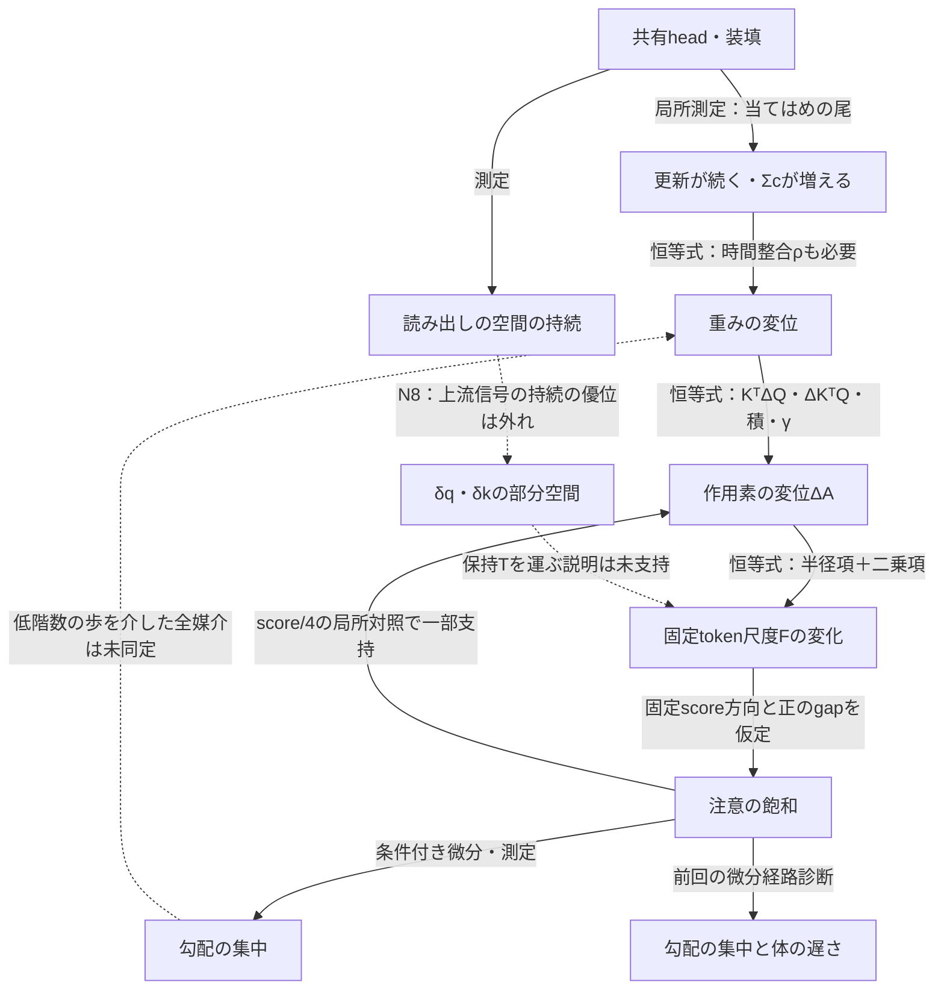
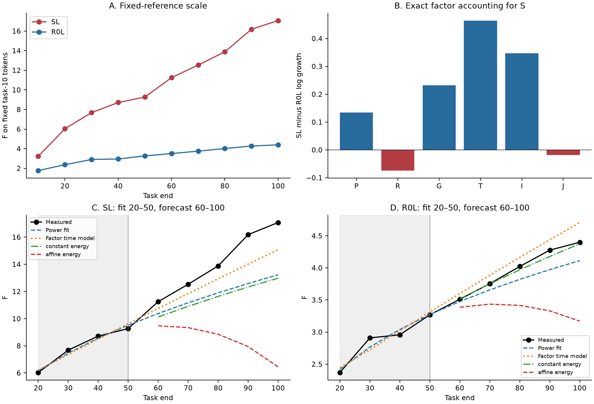
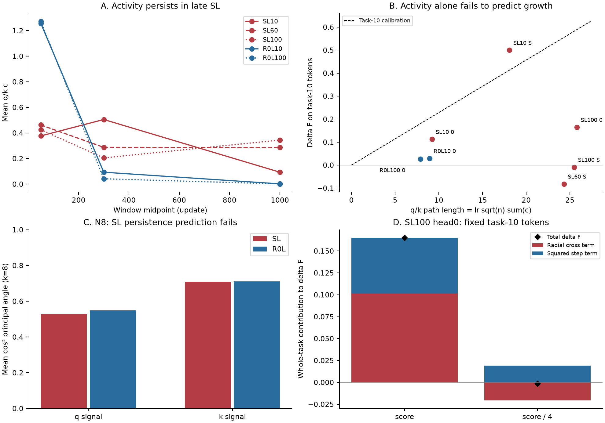

# block0 の q・k と注意の飽和の形成

2026-10-28T16:41:27+09:00。完成版。
seed 10252010 の保存状態と、保存済みの一課題1500更新の回し直しを解析した。
今回の再開後は保存状態の差分をCPUで再集計した。

## 答えと限界

SLの尺度成長の腕差は、主にtokenへの保持と入力の変化に現れた。
課題内では、損失の残る間にAdamの歩が続いた。
その歩を尺度へ変換するには、時間的な整合と作用素の向きの変化も要った。
「当てはめの更新数×c」だけから固定token尺度の増分を決める模型は外れた。
共有headから上流信号の部分空間の持続へ至る予測N8も外れた。
後期のhead0が元のheadと同じ向きを読むという予測N9は逆だった。
共有headから100課題の飽和形成を閉じた自律式で導く段は残った。

| 問い | 今回の答え | 格 |
|---|---|---|
| 尺度の成長を何へ分けられるか | 重みノルム積・積の整合・γ・token保持・入力変化・biasの六因子 | 恒等式と測定 |
| 課題内のいつ歩くか | 当てはめの間。後期SLでは501〜1500更新にも大きな歩が残る | 測定 |
| 歩数×cだけで尺度が伸びるか | 同じ比例係数では符号も量も再現しない | 反証 |
| 軟化で歩幅が減るか | SL100 head0のdAとdaは減る | 局所介入 |
| SLのδq・δk空間がより持続するか | 主判定の上位8方向では逆 | N8の外れ |
| 後期の新headが元headに近づくか | 100更新後の主角は初期より離れた | N9の外れ |

## 方法と尺度の定義

画像は固定した32枚を用いた。
全65queryと6headを等しく重み付けたrmsを主尺度にした。
前回の逆伝播重み付き幾何平均とは集計が異なる。
部分空間の測定は固定256枚を用いた。
全回し直しで保存Adamを使った。
温度1の7本とscore/4の1本を比較した。
各回し直しは同じ次課題の最初の1500更新である。
本走の一課題5000更新の終点とは区別する。

ξ_tはblock0のLN1のaffine前の正規化tokenとする。
Q=W_q、K=W_k、Γ=diag(γ)と置く。
A_h=ΓK_hᵀQ_hΓ/√64と置く。
b_h=ΓK_hᵀ(Q_hβ+b_q,h)/√64と置く。
keyのbiasはqueryごとのscoreへ同じ定数を足すのでsoftmaxでは消える。

F_t=rms‖A_tξ_10‖を長期の固定token尺度とする。
S_t=rms‖A_tξ_t+b_t‖を現在の入力での実効尺度とする。
保存済み回し直しのa_fixedは、開始状態s自身のξ_sで固定した量だった。
これをF^(s)と記す。
再開後のCPU解析で、回し直しも共通のξ_10で測るFを加えた。
各表で両者を区別する。

## Q1：六因子の分解

B_h=K_hᵀQ_h/√64と置く。
P=‖Q‖_F‖K‖_F/√64と置く。
R=‖B‖_F/P、G=‖A‖_F/‖B‖_Fと置く。
T=rms‖Aξ_10‖/‖A‖_Fと置く。
I=rms‖Aξ_t‖/rms‖Aξ_10‖と置く。
J=rms‖Aξ_t+b‖/rms‖Aξ_t‖と置く。

**S=P·R·G·T·I·J、F=P·R·G·T。**

この積は厳密である。
各log変化は足し算になる。
Rは静的な積KᵀQの整合である。
更新ΔWの整合とは同一ではない。
因子の分け方は一意ではない。
この分解の比率を因果寄与率とは呼ばない。

| 課題10→100 | SLのlog増加 | R0Lのlog増加 | SL−R0L |
| --- | --- | --- | --- |
| P：重みノルム積 | 1.4773 | 1.3429 | 0.1343 |
| R：積KᵀQの整合 | 0.3097 | 0.3839 | -0.0741 |
| G：γの実効作用 | -0.1146 | -0.3470 | 0.2324 |
| T：固定tokenへの保持 | -0.0080 | -0.4728 | 0.4647 |
| I：入力の変化 | 0.6469 | 0.3000 | 0.3469 |
| J：bias等の加算 | -0.0186 | -0.0002 | -0.0184 |
| 合計 | 2.2926 | 1.2069 | 1.0858 |

保持Tと入力Iの合計は腕差の74.75%だった。
γの実効作用の差は腕差の21.40%だった。
Rの成長率はR0Lの方が大きかった。
ΔAがSLで大きいことを、静的なRの成長率だけへ帰着させることはできない。

入力の静的入替では、patch埋め込みとpos＋CLSを二つの順序で入れ替えた。
両順序のlog変化を平均した。
これは順序に対称な代数分解である。

| 腕 | log I | patchのlog寄与 | pos＋CLSのlog寄与 |
| --- | --- | --- | --- |
| SL | 0.6469 | 0.6474 | -0.0005 |
| R0L | 0.3000 | 0.3087 | -0.0087 |

入力側の変化はほぼpatch埋め込みに現れた。

### 保存状態の軌跡

初期の毎課題と、それ以降の保存された全時点を示す。

**SL。**

| 課題末 | ‖Q‖ | ‖K‖ | γ平均 | ‖A‖ | F：固定ξ10 | S：現在ξ＋b | 飽和率 |
| --- | --- | --- | --- | --- | --- | --- | --- |
| 0 | 7.645 | 7.691 | 1.0000 | 0.376 | 0.154 | 0.158 | 0.0000 |
| 1 | 7.818 | 7.829 | 1.0013 | 0.413 | 0.227 | 0.263 | 0.0002 |
| 2 | 8.447 | 8.282 | 1.0044 | 0.683 | 0.640 | 0.782 | 0.0046 |
| 3 | 8.794 | 8.573 | 1.0049 | 0.867 | 0.893 | 1.100 | 0.0204 |
| 4 | 9.226 | 8.891 | 1.0065 | 1.100 | 1.248 | 1.682 | 0.0747 |
| 5 | 9.414 | 9.152 | 1.0074 | 1.254 | 1.467 | 1.985 | 0.1240 |
| 6 | 9.621 | 9.396 | 1.0077 | 1.391 | 1.584 | 2.156 | 0.1510 |
| 7 | 9.971 | 9.712 | 1.0086 | 1.584 | 1.902 | 2.433 | 0.1668 |
| 8 | 10.284 | 10.004 | 1.0090 | 1.748 | 2.395 | 2.755 | 0.1817 |
| 9 | 10.447 | 10.228 | 1.0089 | 1.866 | 2.740 | 3.087 | 0.1881 |
| 10 | 10.687 | 10.526 | 1.0099 | 2.066 | 3.233 | 3.299 | 0.2341 |
| 20 | 12.702 | 12.587 | 1.0115 | 3.435 | 6.034 | 7.502 | 0.4736 |
| 30 | 14.172 | 14.098 | 1.0051 | 4.395 | 7.685 | 9.914 | 0.4999 |
| 40 | 15.461 | 15.400 | 0.9965 | 5.277 | 8.718 | 11.042 | 0.5285 |
| 50 | 16.780 | 16.665 | 0.9883 | 6.305 | 9.271 | 12.799 | 0.5821 |
| 60 | 17.910 | 17.820 | 0.9768 | 7.112 | 11.254 | 17.466 | 0.6921 |
| 70 | 19.062 | 18.952 | 0.9661 | 7.929 | 12.533 | 19.383 | 0.7337 |
| 80 | 20.130 | 19.963 | 0.9583 | 8.826 | 13.884 | 24.336 | 0.7706 |
| 90 | 21.157 | 20.990 | 0.9522 | 9.867 | 16.184 | 31.028 | 0.8268 |
| 100 | 22.237 | 22.163 | 0.9469 | 11.004 | 17.076 | 32.658 | 0.8543 |

**R0L。**

| 課題末 | ‖Q‖ | ‖K‖ | γ平均 | ‖A‖ | F：固定ξ10 | S：現在ξ＋b | 飽和率 |
| --- | --- | --- | --- | --- | --- | --- | --- |
| 0 | 7.645 | 7.691 | 1.0000 | 0.376 | 0.154 | 0.158 | 0.0000 |
| 1 | 7.818 | 7.829 | 1.0013 | 0.413 | 0.215 | 0.263 | 0.0002 |
| 2 | 7.954 | 7.928 | 1.0006 | 0.457 | 0.291 | 0.347 | 0.0007 |
| 3 | 8.186 | 8.118 | 0.9994 | 0.548 | 0.452 | 0.495 | 0.0009 |
| 4 | 8.333 | 8.273 | 0.9975 | 0.609 | 0.603 | 0.638 | 0.0054 |
| 5 | 8.600 | 8.473 | 0.9967 | 0.716 | 0.832 | 0.892 | 0.0072 |
| 6 | 8.817 | 8.682 | 0.9951 | 0.809 | 0.999 | 1.043 | 0.0180 |
| 7 | 9.033 | 8.881 | 0.9937 | 0.900 | 1.241 | 1.309 | 0.0606 |
| 8 | 9.261 | 9.105 | 0.9921 | 0.998 | 1.426 | 1.446 | 0.0788 |
| 9 | 9.457 | 9.306 | 0.9904 | 1.070 | 1.563 | 1.610 | 0.1002 |
| 10 | 9.639 | 9.512 | 0.9884 | 1.136 | 1.776 | 1.782 | 0.1147 |
| 20 | 11.306 | 11.209 | 0.9673 | 1.782 | 2.369 | 2.285 | 0.1242 |
| 30 | 12.512 | 12.473 | 0.9442 | 2.222 | 2.909 | 2.847 | 0.1843 |
| 40 | 13.642 | 13.597 | 0.9229 | 2.596 | 2.958 | 2.894 | 0.1954 |
| 50 | 14.661 | 14.639 | 0.9032 | 2.977 | 3.269 | 3.597 | 0.2638 |
| 60 | 15.622 | 15.615 | 0.8853 | 3.357 | 3.511 | 3.919 | 0.2644 |
| 70 | 16.524 | 16.546 | 0.8669 | 3.760 | 3.754 | 4.596 | 0.2991 |
| 80 | 17.228 | 17.351 | 0.8492 | 4.022 | 4.022 | 4.611 | 0.3067 |
| 90 | 17.989 | 18.107 | 0.8321 | 4.294 | 4.277 | 5.124 | 0.3655 |
| 100 | 18.688 | 18.793 | 0.8155 | 4.513 | 4.399 | 5.956 | 0.3978 |

### 尺度対称性とγの符号

LNの出力をz=γ⊙ξ+βとする。
γ_jとβ_jをα_j倍し、qkvの第j列をα_jで割ればqkvの出力は変わらない。
従ってγ_j∂L/∂γ_j+β_j∂L/∂β_j=Σ_rW_rj∂L/∂W_rjが厳密に成り立つ。
和はvalueを含むqkv全体で取る。
これはγ単独の勾配の符号を固定しない。

Adamの正規化歩をu_γとすれば、Δ‖γ‖²=−2η〈γ,u_γ〉+η²‖u_γ‖²である。
従って縮小の条件は2〈γ,u_γ〉>η‖u_γ‖²である。
この条件の符号は実際の勾配とmomentを測って決める。
R0Lで縮む理由を尺度対称性だけから導いたとは主張しない。

| 開始状態 | Δγ平均：1500更新 | γの半径項：二乗ノルム | γの歩の二乗項 |
| --- | --- | --- | --- |
| SL10 共有 | 0.00105295 | 0.834966 | 0.000720487 |
| SL60 共有 | -0.00139677 | -1.02276 | 0.000933994 |
| SL100 共有 | -2.20875e-07 | 0.0101644 | 0.000847538 |
| R0L10 head0 | -0.00213174 | -1.59431 | 0.000691766 |
| R0L100 head0 | -0.00131345 | -0.822703 | 0.000725702 |

### q・kの積と更新の整合

生の逆伝播はδq_i=Σ_jδs_ij k_j/√64である。
生の重み勾配はΣ_iδq_i z_iᵀである。
座標別のAdamの割り算は、この生勾配の部分空間を一般には保たない。
勾配の集中だけからAdamの歩の階数は決まらない。
またδqの出力座標の空間とξの入力座標の空間は異なる。

γを固定した積の差には、KᵀΔQ、ΔKᵀQ、ΔKᵀΔQが全て入る。
γの変化は別の項になる。
今回の動的な整合の指標は‖KᵀΔQ‖/(‖K‖‖ΔQ‖)とした。
下見の‖KΔQᵀ‖/(‖K‖‖ΔQ‖)も生出力に残っている。
両者の行列の積の順序は異なる。

## Q2：成長は課題の中のいつ起きるか

c_qとc_kは、各更新のrms[mhat/(sqrt(vhat)+eps)]である。
下表のcは窓内での算術平均である。
損失は実際の学習batchの損失の平均である。
ΔFは共通ξ10での尺度増分である。
ΔF^(s)は開始状態のξ_sでの尺度増分である。

| 回し直し | 更新窓 | 損失 | c_q | c_k | ΔF：ξ10 | ΔF^(s)：開始ξ |
| --- | --- | --- | --- | --- | --- | --- |
| SL10 共有 | 1–100 | 2.68171 | 0.3931 | 0.3582 | 0.08112 | 0.08112 |
| SL10 共有 | 101–500 | 1.61902 | 0.5384 | 0.4646 | 0.37152 | 0.37152 |
| SL10 共有 | 501–1500 | 0.01904 | 0.0856 | 0.0994 | 0.04724 | 0.04724 |
| SL10 head0 | 1–100 | 2.14625 | 0.4855 | 0.4231 | -0.00144 | -0.00144 |
| SL10 head0 | 101–500 | 0.35016 | 0.3099 | 0.2976 | 0.12066 | 0.12066 |
| SL10 head0 | 501–1500 | 0.00292 | 0.0024 | 0.0022 | -0.00666 | -0.00666 |
| SL60 共有 | 1–100 | 3.57562 | 0.4562 | 0.4680 | -0.01245 | 0.33105 |
| SL60 共有 | 101–500 | 1.86579 | 0.2975 | 0.2761 | -0.03410 | 0.03550 |
| SL60 共有 | 501–1500 | 0.35009 | 0.2831 | 0.2875 | -0.03526 | -0.08003 |
| SL100 共有 | 1–100 | 3.77417 | 0.4209 | 0.4282 | -0.05180 | 0.30818 |
| SL100 共有 | 101–500 | 1.97803 | 0.2184 | 0.1845 | 0.02106 | -0.03403 |
| SL100 共有 | 501–1500 | 0.78709 | 0.3279 | 0.3572 | 0.02202 | 0.29506 |
| R0L10 head0 | 1–100 | 1.66122 | 1.2652 | 1.2479 | 0.02998 | 0.02998 |
| R0L10 head0 | 101–500 | 0.03186 | 0.0944 | 0.0918 | 0.00073 | 0.00073 |
| R0L10 head0 | 501–1500 | 0.00127 | 0.0021 | 0.0020 | -0.00096 | -0.00096 |
| R0L100 head0 | 1–100 | 1.27909 | 1.2568 | 1.2869 | 0.02675 | -0.01404 |
| R0L100 head0 | 101–500 | 0.00612 | 0.0371 | 0.0459 | 0.00214 | 0.01498 |
| R0L100 head0 | 501–1500 | 0.00060 | 0.0016 | 0.0016 | -0.00289 | -0.00287 |
| SL100 head0 | 1–100 | 2.24719 | 0.1187 | 0.1408 | 0.00563 | 0.01154 |
| SL100 head0 | 101–500 | 1.29740 | 0.4879 | 0.5220 | 0.18202 | 0.31034 |
| SL100 head0 | 501–1500 | 0.15367 | 0.2520 | 0.2618 | -0.02266 | 0.00940 |
| SL100 head0 score/4 | 1–100 | 2.24538 | 0.0692 | 0.0741 | -0.00861 | 0.00832 |
| SL100 head0 score/4 | 101–500 | 1.08224 | 0.3654 | 0.3829 | -0.06351 | 0.15090 |
| SL100 head0 score/4 | 501–1500 | 0.05258 | 0.0581 | 0.0650 | 0.07054 | 0.16993 |

後期SLでは、501〜1500更新にも損失とcが残った。
R0Lでは同じ窓のcは小さかった。
SL10の共有headではSの増加の79.1%が101〜500更新に入った。
同じ状態のhead0よりSは大きく伸びた。
これは共有headが一課題内の形成を強める局所対照である。
全課題の形成を同じ因果経路で説明したことにはならない。

### 独立な更新の酔歩では再現しない

Vをq・kの重みを並べたベクトルとする。
n=2×384²と置く。
c_t=√[(c_q,t²+c_k,t²)/2]と置く。
u_tをAdamの正規化歩とすれば、‖ΔV‖=η√n(Σ_tc_t)ρ_timeが成り立つ。
ρ_time=‖Σ_tu_t‖/Σ_t‖u_t‖は時間方向の整合である。
これは0から1までの量である。
ρ_timeを既知としたときの恒等式であり、cだけの予測式ではない。

‖ΔV‖²=η²Σ_t‖u_t‖²+2η²Σ_{r<t}〈u_r,u_t〉である。
SL10のqueryでは、実変位2.095に対し、独立更新の見積もりは0.554だった。
二乗の比は14.27だった。
短い時間内の交差項を捨てる近似は外れた。

| 温度1の7本 | Σc | 有効更新数 | 道のり η√nΣc | 実変位 ‖ΔV‖ | ρ_time | 501以降のΣc割合 | ΔF：ξ10 |
| --- | --- | --- | --- | --- | --- | --- | --- |
| SL10 共有 | 332.98 | 561.1 | 18.083 | 2.879 | 0.1592 | 0.280 | 0.49988 |
| SL10 head0 | 169.58 | 239.7 | 9.209 | 1.910 | 0.2074 | 0.014 | 0.11256 |
| SL60 共有 | 447.75 | 849.5 | 24.315 | 2.784 | 0.1145 | 0.640 | -0.08181 |
| SL100 共有 | 469.29 | 1062.3 | 25.485 | 2.583 | 0.1013 | 0.735 | -0.00872 |
| R0L10 head0 | 164.97 | 144.7 | 8.959 | 2.453 | 0.2738 | 0.012 | 0.02976 |
| R0L100 head0 | 145.55 | 113.5 | 7.904 | 2.381 | 0.3012 | 0.011 | 0.02600 |
| SL100 head0 | 475.15 | 1156.4 | 25.804 | 2.287 | 0.0886 | 0.546 | 0.16499 |

有効更新数は(Σc)²/Σc²と定義した。
cが一定のN更新だけ残る場合にはNに一致する。
損失の閾値で当てはめ区間を選んだ量ではない。

SL100共有の道のりはR0L100の約3.2倍だった。
その時間整合はR0L100の約3分の1だった。
総変位の差は小さくなった。
さらに総変位からΔFへの変換には作用素とtokenに対する向きが入る。
SL60共有とSL100共有では、共通ξ10のΔFは負だった。
「長い尾があるからFが必ず増える」という比例則は成り立たなかった。

### 同じ係数の比例則の検査

事後的な検査として、SL10共有とR0L10の2本で原点を通る比例係数を較正した。
この較正は後述のt20〜50による時間外挿とは別である。
重み変位に対する係数ρ_timeと、ΔFに対する係数をそれぞれ一つに固定した。

| 回し直し | 重み変位の実測 | 同一ρによる予測 | 相対差 | ΔF実測 | 道のり比例によるΔF予測 |
| --- | --- | --- | --- | --- | --- |
| SL10 共有 | 2.879 | 3.287 | 14.2% | 0.49988 | 0.41320 |
| SL10 head0 | 1.910 | 1.674 | -12.4% | 0.11256 | 0.21043 |
| SL60 共有 | 2.784 | 4.420 | 58.8% | -0.08181 | 0.55563 |
| SL100 共有 | 2.583 | 4.633 | 79.4% | -0.00872 | 0.58236 |
| R0L10 head0 | 2.453 | 1.629 | -33.6% | 0.02976 | 0.20471 |
| R0L100 head0 | 2.381 | 1.437 | -39.7% | 0.02600 | 0.18062 |
| SL100 head0 | 2.287 | 4.691 | 105.1% | 0.16499 | 0.58964 |

同じ係数による比例則は後期のΔFの符号も再現しなかった。
多い歩が形成へどう加わるかは、次の離散式で半径項と歩の二乗項に分ける必要がある。

### 一課題の変位と10課題の保存差分

一課題のquery変位が同じ大きさで、課題間で直交し、1500更新後の寄与を無視できる場合を仮定する。
このとき10課題の変位の予測は√10‖ΔQ_1500‖になる。
この三条件は保存状態だけからは保証されない。

| 開始状態 | ‖ΔQ_1500‖ | √10倍の見積もり | 保存区間 | 保存‖ΔQ‖ | 相対差 |
| --- | --- | --- | --- | --- | --- |
| SL10 共有 | 2.095 | 6.624 | 10→20 | 6.324 | 4.7% |
| SL60 共有 | 1.915 | 6.055 | 60→70 | 5.787 | 4.6% |
| SL100 共有 | 1.805 | 5.709 | 90→100 | 6.051 | -5.7% |
| R0L10 head0 | 1.785 | 5.645 | 10→20 | 5.723 | -1.4% |
| R0L100 head0 | 1.744 | 5.515 | 90→100 | 5.400 | 2.1% |

この局所的な換算は重みの変位の桁を再現した。
課題100開始の2本は次の10課題の保存が無いため、90→100を比較対象にした。
この2本を未来予測の成功とは数えない。
ηc√(座標数×更新数)だけの式で同じ数が出たわけではない。

## Q3：飽和から形成への輪の検査

### 飽和率と次の区間の歩幅：N7

飽和率は32枚の全queryでmax softmax>0.99となる割合とした。
課題tの飽和率と、t→t+10の保存差分を対応させた。

| 腕 | 飽和率 対 次の‖ΔA‖ | 飽和率 対 PR(ΔQ) | 飽和率 対 積の整合 | 標本区間数 |
| --- | --- | --- | --- | --- |
| SL | 1.000 | -0.933 | 0.817 | 9 |
| R0L | 0.967 | -0.933 | 0.950 | 9 |

| SL：開始課題 | 飽和率 | 次の10課題の‖ΔA‖ | PR(ΔQ) | ‖KᵀΔQ‖/(‖K‖‖ΔQ‖) |
| --- | --- | --- | --- | --- |
| 10 | 0.2341 | 2.486 | 56.99 | 0.4349 |
| 20 | 0.4736 | 2.677 | 56.97 | 0.4534 |
| 30 | 0.4999 | 2.856 | 52.60 | 0.4425 |
| 40 | 0.5285 | 3.128 | 50.10 | 0.4477 |
| 50 | 0.5821 | 3.297 | 47.05 | 0.4611 |
| 60 | 0.6921 | 3.324 | 49.55 | 0.4487 |
| 70 | 0.7337 | 3.812 | 42.32 | 0.4735 |
| 80 | 0.7706 | 3.956 | 43.13 | 0.4623 |
| 90 | 0.8268 | 4.120 | 42.86 | 0.4645 |

N7の符号の予測は支持された。
ただし両腕で飽和率は課題番号と同じ順位に並んだ。
課題番号の順位を回帰すると説明変数の残差が消える。
従って課題番号と分離した順位相関は定義できなかった。
この相関だけでは飽和→次の大きな歩という因果の向きを決められない。

### 注意を軟らかくする反実仮想：N6

SL100から同じhead0・保存Adam・次課題・1500更新で比較した。
score/4は順伝播と勾配の両方を変える介入である。
表のAとdaは温度で割る前の重みから求めた。

| 条件 | ‖ΔA‖ | da：開始ξ100 | da：共通ξ10 | ΔF^(100) | ΔF：共通ξ10 |
| --- | --- | --- | --- | --- | --- |
| 基準 | 1.11280 | 2.24622 | 1.47359 | 0.33128 | 0.16499 |
| score/4 | 0.67350 | 1.41525 | 0.80525 | 0.32915 | -0.00158 |

daはrms‖ΔAξ‖である。
尺度そのものの差ΔFとは異なる。
N6が予測した二つの変位は減った。
共通ξ10でのΔFも減った。
開始ξ100でのΔFはほぼ同じだった。
従って「変位の減少」と「全ての参照入力での尺度成長の減少」は区別する。

次は一課題全体の差分を一つの増分として分解した表である。
25更新ごとの分解を足した値とは配分が異なる。

| 参照 | 条件 | 半径交差項 | 歩の二乗項 | 内訳：平行二乗 | 内訳：真の直交二乗 | 合計ΔF |
| --- | --- | --- | --- | --- | --- | --- |
| 共通ξ10 | 基準 | 0.101710 | 0.063276 | 0.000304 | 0.062971 | 0.164986 |
| 共通ξ10 | score/4 | -0.020565 | 0.018987 | 0.000012 | 0.018975 | -0.001578 |
| 開始ξ100 | 基準 | 0.254305 | 0.076976 | 0.000997 | 0.075979 | 0.331281 |
| 開始ξ100 | score/4 | 0.298589 | 0.030558 | 0.001374 | 0.029184 | 0.329148 |

共通ξ10では、軟化した側の半径交差項は負になった。
開始ξ100では、軟化した側の正の半径交差項が二乗項の減少を補った。
この参照依存は今回の測定で見えた事実である。
温度介入は局所的な形成の一辺を支持した。
共有headから始まる長期の輪全体を証明したわけではない。

### 勾配の集中と歩の階数

token対の上位5%は画像ごとに選んだ。
その勾配二乗の和を全画像の勾配二乗の和で割った。
この指標はほぼ1に達した。
CLS queryなどへの集中も含むので、飽和による候補間の集中だけを取り出した量ではない。

| 対照 | 101〜500更新の上位5%割合 | 501〜1500更新の上位5%割合 | 101〜500の生query勾配PR | 1500更新のΔQのPR |
| --- | --- | --- | --- | --- |
| SL10 共有 | 0.9999910 | 0.9999898 | 12.83 | 48.43 |
| SL10 head0 | 0.9999797 | 0.9999784 | 16.48 | 46.96 |
| SL100 共有 | 1.0000000 | 1.0000000 | 4.87 | 41.83 |
| SL100 head0 | 1.0000000 | 1.0000000 | 5.25 | 36.54 |
| SL100 head0 score/4 | 1.0000000 | 1.0000000 | 4.88 | 40.79 |

上位5%割合は天井に近く、共有とhead0の差を識別する指標として弱かった。
生勾配のPRと累積Adam変位のPRは異なる。
SL100の軟化では累積ΔQのPRが増えた。
これだけから「飽和が低階数の歩を作り、その歩が拡大する」という全媒介は同定できない。

## Q4：腕差の根をめぐる外れ

### 上流信号の部分空間：N8

δqとδkを全headで連結した384次元で主成分を取った。
画像とtokenをプールし、共分散を中心化した。
比較量は上位8方向の主角のcos²の平均である。
課題10→20から90→100までの9組を平均した。
元課題のラベルと、全保存状態で共通の課題101ラベルを分けた。
画像ごとの信号を単位ノルムにした診断も併記する。

| 残差の条件 | 信号 | 重み | SL | R0L |
| --- | --- | --- | --- | --- |
| 元課題ラベル | q | 勾配エネルギー | 0.4998 | 0.5224 |
| 元課題ラベル | q | 画像ごと正規化 | 0.6159 | 0.6031 |
| 元課題ラベル | k | 勾配エネルギー | 0.7679 | 0.7755 |
| 元課題ラベル | k | 画像ごと正規化 | 0.7828 | 0.7718 |
| 共通ラベル | q | 勾配エネルギー | 0.5282 | 0.5481 |
| 共通ラベル | q | 画像ごと正規化 | 0.6115 | 0.6466 |
| 共通ラベル | k | 勾配エネルギー | 0.7085 | 0.7111 |
| 共通ラベル | k | 画像ごと正規化 | 0.7846 | 0.7844 |

主判定のエネルギー重みでは、q・kともSLがR0Lより小さかった。
N8は逆方向に外れた。
画像ごとの正規化でもSLが一貫して優位にはならなかった。
4方向と16方向の結果は生出力に保存した。
上位8方向という事前基準を別の次元へ差し替えない。

| q/k持続の順位相関 | SL | R0L |
| --- | --- | --- |
| 持続 対 保持Tのlog変化 | -0.117 | 0.233 |
| 持続 対 KᵀΔQの整合 | -0.533 | -0.333 |
| 持続 対 ‖ΔA‖ | -0.567 | -0.250 |

持続が保持Tと整合の差を運ぶという予測も数値から支持されなかった。
headの中心化行空間の隣接保存状態間のcos²は、SLが0.6968、R0Lが0.4856だった。
読み出し側の持続が、そのままδq・δkの持続へ伝わるわけではなかった。
逆伝播には状態と画像に依存するJacobianが挟まる。

δq=J_h,qᵀW_headᵀeという式は厳密である。
W_headの空間が持続しても、J_h,qとeが動けばδqの空間は変わり得る。
この間の段を物語で埋めない。

### head0から新しく育った読み出し：N9

lossに使う10行を平均中心化し、その9次元の行空間を比較した。
100更新後のhead0と元の共有headを比較した。

| 保存状態 | head0 100更新 対 元head | head0 100更新 対 共有100更新 | 共有100更新 対 元head |
| --- | --- | --- | --- |
| SL10 | 0.5673 | 0.5297 | 0.9767 |
| SL100 | 0.3567 | 0.3462 | 0.9793 |

SL100の新headは、SL10の新headより元のheadから離れた。
N9は逆方向に外れた。
後期の形成対照の小さい差を「新headも同じ方向を読むラチェット」で説明する案は、この検査では採れない。
最終特徴が低参加比であるという前回の事実だけから、この説明は導けない。

## Q5：成長則、課題差分、外挿

### 離散の成長則

固定ξ10についてa=Aξ10と置く。
内積は画像・head・queryで平均する。
F²=〈a,a〉である。

**ΔF=[2〈a,Δa〉+‖Δa‖²]/(F_new+F_old)。**

この式は近似ではない。
第一項を半径交差項R_Fと呼ぶ。
第二項を歩の二乗項D_Fと呼ぶ。
依頼でいう直交の足し算に対応する項はD_Fである。
ただしD_Fには平行成分の二乗も含まれる。

r=〈a,Δa〉/F、Δa_perp=Δa−(r/F)aと置く。
‖Δa‖²=r²+‖Δa_perp‖²である。
真の直交成分は後者である。
表では半径交差項と歩の二乗項を主に示し、CSVには平行二乗と真の直交二乗も保存した。
25更新ごとの一次微分だけを足す近似は、特にSL10の伸びを過小評価した。
二乗項を捨てない離散式は測定と一致した。

### 保存された全区間の分解

課題0〜10は1課題ごとの測定である。
以後は10課題ごとの保存差分である。
例えば10→20の増分を10で割った値は区間平均であり、課題11の増分ではない。
保存の無い課題の個別値は復元できない。
区間を細分すると交差項と二乗項の配分は変わる。
10課題差分の二乗を10で割って、一課題の二乗変位と同一視しない。

**SL：共通ξ10。**

| 保存区間 | 課題数 | F_old | F_new | 半径交差項R_F | 歩の二乗項D_F | ΔF | ΔF/課題数 |
| --- | --- | --- | --- | --- | --- | --- | --- |
| 0→1 | 1 | 0.1545 | 0.2271 | 0.00452 | 0.06806 | 0.07258 | 0.07258 |
| 1→2 | 1 | 0.2271 | 0.6403 | 0.09211 | 0.32108 | 0.41320 | 0.41320 |
| 2→3 | 1 | 0.6403 | 0.8928 | 0.12986 | 0.12269 | 0.25256 | 0.25256 |
| 3→4 | 1 | 0.8928 | 1.2485 | 0.20858 | 0.14709 | 0.35566 | 0.35566 |
| 4→5 | 1 | 1.2485 | 1.4674 | 0.10104 | 0.11788 | 0.21892 | 0.21892 |
| 5→6 | 1 | 1.4674 | 1.5842 | 0.04331 | 0.07344 | 0.11675 | 0.11675 |
| 6→7 | 1 | 1.5842 | 1.9023 | 0.18561 | 0.13255 | 0.31816 | 0.31816 |
| 7→8 | 1 | 1.9023 | 2.3946 | 0.31085 | 0.18144 | 0.49229 | 0.49229 |
| 8→9 | 1 | 2.3946 | 2.7395 | 0.17490 | 0.17003 | 0.34493 | 0.34493 |
| 9→10 | 1 | 2.7395 | 3.2327 | 0.32945 | 0.16373 | 0.49318 | 0.49318 |
| 10→20 | 10 | 3.2327 | 6.0340 | 0.88528 | 1.91598 | 2.80126 | 0.28013 |
| 20→30 | 10 | 6.0340 | 7.6848 | 0.39126 | 1.25962 | 1.65088 | 0.16509 |
| 30→40 | 10 | 7.6848 | 8.7176 | 0.02745 | 1.00531 | 1.03276 | 0.10328 |
| 40→50 | 10 | 8.7176 | 9.2710 | -0.32067 | 0.87407 | 0.55340 | 0.05534 |
| 50→60 | 10 | 9.2710 | 11.2538 | 0.92263 | 1.06015 | 1.98278 | 0.19828 |
| 60→70 | 10 | 11.2538 | 12.5326 | 0.56129 | 0.71748 | 1.27877 | 0.12788 |
| 70→80 | 10 | 12.5326 | 13.8841 | 0.37615 | 0.97544 | 1.35158 | 0.13516 |
| 80→90 | 10 | 13.8841 | 16.1844 | 1.26433 | 1.03594 | 2.30027 | 0.23003 |
| 90→100 | 10 | 16.1844 | 17.0763 | 0.15103 | 0.74083 | 0.89185 | 0.08919 |

**R0L：共通ξ10。**

| 保存区間 | 課題数 | F_old | F_new | 半径交差項R_F | 歩の二乗項D_F | ΔF | ΔF/課題数 |
| --- | --- | --- | --- | --- | --- | --- | --- |
| 0→1 | 1 | 0.1537 | 0.2149 | 0.00290 | 0.05830 | 0.06120 | 0.06120 |
| 1→2 | 1 | 0.2149 | 0.2910 | 0.03916 | 0.03692 | 0.07608 | 0.07608 |
| 2→3 | 1 | 0.2910 | 0.4523 | 0.08225 | 0.07900 | 0.16125 | 0.16125 |
| 3→4 | 1 | 0.4523 | 0.6026 | 0.09114 | 0.05921 | 0.15034 | 0.15034 |
| 4→5 | 1 | 0.6026 | 0.8320 | 0.15708 | 0.07229 | 0.22937 | 0.22937 |
| 5→6 | 1 | 0.8320 | 0.9991 | 0.10863 | 0.05854 | 0.16716 | 0.16716 |
| 6→7 | 1 | 0.9991 | 1.2410 | 0.17148 | 0.07038 | 0.24186 | 0.24186 |
| 7→8 | 1 | 1.2410 | 1.4259 | 0.12123 | 0.06371 | 0.18495 | 0.18495 |
| 8→9 | 1 | 1.4259 | 1.5632 | 0.09232 | 0.04498 | 0.13731 | 0.13731 |
| 9→10 | 1 | 1.5632 | 1.7759 | 0.15422 | 0.05840 | 0.21261 | 0.21261 |
| 10→20 | 10 | 1.7759 | 2.3692 | 0.12883 | 0.46449 | 0.59332 | 0.05933 |
| 20→30 | 10 | 2.3692 | 2.9088 | 0.16022 | 0.37938 | 0.53960 | 0.05396 |
| 30→40 | 10 | 2.9088 | 2.9578 | -0.30520 | 0.35422 | 0.04902 | 0.00490 |
| 40→50 | 10 | 2.9578 | 3.2692 | -0.02598 | 0.33733 | 0.31135 | 0.03113 |
| 50→60 | 10 | 3.2692 | 3.5108 | -0.11865 | 0.36030 | 0.24165 | 0.02416 |
| 60→70 | 10 | 3.5108 | 3.7543 | -0.06525 | 0.30878 | 0.24353 | 0.02435 |
| 70→80 | 10 | 3.7543 | 4.0219 | -0.01819 | 0.28581 | 0.26762 | 0.02676 |
| 80→90 | 10 | 4.0219 | 4.2770 | -0.06334 | 0.31838 | 0.25504 | 0.02550 |
| 90→100 | 10 | 4.2770 | 4.3988 | -0.14562 | 0.26747 | 0.12185 | 0.01219 |

課題10→100の10課題刻みの二乗尺度の集計も示す。
この集計の半径項は区間間で正負が相殺される。

| 腕 | Σ 半径交差エネルギー | Σ 歩の二乗エネルギー | 合計ΔF² |
| --- | --- | --- | --- |
| SL | 93.5172 | 187.6313 | 281.1485 |
| R0L | -3.7816 | 19.9776 | 16.1960 |

SLの伸びは正の半径項だけではない。
歩の二乗項も大きく寄与した。
R0Lでは半径項が負で、二乗項の一部を打ち消した。

### 回し直し7本との照合

全て共通ξ10で、一課題の最初の1500更新を一つの増分として分解した。

| 温度1の7本 | rms‖ΔAξ10‖ | 半径交差項R_F | 歩の二乗項D_F | 真の直交二乗の寄与 | 合計ΔF |
| --- | --- | --- | --- | --- | --- |
| SL10 共有 | 1.0273 | 0.34836 | 0.15152 | 0.13130 | 0.49988 |
| SL10 head0 | 0.5565 | 0.06548 | 0.04708 | 0.04640 | 0.11256 |
| SL60 共有 | 1.5071 | -0.18310 | 0.10128 | 0.09980 | -0.08181 |
| SL100 共有 | 1.7409 | -0.09749 | 0.08876 | 0.08849 | -0.00872 |
| SL100 head0 | 1.4736 | 0.10171 | 0.06328 | 0.06297 | 0.16499 |
| R0L10 head0 | 0.4105 | -0.01729 | 0.04704 | 0.04696 | 0.02976 |
| R0L100 head0 | 0.5074 | -0.00317 | 0.02918 | 0.02917 | 0.02600 |

後期SL共有の2本では半径項が二乗項を打ち消し、Fはわずかに減った。
これは保存状態間の長期増加と矛盾しない。
回し直しは一つの次課題の1500更新までである。
長期の各区間には他の課題と残り3500更新も含まれる。
この範囲外の符号を測らずに延長しない。

### t20〜50で較正してt60〜100へ外挿

較正点は課題20・30・40・50に固定した。
検証点は課題60・70・80・90・100に固定した。
全点でのあてはまりと、後半への外挿を区別する。
時間方向に較正と検証を分けたが、この軌跡は既に観測済みである。
盲検の未来予言とは数えない。

第一模型はF=C(t/20)^αである。
第二模型は‖Q‖²=a_q+b_qt、‖K‖²=a_k+b_ktと、R・G・Tそれぞれのべき則を使う。
第二模型のFは√[(a_q+b_qt)(a_k+b_kt)]R(t)G(t)T(t)/√64である。
R・G・Tの係数も較正点だけから求めた。

第三模型は、20→30・30→40・40→50のΔF²の半径項と二乗項の課題あたりの率を一定とする。
課題50の実測F²から、その率を加算して外挿した。
第四模型は、その二つの率を区間中点の一次式に当てる。
後二つは今回追加した事後的な模型である。
一次式の係数を外挿に都合よく修正しない。

| 腕 | 模型 | 較正のα | 後半MAPE | 課題100の予測 | 課題100の実測 |
| --- | --- | --- | --- | --- | --- |
| SL | べき則 | 0.4753 | 15.53% | 13.2330 | 17.0763 |
| SL | 六因子のうちP・R・G・T | — | 8.38% | 15.0756 | 17.0763 |
| SL | 一定の二乗増分 | — | 17.40% | 12.9816 | 17.0763 |
| SL | 一次の二乗増分 | — | 38.13% | 6.4491 | 17.0763 |
| R0L | べき則 | 0.3295 | 4.44% | 4.1131 | 4.3988 |
| R0L | 六因子のうちP・R・G・T | — | 4.06% | 4.7068 | 4.3988 |
| R0L | 一定の二乗増分 | — | 0.89% | 4.3754 | 4.3988 |
| R0L | 一次の二乗増分 | — | 15.44% | 3.1705 | 4.3988 |

MAPEは検証5点の平均絶対相対誤差である。
SLでは前半のべき則と一定の二乗増分が後半を過小予測した。
半径項の一次外挿はさらに大きく外れた。
R0Lでは一定の二乗増分が後半をよく近似した。
これはこの保存軌跡内での外挿であり、独立seedでの検証ではない。

**SLの検証点。**

| 課題末 | 実測F | べき則 | P・R・G・T | 一定の二乗増分 | 一次の二乗増分 |
| --- | --- | --- | --- | --- | --- |
| 60 | 11.2538 | 10.3807 | 10.7485 | 10.1225 | 9.4748 |
| 70 | 12.5326 | 11.1697 | 11.8492 | 10.9078 | 9.3406 |
| 80 | 13.8841 | 11.9015 | 12.9367 | 11.6402 | 8.8530 |
| 90 | 16.1844 | 12.5867 | 14.0118 | 12.3292 | 7.9471 |
| 100 | 17.0763 | 13.2330 | 15.0756 | 12.9816 | 6.4491 |

**R0Lの検証点。**

| 課題末 | 実測F | べき則 | P・R・G・T | 一定の二乗増分 | 一次の二乗増分 |
| --- | --- | --- | --- | --- | --- |
| 60 | 3.5108 | 3.4759 | 3.6004 | 3.5184 | 3.3867 |
| 70 | 3.7543 | 3.6570 | 3.8843 | 3.7510 | 3.4347 |
| 80 | 4.0219 | 3.8215 | 4.1633 | 3.9701 | 3.4162 |
| 90 | 4.2770 | 3.9728 | 4.4373 | 4.1777 | 3.3300 |
| 100 | 4.3988 | 4.1131 | 4.7068 | 4.3754 | 3.1705 |

係数を以下に残す。
‖Q‖²と‖K‖²の係数は切片aと傾きbの順に示す。
R・G・TはC(t/20)^αである。

| 腕 | 量 | a または C | b または α | 形 |
| --- | --- | --- | --- | --- |
| SL | ‖Q‖² | 81.099462 | 3.988441 | a+b t |
| SL | ‖K‖² | 79.328113 | 3.962654 | a+b t |
| SL | R | 0.166661 | 0.094036 | C(t/20)^α |
| SL | G | 1.031794 | -0.043918 | C(t/20)^α |
| SL | T | 1.809736 | -0.180154 | C(t/20)^α |
| R0L | ‖Q‖² | 69.526554 | 2.909356 | a+b t |
| R0L | ‖K‖² | 66.757466 | 2.952677 | a+b t |
| R0L | R | 0.118738 | 0.119092 | C(t/20)^α |
| R0L | G | 0.954034 | -0.135797 | C(t/20)^α |
| R0L | T | 1.361769 | -0.226856 | C(t/20)^α |

| 腕 | 二乗尺度の率 | 一定模型の値/課題 | 一次模型の切片 | 一次模型の傾き/課題 |
| --- | --- | --- | --- | --- |
| SL | 半径 | 0.001653 | 1.950446 | -0.055680 |
| SL | 歩の二乗 | 1.649774 | 1.922285 | -0.007786 |
| R0L | 半径 | -0.036885 | 0.139411 | -0.005037 |
| R0L | 歩の二乗 | 0.206029 | 0.188847 | 0.000491 |

全t20〜100で記述的に当てたべき指数も示す。
これは較正後の外挿精度ではない。

| 腕 | 固定ξ10のFの指数 | 現在ξ＋bのSの指数 |
| --- | --- | --- |
| SL | 0.6454 | 0.9413 |
| R0L | 0.3769 | 0.5734 |

N10は固定token尺度について支持された。
現在のtokenを含むR0LのSの指数は0.5を超えた。
尺度の定義を変えて同じ指数の主張をしない。
固定FのSLの指数も1未満であり、単純なべき則から絶対増分の加速は導けない。

### 尺度から飽和への条件付き導出

固定したscore方向zが一意な最大値を持ち、その最小gapをg>0とすれば、softmax(λz)の最大候補以外の確率は合計で(N−1)e^(−λg)以下なので、λの増加で飽和する。
同点の最大候補がある場合は単一候補への飽和は導けない。
Aのノルムだけが増えても方向と入力が変わる場合には、この固定方向の結論をそのまま使えない。

### 腕の違いが入る図式

実線のうち「恒等式」と書いた段は導出である。
「測定」と書いた段はこの箱の観測または局所対照である。
破線の段は未支持または未導出である。

## 仮定と導出の範囲

| 式・説明 | 必要な条件 | 今回の格 |
|---|---|---|
| 六因子の積 | 同じrmsと同じhead集計を使う | 厳密 |
| Fの離散式 | 固定したξと同じ内積を使う | 厳密 |
| 真の直交二乗の分離 | a≠0 | 厳密 |
| Adamの累積歩 | 保存moment・bias correction・epsを含める | 数値照合 |
| γの縮小 | 前処理後の内積が縮小条件を満たす | 条件式は導出、符号は測定 |
| 10課題の√10換算 | 同じ一課題変位、課題間直交、1500後を無視 | 条件付き近似 |
| Fの時間模型 | 前半の係数を後半へ延長できる | 外挿で検査、一部外れ |
| 共有head→上流空間の持続 | 読み出し以外のJacobianや残差の制御が要る | N8は外れ |
| 特徴の潰れ→新headの同方向化 | Adamと課題による方向変化を制御する必要 | N9は逆 |
| 尺度→飽和 | 固定score方向、一意な最大候補、正のgap | 条件付き導出 |

## N1〜N10の採点

当初のPROGRESS.mdの基準を保った。
追加した事後的な外挿模型を事前予測の成功には数えない。

| ID | 判定 | 証拠 |
| --- | --- | --- |
| N1 | 支持 | 六因子の最大相対誤差 3.33e-16 |
| N2 | 支持 | 保持T＋入力Iは腕差の74.75% |
| N3 | 支持 | 独立更新の見積もりはSL10 queryで0.554、実測2.095。時間交差項を要する |
| N4 | 支持（符号は測定） | 尺度対称性の最大誤差1.09e-06。R0Lでγの平均変位は負 |
| N5 | 支持 | SL10共有のS増加の79.1%が101〜500更新。終点共有/head0=1.1188 |
| N6 | 支持（変位の大きさ） | score/4のdA比0.6052、開始tokenのda比0.6301 |
| N7 | 支持（記述相関） | SLのSpearmanは飽和率対dA=1.000、対PR(ΔQ)=-0.933。課題番号との分離不可 |
| N8 | 外れ（逆方向） | 共通ラベルの上位8方向cos²はq: SL 0.5282<R0L 0.5481、k: 0.7085<0.7111 |
| N9 | 外れ（逆方向） | head0の100更新後対元headのcos²はSL10 0.5673、SL100 0.3567 |
| N10 | 支持（固定ξ10に限定） | t20〜100の指数はSL 0.6454、R0L 0.3769 |

## Q6：既知の点とこの箱で測った点

以下は前の実行で原典を確認した記録に基づく。
原典の節と使った主張は `codex_literature.json` に保存した。

| 原典 | 使った主張 | 適用の限界 |
| --- | --- | --- |
| [Zhai et al. (2023)](https://proceedings.mlr.press/v202/zhai23a.html) | 既知。作用素と入力のスペクトルノルムからattention entropyの達成可能な下界を与え、σReparamでentropy collapseを抑える。 | 下界の低下は全ての入力でのcollapseを保証しない。tokenのrank collapseとentropy collapseも区別している。 |
| [Dehghani et al. (2023)](https://proceedings.mlr.press/v202/dehghani23a/dehghani23a.pdf) | 既知。queryとkeyへ内積前にLayerNormを施し、過大なattention logitによる訓練の発散を抑えた。 | 本解析のscoreを4で割る操作はQK-normそのものではない。 |
| [Wortsman et al. (2023)](https://arxiv.org/html/2309.14322v2) | 既知。大きな学習率の小規模モデルでもattention logit growthを再現し、query/keyの整合増加よりノルム増加を観察した。 | この箱の継続課題やhead共有による長期差を導いた論文ではない。 |
| [Kosson, Messmer and Jaggi (2024)](https://proceedings.mlr.press/v235/kosson24a.html) | 既知。weight decayと更新の釣合いによる重みノルムと角度更新の定常状態を解析した。 | 本走はweight decayがゼロなので、正のdecayを仮定した回転平衡の係数を直接代入しない。 |
| [Dong, Cordonnier and Loukas (2021)](https://proceedings.mlr.press/v139/dong21a.html) | 既知。残差とMLPの無い純粋attentionの出力は深さに対してrank 1へ急速に収束する。 | 残差とMLPがある2-block網の訓練中の接核の階数低下の直接証明ではない。 |
| [Noci et al. (2022)](https://papers.neurips.cc/paper_files/paper/2022/hash/ae0cba715b60c4052359b3d52a2cff7f-Abstract-Conference.html) | 既知。初期化でのtoken表現のrank collapseがquery/keyの勾配を消す機構を解析した。 | token一様化、画像特徴の潰れ、損失勾配の集中、接核の参加比は異なる量である。 |
| [Lyle et al. (2024)](https://arxiv.org/html/2407.01800v1) | 既知。尺度不変な層の重みノルム増加と実効学習率の低下を結び、Normalize-and-Projectを提案した。 | q/kを単独で拡大するとsoftmaxが変わるため、この層のγの縮小符号を同論文の尺度不変性から決めることはできない。 |

尺度の増加とentropy collapseの結び付き自体は既知である。
この箱で新しく測ったのは、head共有とhead0の局所対照、六因子の腕差、課題内の離散増分、軟化への変位応答、上流空間の持続の反証である。
tokenのrank collapseと、画像特徴の低参加比と、接核の階数低下を同一の現象とは呼ばない。

## 検証・資源・未解決

前の測定で入力checkpointとAdamの45ファイルのhashが不変だった。
再開後も既存生出力とscriptのhashを照合した。
今回のCPU差分ではCUDAを初期化しなかった。

| 検証項目 | 値 |
| --- | --- |
| 六因子の相対誤差 | 3.33e-16 |
| 作用素再構成の相対誤差 | 5.41e-07 |
| γの勾配恒等式の相対誤差 | 1.09e-06 |
| 累積Adam変位の相対誤差 | 1.7e-05 |
| CPU共通Fと既存Fの最大相対差 | 1.21e-08 |
| CPU差分の最大恒等式絶対誤差 | 1.44e-15 |
| 以前の測定の最大RSS | 1997 MiB |
| 以前の測定の最大GPU割当 | 1126 MiB |
| 再開後のCPU差分の最大RSS | 625 MiB |
| 再開後の既存ファイルhash照合 | 106件、変更0件 |

共有headから保持Tと入力Iの差が長期に形成される機構は未導出である。
γの長期の縮小をhead共有の有無だけから決める式も無い。
一課題1500更新の測定から、残り3500更新の符号は決まらない。
保存の無い中間課題の個別の増分は決まらない。
同じ温度介入でも参照tokenにより尺度変化の解釈は変わる。
一つのseedの記述相関と局所対照から、全課題の因果媒介率は決まらない。

## 作成ファイル

本文はこのファイルである。
生出力と進行記録は次のディレクトリに置いた。

`/home/issan/Projects/obsidian-research-data/vit_long_1024_2blk_rlfix/posthoc_qk_formation/`

| ファイル | 内容 |
|---|---|
| codex_checkpoints.json | 六因子と全保存状態の軌跡 |
| codex_replay_*.json / npz | 温度1の7本とscore/4の1本の毎更新・25更新記録 |
| codex_signals.json / codex_signals_*.npz | 固定256枚の上流信号・特徴・部分空間 |
| codex_summary.json / codex_verification.json | 前の実行の集計と恒等式・資源監査 |
| codex_finish_cpu.json | 共通ξ10での全保存差分と回し直し差分 |
| codex_finish_analysis.json | 活動量の比例則、追加外挿、N1〜N10採点 |
| codex_finish_checkpoints.csv | 課題末差分の半径項・平行二乗・真の直交二乗 |
| codex_finish_windows.csv | 全回し直しの窓ごとの損失・c・尺度変化 |
| codex_finish_forecasts.csv | t60〜100の全外挿値 |
| codex_finish_input_hashes.json / codex_finish_manifest.json | 再開後の入力照合と成果物一覧 |
| codex_literature.json | 原典・使った主張・範囲 |
| PROGRESS.md | 事前予測、失敗、時刻付きの進行記録 |

| script：analysis/vit_long_1024/posthoc_2blk/ | 役割 |
|---|---|
| codex_qkform_common.py | 作用素・尺度・差分の共通関数 |
| codex_qkform_checkpoints.py | 六因子の全保存状態の測定 |
| codex_qkform_replay.py / codex_qkform_queue.py | 逐次の短い回し直し |
| codex_qkform_signals.py | 上流部分空間の測定 |
| codex_qkform_summarize.py / codex_qkform_verify.py | 前の実行の集計と検証 |
| codex_qkform_finish_cpu.py | 今回追加したCPU保存差分 |
| codex_qkform_finish_analysis.py | 今回追加した比例則と外挿の検査 |
| codex_qkform_finish_report.py | 今回追加した本文・表・図の生成 |

