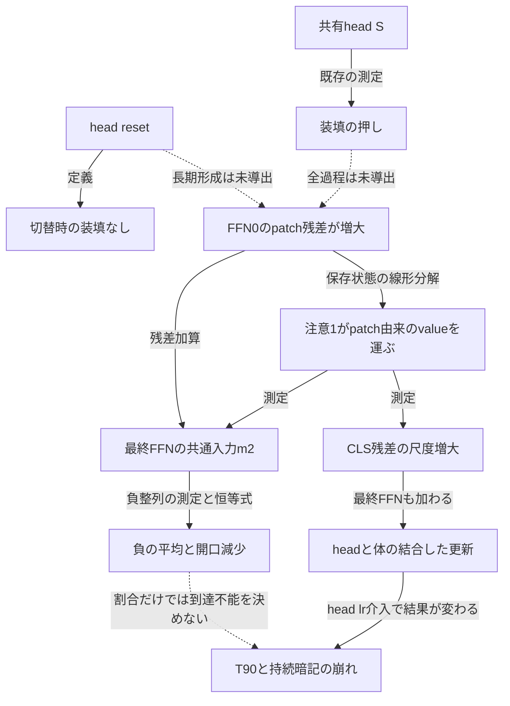
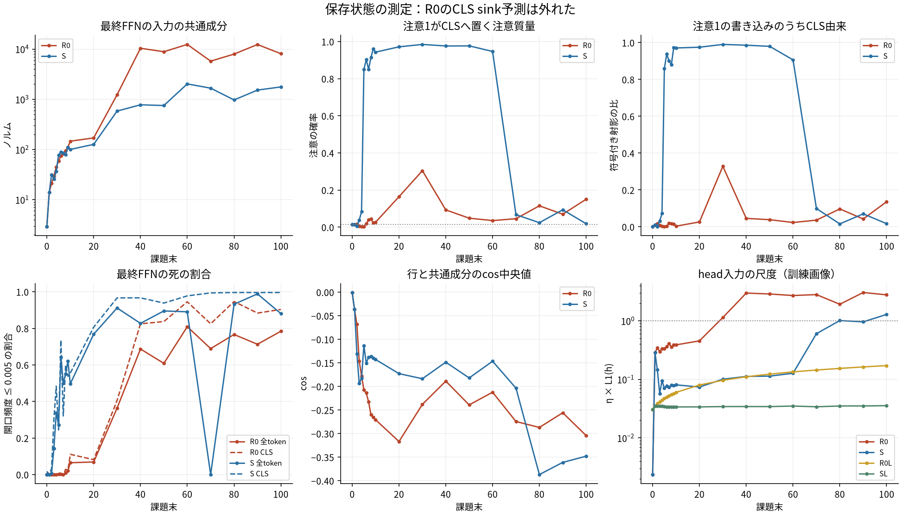
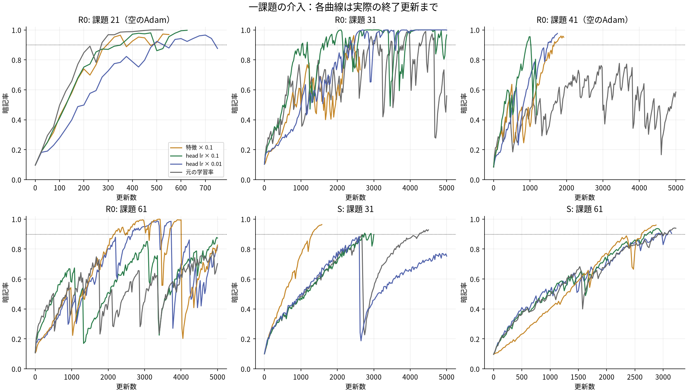
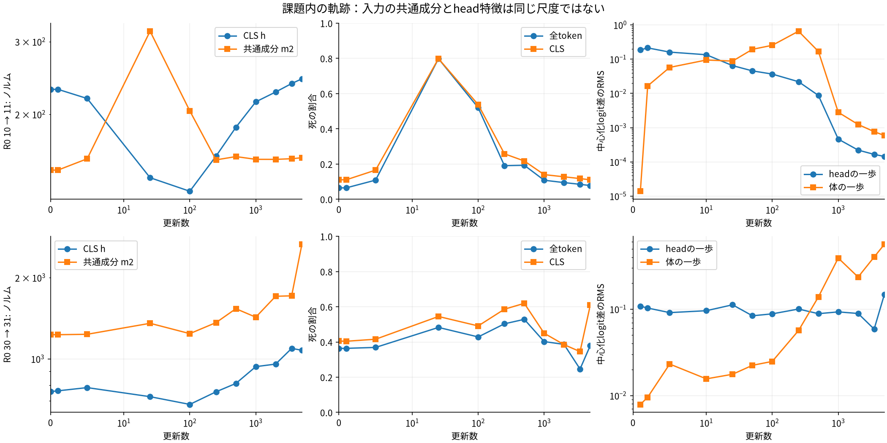
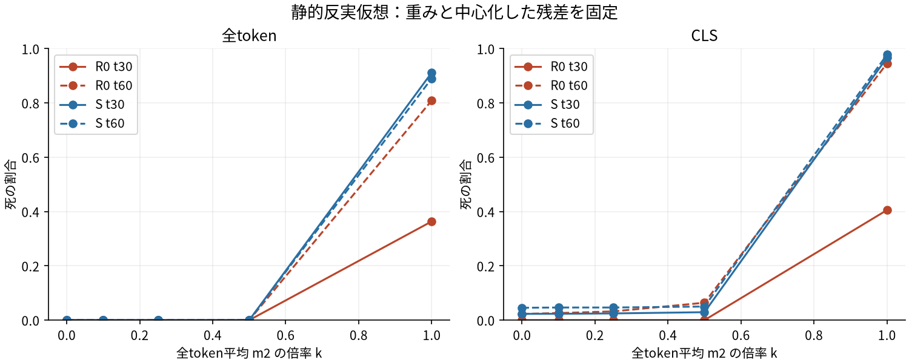

# LNなし・headを戻すR0の崩れの機構

2026-10-28T19:59:01+09:00。最終版。

seed 10252010の保存状態からの事後解析。
予測と途中の判断は `posthoc_r0/PROGRESS.md` に時刻付きで残した。
一文一主張で、導出・測定・局所介入を分ける。

## 答え

R0の注意1は、巨大なCLSを全tokenへ写していなかった。
主にFFN0がpatch側へ書いた出力をvalue経路で運んでいた。
CLSへの注意集中は、むしろSの中期に現れた。
一様乱数ラベルだけから全unitの行が共通成分へ逆らうことは導けない。
共通出力の抑制に必要な追加条件を式にできる。
保存端点の沈みの帳簿では、入力移動が大きかった。
後期R0もhead学習率の変更でT90に届いた。
初期の死の割合は到達不能の判定量にならなかった。
凍結体の新headは全条件で未到達だった。
救済は体の後続学習を含むため、固定特徴に対するheadだけの尺度問題とは結論しない。

| 問 | 結論 | 根拠の種類 |
| --- | --- | --- |
| Q1 書き手 | FFN0のpatch出力を注意1が運ぶ。巨大CLSのbroadcastではない | 保存状態の厳密な線形分解 |
| Q1 長期形成 | 入力の増幅を測った。head resetから成長率を閉じて導く式は未得 | 測定と未導出を区別 |
| Q2 負整列 | 一様ラベルだけでは導けない。自己項は抑制側だが交差項は不定 | 条件付き導出・反例・勾配照合 |
| Q3 直接原因 | 開始時の死の割合またはηΣ\|h\|の閾値だけでは結果が決まらない | 初期状態をそろえたhead lr介入 |

中期R0ではhead学習率の変更で持続した暗記が回復した。
後期R0では初回T90が回復しても、高い暗記率は持続しなかった。
以下は同じ5,000更新予算での比較である。

| R0の切替 | 介入 | T90 | 5,000更新末の暗記率 | 最後1,000更新の平均暗記率 |
| --- | --- | --- | --- | --- |
| 30→31 | base | 2300 | 0.5600 | 0.7352 |
| 30→31 | lr01 | 1025 | 0.9668 | 0.9687 |
| 30→31 | lr001 | 2350 | 0.9992 | 0.9994 |
| 60→61 | base | 未到達 | 0.7028 | 0.7025 |
| 60→61 | lr001 | 2675 | 0.8148 | 0.6510 |
| 60→61 | scale01 | 2200 | 0.8268 | 0.5997 |

baseは元の学習率である。
lr01・lr001はheadだけを1/10・1/100へ変えた。
scale01はhead入力を0.1倍した。
この表はeager回し直しの結果であり、本走のT90とは区別する。

## 方法・欠測・集計

固定probeは既存の64枚と全65tokenを使う。
CLS統計も同じ64枚で測る。
logit尺度と勾配診断は固定した暗記画像2,500枚を使う。
checkpointの順伝播はfloat32で、統計と端点帳簿はfloat64で計算した。
勾配の式は別途float64のautogradと照合した。
unitの状態中央値は中央2個の平均を使う。
既存torch.medianの中央下側とはわずかに異なる。
各unitの恒等式は加法的だが、各列の中央値は加法的ではない。
全tokenの平均m2と画像平均のCLS残差は別の量である。
本走の全層平均の死と、今回の最終FFNだけの死も区別する。

| 対象 | 扱い |
| --- | --- |
| model_t25 | 未保存。介入は欠測。代替対照を課題20末に追加 |
| Adam t20・40 | 未保存。全介入をfresh Adamで比較 |
| Adam t10・30・60 | 保存momentと更新回数を引き継ぐ |
| R0 head reset | 重みとbiasだけをゼロへ戻す。保存momentは残す |
| Sの全体学習 | 共有headを残す |
| 凍結体 | 新しい10行のゼロheadとfresh Adam |
| 追加の凍結体対照 | R0/S t30・60は全体学習と同じ初期head・保存Adamを使い、体の更新だけ停止 |
| 回し直し | 同じ次課題、batch128、同じshuffle、25更新ごとに2,500枚評価 |
| 更新予算 | 一課題5,000以内。成功後250更新追跡。指定baselineと追加4条件は5,000全体 |

実装のラベルはiid一様乱数である。
各課題のクラス枚数が厳密に等しいわけではない。
期待ラベルの一様性と、訓練後のgateとラベルの独立性は別の仮定である。

### 全token平均とCLS平均を混ぜない

損失が直接見る最終FFNの位置はCLSである。
全tokenのm2と、画像間のCLS平均m_CLSは別の母集団の平均である。
特にSの中期ではノルムも向きも異なる。
全tokenでの共通活性を、全画像に共通のlogitへ直ちに置換できない。

| 腕 | 課題末 | ‖m2‖ 全token | ‖m_CLS‖ | 両平均のcos | CLS入力rms | 最終FFN後CLS rms |
| --- | --- | --- | --- | --- | --- | --- |
| R0 | 10 | 146.5 | 126.3 | 0.971 | 216.9 | 254.4 |
| R0 | 30 | 1229.8 | 1071.1 | 0.957 | 1394.2 | 862.2 |
| R0 | 40 | 10380.0 | 8264.5 | 0.900 | 9008.1 | 2191.2 |
| R0 | 60 | 12366.8 | 8223.2 | 0.779 | 8862.0 | 2078.8 |
| R0 | 100 | 8079.2 | 7239.7 | 0.913 | 8491.7 | 3636.8 |
| S | 10 | 100.4 | 16.1 | 0.435 | 25.9 | 65.2 |
| S | 30 | 582.2 | 92.6 | 0.499 | 123.0 | 109.8 |
| S | 40 | 777.2 | 103.1 | 0.446 | 148.8 | 124.4 |
| S | 60 | 2023.8 | 120.2 | 0.357 | 164.6 | 111.3 |
| S | 100 | 1761.9 | 921.9 | 0.686 | 1229.1 | 925.3 |

### 本走のT90と課題末の暗記率は別

依頼の「課題28からT90に届かない」は、一律には成り立たない。
課題28・30は一度到達した後に暗記率が落ちた。
後期にも到達する課題がある。
各課題の初回到達と課題末の性能を別に示す。

| 腕 | 課題 | 本走T90 | 課題末の暗記率 |
| --- | --- | --- | --- |
| R0 | 25 | 550 | 1.0000 |
| R0 | 28 | 1375 | 0.6816 |
| R0 | 30 | 1275 | 0.4824 |
| R0 | 31 | 未到達 | 0.4908 |
| R0 | 40 | 未到達 | 0.5048 |
| R0 | 41 | 1950 | 0.7436 |
| R0 | 60 | 未到達 | 0.4576 |
| R0 | 61 | 4675 | 0.9336 |
| R0 | 100 | 3500 | 0.9120 |
| S | 25 | 1525 | 1.0000 |
| S | 28 | 1750 | 1.0000 |
| S | 30 | 1925 | 1.0000 |
| S | 31 | 2700 | 1.0000 |
| S | 40 | 3875 | 0.9548 |
| S | 41 | 2825 | 1.0000 |
| S | 60 | 2975 | 0.9268 |
| S | 61 | 5000 | 0.9176 |
| S | 100 | 4275 | 0.3700 |

## Q1：共通成分の書き手

### 注意のCLS成分は厳密に分けられる

注意headをr、画像をi、queryをq、keyをkとする。
αᵣᵢqkはsoftmaxの重みとする。
vᵣᵢk=Vᵣxᵢk+bᵣとする。
Pᵣは出力射影のheadに対応する列blockとする。

Aᵢq = ΣᵣPᵣαᵣᵢq0vᵣᵢ0 + ΣᵣPᵣΣₖ>₀αᵣᵢqkvᵣᵢk + b_P。

第1項がCLS由来である。
第2項がpatch由来である。
第3項は出力射影のbiasである。
valueのbiasは各key側へ含めた。
各項を画像・queryで平均してm2方向へ射影する。
符号付きの射影なので、寄与が負または100%超になることもある。
この分解は保存状態の順伝播の帳簿であり、学習の因果媒介率ではない。

### 全保存時点：R0のCLS sink予測は外れた

**R0。**

| 課題末 | ‖m2‖ | CLS注意質量:全query | CLS query→CLS | 最大注意重みの平均 | 注意前CLS/patch rms | 注意1の寄与 | うちCLS | うちpatch |
| --- | --- | --- | --- | --- | --- | --- | --- | --- |
| 0 | 2.9 | 0.016 | 0.015 | 0.018 | 0.090 | 0.1 | 0.00 | 0.1 |
| 1 | 14.0 | 0.014 | 0.003 | 0.695 | 0.595 | 7.3 | 0.08 | 7.2 |
| 2 | 21.3 | 0.016 | 0.015 | 0.828 | 0.611 | 14.8 | 0.27 | 14.5 |
| 3 | 29.6 | 0.005 | 0.001 | 0.866 | 0.606 | 22.1 | 0.17 | 21.9 |
| 4 | 45.1 | 0.004 | 0.007 | 0.879 | 0.565 | 36.7 | 0.12 | 36.6 |
| 5 | 59.0 | 0.004 | 0.009 | 0.899 | 0.553 | 48.3 | 0.08 | 48.3 |
| 6 | 75.2 | 0.019 | 0.017 | 0.925 | 0.500 | 60.4 | 0.18 | 60.3 |
| 7 | 82.0 | 0.040 | 0.038 | 0.924 | 0.487 | 66.0 | 1.24 | 64.9 |
| 8 | 95.2 | 0.045 | 0.053 | 0.927 | 0.471 | 79.3 | 1.36 | 78.1 |
| 9 | 111.3 | 0.023 | 0.030 | 0.941 | 0.489 | 96.3 | 1.55 | 94.8 |
| 10 | 146.5 | 0.027 | 0.043 | 0.939 | 0.443 | 131.9 | 0.44 | 131.6 |
| 20 | 170.2 | 0.164 | 0.175 | 0.947 | 0.247 | 140.8 | 3.68 | 137.1 |
| 30 | 1229.8 | 0.304 | 0.315 | 1.000 | 0.348 | 902.0 | 296.26 | 605.8 |
| 40 | 10380.0 | 0.093 | 0.070 | 1.000 | 0.278 | 5713.3 | 260.43 | 5452.9 |
| 50 | 8840.8 | 0.049 | 0.047 | 1.000 | 0.813 | 7102.8 | 274.26 | 6828.6 |
| 60 | 12366.8 | 0.036 | 0.034 | 1.000 | 0.451 | 7419.7 | 172.44 | 7247.5 |
| 70 | 5748.0 | 0.046 | 0.029 | 1.000 | 1.040 | 5931.3 | 214.35 | 5717.0 |
| 80 | 7933.2 | 0.115 | 0.107 | 1.000 | 0.673 | 7071.5 | 685.62 | 6385.8 |
| 90 | 12326.0 | 0.070 | 0.062 | 1.000 | 0.547 | 7082.8 | 299.93 | 6783.0 |
| 100 | 8079.2 | 0.151 | 0.188 | 1.000 | 0.961 | 6774.2 | 921.54 | 5852.6 |

**S。**

| 課題末 | ‖m2‖ | CLS注意質量:全query | CLS query→CLS | 最大注意重みの平均 | 注意前CLS/patch rms | 注意1の寄与 | うちCLS | うちpatch |
| --- | --- | --- | --- | --- | --- | --- | --- | --- |
| 0 | 2.9 | 0.016 | 0.015 | 0.018 | 0.090 | 0.1 | 0.00 | 0.1 |
| 1 | 14.0 | 0.014 | 0.003 | 0.695 | 0.595 | 7.3 | 0.08 | 7.2 |
| 2 | 31.7 | 0.005 | 0.003 | 0.789 | 0.593 | 21.6 | 0.05 | 21.5 |
| 3 | 26.1 | 0.038 | 0.034 | 0.778 | 0.427 | 10.1 | 0.32 | 9.7 |
| 4 | 36.9 | 0.084 | 0.073 | 0.844 | 0.417 | 10.0 | 0.73 | 9.3 |
| 5 | 78.2 | 0.849 | 0.772 | 0.971 | 0.147 | 2.3 | 1.95 | 0.4 |
| 6 | 89.3 | 0.904 | 0.880 | 0.978 | 0.138 | 6.2 | 5.84 | 0.4 |
| 7 | 85.9 | 0.850 | 0.825 | 0.978 | 0.115 | 5.5 | 4.92 | 0.6 |
| 8 | 79.3 | 0.913 | 0.821 | 0.973 | 0.089 | 3.5 | 3.09 | 0.4 |
| 9 | 110.0 | 0.960 | 0.921 | 0.981 | 0.069 | 4.3 | 4.18 | 0.1 |
| 10 | 100.4 | 0.943 | 0.907 | 0.981 | 0.074 | 3.5 | 3.40 | 0.1 |
| 20 | 126.6 | 0.971 | 0.945 | 0.987 | 0.054 | 12.4 | 12.10 | 0.2 |
| 30 | 582.2 | 0.984 | 0.980 | 0.994 | 0.017 | 42.7 | 42.28 | 0.2 |
| 40 | 777.2 | 0.976 | 0.963 | 1.000 | 0.018 | 41.1 | 40.52 | 0.4 |
| 50 | 750.7 | 0.977 | 0.977 | 1.000 | 0.020 | 36.7 | 35.98 | 0.5 |
| 60 | 2023.8 | 0.947 | 0.948 | 1.000 | 0.014 | 37.1 | 33.61 | 3.3 |
| 70 | 1665.3 | 0.068 | 0.060 | 1.000 | 0.405 | 41.3 | 4.10 | 36.9 |
| 80 | 969.7 | 0.024 | 0.010 | 1.000 | 0.939 | 336.2 | 5.26 | 330.2 |
| 90 | 1524.5 | 0.094 | 0.060 | 1.000 | 0.660 | 986.8 | 69.29 | 916.6 |
| 100 | 1761.9 | 0.019 | 0.013 | 1.000 | 0.442 | 1177.3 | 19.76 | 1156.5 |

R0 t10のCLS注意質量は、一様注意の基準より少し大きい程度だった。
そのCLS由来の寄与は注意1全体のごく小さい部分だった。
P1・P2は外れた。
R0 t30でもCLS由来は過半に届かなかった。
一部のheadでCLS集中が現れることと、出力全体の主な書き手がCLSであることを区別する。
S t10〜60では注意1が主に小さいCLSを読んだ。
S t70以降はこの経路の選択が変わった。
この切替の長期の原因は、この静的分解だけでは決まらない。

### FFN0の書き込みを注意1が運ぶ

LNなしでは注意1の入力はx=e+a0+f0である。
保存したαを固定すれば、valueの線形性により注意1の出力をe・a0・f0由来に分けられる。
注意重み自体がf0に依存する非線形性は、この帳簿では固定している。

| 腕 | 課題末 | 直接FFN0 | 注意1 | 注意内:埋め込み | 注意内:注意0 | 注意内:FFN0 | 注意内:bias |
| --- | --- | --- | --- | --- | --- | --- | --- |
| R0 | 1 | 6.8 | 7.3 | -0.1 | -0.1 | 7.6 | -0.01 |
| R0 | 5 | 10.8 | 48.3 | -0.7 | -0.9 | 50.1 | -0.18 |
| R0 | 10 | 14.6 | 131.9 | -4.7 | -11.5 | 149.1 | -0.97 |
| R0 | 20 | 31.0 | 140.8 | -4.2 | -20.2 | 166.6 | -1.39 |
| R0 | 30 | 330.4 | 902.0 | -14.5 | -121.3 | 1041.4 | -3.51 |
| R0 | 40 | 4671.5 | 5713.3 | -17.4 | -189.7 | 5925.9 | -5.41 |
| R0 | 60 | 4948.6 | 7419.7 | -9.7 | -117.0 | 7552.6 | -6.19 |
| R0 | 80 | 861.0 | 7071.5 | -5.7 | -24.5 | 7111.4 | -9.68 |
| R0 | 100 | 1305.2 | 6774.2 | -0.4 | -55.8 | 6840.4 | -9.96 |
| S | 1 | 6.8 | 7.3 | -0.1 | -0.1 | 7.6 | -0.01 |
| S | 5 | 76.6 | 2.3 | -0.4 | -1.8 | 4.5 | -0.09 |
| S | 10 | 97.9 | 3.5 | -1.0 | -1.9 | 6.3 | 0.01 |
| S | 20 | 115.2 | 12.4 | -0.4 | -2.1 | 14.6 | 0.29 |
| S | 30 | 540.0 | 42.7 | -1.6 | -7.9 | 51.5 | 0.64 |
| S | 40 | 736.5 | 41.1 | -1.9 | -17.7 | 60.1 | 0.58 |
| S | 60 | 1985.8 | 37.1 | -1.1 | -13.9 | 51.1 | 0.99 |
| S | 80 | 633.6 | 336.2 | -2.0 | 5.9 | 328.6 | 3.78 |
| S | 100 | 577.7 | 1177.3 | -0.6 | -12.7 | 1186.5 | 3.99 |

R0では直接のFFN0だけを見ると、共通成分の主な書き手を取り逃がす。
注意1を通って戻るFFN0由来の成分が大きかった。
Sの中期では、FFN0の大きなpatch残差が直接m2へ入る一方、注意1のCLS読み出しは小さかった。
追加予測P13は指定した4状態で支持された。

### 平均注意出力の成長の恒等式

Zᵣ=EᵢqΣₖαᵣᵢqkxᵢkとする。
Zはheadごとの384次元入力を連結した量である。
v=concatᵣ(VᵣZᵣ)、p=Pvとする。
Vはheadごとのvalue作用素をまとめたものとする。

‖平均A‖ = ‖Z‖ ‖V‖_F ‖P‖_F G_V G_P G_b。
G_V=‖v‖/(‖V‖_F‖Z‖)、G_P=‖p‖/(‖P‖_F‖v‖)、G_b=‖平均A‖/‖p‖。

この積は非零の分母で厳密である。
G_VとG_Pは方向と打ち消しを含む。
入力因子Zには入力の増大と注意による選択の変化が混ざる。
各log差は加法的だが、因果寄与率ではない。

| 腕 | 区間 | 全log増加 | 入力Z | 重みノルム積 | value方向 | proj方向 | bias比 |
| --- | --- | --- | --- | --- | --- | --- | --- |
| R0 | 1→10 | 2.307 | 0.943 | 1.014 | 0.210 | 0.155 | -0.015 |
| R0 | 10→40 | 4.010 | 5.437 | 0.559 | -2.162 | 0.170 | 0.006 |
| R0 | 40→60 | 0.221 | -0.284 | -0.235 | 0.688 | 0.052 | 0.000 |
| R0 | 60→100 | -0.169 | -0.135 | -0.171 | 0.195 | -0.057 | -0.000 |
| S | 1→10 | 0.045 | -0.872 | 0.562 | -0.050 | 0.382 | 0.022 |
| S | 10→40 | 1.968 | 0.581 | 0.760 | 0.140 | 0.502 | -0.015 |
| S | 40→60 | 0.125 | 0.867 | 0.050 | -0.788 | -0.015 | 0.011 |
| S | 60→100 | 2.687 | 4.334 | -0.345 | -0.638 | -0.640 | -0.024 |

R0 t10→40の入力Zの増加は、value・projのノルム積の増加を大きく上回った。
valueの方向因子は増大の一部を打ち消した。
注意1の出力増大を、重みノルムだけの爆発とは呼べない。
P3・P14は支持された。

| 腕 | 課題末 | 注意1前CLS rms | patch rms | FFN0開口割合 | 平均活性ノルム | FFN0 fc2ノルム | value1ノルム | proj1ノルム |
| --- | --- | --- | --- | --- | --- | --- | --- | --- |
| R0 | 1 | 19.9 | 33.4 | 0.476 | 11.4 | 24.41 | 9.01 | 9.24 |
| R0 | 5 | 26.0 | 47.1 | 0.400 | 13.4 | 28.97 | 11.82 | 12.45 |
| R0 | 10 | 26.7 | 60.2 | 0.257 | 12.4 | 33.55 | 14.81 | 15.49 |
| R0 | 20 | 25.1 | 101.3 | 0.154 | 15.4 | 41.84 | 18.75 | 19.58 |
| R0 | 30 | 326.4 | 937.2 | 0.259 | 119.5 | 48.87 | 21.16 | 21.32 |
| R0 | 40 | 3115.8 | 11216.4 | 0.427 | 968.5 | 51.30 | 20.98 | 19.13 |
| R0 | 60 | 5253.1 | 11641.7 | 0.514 | 1834.5 | 53.85 | 20.53 | 15.45 |
| R0 | 100 | 8107.3 | 8433.8 | 0.420 | 1446.0 | 60.63 | 21.01 | 12.73 |
| S | 1 | 19.9 | 33.4 | 0.476 | 11.4 | 24.41 | 9.01 | 9.24 |
| S | 5 | 14.8 | 100.6 | 0.399 | 18.4 | 29.57 | 11.02 | 11.77 |
| S | 10 | 10.1 | 135.1 | 0.342 | 17.5 | 35.66 | 11.63 | 12.56 |
| S | 20 | 9.3 | 173.7 | 0.273 | 17.1 | 46.54 | 13.08 | 14.62 |
| S | 30 | 14.3 | 852.1 | 0.421 | 61.6 | 54.23 | 15.55 | 18.58 |
| S | 40 | 21.0 | 1192.8 | 0.442 | 91.3 | 57.92 | 16.25 | 19.21 |
| S | 60 | 44.0 | 3043.0 | 0.507 | 214.9 | 63.63 | 17.31 | 18.95 |
| S | 100 | 1753.3 | 3970.1 | 0.402 | 619.4 | 72.20 | 16.11 | 14.42 |

FFN0の平均出力はU₀ E[ReLU(z₀)]+b₂,₀である。
ReLUの非負性だけでは、この出力ノルムの単調増加は導けない。
開口割合だけでなく、開いた値の大きさとfc2による方向も必要である。
この段の長期成長は測った事実である。

| 腕 | 課題末 | 埋め込みpatch rms | 注意0後patch rms | FFN0出力patch rms | 注意1出力patch rms |
| --- | --- | --- | --- | --- | --- |
| R0 | 10 | 11.7 | 19.0 | 56.1 | 224.4 |
| R0 | 20 | 13.3 | 28.1 | 100.0 | 258.2 |
| R0 | 30 | 23.4 | 77.4 | 928.5 | 1365.1 |
| R0 | 40 | 37.1 | 273.9 | 11192.5 | 8118.7 |
| R0 | 60 | 48.7 | 424.6 | 11609.4 | 10090.1 |
| R0 | 100 | 57.7 | 484.1 | 8441.7 | 9553.8 |
| S | 10 | 12.0 | 20.5 | 134.2 | 23.1 |
| S | 20 | 11.6 | 22.3 | 172.8 | 40.7 |
| S | 30 | 13.8 | 39.4 | 852.9 | 120.0 |
| S | 40 | 15.9 | 45.2 | 1189.1 | 143.8 |
| S | 60 | 24.3 | 65.9 | 3036.3 | 153.9 |
| S | 100 | 42.3 | 276.2 | 3977.1 | 1912.8 |

R0 t10→40のpatch入力は、埋め込みから注意0、FFN0まで段階的に増大した。
FFN0の出力増大が特に大きかった。
平均だけでなくpatch残差のrmsでもこの増大を確認した。
この順伝播の増幅の所在と、長期にその重みが形成される原因を区別する。

### CLS側では注意1の後に大きくなる

R0のCLS queryも、指定した状態では主にpatch側を読んだ。
注意1より前のCLSが全token中で突出していたわけではない。
CLSの大きな残差は注意1の出力を加えた後に現れる。
さらに最終FFNが加わるため、head特徴と注意1直後の残差の尺度も同一ではない。

| 腕 | 課題末 | CLS query→CLS質量 | 注意1前CLS rms | 注意1出力CLS rms | 注意1後CLS rms | 最終FFN後CLS rms |
| --- | --- | --- | --- | --- | --- | --- |
| R0 | 10 | 0.043 | 26.7 | 213.7 | 216.9 | 254.4 |
| R0 | 30 | 0.315 | 326.4 | 1315.4 | 1394.2 | 862.2 |
| R0 | 40 | 0.070 | 3115.8 | 8414.5 | 9008.1 | 2191.2 |
| R0 | 60 | 0.034 | 5253.1 | 10979.4 | 8862.0 | 2078.8 |
| S | 10 | 0.907 | 10.1 | 23.4 | 25.9 | 65.2 |
| S | 30 | 0.980 | 14.3 | 120.1 | 123.0 | 109.8 |
| S | 40 | 0.963 | 21.0 | 143.7 | 148.8 | 124.4 |
| S | 60 | 0.948 | 44.0 | 154.1 | 164.6 | 111.3 |

### headと特徴の尺度

使用する10行のheadをクラス中心化してWcとする。
H=√E‖h‖²、L=√E‖Wc h‖²、κ=L/(‖Wc‖_F H)と置く。
L=‖Wc‖_F Hκは恒等式である。
biasのクラス中心化成分は別に記録する。
headと特徴のノルムだけではlogit尺度は決まらない。

| 腕 | 課題末 | H:特徴rms | ‖Wc‖ | κ | L:logit rms | ηΣ\|h\|中央値 | 暗記率 |
| --- | --- | --- | --- | --- | --- | --- | --- |
| R0 | 1 | 226.5 | 0.923 | 0.3739 | 78.18 | 0.286 | 1.0000 |
| S | 1 | 226.5 | 0.923 | 0.3739 | 78.18 | 0.286 | 1.0000 |
| R0L | 1 | 21.7 | 1.501 | 0.3267 | 10.67 | 0.035 | 1.0000 |
| SL | 1 | 21.7 | 1.501 | 0.3267 | 10.67 | 0.035 | 1.0000 |
| R0 | 10 | 276.5 | 0.504 | 0.2251 | 31.33 | 0.389 | 1.0000 |
| S | 10 | 66.1 | 2.641 | 0.3250 | 56.70 | 0.081 | 1.0000 |
| R0L | 10 | 36.7 | 1.131 | 0.3837 | 15.95 | 0.060 | 1.0000 |
| SL | 10 | 22.1 | 1.750 | 0.3319 | 12.87 | 0.034 | 1.0000 |
| R0 | 20 | 323.4 | 0.460 | 0.1980 | 29.48 | 0.455 | 1.0000 |
| S | 20 | 64.2 | 3.269 | 0.3008 | 63.12 | 0.074 | 1.0000 |
| R0L | 20 | 49.7 | 0.914 | 0.3717 | 16.88 | 0.080 | 1.0000 |
| SL | 20 | 22.4 | 2.040 | 0.3371 | 15.43 | 0.034 | 1.0000 |
| R0 | 30 | 809.4 | 0.264 | 0.0444 | 9.51 | 1.140 | 0.4824 |
| S | 30 | 94.3 | 4.583 | 0.1260 | 54.48 | 0.101 | 1.0000 |
| R0L | 30 | 60.4 | 0.792 | 0.3523 | 16.85 | 0.097 | 1.0000 |
| SL | 30 | 22.5 | 2.277 | 0.3468 | 17.77 | 0.034 | 1.0000 |
| R0 | 40 | 2092.4 | 0.102 | 0.0353 | 7.54 | 2.980 | 0.5048 |
| S | 40 | 87.5 | 4.570 | 0.0854 | 34.14 | 0.112 | 0.9548 |
| R0L | 40 | 69.4 | 0.723 | 0.3333 | 16.73 | 0.111 | 1.0000 |
| SL | 40 | 22.5 | 2.413 | 0.3774 | 20.48 | 0.034 | 1.0000 |
| R0 | 60 | 2082.9 | 0.081 | 0.0393 | 6.59 | 2.705 | 0.4576 |
| S | 60 | 102.0 | 3.885 | 0.0561 | 22.23 | 0.127 | 0.9268 |
| R0L | 60 | 84.5 | 0.646 | 0.3037 | 16.60 | 0.134 | 1.0000 |
| SL | 60 | 22.8 | 3.077 | 0.4191 | 29.37 | 0.035 | 1.0000 |
| R0 | 100 | 2420.7 | 0.200 | 0.0682 | 32.98 | 2.779 | 0.9120 |
| S | 100 | 897.8 | 1.958 | 0.0053 | 9.28 | 1.288 | 0.3700 |
| R0L | 100 | 108.9 | 0.603 | 0.2658 | 17.45 | 0.172 | 1.0000 |
| SL | 100 | 23.3 | 3.909 | 0.3831 | 34.92 | 0.036 | 1.0000 |

R0では大きな特徴と小さなheadが同時に現れた。
崩壊期にはκも低下した。
「headより体のパラメータ数が多いから体が尺度を担うほうが速い」は導出にならない。
一歩のlogit差は、厳密にはΔℓ=ΔW h + WΔh + ΔWΔh + Δbである。
体側のΔhはJacobianとAdamの座標別の歩に依存する。
パラメータ数だけではこれらの内積の符号も大きさも決まらない。

LNもaffine後の‖h‖を厳密には固定しない。
affine前の中心化rmsを規格化する。
R0Lでは学習されたaffineを通したHが増えた。
その増え方とR0の爆発は量的に異なる。

### CEが尺度の成長を促す限定した条件

hを仮想的にαhへ変えると、∂L/∂α=E[(p−y)ᵀWh]が成り立つ。
biasを無視し、正解logitが全ての他クラスより大きい画像では、(p−y)ᵀWh=Σc≠y p_c(ℓ_c−ℓ_y)<0となる。
その画像の損失は特徴尺度の増大で下がる。
同じlogitの尺度はhead側を伸ばしても変えられる。
この局所的な符号は両側のどちらが速く成長するかを決めない。
間違えている画像や大きなbiasがある場合の符号も固定しない。
R0のheadリセット直後はW=0なので、この尺度微分もゼロである。
head再学習後のCEの尺度方向は、装填とは別の候補となる。
ただしθの更新がこの仮想的な一様尺度方向を実現するとは限らない。

| 腕 | 課題末 | 旧ラベルの平均尺度微分 | 旧ラベルで成長側の割合 | 新一様ラベル期待の平均尺度微分 |
| --- | --- | --- | --- | --- |
| R0 | 10 | -0.00041 | 0.999 | 19.9177 |
| R0 | 20 | -0.00038 | 0.998 | 19.3947 |
| R0 | 30 | 0.51034 | 0.586 | 3.9159 |
| R0 | 40 | 0.05665 | 0.643 | 2.7250 |
| R0 | 60 | -0.06602 | 0.653 | 1.9502 |
| R0 | 100 | 0.04142 | 0.903 | 16.0549 |
| S | 10 | -0.00005 | 0.953 | 32.5851 |
| S | 20 | -0.00031 | 0.951 | 32.8080 |
| S | 30 | -0.02805 | 0.987 | 21.1343 |
| S | 40 | -0.11961 | 0.966 | 14.1425 |
| S | 60 | -0.18194 | 0.955 | 9.9584 |
| S | 100 | 1.09922 | 0.448 | 3.7085 |

### 開いた最終FFNの出力が残差を打ち消す分

f=h−xを最終FFNの出力とする。
打ち消し割合は−平均f·平均x/‖平均x‖²と定義する。
これは訓練画像のCLSでの符号付き射影である。
死の割合が高くても、残るunitの出力は大きな残差を打ち消し得る。
この帳簿は、死が打ち消しを生じさせたという因果の主張ではない。

| 腕 | 課題末 | CLS入力平均ノルム | FFN出力平均ノルム | head特徴平均ノルム | 入力平均の打ち消し割合 |
| --- | --- | --- | --- | --- | --- |
| R0 | 10 | 89.9 | 96.6 | 33.6 | 1.007 |
| R0 | 20 | 117.0 | 131.7 | 56.5 | 1.017 |
| R0 | 30 | 887.1 | 824.4 | 202.2 | 0.906 |
| R0 | 40 | 7666.4 | 7666.9 | 429.3 | 0.999 |
| R0 | 60 | 7602.1 | 7599.3 | 322.6 | 0.999 |
| R0 | 100 | 6467.9 | 6507.1 | 311.1 | 1.005 |
| S | 10 | 12.9 | 15.8 | 15.2 | 0.557 |
| S | 20 | 21.4 | 20.2 | 24.2 | 0.306 |
| S | 30 | 76.5 | 26.3 | 65.4 | 0.194 |
| S | 40 | 83.8 | 32.7 | 65.3 | 0.273 |
| S | 60 | 113.7 | 67.9 | 61.1 | 0.534 |
| S | 100 | 839.5 | 673.2 | 447.1 | 0.680 |

## Q2：行が共通成分へ逆らうことはどこまで導けるか

### 一様ラベルから導ける式

LNなしの最終FFNについて、xᵢ=m+εᵢ、zᵢⱼ=wⱼ·xᵢ+bⱼ、aᵢⱼ=ReLU(zᵢⱼ)と置く。
残差を含むhead入力はhᵢ=xᵢ+ΣⱼUⱼaᵢⱼ+b₂である。
使用headをW、vⱼ=WUⱼ、eᵢ=pᵢ−onehot(yᵢ)とする。
gᵢⱼ=1[zᵢⱼ>0]vⱼᵀeᵢと置く。

∇wⱼL=Eᵢ[gᵢⱼxᵢ]、∂bⱼL=Eᵢ[gᵢⱼ]。
∇wⱼL·m=‖m‖² Eᵢgᵢⱼ+Eᵢ[gᵢⱼ(εᵢ·m)]。

この式は有限標本でも厳密である。
新しいラベルが固定した網から独立で一様なら、期待誤差はpᵢ−1/Kへ置換できる。
ただしgateとvⱼと画像ごとのpᵢが残る。
クラス数の釣合いだけでは行勾配の符号は消えない。
訓練後のラベルに対して独立性を仮定することもできない。

全画像に同じ活性をδだけ足す仮想操作では、∂L/∂δ=vⱼᵀ(平均p−平均onehot(y))となる。
この符号はvⱼと平均誤差の向きに依存する。
ReLU(wⱼ·m+bⱼ)を平均活性と同一視する等式は一般にはない。

### 共通成分を下げる十分条件と反例

すべての画像のlogitがav+cᵢ1で、a≥0とする。
ラベルは独立一様とする。
期待CEのa微分はvᵀ(softmax(av)−1/K)である。
これはa≥0で非負である。
各vの値が等しくなければa>0で正になる。
同じ結果はf(a)=logΣexp(av)−a mean(v)の凸性とf′(0)=0からも出る。
この限定した形では共通の活性を減らす勾配になる。

他のlogit成分があると符号は反転できる。
K=2、v=(1,−1)、他の成分=−3v、a=1を考える。
期待CEの微分はtanh(a−3)=tanh(−2)<0となる。
一様ラベルでもaを増やす方向へ更新する。
したがって全unitの負整列も、そのcosの数値も一様ラベルだけからは導けない。

さらにReLUが閉じると、そのunit自身を通る現在勾配はゼロになる。
共通成分の成長で負位置が深まっても、行が毎課題さらに回るとは限らない。
biasと下流biasによる補償も許される。

### 自己項の正は厳密に導ける

B(ℓ)=∫₀¹[diag p(tℓ)−p(tℓ)p(tℓ)ᵀ]dtと置く。
各softmax Jacobianは半正定値なのでBも半正定値である。
p(ℓ)−1/K=B(ℓ)ℓが積分の基本定理から成り立つ。
ℓᵢ=aᵢⱼvⱼ+rᵢ,−jと分ける。
一様な新ラベルで期待を取った前活性勾配は次になる。

gᵢⱼ=gateᵢⱼ aᵢⱼ vⱼᵀBᵢvⱼ + gateᵢⱼ vⱼᵀBᵢrᵢ,−j。

第1項は非負である。
第2項の符号は決まらない。
rᵢ,−jには他unit・残差・biasのlogitが全て入る。
行への共通方向の投影にはさらにxᵢ·mが掛かる。
xᵢ·m≥0なら自己項の沈める符号は保たれる。
交差項との大小関係と、Adamによる前処理は別に測る必要がある。
この導出もcosの定量的な着地点を与えない。

| 腕 | 課題末 | 訓練画像で生きたunit数 | 前活性の自己項が正の割合 | 行投影:自己項の沈める割合 | 行投影:交差項の沈める割合 | 行投影:合計の沈める割合 | 自己/交差の絶対値比中央値 |
| --- | --- | --- | --- | --- | --- | --- | --- |
| R0 | 10 | 3072 | 1.000 | 0.966 | 0.707 | 0.765 | 0.177 |
| R0 | 30 | 2926 | 1.000 | 1.000 | 0.452 | 0.722 | 0.879 |
| R0 | 60 | 974 | 1.000 | 1.000 | 0.450 | 0.684 | 0.587 |
| S | 10 | 2759 | 1.000 | 0.777 | 0.647 | 0.658 | 0.013 |
| S | 30 | 671 | 1.000 | 1.000 | 0.605 | 0.700 | 0.095 |
| S | 60 | 315 | 1.000 | 1.000 | 0.483 | 0.730 | 0.487 |

Bの積分はGauss–Legendre求積で評価した。
求積点数を増やし、Bℓ=p−1/Kの最大絶対誤差を検査した。
自己項の正の導出と、その行投影の実測を区別する。

S t10では自己項の行投影が沈める割合も予測値を下回った。
P16は外れた。
前活性の自己項が非負であることと、全token平均への行投影が非負であることは別である。
CLS入力と全token平均の内積の符号が関与する。

| 腕 | 課題末 | x_CLS·m_allが負の画像割合 | x_CLS·probe CLS平均が負 | x_CLS·訓練CLS平均が負 |
| --- | --- | --- | --- | --- |
| R0 | 10 | 0.022 | 0.019 | 0.017 |
| R0 | 30 | 0.000 | 0.000 | 0.000 |
| R0 | 60 | 0.000 | 0.000 | 0.000 |
| S | 10 | 0.010 | 0.000 | 0.000 |
| S | 30 | 0.000 | 0.000 | 0.000 |
| S | 60 | 0.000 | 0.000 | 0.000 |

| 主張 | 必要な条件 | 格 |
| --- | --- | --- |
| ∇wの共通項＋残差項 | 同じ入力分布と固定m | 恒等式 |
| 新ラベル期待e=p−1/K | 網から独立な新しい一様ラベル | 条件付きで厳密 |
| 共通活性を抑える符号 | 他のlogit差がなくℓ=av+c1、a≥0 | 十分条件 |
| 全unitが負へ回る | 他のunit・残差・gate・Adamの制御が必要 | 一般には導けない |
| cos中央値−0.14〜−0.35 | 保存状態で測る | 測定 |
| R0リセット直後のbody生勾配 | W=0 | 厳密にゼロ。momentによる更新は別 |

### 保存状態での符号照合

期待一様ラベルの誤差を保存headへ戻した。
R0ではheadを戻さなかった反実仮想の診断である。
実際のリセット直後のbody生勾配ではない。
表の「減少側」は負勾配がw·mを減らす割合である。
生勾配の符号をAdam更新の符号と同一視しない。

| 腕 | 課題末 | cos中央値 | cos負の割合 | 共通活性の減少側 | 生きたunitのw·m減少側 | bias中央値 | w·m中央値 |
| --- | --- | --- | --- | --- | --- | --- | --- |
| R0 | 1 | -0.036 | 0.623 | 0.584 | 0.785 | -0.0027 | -0.23 |
| R0 | 5 | -0.207 | 0.924 | 0.506 | 0.846 | -0.0081 | -7.15 |
| R0 | 10 | -0.271 | 0.971 | 0.502 | 0.765 | -0.0105 | -27.63 |
| R0 | 20 | -0.317 | 0.982 | 0.506 | 0.688 | -0.0154 | -46.75 |
| R0 | 30 | -0.238 | 0.994 | 0.508 | 0.722 | -0.0132 | -305.87 |
| R0 | 40 | -0.189 | 0.987 | 0.493 | 0.697 | -0.0082 | -2288.61 |
| R0 | 60 | -0.212 | 0.981 | 0.502 | 0.684 | -0.0108 | -3428.33 |
| R0 | 100 | -0.304 | 0.991 | 0.504 | 0.824 | -0.0131 | -3393.19 |
| S | 1 | -0.036 | 0.623 | 0.584 | 0.785 | -0.0027 | -0.23 |
| S | 5 | -0.113 | 0.849 | 0.498 | 0.737 | -0.0147 | -4.73 |
| S | 10 | -0.143 | 0.914 | 0.542 | 0.658 | -0.0175 | -8.46 |
| S | 20 | -0.173 | 0.950 | 0.493 | 0.704 | -0.0197 | -14.43 |
| S | 30 | -0.184 | 0.979 | 0.481 | 0.700 | -0.0220 | -72.86 |
| S | 40 | -0.149 | 0.952 | 0.530 | 0.726 | -0.0238 | -81.71 |
| S | 60 | -0.146 | 0.962 | 0.486 | 0.730 | -0.0268 | -218.36 |
| S | 100 | -0.348 | 0.996 | 0.517 | 0.767 | -0.0402 | -480.46 |

共通活性だけを動かす診断の符号はおよそ半々だった。
gateと入力を含む行勾配では減少側が多かった。
この差を、すべての共通活性が一様に罰せられるという導出で置き換えられない。
biasの絶対値は大きな負のw·mに比べて小さかった。

### 保存端点の厳密な帳簿

Δ(w·m)=Δw·m₀+w₀·Δm+Δw·Δm。
前活性平均の変化にはΔbも加わる。
w=n u、‖u‖=1と置く。
Δw=(n₁−n₀)u₀+n₁(u₁−u₀)と伸びと回転へ分ける。
幅sを含む位置r=μ/sには、各前活性項をs₁で割った分とμ₀(1/s₁−1/s₀)が加わる。
これらは端点の恒等式である。
保存間隔を変えると交差項などの配分は変わる。
課題10以降は10課題の端点差であり、毎課題の値ではない。

**R0：全token、全3,072unitの中央値。**

| 保存区間 | Δμ | Δw·m | w·Δm | 交差 | Δbias | うち回転 |
| --- | --- | --- | --- | --- | --- | --- |
| 0→1 | -0.24 | 0.009 | -0.009 | -0.227 | -0.003 | 0.009 |
| 1→2 | -0.52 | -0.205 | -0.238 | -0.130 | -0.001 | -0.185 |
| 2→3 | -1.47 | -0.461 | -0.639 | -0.345 | -0.002 | -0.396 |
| 3→4 | -2.32 | -0.540 | -1.368 | -0.385 | -0.001 | -0.404 |
| 4→5 | -2.65 | -0.931 | -1.334 | -0.294 | -0.001 | -0.711 |
| 5→6 | -2.82 | -0.803 | -1.663 | -0.272 | -0.000 | -0.522 |
| 6→7 | -2.44 | -1.081 | -1.230 | -0.149 | -0.000 | -0.707 |
| 7→8 | -4.32 | -1.511 | -2.466 | -0.310 | -0.000 | -0.988 |
| 8→9 | -4.27 | -0.991 | -3.109 | -0.212 | -0.001 | -0.440 |
| 9→10 | -8.25 | -1.505 | -5.990 | -0.467 | -0.001 | -0.866 |
| 10→20 | -17.99 | -11.164 | -4.780 | -1.893 | -0.006 | -4.783 |
| 20→30 | -261.83 | 0.493 | -284.291 | 3.711 | 0.002 | 8.847 |
| 30→40 | -1996.12 | 13.245 | -2142.359 | 27.800 | 0.004 | 45.428 |
| 40→50 | -143.38 | -300.300 | 117.939 | 11.090 | -0.000 | -191.705 |
| 50→60 | -663.63 | -167.691 | -312.948 | -0.188 | 0.000 | -71.010 |
| 60→70 | 1424.98 | -80.337 | 1508.818 | 20.191 | -0.000 | -1.737 |
| 70→80 | -994.03 | 0.000 | -856.814 | 0.000 | 0.000 | 0.000 |
| 80→90 | -1168.26 | 0.000 | -1077.470 | 0.000 | 0.000 | 0.000 |
| 90→100 | 990.75 | 0.000 | 1062.347 | 0.000 | 0.000 | 0.000 |

**S：全token、全3,072unitの中央値。**

| 保存区間 | Δμ | Δw·m | w·Δm | 交差 | Δbias | うち回転 |
| --- | --- | --- | --- | --- | --- | --- |
| 0→1 | -0.24 | 0.009 | -0.009 | -0.227 | -0.003 | 0.009 |
| 1→2 | -1.87 | -0.290 | -0.784 | -0.692 | -0.007 | -0.281 |
| 2→3 | -0.41 | -0.997 | 0.420 | 0.108 | -0.004 | -0.916 |
| 3→4 | -0.92 | -0.184 | -0.588 | -0.032 | -0.001 | -0.155 |
| 4→5 | -1.45 | -0.669 | -0.711 | -0.221 | -0.002 | -0.481 |
| 5→6 | -2.64 | -0.251 | -2.189 | -0.046 | -0.001 | -0.220 |
| 6→7 | 0.79 | -0.294 | 1.177 | 0.000 | -0.000 | -0.160 |
| 7→8 | 0.32 | -0.224 | 0.639 | 0.042 | -0.000 | -0.146 |
| 8→9 | -2.92 | -0.301 | -2.255 | -0.033 | -0.001 | -0.187 |
| 9→10 | 0.34 | -0.173 | 0.669 | 0.026 | -0.000 | -0.077 |
| 10→20 | -5.21 | -1.630 | -2.536 | -0.462 | -0.002 | -0.834 |
| 20→30 | -58.29 | -0.001 | -49.932 | -0.015 | 0.000 | 0.000 |
| 30→40 | -6.52 | -2.796 | 0.846 | 0.000 | -0.000 | -0.900 |
| 40→50 | -15.36 | -3.257 | -10.550 | 0.000 | -0.000 | -1.814 |
| 50→60 | -118.88 | -2.761 | -104.020 | -4.974 | -0.001 | -1.814 |
| 60→70 | -32.18 | -16.182 | -13.523 | 1.645 | -0.003 | -14.434 |
| 70→80 | -25.41 | -33.220 | -8.228 | 15.098 | -0.004 | -29.924 |
| 80→90 | -138.70 | -13.675 | -123.523 | 1.231 | -0.004 | -10.792 |
| 90→100 | -48.70 | -9.133 | -42.333 | 0.380 | -0.003 | -7.332 |

R0の20→40では、負整列を保った行へ大きな入力が入る分が沈みを運んだ。
後期R0では行が止まったunitが多く、回転の中央値もゼロになった。
文字GPT L0の「W項が全seedで主」という結果を、そのまま移せない。
共通しているのは、負整列と入力共通成分の成長が共存する形である。
文字GPTの39→100とViTの20→40は異なる窓である。

### 幅も増えるが負の平均に追いつかない

| 腕 | 課題末 | 平均前活性 | 幅中央値 | r中央値 | cos中央値 | 全token死 |
| --- | --- | --- | --- | --- | --- | --- |
| R0 | 1 | -0.2 | 3.1 | -0.075 | -0.036 | 0.000 |
| R0 | 10 | -27.5 | 23.1 | -1.201 | -0.271 | 0.065 |
| R0 | 20 | -45.0 | 44.9 | -1.035 | -0.317 | 0.069 |
| R0 | 30 | -317.1 | 180.6 | -1.719 | -0.238 | 0.364 |
| R0 | 40 | -2360.8 | 1088.6 | -2.117 | -0.189 | 0.687 |
| R0 | 60 | -3293.2 | 1251.9 | -2.561 | -0.212 | 0.809 |
| R0 | 100 | -3293.6 | 1547.2 | -2.250 | -0.304 | 0.784 |
| S | 1 | -0.2 | 3.1 | -0.075 | -0.036 | 0.000 |
| S | 10 | -8.5 | 7.2 | -1.185 | -0.143 | 0.496 |
| S | 20 | -14.8 | 13.1 | -1.108 | -0.173 | 0.768 |
| S | 30 | -76.7 | 64.5 | -1.112 | -0.184 | 0.911 |
| S | 40 | -87.2 | 71.0 | -1.113 | -0.149 | 0.827 |
| S | 60 | -230.4 | 203.0 | -1.071 | -0.146 | 0.890 |
| S | 100 | -492.2 | 193.1 | -2.574 | -0.348 | 0.881 |

行のノルムだけを正の定数倍すると、biasを無視できる場合に平均と幅が同じ倍率になる。
rはその純粋な倍率では変わらない。
平均の帳簿とrの帳簿を別に示す。

| 腕 | 保存区間 | Δr | 重み/s₁ | 入力/s₁ | 交差/s₁ | bias/s₁ | 幅項 |
| --- | --- | --- | --- | --- | --- | --- | --- |
| R0 | 10→20 | 0.190 | -0.2489 | -0.1062 | -0.0433 | -0.0001 | 0.4946 |
| R0 | 20→30 | -0.732 | 0.0027 | -1.5276 | 0.0215 | 0.0000 | 0.7427 |
| R0 | 30→40 | -0.439 | 0.0108 | -1.9001 | 0.0218 | 0.0000 | 1.3883 |
| R0 | 40→50 | -0.035 | -0.2284 | 0.0995 | 0.0089 | -0.0000 | 0.1502 |
| R0 | 50→60 | -0.393 | -0.1185 | -0.2544 | -0.0001 | 0.0000 | 0.0833 |
| R0 | 60→70 | 0.378 | -0.0817 | 1.6402 | 0.0228 | -0.0000 | -0.8264 |
| R0 | 70→80 | -0.530 | 0.0000 | -0.7570 | 0.0000 | 0.0000 | 0.3070 |
| R0 | 80→90 | 0.433 | 0.0000 | -0.6153 | 0.0000 | 0.0000 | 1.1147 |
| R0 | 90→100 | 0.174 | 0.0000 | 0.6956 | 0.0000 | 0.0000 | -0.5158 |
| S | 10→20 | 0.066 | -0.1288 | -0.1979 | -0.0379 | -0.0001 | 0.4045 |
| S | 20→30 | -0.009 | -0.0000 | -0.8120 | -0.0003 | 0.0000 | 0.8602 |
| S | 30→40 | -0.010 | -0.0280 | 0.0108 | 0.0000 | -0.0000 | 0.1021 |
| S | 40→50 | 0.030 | -0.0285 | -0.1161 | 0.0000 | -0.0000 | 0.1751 |
| S | 50→60 | 0.017 | -0.0120 | -0.5251 | -0.0195 | -0.0000 | 0.5928 |
| S | 60→70 | -0.251 | -0.0721 | -0.0782 | 0.0074 | -0.0000 | -0.0783 |
| S | 70→80 | -0.834 | -0.2445 | -0.0627 | 0.1120 | -0.0000 | -0.5906 |
| S | 80→90 | -0.005 | -0.0681 | -0.6395 | 0.0061 | -0.0000 | 0.6955 |
| S | 90→100 | -0.411 | -0.0473 | -0.2186 | 0.0018 | -0.0000 | -0.0965 |

P5は早期0→10と後期10→100で分けて採点する。

| 腕 | 窓 | 入力項が重み項より負の区間数 | 区間数 |
| --- | --- | --- | --- |
| R0 | 0→10 | 10 | 10 |
| R0 | 10→100 | 5 | 9 |
| S | 0→10 | 6 | 10 |
| S | 10→100 | 6 | 9 |

## Q3：死と尺度を分ける介入

### ηΣ|h|から導けること

固定hに対するhead一歩のlogit変化はΔℓ=ΔW h+Δbである。
|Δℓ_c|≤Σⱼ|ΔW_cj||h_j|+|Δb_c|が厳密に成り立つ。
fresh Adamの最初の一歩では、|ΔW_cj|≤ηである。
その場合はηΣ|h|が重み部分の上界になる。
保存momentとbias correctionを含む一般のAdamでは、|ΔW_cj|≤ηは保証されない。
さらに座標ごとの相殺がある。
ηΣ|h|>1だけでは不安定性の必要条件にも十分条件にもならない。
実際のhead一歩のlogit差とbodyのlogit差を別に保存した。

head lrだけを変える対照は、初期の特徴と死を同一に保つ。
後の体の学習は変わり得る。
hを0.1倍する介入は、順伝播とbodyへの勾配を変える。
Sでは開始logitも変わる。
この介入を純粋なoptimizer変更とは呼ばない。
凍結体の失敗は、固定特徴で次の乱数ラベルが分離できないことも含む。
それだけで死の因果を確定できない。

### 最終FFNの死は体全体の微分の消失ではない

最終FFNと残差の和はh=x+U ReLU(W₁x+b₁)+b₂である。
その入力JacobianはJ_h,x=I+U diag(gate) W₁である。
全gateがゼロならJ_h,x=Iとなる。
最終FFN自身の重みへの現在勾配は消えるが、上流へ戻る残差経路は消えない。
したがって最終FFNの死の割合だけから、体全体の応答や次課題の到達不能は導けない。
残る経路が画像ごとの必要な方向を学べるかは別の問題である。
またprobe上の死は、全2,500枚で一度も開かないことと同一ではない。

### 一課題の回し直し

| 腕 | 課題末 | 介入 | Adam | T90 | 実行更新 | 最終暗記率 | 最大暗記率 | 最終損失 |
| --- | --- | --- | --- | --- | --- | --- | --- | --- |
| R0 | 10 | base | 保存 | 325 | 5000 | 1.0000 | 1.0000 | 0.000 |
| R0 | 20 | base | 空 | 275 | 525 | 1.0000 | 1.0000 | 0.009 |
| R0 | 20 | lr001 | 空 | 500 | 750 | 0.8760 | 0.9656 | 0.455 |
| R0 | 20 | lr01 | 空 | 375 | 625 | 0.9976 | 0.9976 | 0.048 |
| R0 | 20 | scale01 | 空 | 300 | 550 | 0.9692 | 0.9724 | 0.148 |
| R0 | 30 | base | 保存 | 2300 | 5000 | 0.5600 | 0.9900 | 1.263 |
| R0 | 30 | lr001 | 保存 | 2350 | 5000 | 0.9992 | 1.0000 | 0.007 |
| R0 | 30 | lr01 | 保存 | 1025 | 5000 | 0.9668 | 1.0000 | 0.131 |
| R0 | 30 | scale01 | 保存 | 2375 | 2625 | 0.7332 | 0.9628 | 0.848 |
| R0 | 40 | base | 空 | 未到達 | 5000 | 0.5852 | 0.7768 | 1.210 |
| R0 | 40 | lr001 | 空 | 1500 | 1750 | 0.9768 | 0.9768 | 0.174 |
| R0 | 40 | lr01 | 空 | 925 | 1175 | 0.4332 | 0.9548 | 1.826 |
| R0 | 40 | scale01 | 空 | 1675 | 1925 | 0.9512 | 0.9596 | 0.217 |
| R0 | 60 | base | 保存 | 未到達 | 5000 | 0.7028 | 0.7868 | 0.910 |
| R0 | 60 | lr001 | 保存 | 2675 | 5000 | 0.8148 | 0.9876 | 0.629 |
| R0 | 60 | lr01 | 保存 | 未到達 | 5000 | 0.8736 | 0.8772 | 0.458 |
| R0 | 60 | scale01 | 保存 | 2200 | 5000 | 0.8268 | 1.0000 | 0.592 |
| S | 30 | base | 保存 | 4250 | 4500 | 0.9284 | 0.9292 | 0.308 |
| S | 30 | lr001 | 保存 | 未到達 | 5000 | 0.7528 | 0.8856 | 0.773 |
| S | 30 | lr01 | 保存 | 2750 | 3000 | 0.8968 | 0.9064 | 0.374 |
| S | 30 | scale01 | 保存 | 1325 | 1575 | 0.9636 | 0.9636 | 0.176 |
| S | 60 | base | 保存 | 2975 | 3225 | 0.9392 | 0.9408 | 0.256 |
| S | 60 | lr001 | 保存 | 2900 | 3150 | 0.9044 | 0.9224 | 0.340 |
| S | 60 | lr01 | 保存 | 2725 | 2975 | 0.9080 | 0.9372 | 0.351 |
| S | 60 | scale01 | 保存 | 2625 | 2875 | 0.9604 | 0.9604 | 0.196 |

同じ条件を追加で5,000更新まで回した場合、この表は長い曲線を採用する。
先に終えた短い曲線は別ファイルで保存している。
実行更新が異なる行の最終暗記率を、同じ予算の優劣とは読まない。

R0 t30からのbaselineは本走の課題31と初回T90が異なった。
本走は未到達だが、今回のeager回し直しは一度到達した。
元のcompile実行との軌跡の完全一致は主張しない。
介入の因果比較は、同じeager実装とbatch順を使った条件間に限定する。

| 腕 | 課題末 | 介入 | 先行した短い追跡の更新数 | その時点の暗記率 |
| --- | --- | --- | --- | --- |
| R0 | 30 | lr001 | 2600 | 0.9940 |
| R0 | 30 | lr01 | 1275 | 0.5908 |
| R0 | 60 | lr001 | 2925 | 0.9460 |
| R0 | 60 | scale01 | 2450 | 0.9044 |

baseは元の学習率である。
lr01・lr001はheadだけを1/10・1/100へ変える。
scale01はhead入力を0.1倍する。

### R0の課題内の尺度軌跡

| 開始課題末 | 更新 | probe ‖h‖ | ηΣ\|h\| | ‖m2‖ | z平均 | 全token死 | CLS死 |
| --- | --- | --- | --- | --- | --- | --- | --- |
| 10 | 0 | 229.9 | 0.362 | 146.5 | -27.5 | 0.065 | 0.111 |
| 10 | 1 | 229.9 | 0.362 | 146.5 | -27.5 | 0.065 | 0.111 |
| 10 | 5 | 218.4 | 0.346 | 156.0 | -29.7 | 0.109 | 0.165 |
| 10 | 25 | 140.4 | 0.221 | 318.0 | -63.6 | 0.799 | 0.799 |
| 10 | 100 | 130.2 | 0.205 | 203.8 | -41.0 | 0.520 | 0.537 |
| 10 | 250 | 158.4 | 0.248 | 155.1 | -31.1 | 0.191 | 0.258 |
| 10 | 500 | 186.0 | 0.292 | 158.0 | -31.7 | 0.193 | 0.217 |
| 10 | 1000 | 214.4 | 0.334 | 155.6 | -31.2 | 0.108 | 0.140 |
| 10 | 2000 | 226.5 | 0.358 | 155.5 | -31.1 | 0.095 | 0.128 |
| 10 | 3500 | 237.5 | 0.370 | 156.1 | -31.1 | 0.085 | 0.118 |
| 10 | 5000 | 243.8 | 0.380 | 156.9 | -31.2 | 0.078 | 0.110 |
| 30 | 0 | 756.1 | 1.178 | 1229.8 | -317.1 | 0.364 | 0.405 |
| 30 | 1 | 761.3 | 1.173 | 1229.0 | -316.9 | 0.364 | 0.404 |
| 30 | 5 | 782.5 | 1.196 | 1233.3 | -316.9 | 0.369 | 0.416 |
| 30 | 25 | 724.2 | 1.141 | 1354.5 | -351.5 | 0.483 | 0.545 |
| 30 | 100 | 678.0 | 1.056 | 1240.3 | -322.6 | 0.429 | 0.491 |
| 30 | 250 | 755.0 | 1.157 | 1362.6 | -356.1 | 0.503 | 0.586 |
| 30 | 500 | 810.9 | 1.266 | 1534.2 | -378.1 | 0.529 | 0.619 |
| 30 | 1000 | 935.7 | 1.480 | 1427.2 | -351.7 | 0.402 | 0.450 |
| 30 | 2000 | 956.4 | 1.477 | 1705.6 | -375.3 | 0.386 | 0.385 |
| 30 | 3500 | 1093.4 | 1.678 | 1712.4 | -391.4 | 0.246 | 0.345 |
| 30 | 5000 | 1076.2 | 1.660 | 2656.7 | -675.5 | 0.380 | 0.609 |

### head lr介入はbodyの後続軌跡も変える

| 開始課題末 | 介入 | 更新 | 初期‖h‖ | 最終‖h‖ | 初期CLS死 | 最終CLS死 | 最終暗記率 |
| --- | --- | --- | --- | --- | --- | --- | --- |
| 30 | base | 5000 | 756.1 | 1076.2 | 0.405 | 0.609 | 0.5600 |
| 30 | lr001 | 5000 | 756.1 | 5039.5 | 0.405 | 0.042 | 0.9992 |
| 30 | lr01 | 5000 | 756.1 | 1930.4 | 0.405 | 0.201 | 0.9668 |
| 30 | scale01 | 2625 | 756.1 | 1827.8 | 0.405 | 0.238 | 0.7332 |
| 60 | base | 5000 | 1732.8 | 1976.8 | 0.945 | 0.793 | 0.7028 |
| 60 | lr001 | 5000 | 1732.8 | 6246.8 | 0.945 | 0.619 | 0.8148 |
| 60 | lr01 | 5000 | 1732.8 | 3532.6 | 0.945 | 0.805 | 0.8736 |
| 60 | scale01 | 5000 | 1732.8 | 3845.4 | 0.945 | 0.736 | 0.8268 |

この表の‖h‖は、特徴倍率を掛ける前の体出力である。
scale01でheadへ実際に入る特徴は、この値をさらに0.1倍したものになる。

学習率の変更後には、体の特徴尺度も開口も変化した。
到達の回復を、凍結した体の同じ特徴をheadだけで読めたという結果に置き換えない。
特徴のノルムがさらに大きくても、head lrが小さい条件で到達することがある。
特徴ノルムだけを到達不能の判定量にはできない。

### 診断した一歩のlogit差

| 開始課題末 | 介入 | 更新 | head ηΣ\|h\| | head一歩rms | body一歩rms | head一歩の最大絶対値 |
| --- | --- | --- | --- | --- | --- | --- |
| 30 | base | 1 | 1.178 | 0.1083 | 0.0079 | 0.3768 |
| 30 | base | 100 | 1.058 | 0.0883 | 0.0249 | 0.4751 |
| 30 | base | 1000 | 1.483 | 0.0930 | 0.3907 | 0.4956 |
| 30 | base | 2000 | 1.447 | 0.0892 | 0.2354 | 0.4526 |
| 30 | base | 5000 | 1.697 | 0.1480 | 0.5628 | 0.6388 |
| 30 | lr001 | 1 | 0.012 | 0.0011 | 0.0001 | 0.0038 |
| 30 | lr001 | 100 | 0.015 | 0.0016 | 0.0007 | 0.0064 |
| 30 | lr001 | 1000 | 0.031 | 0.0023 | 0.0741 | 0.0112 |
| 30 | lr001 | 2000 | 0.041 | 0.0028 | 0.1198 | 0.0135 |
| 30 | lr001 | 5000 | 0.079 | 0.0012 | 0.6399 | 0.0067 |
| 60 | base | 1 | 2.709 | 0.1314 | 0.0021 | 0.7841 |
| 60 | base | 100 | 2.685 | 0.1279 | 0.0709 | 0.8926 |
| 60 | base | 1000 | 2.818 | 0.1373 | 0.3091 | 0.6167 |
| 60 | base | 2000 | 2.632 | 0.1279 | 0.3384 | 0.6853 |
| 60 | base | 5000 | 3.089 | 0.1667 | 1.5962 | 1.2705 |
| 60 | lr001 | 1 | 0.027 | 0.0013 | 0.0000 | 0.0078 |
| 60 | lr001 | 100 | 0.030 | 0.0015 | 0.0003 | 0.0063 |
| 60 | lr001 | 1000 | 0.059 | 0.0058 | 0.1312 | 0.0290 |
| 60 | lr001 | 2000 | 0.100 | 0.0069 | 0.3246 | 0.0318 |
| 60 | lr001 | 5000 | 0.098 | 0.0045 | 0.3863 | 0.0172 |

rmsは画像とクラスを平均し、各画像のクラス平均logitを引いてから取った。
head一歩は旧hを固定したΔW h+Δbである。
body一歩は更新後のheadを使ったW_new Δhである。
両者の和は全logit差と一致する。
rms同士は交差項があるため加法的ではない。
少数の診断時点の記録なので、全5,000更新の最大値だとは呼ばない。

後半の診断時点では、head自身の更新よりbodyの変化が作るlogit差の方が大きかった。
headの学習率を下げる介入が効くことと、head自身の一歩がlogit変化の主成分であることは同じ主張ではない。
body一歩のrmsにも、学習不能を決める普遍的な閾値を置かない。

### 体を凍結した新しいhead

| 腕 | 課題末 | head lr | 特徴PR | T90 | 最大暗記率 | 最終暗記率 |
| --- | --- | --- | --- | --- | --- | --- |
| R0 | 20 | 1e-04 | 25.53 | 未到達 | 0.3964 | 0.3944 |
| R0 | 20 | 1e-05 | 25.53 | 未到達 | 0.2752 | 0.2712 |
| R0 | 20 | 1e-06 | 25.53 | 未到達 | 0.1984 | 0.1976 |
| R0 | 30 | 1e-04 | 42.49 | 未到達 | 0.4620 | 0.4600 |
| R0 | 30 | 1e-05 | 42.49 | 未到達 | 0.3424 | 0.3424 |
| R0 | 30 | 1e-06 | 42.49 | 未到達 | 0.2528 | 0.2500 |
| R0 | 40 | 1e-04 | 36.49 | 未到達 | 0.4380 | 0.4256 |
| R0 | 40 | 1e-05 | 36.49 | 未到達 | 0.3872 | 0.3872 |
| R0 | 40 | 1e-06 | 36.49 | 未到達 | 0.2808 | 0.2788 |
| R0 | 60 | 1e-04 | 41.14 | 未到達 | 0.4692 | 0.4632 |
| R0 | 60 | 1e-05 | 41.14 | 未到達 | 0.4180 | 0.4100 |
| R0 | 60 | 1e-06 | 41.14 | 未到達 | 0.3128 | 0.3124 |
| S | 30 | 1e-04 | 2.91 | 未到達 | 0.2228 | 0.2132 |
| S | 30 | 1e-05 | 2.91 | 未到達 | 0.1748 | 0.1692 |
| S | 30 | 1e-06 | 2.91 | 未到達 | 0.1472 | 0.1460 |
| S | 60 | 1e-04 | 14.49 | 未到達 | 0.2940 | 0.2872 |
| S | 60 | 1e-05 | 14.49 | 未到達 | 0.2112 | 0.2088 |
| S | 60 | 1e-06 | 14.49 | 未到達 | 0.1644 | 0.1636 |

R0の中期でも凍結体は到達しなかった。
P9は外れた。
後期R0のhead lr変更は到達したので、P10も外れた。
Sもhead lr変更で到達したので、P11も外れた。
Sのbaseline自体も到達している。
したがってSのこの2状態を、死が到達不能を決めた対照とは扱えない。

### 同じ5,000更新予算で見た後半の維持

追加の長い回し直しは、同じ保存状態から同じ次課題だけを実行した。
最後の1,000更新の集計は、25更新ごとの評価点に対する記述統計である。
初回T90と持続した性能を区別するために示す。

| 腕 | 開始課題末 | 介入 | 5,000末 | 4,000〜5,000平均 | 同最小 | 同最大 | 同区間で0.9以上の評価割合 |
| --- | --- | --- | --- | --- | --- | --- | --- |
| R0 | 60 | lr01 | 0.8736 | 0.7551 | 0.6208 | 0.8772 | 0.0000 |
| R0 | 30 | base | 0.5600 | 0.7352 | 0.2776 | 0.9900 | 0.3171 |
| R0 | 40 | base | 0.5852 | 0.4481 | 0.1664 | 0.6412 | 0.0000 |
| R0 | 60 | lr001 | 0.8148 | 0.6510 | 0.4084 | 0.8612 | 0.0000 |
| R0 | 60 | scale01 | 0.8268 | 0.5997 | 0.2028 | 0.9952 | 0.0244 |
| R0 | 10 | base | 1.0000 | 1.0000 | 1.0000 | 1.0000 | 1.0000 |
| R0 | 30 | lr01 | 0.9668 | 0.9687 | 0.8044 | 1.0000 | 0.8780 |
| R0 | 60 | base | 0.7028 | 0.7025 | 0.6100 | 0.7868 | 0.0000 |
| R0 | 30 | lr001 | 0.9992 | 0.9994 | 0.9940 | 1.0000 | 1.0000 |
| S | 30 | lr001 | 0.7528 | 0.7230 | 0.6496 | 0.7700 | 0.0000 |

R0 t30のhead lr0.01は後半の全評価点で高い暗記率を保った。
R0 t30のhead lr0.1も、到達直後の再低下から回復した。
P15のlr0.1は回復しないという部分は外れた。
R0 t60のhead lr0.01は持続しなかった。
P17は外れた。
R0 t60の特徴0.1倍も、最終暗記率は到達水準を下回った。
P20は支持された。
尺度操作だけで後期の持続崩れまで解けたとは結論しない。

### 初期headとAdamをそろえて体だけを凍結

先のlinear probeはheadとAdamも新しくしていた。
追加対照では全体学習と初期head・保存Adamをそろえた。
R0はheadをゼロへ戻し、Sは共有headを残した。
同じ保存状態の固定特徴を使い、体への更新だけを止めた。

| 腕 | 開始課題末 | head lr | T90 | 最大暗記率 | 5,000末暗記率 |
| --- | --- | --- | --- | --- | --- |
| R0 | 30 | 1e-04 | 未到達 | 0.4644 | 0.4632 |
| R0 | 30 | 1e-05 | 未到達 | 0.3488 | 0.3480 |
| R0 | 30 | 1e-06 | 未到達 | 0.2548 | 0.2544 |
| R0 | 60 | 1e-04 | 未到達 | 0.4656 | 0.4656 |
| R0 | 60 | 1e-05 | 未到達 | 0.4152 | 0.4072 |
| R0 | 60 | 1e-06 | 未到達 | 0.3120 | 0.3100 |
| S | 30 | 1e-04 | 未到達 | 0.1984 | 0.1824 |
| S | 30 | 1e-05 | 未到達 | 0.1016 | 0.1008 |
| S | 30 | 1e-06 | 未到達 | 0.1004 | 0.1004 |
| S | 60 | 1e-04 | 未到達 | 0.2336 | 0.2312 |
| S | 60 | 1e-05 | 未到達 | 0.1124 | 0.1088 |
| S | 60 | 1e-06 | 未到達 | 0.0984 | 0.0980 |

初期状態をそろえた凍結体でも全条件が未到達だった。
headだけの最適化では今回の救済を再現できなかった。
指定した予算と学習率の範囲では、体の後続の変化が必要だった。
これは別のoptimizerや無限の更新でも不可能という証明ではない。

### m2だけを縮める死の反実仮想

xᵢq=m2+εᵢqを、x′ᵢq=k m2+εᵢqへ置換した。
重み・biasと中心化残差εを固定した。
z′ᵢqj=zᵢqj+(k−1)wⱼ·m2となる。
従ってwⱼ·m2<0ならkの減少で前活性は上がる。
この一歩の関数変更を学習による回復と同一視しない。

| 腕 | 課題末 | k | 全token死 | 全tokenで一度でも開く | CLS死 | CLSで一度でも開く |
| --- | --- | --- | --- | --- | --- | --- |
| R0 | 20 | 1.0 | 0.069 | 3012 | 0.081 | 2822 |
| R0 | 20 | 0.5 | 0.000 | 3072 | 0.000 | 3072 |
| R0 | 20 | 0.1 | 0.000 | 3072 | 0.000 | 3072 |
| R0 | 20 | 0.0 | 0.000 | 3072 | 0.000 | 3072 |
| R0 | 30 | 1.0 | 0.364 | 2510 | 0.405 | 1827 |
| R0 | 30 | 0.5 | 0.000 | 3072 | 0.000 | 3072 |
| R0 | 30 | 0.1 | 0.000 | 3072 | 0.000 | 3072 |
| R0 | 30 | 0.0 | 0.000 | 3072 | 0.000 | 3072 |
| R0 | 40 | 1.0 | 0.687 | 1240 | 0.825 | 539 |
| R0 | 40 | 0.5 | 0.000 | 3072 | 0.010 | 3041 |
| R0 | 40 | 0.1 | 0.000 | 3072 | 0.004 | 3059 |
| R0 | 40 | 0.0 | 0.000 | 3072 | 0.005 | 3056 |
| R0 | 60 | 1.0 | 0.809 | 834 | 0.945 | 168 |
| R0 | 60 | 0.5 | 0.000 | 3072 | 0.064 | 2875 |
| R0 | 60 | 0.1 | 0.000 | 3072 | 0.026 | 2992 |
| R0 | 60 | 0.0 | 0.000 | 3072 | 0.023 | 3001 |
| R0 | 100 | 1.0 | 0.784 | 973 | 0.903 | 297 |
| R0 | 100 | 0.5 | 0.000 | 3072 | 0.000 | 3071 |
| R0 | 100 | 0.1 | 0.000 | 3072 | 0.000 | 3072 |
| R0 | 100 | 0.0 | 0.000 | 3072 | 0.000 | 3072 |
| S | 20 | 1.0 | 0.768 | 1127 | 0.806 | 595 |
| S | 20 | 0.5 | 0.000 | 3072 | 0.041 | 2946 |
| S | 20 | 0.1 | 0.000 | 3072 | 0.041 | 2947 |
| S | 20 | 0.0 | 0.000 | 3072 | 0.041 | 2946 |
| S | 30 | 1.0 | 0.911 | 462 | 0.966 | 103 |
| S | 30 | 0.5 | 0.000 | 3072 | 0.029 | 2982 |
| S | 30 | 0.1 | 0.000 | 3072 | 0.023 | 3000 |
| S | 30 | 0.0 | 0.000 | 3072 | 0.023 | 3001 |
| S | 40 | 1.0 | 0.827 | 789 | 0.967 | 102 |
| S | 40 | 0.5 | 0.000 | 3072 | 0.069 | 2860 |
| S | 40 | 0.1 | 0.000 | 3072 | 0.056 | 2901 |
| S | 40 | 0.0 | 0.000 | 3072 | 0.054 | 2906 |
| S | 60 | 1.0 | 0.890 | 525 | 0.978 | 69 |
| S | 60 | 0.5 | 0.000 | 3072 | 0.050 | 2918 |
| S | 60 | 0.1 | 0.000 | 3072 | 0.047 | 2929 |
| S | 60 | 0.0 | 0.000 | 3072 | 0.046 | 2932 |
| S | 100 | 1.0 | 0.881 | 1123 | 0.996 | 12 |
| S | 100 | 0.5 | 0.000 | 3072 | 0.000 | 3072 |
| S | 100 | 0.1 | 0.000 | 3072 | 0.000 | 3071 |
| S | 100 | 0.0 | 0.000 | 3072 | 0.001 | 3070 |

R0 t40・60では、k=0.1で全tokenの死はゼロになった。
CLSでも大部分が開き直った。
P12は支持された。
保存された行の大部分が不可逆に応答を失ったという解釈は、この静的反実仮想と合わない。
元の入力分布の下で応答が乏しいことと、重みを固定したまま別の入力で開けることは両立する。

## 機構の鎖と未導出の段

R0の①装填は、次課題のheadリセットにより走らない。
R0の②には、保存Adamの残りと、新headが育った後の通常の誤差伝播がある。
②の長期の符号をパラメータ数だけからは決められない。
R0の③は、FFN0のpatch出力を注意1が運ぶ経路として測った。
R0の④では、絶対幅も増えるが負の平均の増大に追いつかない。
LNありの取り分競合による幅の縮小とは区別する。
R0の⑤は、固定probe上の開口減少として存在する。
同じ初期の⑤でもhead lr変更で到達したため、⑤の割合は到達不能の十分条件ではない。
ηΣ|h|だけを使ったhead一歩の行き過ぎという判定も支持されなかった。
head lr介入は、最終FFNの再開口と特徴の成長を含む後続の体の学習を変えた。
局所介入が支持するのは、このheadと体の結合した更新への依存である。

Sでは共有headの装填が残る。
Sの中期はFFN0の直接の共通書き込みで最終FFNが先に沈む。
その時期の注意1は小さいCLSを主に読む。
後期にCLS集中が崩れるとpatch側の大きな残差も読み出しへ流れる。
最後の文は保存状態の対応であり、切替の動的因果を導いたものではない。

### 尺度と死の出現順序

以下の閾値は時系列を要約するための記述上の目印である。
不安定性や学習不能の必要十分条件ではない。
最初に閾値を超えた保存時点を示す。
未保存の課題内や課題間の正確な発生時刻は決まらない。

| 腕 | ηΣ\|h\|>1の最初の保存時点 | 全token死>0.5の最初の保存時点 | CLS死>0.5の最初の保存時点 |
| --- | --- | --- | --- |
| R0 | 30 | 40 | 40 |
| S | 80 | 6 | 6 |

この尺度ではR0は尺度の大きさが先で、Sは開口減少が先だった。
死の時系列自体は単調ではない。
S t70の全token死はゼロだったが、CLS死はほぼ全unitだった。
全tokenとCLSでの応答を混ぜない。

| 腕 | 課題末 | 全token死 | CLS死 |
| --- | --- | --- | --- |
| S | 60 | 0.8903 | 0.9775 |
| S | 70 | 0.0000 | 0.9938 |
| S | 80 | 0.9320 | 0.9961 |

## 予測の採点

測定後に予測を書き換えていない。
追加予測も、対応する測定を始める前にPROGRESSへ記録した。
「支持」は指定した状態・条件での判定である。

| ID | 測定前の予測 | 判定 | 根拠 |
| --- | --- | --- | --- |
| P1 | R0 t10のCLS由来が注意1寄与の過半 | 外れ | CLS寄与率=0.0033 |
| P2 | R0 t10のCLS質量>0.5かつSより大きい | 外れ | R0=0.0270; S=0.9429 |
| P3 | R0 t10→40は重みノルム積より入力が成長 | 支持 | 注意選択込み入力Z倍率=229.78; ノルム積倍率=1.75; P14で精密化 |
| P4 | R0 t10・30の次課題末でh尺度が増える | 支持 | 末/初のh中央値=1.060, 1.423; 課題内は非単調 |
| P5 | 入力項が重み項より負の保存区間が過半 | 支持 | R0 0→10: 10/10; R0 10→100: 5/9; S 0→10: 6/10; S 10→100: 6/9 |
| P6 | bias変化の絶対値中央値はΔ(w·m)より小さい | 支持 | 38/38区間; 最大比=0.0129119 |
| P7 | 一様ラベルだけから全unitの勾配符号は決まらない | 支持 | 二クラスの反例とPSD自己項・交差項の厳密分解 |
| P8 | R0 t20・30はhead lr調整でT90到達 | 支持 | t20 baselineも到達。t30は到達後の再低下を別検査 |
| P9 | R0 t20・30は凍結体のheadでもT90到達 | 外れ | 6条件すべて未到達 |
| P10 | R0 t60はhead lr調整・凍結体とも未到達 | 外れ | head lr0.01は到達。凍結体は全3条件未到達 |
| P11 | S t30・60はhead lr調整・凍結体とも未到達 | 外れ | S t30のlr0.1で到達。凍結体は全6条件未到達 |
| P12 | m2を0.1倍でR0 t40・60の死が半分未満 | 支持 | t40 all: 0.6868→0.0000; t40 cls: 0.8245→0.0042; t60 all: 0.8089→0.0000; t60 cls: 0.9453→0.0260 |
| P13 | R0注意1内のFFN0由来が埋め込み由来より大きい | 支持 | 指定4状態すべてで成立。注意固定の帳簿 |
| P14 | 精密化した注意入力Zの成長が重みノルム積より大きい | 支持 | 229.78倍対1.75倍 |
| P15 | R0 t30の5000末はlr0.01が0.9以上、lr0.1が0.9未満 | 外れ | lr0.01=0.9992; lr0.1=0.9668 |
| P16 | CE自己項の行投影は生きたunitの95%以上で沈める | 外れ | 6状態の最小割合=0.776731; 合計の符号は別 |
| P17 | R0 t60 lr0.01は5000末も0.9以上 | 外れ | 5000更新末=0.8148 |
| P18 | R0 t40・60の最終FFNはCLS入力平均を80%以上打ち消す | 支持 | 0.998502, 0.998726 |
| P19 | 初期head・保存Adamをそろえた凍結体もT90未到達 | 支持 | 12/12条件が未到達; 最大暗記率=0.4656 |
| P20 | R0 t60の特徴0.1倍も5000末で0.9未満 | 支持 | T90=2200; 5000末=0.8268 |

## 図

図中の曲線は実際に実行した更新時点までを示す。
介入図は同条件の短い追跡より、追加した長い追跡を優先する。

## 原典で確認した主張

既知の現象と、この箱で測った経路を区別する。

| 原典 | 確認した箇所 | 使った主張 | 範囲 |
| --- | --- | --- | --- |
| [Xiao et al. (2023/ICLR 2024)](https://arxiv.org/html/2309.17453v4) | §3.1 | 意味的に重要でない初期tokenにも注意が集中し、そのKV保持がstreaming推論を支えると観測した。 | 本箱のR0でCLS sinkがあることの根拠にはならない。 |
| [Sun et al. (COLM 2024)](https://arxiv.org/html/2402.17762v2) | §4・§5 | 大きな活性と注意集中・暗黙biasを結び、ViTでは画像ごとに異なるpatch位置の大きな活性も観測した。 | 本箱の平均残差の増大を、同論文の稀な座標活性と同一とはしない。 |
| [Xiong et al. (ICML 2020)](https://proceedings.mlr.press/v119/xiong20b.html) | Abstract・理論 | 初期化時のpost-LNとpre-LNの勾配尺度の違いを解析した。 | 全LNを外した継続学習の長期爆発を証明した論文ではない。 |
| [Dong et al. (ICML 2021)](https://proceedings.mlr.press/v139/dong21a.html) | Abstract | 残差とMLPのない純粋attentionは深さとともにrank 1へ急速に近づくと証明した。 | 本箱は残差とMLPを持つので、その定理をそのまま適用しない。 |
| [Noci et al. (NeurIPS 2022)](https://papers.neurips.cc/paper_files/paper/2022/hash/ae0cba715b60c4052359b3d52a2cff7f-Abstract-Conference.html) | Abstract | 初期化時のtoken rank collapseがquery/keyの勾配を消す機構を解析した。 | 画像特徴の線形分離性や本箱の学習後T90を直接決めない。 |
| [Joudaki et al. (ICLR 2026)](https://arxiv.org/abs/2510.00304v3) | §4・Fig 4.1・Appendix B | 正規化の有無を含むViT等の継続学習で、凍結・重複・有効階数と可塑性の関係を調べた。 | 本箱のhead reset・ReLU・2 blockの尺度経路は別の測定である。 |

## 検証と残る問い

| 数値検証 | 値 |
| --- | --- |
| 順伝播の元実装との差 | float64の指定3状態で0 |
| 最終FFNの解析勾配とautogradの最大相対差 | 3.53e-16 |
| 同一lrのAdam群分割の一歩の最大差 | 0.000 |
| 注意1の入力書き手再構成の最大相対差 | 4.81e-08 |
| 端点帳簿の最大絶対誤差 | 5.46e-12 |
| 保存状態測定のRSS最大MiB | 2499.9 |
| 保存状態測定のGPU割当最大MiB | 2873.8 |

| 最終監査 | 値 |
| --- | --- |
| SHA256を照合した既存入力数 | 152 |
| 変更された既存入力数 | 0 |
| 一課題の全体学習条件数 | 29 |
| 新headの凍結体条件数 | 18 |
| 初期head・Adamをそろえた凍結体条件数 | 12 |
| 全実験RSS最大MiB | 2499.9 |
| GPU予約最大MiB | 3262.0 |
| 長い再実行と先行曲線の共通区間 | 4条件とも全評価点の暗記率が完全一致 |

GPU値はPyTorch allocatorの最大値であり、CUDA contextを含まない。
全ての重い処理をnice 10で逐次実行した。
git操作・プロセス停止・vault書込は行わなかった。

共有headの有無からFFN0のpatch残差の成長率を閉じて導く式は得ていない。
負整列の初期形成と長期の維持の全てを一様ラベルからは導いていない。
保存のない課題25末や課題間の細かな増分は復元していない。
同じ一seedの局所介入を、全seedの必要十分な機構とは呼ばない。
元の本走はcompile、今回の回し直しはeagerである。
浮動小数点演算順の差に敏感な領域では、軌跡の完全再現を保証しない。

R0は「装填なしでも③共通入力の成長から⑤開口減少まで走る」測定例として使える。
ただし開始時の死の割合だけでT90喪失を決める扱いは、今回の介入と合わない。
head lr変更後の再開口が救済を媒介するかは、まだ分離していない。
後期の持続崩れが応答の制約によるか、体の更新の不安定さによるかも未同定である。
V13では尺度とhead・体の結合した更新への依存を別経路として記す必要がある。

## 作成ファイル

本文はこのファイルである。
予測・途中経過・生出力は次に置いた。

`/home/issan/Projects/obsidian-research-data/vit_long_1024_2blk_rlfix/posthoc_r0/`

| ファイル | 内容 |
| --- | --- |
| PROGRESS.md | 時刻付き予測・外れ・進行記録 |
| codex_checkpoints.json | 全4腕80保存状態、注意分解・尺度・勾配・端点帳簿・死の反実仮想 |
| codex_transport.json | LNなし40状態のvalue経路の入力書き手と成長因子 |
| codex_units_*.npz | unitごとの行・入力平均・bias・幅・開口 |
| codex_features_*.npz | 2,500枚の固定特徴・最終FFNのCLS入力と前活性 |
| codex_replay_*.json / log | 一課題の介入曲線・尺度軌跡・実際の一歩量 |
| codex_linear_probes.json | 18条件の凍結体の新head |
| codex_frozen_matched.json | 初期head・保存Adamをそろえた12条件の凍結体 |
| codex_radial.json | 特徴尺度のCE微分と最終FFNの打ち消し |
| codex_ce_self.json | 期待CEのPSD自己項・交差項と求積誤差 |
| codex_mean_populations.json | 全token平均とCLS平均の区別 |
| codex_summary.json | 事前予測の採点・bias分担・最後の1,000更新 |
| codex_state_table.csv / codex_replay_curves.csv | 図の数表 |
| codex_audit.json / codex_manifest.json | 既存入力・予算の監査と出力SHA256 |
| codex_verification.json | 恒等式とAdam群分割の検証 |
| codex_input_hashes.json | 開始時の入力SHA256 |
| codex_literature.json | 原典・主張・適用範囲 |

| script：analysis/vit_long_1024/posthoc_2blk/ | 役割 |
| --- | --- |
| codex_r0_common.py | 保存状態読取と共通の順伝播・尺度 |
| codex_r0_checkpoints.py | Q1・Q2・死の静的反実仮想 |
| codex_r0_transport.py | 注意1が運ぶ入力の書き手 |
| codex_r0_verify.py | 式と実装の照合 |
| codex_r0_replay.py | 一課題だけの回し直しと介入 |
| codex_r0_probe.py | 体を凍結したhead学習 |
| codex_r0_queue.py | 終了を確認する逐次実行 |
| codex_r0_finish_queue.py | 追加のCPU分解と長い追跡の逐次実行 |
| codex_r0_radial.py | CE尺度微分と平均の打ち消し |
| codex_r0_ce_self.py | CEのPSD自己項・交差項 |
| codex_r0_frozen_match.py | 初期状態をそろえた凍結体 |
| codex_r0_summary.py | 予測の採点と比較集計 |
| codex_r0_figures.py | 図4枚とCSV |
| codex_r0_audit.py | 入力SHA256・予算・再実行の照合 |
| codex_r0_report.py | 段階ごとの本文生成 |
