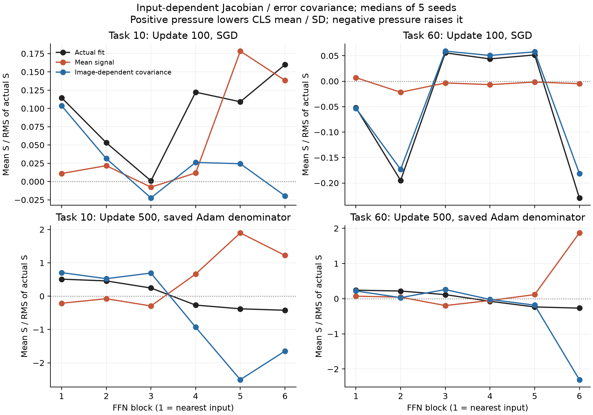
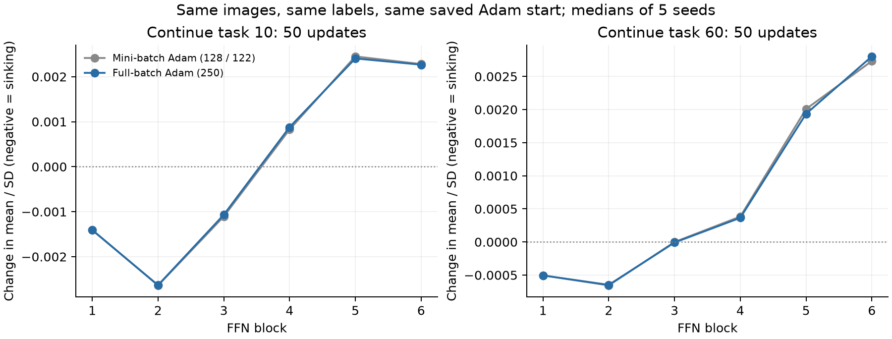

# ViT: 入力データのばらつき仮説の検査（1025・探索的追補）

Issa「相2の正体って入力データのばらつき説」に対する追加。追補specとコードは1dc1211bで結果閲覧前にcommit。共有head、5 seed、task10/60の100/500更新後の20状態。

**「画像ごとの経路と誤差の対応」が効いているという仮説には支持がある。** task60の100更新時では共分散項が押しの符号BA97〜99%、相対誤差4〜8%（各層のseed中央値）で実fitを近似し、全層で4/5以上の判定を満たした。ただし500更新後では平均項との相殺が大きく、共分散項だけでは実fitを近似しない。入力ばらつき単独の説明が成立したわけではない。

全250画像で50更新する対照でも、minibatchとほぼ同じ層別変位が残った。task10のFFN1〜3は5/5 seedで沈降、FFN5〜6は5/5で上昇。task60はFFN1が5/5で沈降、FFN2〜3は3/5と弱く、FFN5〜6は5/5で上昇。この継続区間ではbatch抽選ノイズは沈降に必要でなかった。画像間の違いとbatch抽選ノイズは区別できる。

## 今回の「ばらつき」の操作

画像nのhead前特徴をH_n、headからの誤差信号をe_n=(p_n−q_n)Vc、入力によって変わるbodyの微分をJ_nとする。実際の勾配はg=E[J_nᵀe_n]。これを、平均同士の積g_mean=E[J_nᵀ]E[e_n]と、画像ごとの対応から来るg_cov=g−g_meanへ分けた。固定probeの各FFNのμ/σへ全パラメータ経路で運んだ。

画像・元logitsは変えず、backwardで全画像へ同じ平均誤差信号を渡す対照と、誤差信号を画像間で4通りにシャッフルする対照を作った。後者は誤差の周辺分布を保ち、画像と誤差の対応を壊す。これは入力の分散値そのものを縮める操作ではない。画像依存の微分経路と誤差の相関が、どちらへ押しているかを検査する。

## 共分散項は実際の押しを運ぶか

正のSが沈める方向。各セルは全unit平均Sのseed中央値。各seedではfit=mean+covだが、別々の中央値同士は必ずしも足し合わない。誤差比は||S_cov−S_fit||/||S_fit||。事前条件はこの比≤0.2かつBA≥80%を4/5 seed以上。

| 課題 | 更新 | FFN | 実fit S | 平均項 S | 共分散項 S | 誤差比 | 符号BA | 条件成立 |
|---:|---:|---:|---:|---:|---:|---:|---:|---:|
| 10 | 100 | 1 | +0.00786 | +0.00138 | +0.0122 | 0.699 | 77.6% | 0/5 |
| 10 | 100 | 2 | +0.00485 | +0.00252 | +0.00494 | 1.116 | 74.0% | 0/5 |
| 10 | 100 | 3 | +0.000238 | -0.00474 | -0.00049 | 1.304 | 75.6% | 0/5 |
| 10 | 100 | 4 | +0.0104 | +0.00723 | +0.0162 | 1.342 | 81.0% | 0/5 |
| 10 | 100 | 5 | +0.0082 | +0.017 | +0.00169 | 1.507 | 79.8% | 0/5 |
| 10 | 100 | 6 | +0.0166 | +0.0233 | -0.00165 | 1.306 | 77.3% | 0/5 |
| 10 | 500 | 1 | +0.277 | -0.101 | +0.41 | 4.320 | 61.7% | 0/5 |
| 10 | 500 | 2 | +0.511 | -0.0763 | +0.625 | 6.508 | 56.4% | 0/5 |
| 10 | 500 | 3 | +0.193 | -0.487 | +0.856 | 7.778 | 53.7% | 0/5 |
| 10 | 500 | 4 | -0.35 | +0.866 | -1.22 | 9.314 | 53.8% | 0/5 |
| 10 | 500 | 5 | -0.714 | +3.02 | -3.52 | 8.941 | 56.5% | 0/5 |
| 10 | 500 | 6 | -0.575 | +1.99 | -2.68 | 12.740 | 58.2% | 0/5 |
| 60 | 100 | 1 | -0.122 | +0.0636 | -0.103 | 0.068 | 97.8% | 4/5 |
| 60 | 100 | 2 | -1.75 | -0.182 | -1.34 | 0.064 | 97.1% | 5/5 |
| 60 | 100 | 3 | +0.475 | -0.208 | +0.504 | 0.051 | 98.9% | 5/5 |
| 60 | 100 | 4 | +1.93 | -0.15 | +2.22 | 0.061 | 98.8% | 5/5 |
| 60 | 100 | 5 | +1.09 | -0.0156 | +1.31 | 0.084 | 97.6% | 5/5 |
| 60 | 100 | 6 | -2.96 | -0.199 | -2.99 | 0.041 | 98.8% | 5/5 |
| 60 | 500 | 1 | +0.113 | +0.0259 | +0.0984 | 0.962 | 70.8% | 0/5 |
| 60 | 500 | 2 | +0.222 | +0.0481 | +0.0495 | 1.566 | 69.0% | 0/5 |
| 60 | 500 | 3 | +0.0922 | -0.189 | +0.357 | 1.795 | 62.5% | 0/5 |
| 60 | 500 | 4 | -0.165 | -0.113 | -0.0486 | 2.059 | 67.9% | 0/5 |
| 60 | 500 | 5 | -0.435 | +0.132 | -0.551 | 3.023 | 59.5% | 0/5 |
| 60 | 500 | 6 | -0.678 | +2.76 | -3.4 | 5.816 | 59.7% | 0/5 |

100更新はSGD方向、500更新は保存Adam分母固定。500更新についてSGD版も生CSVに保存した。対応が良い場合でも、共分散が常に沈めるとは限らない。共分散が浮かせる層も、同じ方法でそのまま残している。

## 保存momentumを含む有限1更新

課題60末。元の通常学習勾配と、画像との対応を壊した勾配を同じAdam状態へ1回入れ、実際のμ/σ差を測定した。全250画像の勾配であり、元のminibatch更新ではない。各値はunit平均変位、その後seed中央値。

| FFN | 元のfit Δμ/σ | 平均誤差へ置換 | 4シャッフル対照平均 | 元fitの方が平均誤差より沈むseed |
|---:|---:|---:|---:|---:|
| 1 | -1.1067e-05 | -9.8593e-06 | -1.0546e-05 | 4/5 |
| 2 | -1.4409e-05 | -1.2739e-05 | -6.1332e-06 | 4/5 |
| 3 | +2.0572e-06 | +2.2829e-06 | -7.0892e-06 | 4/5 |
| 4 | +1.2401e-05 | +1.5241e-05 | -2.877e-05 | 2/5 |
| 5 | +3.71e-05 | +1.8759e-06 | -3.5743e-05 | 1/5 |
| 6 | +5.5895e-05 | +9.1352e-06 | -4.0248e-06 | 1/5 |

保存momentumはすべての対照で同じ。したがって新しい勾配から共分散項を除いても、過去の押しは1更新では消えない。有限stepの符号だけで、直前に計算した瞬間の勾配の符号を否定しない。

## ミニバッチ抽選のノイズを除く対照

元の課題末から旧画像・旧ラベルのまま50更新した。full batchは全250画像を毎回使い、データ間の違いを保ったままbatch抽選を除く。元Adamを再開しhead/bodyをともに学習。更新回数は同じだが画像提示回数は異なる。各unitの開始からの差の中央値、その後seed中央値を示す。

| 課題末 | FFN | minibatch Δμ/σ | full batch Δμ/σ | full batchで沈むseed |
|---:|---:|---:|---:|---:|
| 10 | 1 | -0.0014051 | -0.0014093 | 5/5 |
| 10 | 2 | -0.0026385 | -0.0026324 | 5/5 |
| 10 | 3 | -0.001106 | -0.0010676 | 5/5 |
| 10 | 4 | +0.00082753 | +0.0008789 | 2/5 |
| 10 | 5 | +0.0024507 | +0.0024054 | 0/5 |
| 10 | 6 | +0.0022802 | +0.0022668 | 0/5 |
| 60 | 1 | -0.00050437 | -0.00050567 | 5/5 |
| 60 | 2 | -0.0006565 | -0.00064826 | 3/5 |
| 60 | 3 | -1.2096e-06 | -8.6923e-06 | 3/5 |
| 60 | 4 | +0.00038304 | +0.00036465 | 1/5 |
| 60 | 5 | +0.0020081 | +0.0019357 | 0/5 |
| 60 | 6 | +0.0027326 | +0.0028027 | 0/5 |

## 解釈の範囲

- 入力依存の微分経路と誤差の共分散は、単なる非負の「分散」と違って符号を持つ。ばらつきは押しを作る材料になり得るが、沈むか浮くかはReLUの開閉、後段、上流の更新を含む相関で決まる。
- mean/covの分解恒等式だけでは証拠にならない。どの項がどの方向に効くか、対応を壊すと実変位が変わるかを比較した。
- 共分散に誤差が含まれるため、これを「入力のばらつきだけで相2が説明できた」とは呼ばない。真の入力分散のdose介入や長期の必要性・十分性は未実施。
- 全batchでも沈降が残る場合、その継続区間でbatch抽選ノイズは必要条件でない。ただし過去のminibatch学習の履歴は初期状態に残る。
- 100→500更新の既存観測と、500更新後からさらに50更新する今回の区間を混同しない。
- 既存の共同LS相2式の検査は[機構検証の本体](summary.md)。この共分散仮説は、それと同じ模型だと仮定しない。

