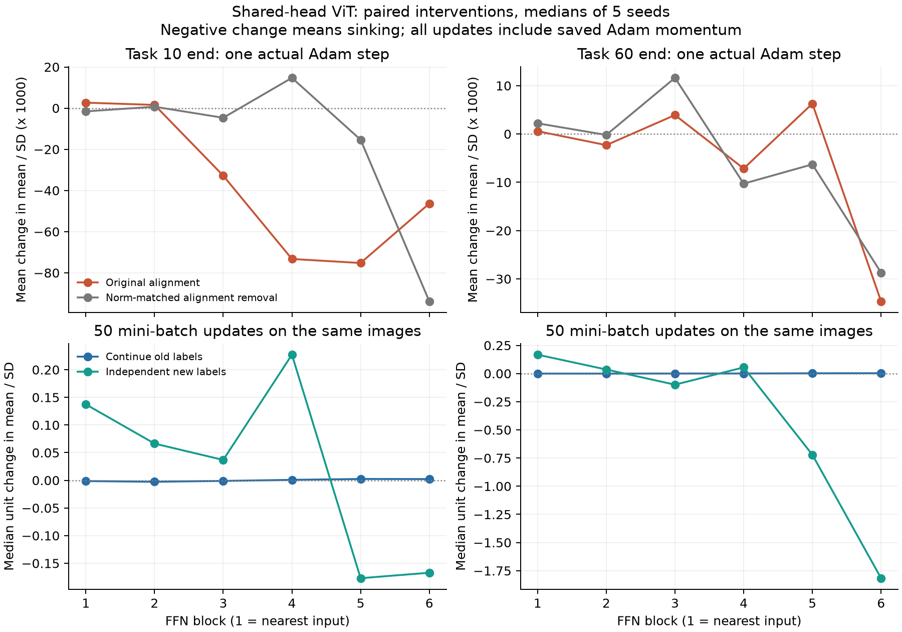
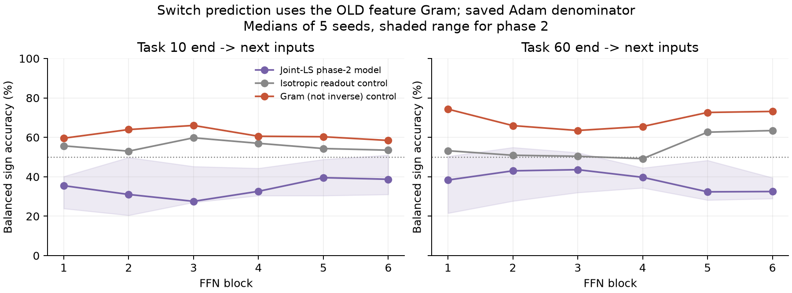

# ViT: 整列への介入と相2の機構検証（1025）

**用語の訂正（1025・ユーザーの説明を確認後）:** 本稿Bの共同LS型の「相2」と、追補の画像間共分散は、Issaが意図した先生のT5を検証したものではない。T5は標本列を変えた学習複製間の誤差–ゲート共分散であり、[2blockの複製実験](../../analysis/vit_two_block_1025/mechanism.md)が対応する検証である。以下の測定値は独立した診断として保持するが、T5の支持・反証に転用しない。

前回の層別観測を知った上での探索的追試。コード・判定を77a97ce7で新しい計測前に凍結。SL・全5 seed・task10/60末の10状態を起点とし、最終分類headを操作した。各FFN自身のfc2を独立に分解した検査ではない。

**通常学習中の前段の沈降は、ラベルを替えない50更新でも再現した。一方、最終FFNの沈降を読み出し整列に固有の効果とする判定は満たさず、共同LS型の相2予測も今回のViTの切替勾配とは対応しなかった。** 整列介入の基準を満たしたのはtask10末のFFN3〜5。task60末では全層が未達。共同LS相2の方向対応基準は全層・両時点で0/5 seed。

画像間の経路と誤差の対応は、[画像依存共分散とfull-batch対照](covariance_summary.md)で補助的に検証した。上記の訂正どおり、T5の検証とは区別する。

「切替と通常学習が沈めるunitがなぜ分かれるか」は[同じunitの対応検査](unit_overlap.md)に整理した。最終FFNでも向きが反対なのは約63%、他層は約51〜55%で、unitが二分された結果ではない（task60・次課題入力）。

## A. 相1：headの大きさを保って整列だけを崩す

元headを、旧ラベルと特徴の整列成分Lと残りRへ分けた。Rは残し、Lを旧ラベルpermutation由来の直交方向へ置換する対照を4本作った。元headとFrobenius normが同じで、元の整列は0。logitsと確率も再計算して、次課題11/61の独立ラベル期待勾配を測った。61は仮想次課題。

Sは全パラメータ更新を固定probeのμ/σへ運んだ量で、正なら沈む。以下は保存Adam分母固定の全unit平均Sのseed中央値。「条件成立」は元headでS>0かつ4対照平均よりSが大きいseed数。4/5以上をLOCAL_ALIGNMENT_EFFECTと事前に定義した。

| 課題末 | FFN | 元head S | 整列除去対照 S | 条件成立 | 実Adam 1更新でも元headがより沈む |
|---:|---:|---:|---:|---:|---:|
| 10 | 1 | -262 | +161 | 2/5 | 3/5 |
| 10 | 2 | -175 | -27 | 2/5 | 2/5 |
| 10 | 3 | +3.61e+03 | -317 | 5/5 | 3/5 |
| 10 | 4 | +7.79e+03 | -3.51e+03 | 5/5 | 5/5 |
| 10 | 5 | +6.48e+03 | -2.17e+03 | 5/5 | 5/5 |
| 10 | 6 | +4.62e+03 | +5.79e+03 | 3/5 | 2/5 |
| 60 | 1 | -67.4 | -8.98 | 2/5 | 3/5 |
| 60 | 2 | +184 | -206 | 3/5 | 3/5 |
| 60 | 3 | -831 | -975 | 1/5 | 3/5 |
| 60 | 4 | +600 | +1.11e+03 | 1/5 | 3/5 |
| 60 | 5 | -913 | -220 | 1/5 | 1/5 |
| 60 | 6 | +5.25e+03 | +3.88e+03 | 3/5 | 3/5 |

有限1更新では保存momentum・二次moment・stepを含め、実際にbodyを動かしてμ/σ差を測った。250画像の期待勾配に対するAdam stepであり、元のminibatch Adam更新の期待値ではない。大きさを変えるalpha=1/.5/0のdose、整列を除いた残りを元normへ拡大する対照もalignment_verdict.csvとpressures.csvに保持した。整列を除いても沈降が残る場合、整列は必要条件とは言わない。

前回の「最終FFNの64.8%を整列成分が沈める」という符号測定は再現したが、それだけでは整列に固有の効果の証拠にならない。今回はhead normを保つ除去対照にも最終FFNの沈降が残り、元headが対照より沈めるという登録条件は3/5 seedに留まった（両時点）。成分が沈めることと、整列が特別に沈降を増やすことを分ける必要がある。

## B. 相2：共同fit模型を正しい入力条件で検査

前回の「通常学習との一致が約50%」だけでは相2の反証にならない。既存の共同fit式は独立な旧ラベルを最小二乗でfitした後の、**切替期待**の模型だった。今回はbiasを定数特徴として含め、新入力での予測にも旧入力のGramの擬似逆を使った。等方head模型と、逆でないGramを使う模型も同じ微分経路で比較した。

| 課題末 | FFN | 相2 BA | 相2 Spearman | 等方対照 BA | Gram対照 BA | 事前条件を満たすseed |
|---:|---:|---:|---:|---:|---:|---:|
| 10 | 1 | 35.5% | -0.411 | 55.7% | 59.6% | 0/5 |
| 10 | 2 | 31.0% | -0.504 | 53.0% | 63.9% | 0/5 |
| 10 | 3 | 27.5% | -0.601 | 59.8% | 66.0% | 0/5 |
| 10 | 4 | 32.6% | -0.516 | 57.0% | 60.5% | 0/5 |
| 10 | 5 | 39.5% | -0.427 | 54.3% | 60.3% | 0/5 |
| 10 | 6 | 38.7% | -0.345 | 53.5% | 58.4% | 0/5 |
| 60 | 1 | 38.3% | -0.421 | 53.2% | 74.3% | 0/5 |
| 60 | 2 | 43.0% | -0.292 | 50.9% | 65.9% | 0/5 |
| 60 | 3 | 43.6% | -0.250 | 50.4% | 63.5% | 0/5 |
| 60 | 4 | 39.7% | -0.321 | 49.2% | 65.5% | 0/5 |
| 60 | 5 | 32.3% | -0.555 | 62.6% | 72.6% | 0/5 |
| 60 | 6 | 32.5% | -0.600 | 63.4% | 73.1% | 0/5 |

事前条件はBA≥65%、順位相関≥0.5、等方対照よりBAが5ポイント以上高い、を同じseedで満たすこと。4/5以上で方向対応とする。BAは沈むunitと浮くunitの各的中率の平均。常に一方の符号を答える対照は50%。予測ゼロを除いて的中率を上げる扱いはしていない。

### 適用条件の実測

| 課題末 | 有効rankの範囲 / 250画像 | LS予測とのlogit差の比 | LSの残差比 | 通常学習のCE補正 / 実信号ノルム |
|---:|---:|---:|---:|---:|
| 10 | 250–250 | 0.414 | 1.12e-14 | 148 |
| 60 | 250–250 | 0.966 | 2.09e-14 | 243 |

LSはC(Q−u)を教師とする一様点二次近似の共同最小二乗解。実網はCEを学習しているため、LSとの差がそのまま学習不足を意味するわけではない。actual_fit=ls_fit+fit_gap+CE補正、actual_switch=ls_switch+switch_gap+CE補正を信号・位置で検算した。大きな項が相殺して小さい実勾配になる場合、各項のnorm比を因果寄与率として足し上げない。

### なぜ通常学習と同じ式にならないか

固定Hbar上でW*=Hbar⁺Yとすると、旧課題の二乗損失のbody信号は(Hbar W*−Y)W*ᵀ。独立・等分散な旧ラベルの平均を取ると、射影残差と擬似逆の直交性から期待値は0になる。特に250画像に対して有効rankが250なら、個別課題でもLS残差はほぼ0になる。従ってこの条件付き模型は、通常学習中に前段が一方向へ沈むという予測をそのまま与えない。実学習では特徴とラベルが依存し、CE・共同fitからのずれ・momentumがある。そのどれが持続沈降を作るかは、別の機構命題になる。

正の対照として、固定特徴に独立一様ラベル256組を与えてLSでfitした。次入力でのMonte Carlo平均信号と理論の相対L2差（10状態）の範囲は 0.166–0.190。128組ずつのsplit差もstates.csvに保存。これは条件付き模型の実装検査であり、実ViTへの適用の証拠ではない。

## C. ラベルを替えずに50更新続けた実測

元のAdam状態を再開し、旧画像・旧ラベルを保つ腕と、同じ画像を独立に再ラベルする腕を、同じbatch順で50更新した。headとbodyをともに更新。表は各unitの開始状態からの差を取り、unit中央値、その後seed中央値。負が沈降。「沈降seed」は各seedのunit中央値が負の本数。

| 課題末 | FFN | 継続50更新 Δμ/σ | 沈降seed | 再ラベル50更新 Δμ/σ |
|---:|---:|---:|---:|---:|
| 10 | 1 | -0.0014051 | 5/5 | +0.13732 |
| 10 | 2 | -0.0026385 | 5/5 | +0.066399 |
| 10 | 3 | -0.001106 | 5/5 | +0.036847 |
| 10 | 4 | +0.00082753 | 2/5 | +0.22717 |
| 10 | 5 | +0.0024507 | 0/5 | -0.17698 |
| 10 | 6 | +0.0022802 | 0/5 | -0.16713 |
| 60 | 1 | -0.00050437 | 5/5 | +0.16722 |
| 60 | 2 | -0.0006565 | 3/5 | +0.035639 |
| 60 | 3 | -1.2096e-06 | 3/5 | -0.098911 |
| 60 | 4 | +0.00038304 | 1/5 | +0.054316 |
| 60 | 5 | +0.0020081 | 0/5 | -0.72083 |
| 60 | 6 | +0.0027326 | 0/5 | -1.8164 |

この50更新は、元走で既に100% fitした課題末からの継続。前回の課題内100–500更新と同じ区間ではない。ここで沈降が再現しなくても、前回の実測を撤回する理由にはせず、通常学習の段階依存性として読む。旧/新ラベルの対応だけを変えた対照で、入力分布の変更は含めていない。

## 検算と限界

- 全10状態で元checkpointとsourceのSHAを照合、元CE/精度を再現。前回の次入力期待勾配を再現。head normと直交制約、LS正規方程式、共分散恒等式、全パラメータ位置の帳簿を検算した。
- 保存Adamから計算した有限更新をtorch.optim.Adamとseed0/task10で照合した。有限差分とJVPの差はfinite_steps.csvに全状態・全層を保存。ReLUの境界を跨ぐ有限変位と一次微分は同一とは仮定しない。
- 相1/相2の期間積分された寄与率や長期の必要十分性を確定する検査ではない。方向一致、同一状態の局所介入、実際の50更新の観測を分けて報告する。
- 全5 seedを使用。unit数1536を独立なseed数の代わりにしていない。多層の判定は探索的な記述であり、事後解析であることを外さない。
- 元の学習データ・checkpoint・他の走は変更していない。生配列とログはbackup_manifest.jsonの恒久保存先。
