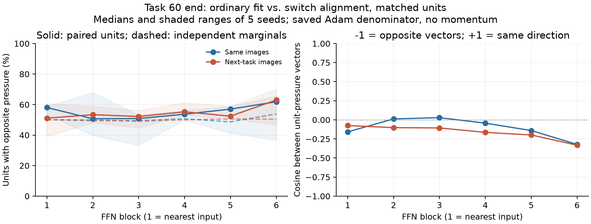

# 同じunitを追うと、切替整列と通常学習は二分されているか

Issaの追加質問を受けた事後の記述的検査。新しい介入の成功基準には使わない。共有head、課題60末、5 seed。通常学習fitの旧画像上の勾配と、切替期待勾配の整列成分loadを、同じ固定probeの同じFFN unitへ運んで対応付けた。保存Adamの分母固定、momentum除外。正のSがμ/σを下げる方向。

**最終FFNには反対向きの偏りがあるが、unitが明確に二分されているわけではない。** 前回の各層の「沈むunitの割合」は二つの別の周辺割合であり、同じunitが反転した割合ではなかった。

| FFN | 同じ画像で反対向き | 次課題画像で反対向き | 次課題：seed範囲 | 次課題：独立な組合せとの差 | 次課題：押しベクトルcosine |
|---:|---:|---:|---:|---:|---:|
| 1 | 58.1% | 51.1% | 39.0–60.7% | -0.1ポイント | -0.075 |
| 2 | 50.7% | 53.4% | 48.2–58.9% | +2.7ポイント | -0.102 |
| 3 | 50.8% | 52.2% | 44.7–56.2% | +2.6ポイント | -0.106 |
| 4 | 53.7% | 55.3% | 52.9–61.3% | +5.2ポイント | -0.164 |
| 5 | 57.0% | 52.4% | 50.8–58.7% | +3.4ポイント | -0.198 |
| 6 | 61.8% | 63.0% | 46.5–70.3% | +3.6ポイント | -0.332 |

範囲以外はseed中央値。「独立な組合せ」はそのseedでのfit/loadの沈降割合をa,bとしてa(1−b)+(1−a)b。実測との差もseed内で取ってから中央値にした。別々の中央値の差とは一致しない。これは周辺割合だけでも反対向きが増える効果を区別する記述量で、有意性検定ではない。共通の有効unitのうち、双方の絶対圧がmax(10⁻¹², 10⁻⁶×最大絶対圧)を超えるものを使用。4組の全割合とtask10もCSVに保存した。

最終FFNの次課題入力でもseed範囲は46.5〜70.3%で、2/5 seedでは反対向きが半数未満だった。層平均の傾向を、全seedに共通するunitの住み分けと解釈しない。

## 逆向きになりやすい理由と、その説明の限界

同じ画像を考え、予測確率をp、旧正解one-hotをq、一様分布をuとすると、通常学習のlogit誤差はp−q、独立な新ラベルへの切替の期待logit誤差はp−u。通常学習は残った正解への不足を埋め、切替期待は旧課題で作った確信を弱める。

10分類で正解確率0.99、他の9クラスが均等なら、通常誤差の正解成分は−0.01、切替期待は+0.89となり、全logit誤差ベクトルが逆向きになる。より一般にも、旧正解が最大確率なら (p−q)·(p−u)=||p||²−p_y≤0。これはlogit空間での関係である。

ただし、読み出しVと画像依存のJacobianは角度を保存しない。画像ごとに通常誤差の大きさが違い、十分覚えた画像は通常学習への重みが小さくなる一方、切替期待では強く寄与できる。各unitにはReLUの開閉、attention、残差経路、上流パラメータ更新を通じて異なる重みで和が届く。そのため、同じ画像でlogit誤差が反対でも、平均したunitのμ/σへの押しまで一律に反転するわけではない。

さらに今回比べたloadは、全読み出しVではなく旧ラベルとの整列成分Lだけを通す。次課題入力の場合は画像も変わる。従って上の誤差の式は機構の候補を説明するものであり、この表の層差を導いた証明ではない。

## 入力ばらつきとの関係

画像ごとに経路と誤差が違うため、平均勾配はE[Jᵀe]=E[Jᵀ]E[e]+Cov(J,e)と分けられる。この画像ごとの対応がどの程度効くかは[共分散介入とfull-batch対照](covariance_summary.md)で測った。単なる画素分散の大きさだけでは押しの符号は決まらない。

また、入力データ間のばらつきと、測定指標μ/σの分母σは別の概念である。位置の微分をS_r=S_μ/(σ+ε)−μS_σ/(σ+ε)²に分けた数値をposition_channels.csvへ保存した。μの移動とσの変化は同じ方向に効くとは限らない。

整列が特別に沈降を増やすかの介入結果は[機構検証本体](summary.md)。今回の単なる符号対応と混同しない。

