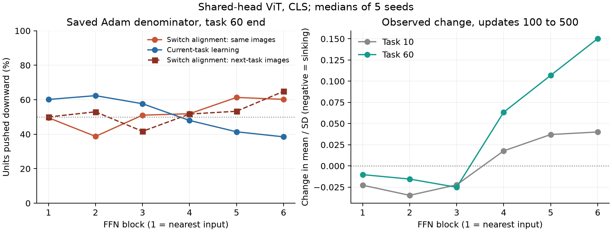
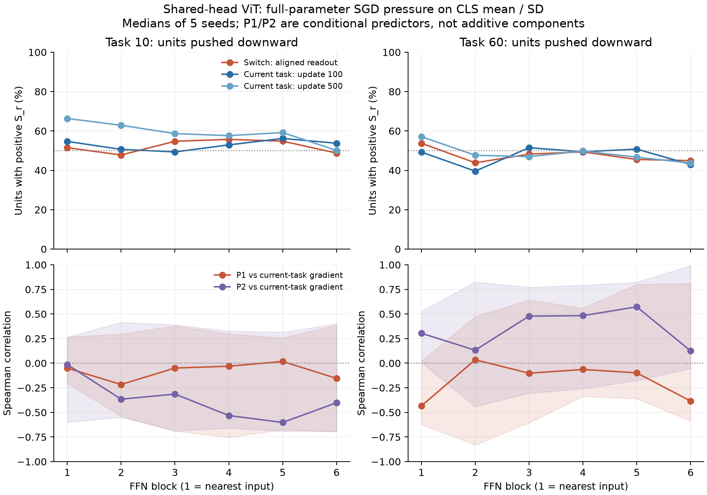

# ViT 各ブロックの切替・通常学習・相2模型（1025、探索的事後解析）

**用語の訂正（1025・ユーザーの説明を確認後）:** 本稿の「相2模型」「P2」は共同最小二乗fitによる切替予測であり、Issaが通常学習中の沈降の説明として意図した先生のT5とは別の模型だった。以下のP2の不一致はT5の反証ではない。T5は同じ状態から標本列を変えた学習複製間の誤差–ゲート共分散として、[2blockの複製実験](../../analysis/vit_two_block_1025/mechanism.md)で別に調べている。以下の数値は変更していない。

**「入力側は通常学習中にも沈み、最終FFNは切替を含む初期に沈んで後半に戻る」という時間的な層差は支持された。切替の整列成分も最終FFNを沈める側だった。ただし、全ての後段が一律に相1優勢とは言えず、前段の沈降を既存の相2理論で同定できたわけでもない。** 共有headのtask10/60で、100〜500更新のμ/σ変位の中央値はFFN1〜3が負、FFN4〜6が正。task60では各層4/5 seedがこの向きだった。最終FFNは両課題とも0〜100更新で沈み、100〜500更新で戻った（中央値）。

6 ブロック ReLU/LN、共有 head（SL）と reset（R0L）、全 5 seed。task 10 と60の開始前・100更新後・500更新後、計60保存状態を測定した。各対象課題の画像250枚で勾配を計算し、固定64画像probeのCLSにおける各unitの μ/σ の微分へ運んだ。最初の検査はSGD方向の一次診断であり、実際のAdam更新ではない。

追加で、Adam状態が保存されたtask10/60末の20状態を、保存二次momentの分母で重み付けして照合した。共有headではさらに10状態で次課題画像への切替を測定した。分母は固定し、運動量は含めない。

今回分解した読み出しvは最終分類headであり、その整列成分の信号を各FFNまで逆伝播した。クラス中心化headと旧ラベル×特徴の整列は強く、task10末のcos²はseed中央値0.907、task60末は0.777。head共有で整列そのものが消えているわけではない。各FFN自身のfc2の整列を独立に分解したものではない。

## 実軌跡と保存Adam分母での診断

共有head・task60末・全有効unit・5 seed中央値。切替の整列成分を、同じ画像の独立再ラベルと、元の手順で生成する次課題画像の両方で測った。後者のtask61は未学習の仮想的な次課題であり、学習を延長した結果ではない。整列を求める旧画像・旧ラベルはどちらもtask60。

| FFN | 整列成分：同じ画像 | 整列成分：次課題画像 | 通常学習が沈めるunit | 実際のΔ(μ/σ)、100–500更新 |
|---:|---:|---:|---:|---:|
| 1 | 49.5% | 50.0% | 60.2% | -0.0103 |
| 2 | 38.7% | 53.0% | 62.4% | -0.0155 |
| 3 | 51.0% | 41.7% | 57.7% | -0.0252 |
| 4 | 51.9% | 51.7% | 48.0% | +0.0634 |
| 5 | 61.3% | 53.3% | 41.4% | +0.1069 |
| 6 | 60.2% | 64.8% | 38.5% | +0.1502 |

通常学習は入力側の多くを沈め、FFN5〜6の多くを浮かせる。切替の整列成分は、次課題画像でも最終FFNを64.8%のunitで沈め、5/5 seedで過半数だった（seed範囲50.7〜75.9%）。ただしFFN4/5は51.7/53.3%で中立に近く、画像を同じにした場合の51.9/61.3%とも違う。深さに沿った単調な交代ではない。

task10末から11への切替期待では、整列成分が沈める割合はFFN4〜6で67.3%、66.4%、62.2%。前半の課題列では後段3層に広がり、task60末では最終層が最も明瞭だった。割合は押しの符号の頻度であり、相1と相2の期間積分された寄与率ではない。

## 「通常学習中の沈降」と相2模型の同定

Issaの「相2」を通常学習中の沈降という観測上の意味で使えば、前段優勢という見立てに対応する。一方、既存ノートの相2は、読み出しの共同最小二乗fitから切替の押しを予測する理論でもあり、単純な時間区分とは異なる。以下はその既存式を通常学習にも照合した結果。

保存Adam分母で比べたtask60末のP2と通常学習のbalanced accuracyのseed中央値は、FFN1〜6で50.8%、51.3%、49.4%、51.6%、47.2%、53.0%。順位相関も約−.05〜.12で、今回の条件付きP2は通常学習のunitごとの押しを説明していない。したがって、観測された前段の沈降を、そのまま既存の相2模型の成立とは結論しない。

## 読み方

- 正の押し S は勾配降下で μ/σ を下げる方向。表の割合は有効unitのうち沈める方向の割合で、各seedの値を作ってから中央値を取る。平均Sの符号も別表に残す。
- load は前課題のラベル・特徴と整列したhead成分が、切替で作る信号。load と remainder の和が切替の期待勾配になる。remainder を相2とは扱わない。
- 通常学習の fit は実CEの勾配。これを相2だと決めず、独立なP2予測と照合する。P1/P2は係数を実測へfitせず、後段を通して同じ位置微分へ運んだ。

## 共有head: SGD方向で沈めるunitの割合

この節の切替はtask9→10・59→60の開始前で、上のAdam表のtask10→11・60→61とは時点も重み付けも異なる。数値の差をAdam重み付けだけの効果とは解釈しない。

### task 10

| FFN | 切替・整列成分 | 切替・全体 | 通常学習100 | 通常学習500 |
|---:|---:|---:|---:|---:|
| 1 | 51.5% | 51.4% | 54.7% | 66.3% |
| 2 | 47.8% | 49.7% | 50.7% | 62.9% |
| 3 | 54.8% | 49.5% | 49.3% | 58.7% |
| 4 | 55.7% | 51.4% | 52.9% | 57.6% |
| 5 | 54.8% | 50.1% | 56.2% | 59.2% |
| 6 | 48.8% | 49.2% | 53.8% | 50.1% |

### task 60

| FFN | 切替・整列成分 | 切替・全体 | 通常学習100 | 通常学習500 |
|---:|---:|---:|---:|---:|
| 1 | 53.8% | 53.1% | 49.3% | 57.1% |
| 2 | 43.8% | 44.5% | 39.6% | 47.7% |
| 3 | 48.2% | 47.7% | 51.5% | 46.9% |
| 4 | 49.3% | 49.7% | 49.4% | 49.8% |
| 5 | 45.5% | 48.2% | 50.8% | 46.7% |
| 6 | 44.9% | 38.7% | 43.0% | 43.7% |

## P2は通常学習の押しを説明するか

下表は共有head・100更新後・全有効unitのSpearman相関（seed中央値）。相関1ならunit間の押しの順位が一致、負なら逆方向の関係。符号のbalanced accuracyと共通集合の数はcomparison_aggregate.csv。

| FFN | task10 P1 | task10 P2 | task60 P1 | task60 P2 |
|---:|---:|---:|---:|---:|
| 1 | -0.050 | -0.014 | -0.435 | +0.304 |
| 2 | -0.216 | -0.366 | +0.035 | +0.132 |
| 3 | -0.049 | -0.314 | -0.102 | +0.478 |
| 4 | -0.031 | -0.532 | -0.064 | +0.483 |
| 5 | +0.017 | -0.602 | -0.098 | +0.573 |
| 6 | -0.154 | -0.402 | -0.385 | +0.125 |

## 実際のμ/σの移動

同じunit・同じ固定probeの差を取り、unit中央値、その後seed中央値。負なら実際に沈んだ。0–100更新には、切替直後と通常学習の両方が含まれる。

| FFN | task10 0–100 | task10 100–500 | task60 0–100 | task60 100–500 |
|---:|---:|---:|---:|---:|
| 1 | -0.0400 | -0.0227 | -0.0363 | -0.0103 |
| 2 | -0.0394 | -0.0347 | +0.1290 | -0.0155 |
| 3 | -0.1496 | -0.0223 | +0.3229 | -0.0252 |
| 4 | -0.2102 | +0.0177 | +0.0593 | +0.0634 |
| 5 | -0.2246 | +0.0370 | +0.2203 | +0.1069 |
| 6 | -0.1047 | +0.0401 | -0.1347 | +0.1502 |

task60の0–100更新は、FFN1と6が沈む一方、FFN2〜5は浮く（中央値）。したがって「出力に近い全ブロックが、各切替の最初の100更新で沈む」という形ではない。

head reset群の最終FFNの0–100更新は、task10で+0.0387、task60で+0.0040。共有群の−0.1047、−0.1347と向きが異なる。ただし別々に学習したbody同士なので、共有群の同一状態で整列だけを消す因果介入ではない。

## 次課題画像の切替期待：seed間の幅

保存Adam分母、整列成分、全経路のμ/σ。次課題は11/61。中央値だけで一貫性を過大評価しないため、seed範囲と、沈めるunitが過半数だったseed数を示す。

| 旧課題末 | FFN | 中央値 | seed範囲 | 過半数となるseed |
|---:|---:|---:|---:|---:|
| 10 | 1 | 52.4% | 45.6–59.8% | 3/5 |
| 10 | 2 | 50.3% | 48.2–61.4% | 3/5 |
| 10 | 3 | 56.1% | 51.4–66.7% | 5/5 |
| 10 | 4 | 67.3% | 45.9–78.3% | 4/5 |
| 10 | 5 | 66.4% | 54.7–77.7% | 5/5 |
| 10 | 6 | 62.2% | 58.4–70.3% | 5/5 |
| 60 | 1 | 50.0% | 37.1–63.2% | 2/5 |
| 60 | 2 | 53.0% | 49.7–63.9% | 4/5 |
| 60 | 3 | 41.7% | 39.5–75.1% | 2/5 |
| 60 | 4 | 51.7% | 47.7–75.5% | 4/5 |
| 60 | 5 | 53.3% | 43.7–75.5% | 3/5 |
| 60 | 6 | 64.8% | 50.7–75.9% | 5/5 |

## 上流経路の寄与

先の結論に使った保存Adam分母・共有head・task60末の通常学習では、下表の方向だった。S>0が沈降。自unitのfc1更新だけでなく、上流が動いてそのunitへの入力が変わる経路も含める必要がある。例えばFFN3はlocalがわずかに浮かせる側でも、上流込みでは沈める側となる。

| FFN | fit500 local | fit500 upstream | fit500 full |
|---:|---:|---:|---:|
| 1 | +0.0665 | +0.0545 | +0.1129 |
| 2 | +0.0325 | +0.1525 | +0.2224 |
| 3 | -0.0036 | +0.0576 | +0.0923 |
| 4 | -0.0414 | -0.1997 | -0.1653 |
| 5 | -0.0649 | -0.3698 | -0.4346 |
| 6 | -0.0928 | -0.6129 | -0.6778 |

共有head・task60、SGD方向。各セルは全unit平均Sのseed中央値。localは自unitのfc1の重み・biasだけ、upstreamは残り、fullは合計。各seedでは加算が成り立つが、個別の中央値同士は必ずしも足し合わない。値が正なら沈める向き。

| FFN | 切替load local | 切替load upstream | 切替load full | fit100 local | fit100 upstream | fit100 full |
|---:|---:|---:|---:|---:|---:|---:|
| 1 | +0.14 | +5.76 | +5.53 | -0.001 | -0.111 | -0.122 |
| 2 | -0.0505 | -4.05 | -4.1 | +0.00379 | -1.75 | -1.75 |
| 3 | -0.0599 | -0.391 | -0.459 | +0.00199 | +0.478 | +0.475 |
| 4 | +0.00212 | +17.4 | +17.4 | +0.00238 | +1.93 | +1.93 |
| 5 | -0.0241 | -32.2 | -32.2 | +0.000571 | +1.09 | +1.09 |
| 6 | +0.0129 | -49.1 | -49 | -0.00155 | -2.96 | -2.96 |

## 限界と検算

- P2は特徴固定の共同最小二乗head模型。実際のheadはCE/Adamで学習しており、同一ではない。250画像に384特徴なので列独立な模型の仮定も満たさず、ここでは最小ノルム・擬似逆の拡張を検査した。
- rank閾値1e-8でのrankは 250〜250。閾値1e-6/1e-10でrankが変わった状態は追加予測を保存した。
- 相1と相2を加算して100%にした寄与率は、この定義からは出せない。通常学習中に沈むという観測だけで相2の機構を確定しない。
- 整列成分は最終分類headのものを各FFNへ戻している。中間FFN自身の出力行列の整列を、層ごとに独立に分解した検査ではない。
- R0Lの開始時はheadを0へ戻すため、実fit/switch/loadのbody勾配は0。予測器P1/P2だけが非ゼロでも、実headでその模型が成立したことを意味しない。
- 全60状態のbaseline精度が元記録と一致。平均CEの最大絶対差 4.46e-07。checkpoint/source SHA照合、load+remainder=switch、local解析微分とJVPの検算を通過。
- 元の登録J5の早期/後期窓の正式判定ではない。今回は多層と通常学習を追加した別の探索的検査。

生unit配列は `/home/issan/Projects/obsidian-research-data/vit_phases_1025/` 以下の `raw/`、`adam_raw/`、`adam_next_raw/`。元のcheckpointはcheckpoint_provenance.jsonおよびadam*_provenance.json、保存物はbackup_manifest.json。
