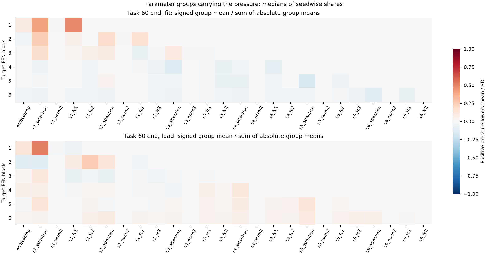
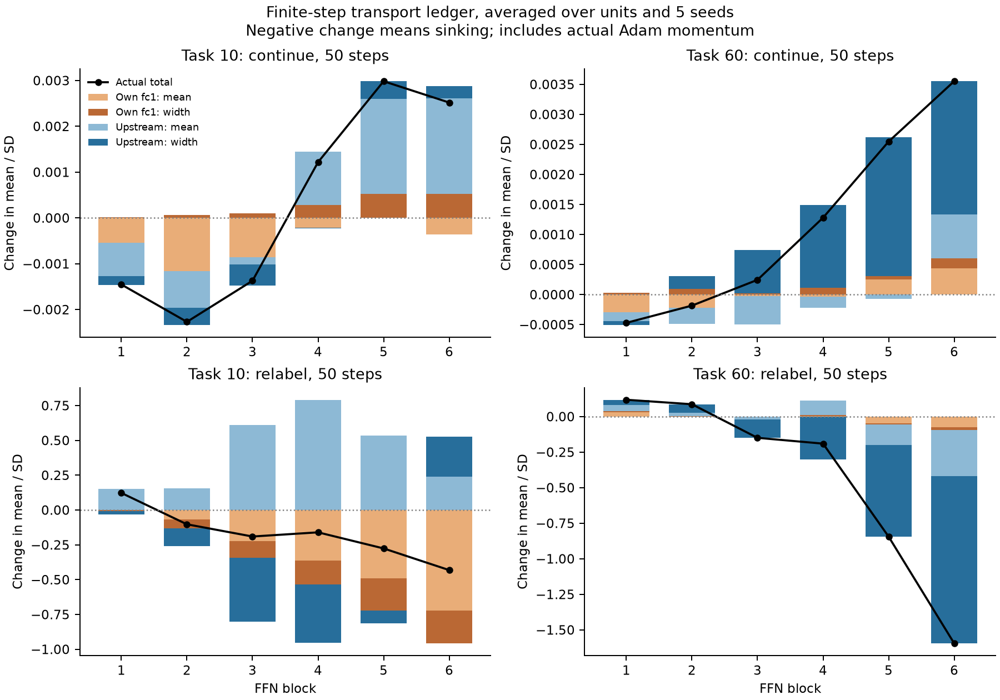
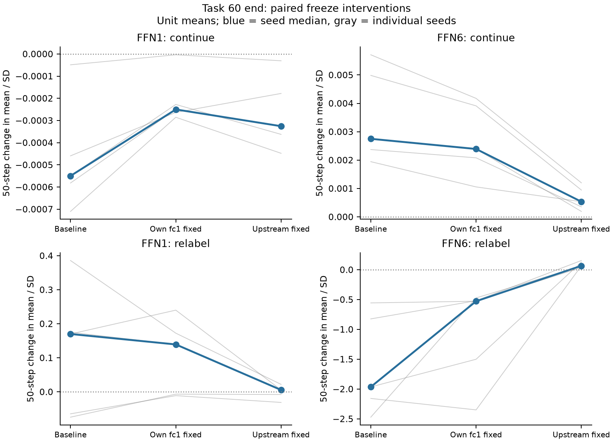
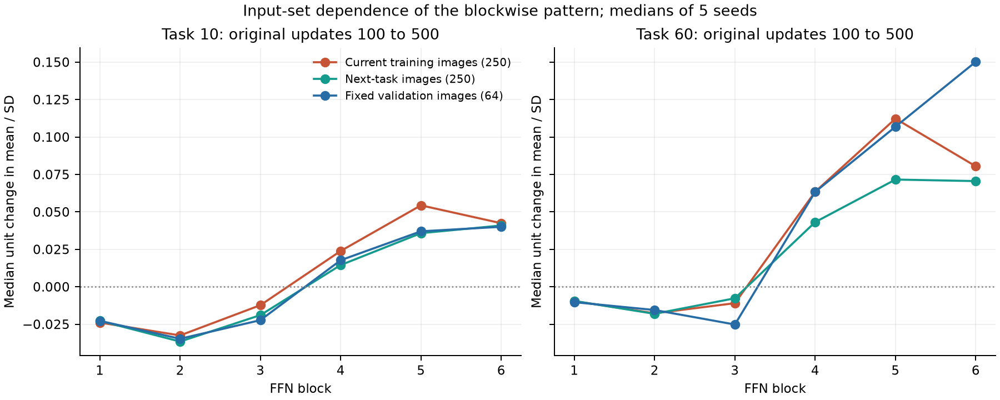

# ViTの層差：上流の更新と平均・幅を分離する（1025）

既存結果を知った探索的追試。測定前specはf7636441、数値精度のgate修正はd9f2661e。全5 seed。切替の整列成分は最終分類headについての定義であり、各FFNのfc2の整列そのものではない。

[導出と適用範囲](../../analysis/vit_transport_1025/theory.md)。出力の切替期待はlog C+KL(u||p)、通常学習はそこから正解方向の項を引く。正答後には出力の尺度への押しが逆になるが、各FFNが沈む符号は上流の経路と平均・幅の収支による。

時点の注意：task10は100更新ですでに全seedの訓練精度が100%だが、task60の100更新では61.2〜100%だった。100→500をすべて「完全にfitした後」と呼ばない。500更新時は両課題・全seedで100%。task10では精度100%のまま平均最大確率のseed中央値が0.9879→0.9978へ増えた。位置が動くことは正答率の変化を必要としない。元値はoriginal_fit_confidence.csv。

## A. 最終FFNへ押しを運ぶのはどこか

旧画像の通常学習fitと、次課題画像11/61の切替switch・整列成分load。保存Adam分母固定、momentum除外。比は||上流のunit押し||₂ / (||上流||₂+||自fc1||₂)。符号付き因果寄与率ではない。

| 課題末 | 信号 | 最終FFNの上流L2比・中央値 | seed範囲 | 75%以上のseed |
|---:|---|---:|---:|---:|
| 10 | fit | 57.8% | 55.4–70.0% | 0/5 |
| 10 | switch | 97.8% | 94.5–99.0% | 5/5 |
| 10 | load | 98.0% | 95.8–98.9% | 5/5 |
| 60 | fit | 70.1% | 53.8–71.8% | 0/5 |
| 60 | switch | 95.7% | 92.7–97.0% | 5/5 |
| 60 | load | 96.5% | 94.8–97.7% | 5/5 |

最終FFNのloadで75%以上が4/5 seed以上、が登録仮説。全層の比はcarrier_verdict.csv。群別の平均・幅・符号はcarriers.csv、生unit配列はraw archiveに保持した。

課題60末の主なparameter群（各seed・対象層で絶対unit平均が最大の群を数える。全体が沈むことを意味しない）：

| 信号 | FFN | 最多の群 | 最大だったseed |
|---|---:|---|---:|
| fit | 1 | L1_fc1 | 3/5 |
| fit | 2 | L1_attention | 2/5 |
| fit | 3 | L1_attention | 3/5 |
| fit | 4 | L3_attention | 2/5 |
| fit | 5 | L5_attention | 3/5 |
| fit | 6 | L6_attention | 2/5 |
| load | 1 | L1_attention | 5/5 |
| load | 2 | L1_fc2 | 2/5 |
| load | 3 | L1_attention | 4/5 |
| load | 4 | L1_attention | 2/5 |
| load | 5 | L1_attention | 3/5 |
| load | 6 | L1_attention | 2/5 |

## B. 実際の50更新：どの項が位置を動かしたか

元の課題末から、旧ラベルの継続／同じ画像の独立再ラベル。元Adamと前回と同じbatch順を再現。各stepの有限変位を、自fc1／上流、平均／幅の4項へ分けて50 step分足した。以下はunit平均変位をseed間で**平均**した加法帳簿。負が沈降。中央値や沈降seed数をこの平均へ読み替えない。

| 課題末 | 腕 | FFN | 自fc1・平均 | 自fc1・幅 | 上流・平均 | 上流・幅 | 合計Δr |
|---:|---|---:|---:|---:|---:|---:|---:|
| 10 | continue | 1 | -0.00054628 | +1.175e-05 | -0.00072392 | -0.00019401 | -0.0014525 |
| 10 | continue | 2 | -0.0011592 | +6.5311e-05 | -0.00080148 | -0.00037232 | -0.0022677 |
| 10 | continue | 3 | -0.00085141 | +0.00010691 | -0.00016646 | -0.00045944 | -0.0013704 |
| 10 | continue | 4 | -0.00021606 | +0.00028366 | +0.0011588 | -8.4695e-06 | +0.001218 |
| 10 | continue | 5 | -9.2587e-07 | +0.0005251 | +0.0020761 | +0.0003836 | +0.0029838 |
| 10 | continue | 6 | -0.00036331 | +0.00052213 | +0.0020937 | +0.00026714 | +0.0025196 |
| 10 | relabel | 1 | +0.00098634 | -0.008801 | +0.15165 | -0.021112 | +0.12272 |
| 10 | relabel | 2 | -0.069411 | -0.061785 | +0.15479 | -0.12597 | -0.10238 |
| 10 | relabel | 3 | -0.2243 | -0.1182 | +0.60952 | -0.45706 | -0.19004 |
| 10 | relabel | 4 | -0.3643 | -0.17123 | +0.79192 | -0.41649 | -0.16011 |
| 10 | relabel | 5 | -0.49151 | -0.231 | +0.53667 | -0.089857 | -0.27569 |
| 10 | relabel | 6 | -0.72061 | -0.23676 | +0.24093 | +0.2852 | -0.43124 |
| 60 | continue | 1 | -0.00029036 | +3.3239e-05 | -0.00014863 | -6.4304e-05 | -0.00047006 |
| 60 | continue | 2 | -0.00022124 | +9.5546e-05 | -0.00026898 | +0.00021151 | -0.00018316 |
| 60 | continue | 3 | -2.9281e-05 | +1.9495e-05 | -0.00046637 | +0.00072193 | +0.00024578 |
| 60 | continue | 4 | -3.5644e-05 | +0.00011212 | -0.00017902 | +0.0013828 | +0.0012802 |
| 60 | continue | 5 | +0.00025694 | +4.8518e-05 | -6.8716e-05 | +0.0023112 | +0.002548 |
| 60 | continue | 6 | +0.00043499 | +0.00016748 | +0.00073353 | +0.0022163 | +0.0035523 |
| 60 | relabel | 1 | +0.029217 | +0.0088547 | +0.042666 | +0.03761 | +0.11835 |
| 60 | relabel | 2 | +0.0010751 | +0.0041175 | +0.022291 | +0.059405 | +0.086889 |
| 60 | relabel | 3 | -0.00042387 | -0.00060447 | -0.018678 | -0.12965 | -0.14935 |
| 60 | relabel | 4 | +0.0038078 | +0.0056551 | +0.10201 | -0.30165 | -0.19018 |
| 60 | relabel | 5 | -0.047544 | -0.0083327 | -0.14304 | -0.64535 | -0.84427 |
| 60 | relabel | 6 | -0.074654 | -0.018794 | -0.32502 | -1.1763 | -1.5948 |

四項が合計に一致することは恒等式の検算であり、機構の証拠そのものではない。実現した学習経路上の二要因Shapley差であり、相互作用の割当は一意ではない。次の固定介入を別に行った。

課題60末・再ラベル後の最終FFNを時系列で見る（unit平均のseed平均、各時点までの累積変位）：

| 更新数 | 自fc1・平均 | 自fc1・幅 | 上流・平均 | 上流・幅 | 合計Δr |
|---:|---:|---:|---:|---:|---:|
| 0 | +0 | +0 | +0 | +0 | +0 |
| 1 | -0.000506651 | -3.06731e-05 | -0.0388363 | -0.00269681 | -0.0420704 |
| 5 | -0.00668355 | -0.00134479 | -0.187958 | -0.258602 | -0.454588 |
| 20 | -0.0484981 | -0.0146215 | -0.283219 | -1.21751 | -1.56385 |
| 50 | -0.074654 | -0.0187943 | -0.325019 | -1.1763 | -1.59477 |

50更新では、seed平均の実変位に対する上流二項の比が94.1403%。これは符号付き帳簿の比であり、上流を固定した別軌道の因果割合ではない。個々のseedでは上流平均と幅が逆向きの場合もあり、幅の比が100%を超えることもある。切替後50更新には新ラベルへの学習も含まれるので、全変位を整列由来の相1だけへ割り当てない。

## C. 上流と自fc1を別々に固定して学習

task60末、FFN1または6が対象。上流固定でも対象fc1と後段は学習する。自fc1固定でも上流・後段は学習する。固定parameterはgrad=NoneでAdamのmomentumによる移動も止めた。各値は50更新後のunit平均Δr、そのseed中央値。

| 腕 | FFN | 無介入 | 自fc1固定 | 上流固定 | 自fc1固定でも半分以上残る | 上流固定で同方向・半分以下 | 両条件同じseed | 上流固定で逆転 |
|---|---:|---:|---:|---:|---:|---:|---:|---:|
| continue | 1 | -0.00054996 | -0.00025017 | -0.00032566 | 1/5 | 1/5 | 1/5 | 0/5 |
| continue | 6 | +0.0027499 | +0.0023916 | +0.00053445 | 5/5 | 5/5 | 5/5 | 0/5 |
| relabel | 1 | +0.16995 | +0.13929 | +0.0055542 | 2/5 | 5/5 | 2/5 | 0/5 |
| relabel | 6 | -1.9646 | -0.52787 | +0.065821 | 4/5 | 0/5 | 0/5 | 5/5 |

登録判定は両条件が4/5以上。表では同一seedで両条件を満たす本数を使って保守的に判定する。上流固定で逆方向になった場合、同方向の条件を満たしたことに置換しない。逆転の有無はfreeze_verdict.csvに残す。

最終FFNの再ラベルは、上流固定で全5 seedが沈降から浮上へ逆転した。そのため「同方向のまま半分以下」という登録判定は不成立（0/5）だが、上流を止めても元の沈降が残るという結果ではない。自fc1固定では全5 seedが沈み、4/5で無介入の半分以上が残った。この符号逆転は登録基準と区別した観測結果として扱う。第1FFNの通常学習では上流固定でも全5 seedで沈降が残った。

| 腕 | FFN | 無介入CE | 自fc1固定CE | 上流固定CE |
|---|---:|---:|---:|---:|
| continue | 1 | 0.0026317 | 0.0026399 | 0.0026573 |
| continue | 6 | 0.0026317 | 0.0026765 | 0.0027969 |
| relabel | 1 | 1.5227 | 1.4378 | 0.92684 |
| relabel | 6 | 1.5227 | 1.364 | 2.1898 |

上流固定は多くの自由度を止める。性能を保つ選択的な沈降防止の実験ではない。自fc1固定時の残存と併せて、位置変化の運搬経路を検査する。

## 元の学習区間100→500更新にも、平均と幅を分ける（事後）

これは追加50更新とは異なる元走の区間。同じ積の対称分解を保存配列へ適用した。下表もunit平均、そのseed平均の加法帳簿。

| 課題 | FFN | 平均の項Δr | 幅の項Δr | 合計Δr | σ比のseed中央値 |
|---:|---:|---:|---:|---:|---:|
| 10 | 1 | -0.019376 | -0.0025764 | -0.021952 | 0.9877 |
| 10 | 2 | -0.032158 | -0.0025284 | -0.034687 | 0.9814 |
| 10 | 3 | -0.023001 | -0.0023675 | -0.025369 | 0.9915 |
| 10 | 4 | +0.005625 | +0.0065674 | +0.012192 | 1.0068 |
| 10 | 5 | +0.020457 | +0.015037 | +0.035494 | 1.0192 |
| 10 | 6 | +0.023412 | +0.0135 | +0.036913 | 1.0243 |
| 60 | 1 | -0.00022519 | +0.020874 | +0.020649 | 0.9959 |
| 60 | 2 | +0.013634 | +0.045309 | +0.058942 | 1.0045 |
| 60 | 3 | -0.079131 | +0.059675 | -0.019456 | 1.0211 |
| 60 | 4 | -0.040654 | +0.083815 | +0.043161 | 1.0428 |
| 60 | 5 | -0.043183 | +0.12379 | +0.080611 | 1.0706 |
| 60 | 6 | -0.024865 | +0.15109 | +0.12622 | 1.2001 |

同じ元区間の両端点で、fc1重みとその入力を入れ替えた四項（固定検証画像、unit平均のseed平均）：

| 課題 | FFN | 自fc1・平均 | 自fc1・幅 | 上流・平均 | 上流・幅 | 合計Δr |
|---:|---:|---:|---:|---:|---:|---:|
| 10 | 1 | -0.0084632 | +0.0002709 | -0.010914 | -0.0028454 | -0.021952 |
| 10 | 2 | -0.019446 | +0.0015065 | -0.01272 | -0.0040269 | -0.034687 |
| 10 | 3 | -0.017724 | +0.0024337 | -0.0052856 | -0.0047929 | -0.025369 |
| 10 | 4 | -0.0070794 | +0.0051832 | +0.012703 | +0.0013854 | +0.012192 |
| 10 | 5 | -0.002826 | +0.0090795 | +0.02329 | +0.0059508 | +0.035494 |
| 10 | 6 | -0.0091765 | +0.0080802 | +0.032609 | +0.0053996 | +0.036913 |
| 60 | 1 | -0.0044152 | +0.0022531 | +0.0041977 | +0.018613 | +0.020649 |
| 60 | 2 | -0.014858 | +0.01087 | +0.028232 | +0.034699 | +0.058942 |
| 60 | 3 | -0.01786 | +0.014779 | -0.061262 | +0.044887 | -0.019456 |
| 60 | 4 | -0.0037287 | +0.0034023 | -0.037051 | +0.080539 | +0.043161 |
| 60 | 5 | +0.01932 | +0.002508 | -0.062745 | +0.12153 | +0.080611 |
| 60 | 6 | -0.0034675 | +0.0064978 | -0.02252 | +0.14571 | +0.12622 |

この表は元区間の端点を組み合わせた分解。途中のAdam状態が保存されていないため、更新ごとの実経路を再生した分担ではない。継続50更新のstep積分と同一視しない。

## 入力集合を替えても層差は残るか

保存された100/500更新時のモデルを、学習画像250枚・次課題画像250枚・固定検証画像64枚へ適用した。各集合は前後で同一。下表はunitの前後差の中央値を取り、さらにseed中央値。括弧内はunit差の中央値が負のseed数。probe追補は06b00f0bで計測前に登録。

| 課題 | FFN | 学習画像Δr（沈降seed） | 次課題画像Δr（沈降seed） | 固定検証画像Δr（沈降seed） |
|---:|---:|---:|---:|---:|
| 10 | 1 | -0.023871 (5/5) | -0.022729 (5/5) | -0.022738 (5/5) |
| 10 | 2 | -0.03247 (5/5) | -0.036571 (5/5) | -0.034705 (5/5) |
| 10 | 3 | -0.012282 (5/5) | -0.018918 (5/5) | -0.022288 (4/5) |
| 10 | 4 | +0.023907 (2/5) | +0.01451 (2/5) | +0.017738 (2/5) |
| 10 | 5 | +0.054368 (1/5) | +0.035796 (2/5) | +0.037037 (2/5) |
| 10 | 6 | +0.042441 (0/5) | +0.040925 (0/5) | +0.040053 (1/5) |
| 60 | 1 | -0.0095441 (4/5) | -0.0094665 (4/5) | -0.010275 (4/5) |
| 60 | 2 | -0.017695 (4/5) | -0.018041 (4/5) | -0.015506 (4/5) |
| 60 | 3 | -0.010943 (4/5) | -0.007672 (4/5) | -0.025179 (4/5) |
| 60 | 4 | +0.063447 (0/5) | +0.043179 (2/5) | +0.063369 (1/5) |
| 60 | 5 | +0.11226 (1/5) | +0.071594 (1/5) | +0.10687 (1/5) |
| 60 | 6 | +0.080446 (1/5) | +0.070565 (1/5) | +0.15024 (1/5) |

これは入力分散の大きさを操作した対照ではない。画像の内容・クラス・学習済みか・集合サイズが違う。どの集合へ一般化する層差かを確認する検査であり、集合間の差を分散の因果効果と呼ばない。

### 相対位置の移動と閉じたunitは別

課題60・500更新時、各集合の全画像で前活性が0以下だったunitの割合。seed中央値。有限個の画像での無応答であり、全入力空間で死んだことの証明ではない。

| FFN | 学習画像 | 次課題画像 | 固定検証画像 |
|---:|---:|---:|---:|
| 1 | 6.77% | 6.18% | 11.59% |
| 2 | 16.67% | 8.40% | 17.64% |
| 3 | 22.27% | 17.77% | 31.71% |
| 4 | 22.59% | 20.44% | 31.64% |
| 5 | 9.05% | 10.22% | 17.06% |
| 6 | 0.59% | 0.65% | 2.60% |

## 検証範囲と未確定の点

- 全10状態の元source/checkpoint SHA、元CE、既存の一次押しと50更新のrを照合した。数値精度の問題は閾値を緩めず、元と同じLinear計算で修正した。失敗gateもarchiveに保持。
- 群ごとのJVP和、自fc1解析式、後段の直接寄与ゼロ、有限四項の和、固定parameterの不変性を検算した。各結果のchecks.jsonが記録。
- これらはこの保存状態と継続区間における条件付きの機構。深さだけから沈降を保証する定理、入力分散単独の必要十分性、長期可塑性喪失の媒介率は未同定。
- 最終分類headの整列の検査と、各FFNのfc2列の整列は別である。ここでは前者の定義を保った。
- 普通の学習を相2と呼ぶ現象上の分類と、旧ラベル平均の共同LS切替模型を区別した。以前のLS不一致を成功へ差し替えていない。

