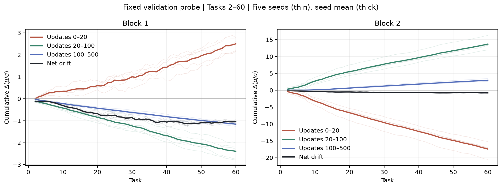

# 全60課題の時間区間別の位置変化（事後解析）

課題60の全5seedが揃った後に、同じ時間区間を全課題へ広げた。追加の学習は行っていない。
初回学習の課題1を切替として数えず、下表は課題2〜60の59課題。各値は共通valid unitのΔ(μ/σ)の平均の符号。
seedごとの本数を示し、295個のseed×課題やunit数を独立標本数として検定しない。

| probe | block | 区間 | 下向きの課題数：seed 0 / 1 / 2 / 3 / 4（各59中） | 全5seedで下向きの課題数 | 全5seedで上向きの課題数 |
|---|---:|---|---|---:|---:|
| train | 1 | 0→20 | 14 / 13 / 13 / 13 / 5 | 0 | 16 |
| train | 1 | 20→100 | 55 / 52 / 59 / 52 / 57 | 41 | 0 |
| train | 1 | 100→500 | 59 / 59 / 59 / 59 / 59 | 59 | 0 |
| train | 2 | 0→20 | 59 / 59 / 59 / 59 / 59 | 59 | 0 |
| train | 2 | 20→100 | 0 / 0 / 0 / 0 / 0 | 0 | 59 |
| train | 2 | 100→500 | 3 / 0 / 2 / 2 / 1 | 0 | 55 |
| validation | 1 | 0→20 | 16 / 17 / 15 / 20 / 16 | 0 | 14 |
| validation | 1 | 20→100 | 54 / 50 / 59 / 50 / 57 | 38 | 0 |
| validation | 1 | 100→500 | 58 / 59 / 59 / 59 / 59 | 58 | 0 |
| validation | 2 | 0→20 | 59 / 59 / 59 / 59 / 59 | 59 | 0 |
| validation | 2 | 20→100 | 1 / 0 / 0 / 0 / 1 | 0 | 57 |
| validation | 2 | 100→500 | 3 / 0 / 2 / 3 / 3 | 0 | 53 |

## 固定validation上で、長期変位を時間区間へ足し戻す

全軌道共通のunit集合を使い、前課題500更新と次課題0更新のμ・σ・r・validがbit一致することを全590境界で検算した。
下表は課題2〜60の合計についての5seed平均。初回の課題1は別途CSVへ残した。三つの窓の和は長期の実変位に一致する。
これは時間区間の帳簿であり、整列・T5・上流などの原因別の割合ではない。学習画像は課題ごとに替わるため、この足し戻しには使わない。

| block | 0→20の累積 | 20→100の累積 | 100→500の累積 | 課題1末→60末の実Δr |
|---:|---:|---:|---:|---:|
| 1 | +2.500816 | -2.393895 | -1.157578 | -1.050657 |
| 2 | -17.459157 | +13.709921 | +2.973763 | -0.775474 |

