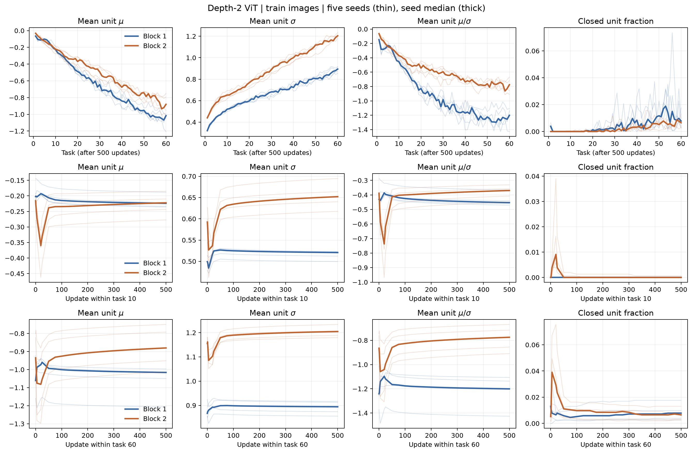
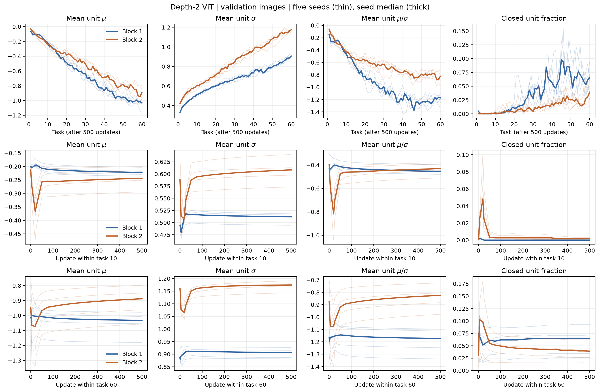
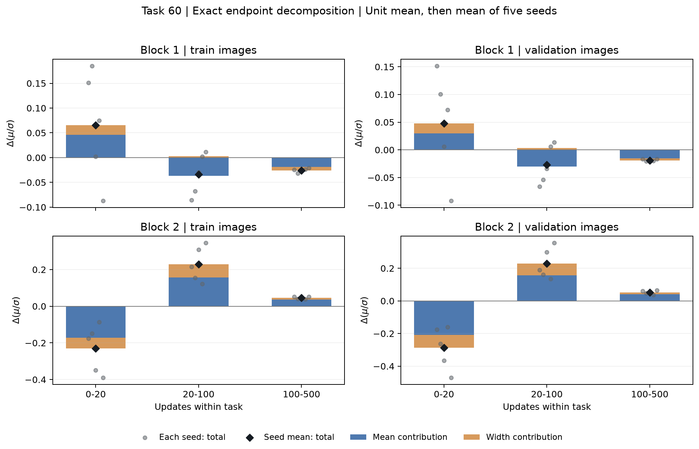

# 2block基準走・全5seed・課題60まで

各点でunitごとのμ・σ・μ/σを計算してからunit平均を取り、太線をseed中央値として描いた。平均μ÷平均σではない。
閉じたunitは、その時点の評価画像全てで前活性が0以下のunit。全入力空間で死んだことを意味しない。

| 課題 | block | 区間 | Δμ（seed中央値） | Δσ | Δr | rが下がるseed |
|---:|---:|---|---:|---:|---:|---:|
| 10 | 1 | 0→1 | 0.0013872 | -0.0007211 | 0.00279 | 2/5 |
| 10 | 1 | 0→20 | 0.0069525 | 0.016025 | 0.023182 | 1/5 |
| 10 | 1 | 0→500 | -0.018992 | 0.021017 | -0.022588 | 5/5 |
| 10 | 1 | 1→5 | 0.0069775 | -0.0069861 | -0.00057159 | 3/5 |
| 10 | 1 | 5→20 | 0.0093243 | 0.023511 | 0.037688 | 2/5 |
| 10 | 1 | 20→100 | -0.024182 | 0.0097703 | -0.036239 | 5/5 |
| 10 | 1 | 100→150 | -0.0027003 | -0.001066 | -0.0057047 | 5/5 |
| 10 | 1 | 100→500 | -0.010854 | -0.0045514 | -0.023378 | 5/5 |
| 10 | 2 | 0→1 | -0.0087501 | -0.010044 | -0.024002 | 5/5 |
| 10 | 2 | 0→20 | -0.12429 | -0.049283 | -0.29453 | 5/5 |
| 10 | 2 | 0→500 | 0.0058434 | 0.065599 | 0.044293 | 1/5 |
| 10 | 2 | 1→5 | -0.041417 | -0.059404 | -0.15873 | 5/5 |
| 10 | 2 | 5→20 | -0.097886 | 0.01639 | -0.18585 | 4/5 |
| 10 | 2 | 20→100 | 0.11845 | 0.099066 | 0.32062 | 0/5 |
| 10 | 2 | 100→150 | 0.001795 | 0.003215 | 0.0048835 | 0/5 |
| 10 | 2 | 100→500 | 0.012141 | 0.014359 | 0.030268 | 0/5 |
| 60 | 1 | 0→1 | -0.003285 | -0.0054877 | -0.013246 | 3/5 |
| 60 | 1 | 0→20 | 0.042455 | 0.019501 | 0.075141 | 1/5 |
| 60 | 1 | 0→500 | 0.011418 | 0.018595 | 0.040858 | 2/5 |
| 60 | 1 | 1→5 | 0.037255 | 0.0079337 | 0.052655 | 2/5 |
| 60 | 1 | 5→20 | 0.017859 | 0.018221 | 0.04936 | 1/5 |
| 60 | 1 | 20→100 | -0.029636 | 0.0043613 | -0.029672 | 3/5 |
| 60 | 1 | 100→150 | -0.0041267 | -0.0014424 | -0.0063873 | 5/5 |
| 60 | 1 | 100→500 | -0.01541 | -0.0057 | -0.024703 | 5/5 |
| 60 | 2 | 0→1 | -0.024638 | -0.0090703 | -0.027959 | 4/5 |
| 60 | 2 | 0→20 | -0.1423 | -0.059193 | -0.17588 | 5/5 |
| 60 | 2 | 0→500 | 0.030339 | 0.038273 | 0.046227 | 0/5 |
| 60 | 2 | 1→5 | -0.11432 | -0.071756 | -0.16551 | 5/5 |
| 60 | 2 | 5→20 | -0.0071776 | 0.017052 | 0.0020569 | 2/5 |
| 60 | 2 | 20→100 | 0.15568 | 0.094376 | 0.21462 | 0/5 |
| 60 | 2 | 100→150 | 0.0087099 | 0.0033722 | 0.010638 | 0/5 |
| 60 | 2 | 100→500 | 0.04221 | 0.015018 | 0.050297 | 0/5 |

0→20は切替直後、100→500は登録した通常学習の観測窓。20→100と0→500は課題10の回復を見た後に追加した探索的な窓。0→1、1→5、5→20は課題60のseed0で最初の1歩と5歩後の向きが異なるのを見て追加し、全対象・全seedへ同じ区間を適用した。0→20全体を切替の瞬間的な作用と同一視しない。起点のCE・精度は数表に残し、100更新を自動的に「適合後」とは呼ばない。

CSVのr_mean_termとr_width_termは端点の対称分解: Δr = Δμ×平均[1/(σ+ε)] + 平均[μ]×Δ[1/(σ+ε)]。ここで平均は二つの時点の平均。unitごとに実Δrとの加法性を検算した。有限変位の帳簿であり、μ・σを独立に操作した因果割合ではない。

第2blockについて、20更新時に学習250画像で閉じていたunitが、500更新までに同じ画像のいずれかで再び開く本数:

| 課題 | seed | 20更新で閉じた本数 | そのうち500更新までに再開口 |
|---:|---:|---:|---:|
| 10 | 0 | 60 | 59 |
| 60 | 0 | 45 | 34 |
| 10 | 1 | 6 | 6 |
| 60 | 1 | 21 | 17 |
| 10 | 2 | 14 | 14 |
| 60 | 2 | 54 | 44 |
| 10 | 3 | 9 | 9 |
| 60 | 3 | 13 | 10 |
| 10 | 4 | 25 | 25 |
| 60 | 4 | 116 | 97 |

平均と幅の寄与。加法性を保つため、この図の棒はseed中央値ではなくseed平均。灰色の点は各seedの合計Δr。

平均と幅の寄与。加法性を保つため、この図の棒はseed中央値ではなくseed平均。灰色の点は各seedの合計Δr。

